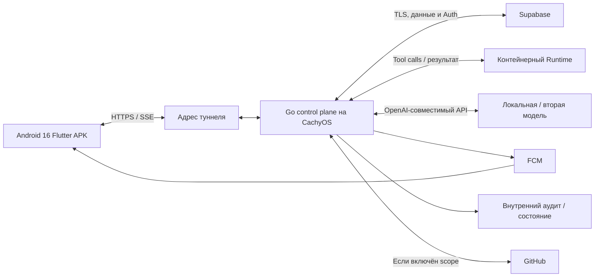
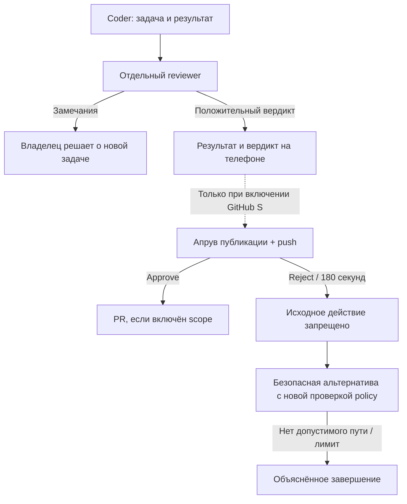

# Portway — спецификация требований к программному обеспечению ([SRS][g-requirement-ids])

> **Изменение 11.10.2026 (D-22):** по решению владельца целевая архитектура — Go-микросервисы и Kafka. [Принятое изменение архитектуры](21-microservices-kafka-amendment.md) заменяет прежний монолит/DB-only шину; PostgreSQL outbox сохраняется для надёжной публикации. Старые схемы одного процесса ниже — baseline до изменения, не текущая целевая топология. Первый реализованный срез Kafka описан в [DOC-022](22-kafka-first-slice.md); полный переход ещё не завершён.

| Поле | Значение |
|---|---|
| Артефакт | № 3 дорожной карты |
| Версия и дата | v0.12 · 10.10.2026 |
| Роль документа | Рабочий документ; обновлять при изменении своей области; актуальный состав — [навигатор](README.md#existing) |
| Статус | Обновлено по решениям [владельца][g-owner]; [SMART][g-smart] и [MoSCoW][g-priorities] созданы; базовый объём зафиксирован; испытания не выполнялись |
| [Владелец][g-owner] | [Владелец][g-owner] проекта; техническая детализация — [ИИ-агент][g-development-agent] |
| Защита | **12.10.2026**, учебный [MVP][g-mvp], 1-й семестр КМ07 |
| Связи | [ТЗ](02-technical-specification.md), [Backlog](01-product-backlog.md), [SMART](04-smart-goals-and-metrics.md), [MoSCoW](05-moscow-prioritization.md) |

## Состав документации

Подготовлены все восемь сводных контрактов сокращённого плана; всего 22 проектных артефакта. [Состав и актуальный остаток](README.md#remaining), [сопоставление прежних DOC-ID](01-product-backlog.md#legacy-registry). Новых обязательных проектных документов в очереди нет. Следующая работа — реализация и проверки; [BL][g-work-ids]/[CW][g-work-ids] и все [TC][g-acceptance]/[AC][g-acceptance] остаются неподтверждёнными.

## 1. Введение

[SRS][g-requirement-ids] задаёт проверяемое поведение Portway и служит основой реализации и приёмки. Приоритет источников: прямые решения [владельца][g-owner] → критерии применимого 1-го семестра → актуальное [ТЗ][g-requirement-ids] → исходный бриф. Формальная редакция ISO/ГОСТ не требуется преподавателем; структура сохранена как инженерная форма, соответствие стандарту не заявляется.

[FR-001][id-fr-001]–080 и [NFR-001][id-nfr-001]–024 сохранены, их содержание обновлено там, где изменились решения. [FR-081][id-fr-081]–090 добавляют требования курса, [push][g-push] lifecycle, каталог [ролей][g-role], перенос на другой [хост][g-host] и [аудит][g-audit]/поставку. Связи [SYS][g-requirement-ids]/[QLT][g-requirement-ids] и [BL][g-work-ids] позволяют проследить изменения. M/[S/C][g-priorities] закреплены в [MoSCoW][g-priorities]; смешанное M/S отмечает обязательную основу и дополнительную GitHub-часть; явно обязательные решения [владельца][g-owner] нельзя снизить молча. В предыдущей версии П означало предложение; теперь принятые технические детали опираются на делегирование [агенту][g-development-agent]. Принятие решения не равно готовности кода.

Канонический реестр принятых решений **[D-01][id-d-01]–21 находится в [ТЗ][g-requirement-ids] § 4.9**. Состояние Q/[TBD][g-decision-ids] обновлено, прежние неопределённости не нужно согласовывать повторно. Реальные доступы, [модель][g-model], [туннель][g-https] и второй [хост][g-host] ещё должны быть проверены. Создан [SMART](04-smart-goals-and-metrics.md): цели, сроки, методики измерений и привязка текущих [M-задач][g-priorities]. [MoSCoW][g-priorities] создан: 66 M / 8 S / 4 C / 1 W по [BL][g-work-ids]; подготовлен [Vision](06-product-vision.md); подготовлены [Глоссарий](07-glossary.md), [акторы](08-actors-and-stakeholders.md), [аналоги](09-analogue-analysis.md), [границы](10-project-scope-and-constraints.md) и [риски](11-initial-risk-register.md) ([DOC-007][id-doc-007]–011); подготовлен [DOC-012 Use Case](12-use-case-diagrams-and-specifications.md) с 20 обязательными сценариями и локальной трассировкой [FR/NFR][g-requirement-ids]; подготовлен [DOC-013 — сценарии качества и Utility Tree](13-quality-attribute-scenarios-and-utility-tree.md) с покрытием всех 24 [NFR][g-requirement-ids]; подготовлен [DOC-014 — критерии приёмки демо](14-demo-acceptance-criteria.md); восемь сводных документов подготовлены: [ADR][g-traceability] — [DOC-020][id-doc-020], HTTP/event-контракт — [DOC-036][id-doc-036], [RTM][g-traceability]/[TC][g-acceptance] — [DOC-057][id-doc-057]; [OpenAPI][g-api] YAML и тестовый код появятся вместе с реализацией.

### 1.1. Термины

Полные определения и правила употребления — [Глоссарий](07-glossary.md#glossary) ([DOC-007][id-doc-007]). Краткие определения ниже сохранены для чтения [SRS][g-requirement-ids].

[Владелец][g-owner] — единственный пользователь [установки][g-host]. [AgentVersion][g-agent-version] — зафиксированная конфигурация [агента][g-agent] и [пресета][g-role]. [Role][g-role] — инструкции/[инструменты][g-tool]/права, не пользовательская [роль][g-role]. [Run][g-run] — одна [задача][g-task]; [шаг][g-step] — итерация [Harness][g-harness]. [Runtime][g-runtime] исполняет [инструменты][g-tool] в [песочнице][g-sandbox]. [Control plane][g-control-plane] управляет ключами, [LLM][g-model], [политиками][g-policy] и [сообщениями][g-message]. [Апрув][g-approval] разрешает конкретный [tool][g-tool]/аргументы до истечения срока. [Chain][g-chain]/[correlation_id][g-chain] объединяет делегированные [запуски][g-run] и лимиты. [Hops][g-hops] считает передачи [сообщения][g-message]; [depth][g-depth] — глубину создания дочерних [run][g-run]. [Agent Package][g-package] переносит конфигурацию без [секретов][g-secret]/полной памяти. [Пресет субагента][g-subagent-presets] не означает автоматическое создание дополнительного [агента][g-agent].

## 2. Общее описание

### 2.1. Продукт, платформа и участники

Portway — Android-пульт для [ИИ-агентов][g-agent] разработки. Единственный [владелец][g-owner] через [Flutter][g-flutter] [APK][g-apk] на [Android 16][g-flutter] управляет [задачами][g-task], [событиями][g-event], [апрувами][g-approval], ручной связью двух [агентов][g-agent] и переносом [пакетов][g-package]. [Google Play Services][g-flutter] и [Google Play Services for AR][g-flutter] на телефоне подтверждены пользователем; для [FCM][g-push] нужен первый компонент, AR не используется. Приложение должно запросить разрешение уведомлений и пройти фактический push-тест.

Разработка: [владелец][g-owner] + [ИИ-агент][g-development-agent]. 08.10 [владелец][g-owner] подтвердил 3–4 часа участия в день 8–11.10 (12–16 часов на доступы, проверки, теорию и репетицию); это не оценка трудоёмкости реализации. Дедлайн 12.10.2026 заменяет декабрьский план. Клиент и backend собираются вертикальными срезами, [UI][g-ui] курса начинается рано. Базовая машина: CachyOS, i5-13420H, RAM 16 GB, свободно 275 GB; GPU не заявлен. Два активных [run][g-run] могут разделять один локальный [inference-сервис][g-model-protocol] с очередью.

### 2.2. Принятая форма системы

[Go][g-go]-микросервисы и Kafka (D-22), [Harness][g-harness] в execution-сервисе, контейнерный [Runtime][g-runtime] на ПК, [PostgreSQL][g-supabase] [Supabase][g-supabase] с [outbox][g-outbox], [SSE][g-sse] для клиента, неизменяемые версии и [at-least-once][g-at-least-once] с [дедупликацией][g-idempotency]. [Auth][g-auth] — [Supabase][g-supabase] email/пароль с серверным owner-ограничением. Внутренний сервис [аудита][g-audit]/состояния — отдельная подсистема этого сервера. [FCM][g-push] отправляет [Android][g-flutter] [push][g-push]. [APK][g-apk] не хранит [LLM][g-model]/[GitHub][g-github]/[FCM][g-push] server/DB service-role [секреты][g-secret].

Сеть: [Android][g-flutter] → [HTTPS endpoint][g-https] → [Go][g-go] [API][g-api] на ПК. Собственный [домен][g-https]/сайт не требуются. Первый кандидат [туннеля][g-https] — [ngrok][g-tunnel-providers] с выданным адресом; [SSE][g-sse]/переподключение обязательно проверить на нём. [Railway][g-tunnel-providers] лишь возможный поздний [хост][g-host]; перенос туда требует проверки способа исполнения [Runtime][g-runtime]. [Supabase][g-supabase] и [FCM][g-push] делают [установку][g-host] зависимой от внешних сервисов; обещание полностью автономного offline-развёртывания не применяется к [MVP][g-mvp].

### 2.3. Объём

Явно обязательны: [оркестрация][g-orchestration] двух [агентов][g-agent], перенос конфигурации на другую [модель][g-model] **и [хост][g-host]**, [push][g-push] при обычном закрытии [APK][g-apk], мобильный [импорт][g-export-import]/[экспорт][g-export-import], внутренний сервис [аудита][g-audit]/состояния, [Android][g-flutter] [APK][g-apk] и критерии 1-го семестра. [GitHub App][g-github]/[PR][g-pr] — S, вне [базовой поставки][g-mvp] по [MoSCoW][g-priorities]. Результат/[review][g-review] и локальная [ревизия][g-repository] обязательны. Остальные [S/C][g-priorities] тоже не включены в базовый календарь.

[Runner][g-runner] и расписания — если успеем; [Prometheus/Grafana][g-observability-tools] — дополнительный вариант. Автопланировщик, автоматический цикл исправлений, Web/iOS/Desktop, мультипользовательский SaaS, полный перенос памяти/активного [run][g-run] и автоматическое продолжение после рестарта вне [MVP][g-mvp]. После сбоя [владелец][g-owner] запускает новую работу вручную.

Модельный доступ: один [OpenAI-совместимый адаптер][g-model-endpoint]; реальная локальная проверка обязательна, для переноса нужны две совместимые реальные [модели][g-model]. Ни произвольная [модель][g-model], ни бесплатный Colab, ни одинаковая совместимость всех [endpoints][g-model-endpoint] не гарантируются. Названия [моделей][g-model] выбираются по доступности и тесту [tool calling][g-model-protocol]/[streaming][g-model-protocol]/[usage][g-usage].

## 3. Функциональные требования

### 3.1. Доступ и [аудит][g-audit]

| ID | Приоритет | Требование | Источник | Проверка |
|---|---|---|---|---|
| [FR-001][id-fr-001] | M | Система должна аутентифицировать единственного [владельца][g-owner] по email/паролю через [Supabase Auth][g-supabase] и выдавать доступ только привязанному [owner][g-owner] ID | [SYS-12][id-sys-12]; [BL-100][id-bl-100]; [D-18][id-d-18] | Верные данные [владельца][g-owner] открывают доступ; неверный пароль и другой [Supabase][g-supabase] user ID не дают доступ к Portway |
| [FR-002][id-fr-002] | M | Система должна проверять доступ к операциям над [агентами][g-agent], [запусками][g-run], [секретами][g-secret], связями, [апрувами][g-approval] и к потокам [событий][g-event] на сервере | [SYS-12][id-sys-12]; [BL-100][id-bl-100] | Без сессии чтение/изменение и подписка отклоняются; [агент][g-agent] не получает пользовательские полномочия |
| [FR-003][id-fr-003] | M | [Владелец][g-owner] должен иметь возможность отозвать доступ устройства; отозванная сессия не должна разрешать последующие защищённые операции | [SYS-12][id-sys-12]; [QLT-12][id-qlt-12]; [BL-100][id-bl-100] | После выхода/отзыва новый запрос отклонён; существующий поток закрыт не позже следующей серверной проверки, максимум 5 с; user/[device token][g-push-token] от [push][g-push] отвязан |
| [FR-004][id-fr-004] | M | Система должна регистрировать исходы [auth][g-auth]/отзыва, [апрувов][g-approval], остановки, отказов [политик][g-policy] и лимитов в базовом [аудите][g-audit] | [SYS-13][id-sys-13]; [BL-103][id-bl-103]; [D-15][id-d-15] | Для [auth][g-auth], [апрувов][g-approval], остановки и лимитов есть субъект, объект, серверное время, действие, исход и контекст без [секретов][g-secret] |

### 3.2. [Агенты][g-agent] и версии

| ID | Приоритет | Требование | Источник | Проверка |
|---|---|---|---|---|
| [FR-005][id-fr-005] | M | [Владелец][g-owner] должен создавать описание [агента][g-agent] с инструкциями, [инструментами][g-tool], настройками [MCP][g-mcp] и [навыками][g-skill] | [SYS-02][id-sys-02]; [BL-010][id-bl-010] | Валидная конфигурация возвращает ID; некорректная отклоняется с указанием поля |
| [FR-006][id-fr-006] | M | [Владелец][g-owner] должен получать сохранённую конфигурацию [агента][g-agent] и список доступных для выбора [агентов][g-agent] | [SYS-02][id-sys-02], [SYS-11][id-sys-11]; [BL-010][id-bl-010], [BL-110][id-bl-110] | После создания [агент][g-agent] виден при выборе и читается по ID с сохранёнными значениями |
| [FR-007][id-fr-007] | M | [Владелец][g-owner] должен выбирать готовую роль-пресет из каталога основных [агентов][g-agent] или отдельной группы [пресетов субагентов][g-subagent-presets] | [SYS-02][id-sys-02]; [BL-011][id-bl-011], [BL-014][id-bl-014]; [D-13][id-d-13] | Выбранная [роль][g-role] меняет инструкции и допустимые [инструменты][g-tool]; каталог не создаёт дополнительных пользователей и не запускает [субагента][g-subagent-presets] автоматически |
| [FR-008][id-fr-008] | M | Изменение конфигурации [агента][g-agent] должно формировать новую доступную для [запуска][g-run] версию, сохраняя старую | [SYS-02][id-sys-02]; [BL-012][id-bl-012]; [ADR-13][id-adr-13] | Две версии читаются отдельно; редактирование не меняет содержимое уже выбранной версии [запуска][g-run] |
| [FR-009][id-fr-009] | M | Система должна сохранять для [запуска][g-run] конкретную версию и эффективную конфигурацию [роли][g-role]/[инструментов][g-tool] | [SYS-02][id-sys-02], [SYS-04][id-sys-04]; [BL-011][id-bl-011], [BL-012][id-bl-012], [BL-030][id-bl-030] | Правка инструкций не меняет сохранённую версию; новый запрет проверяется перед действием; повышение прав требует новой версии/[запуска][g-run] |
| [FR-010][id-fr-010] | S | [Владелец][g-owner] должен просматривать версии и архивировать [агента][g-agent]/версию без разрушения ссылок в истории | [SYS-17][id-sys-17]; [BL-013][id-bl-013] | Архив исключён из нового активного выбора, но прошедший [запуск][g-run] по-прежнему показывает свою версию |

### 3.3. [Провайдеры][g-provider]

| ID | Приоритет | Требование | Источник | Проверка |
|---|---|---|---|---|
| [FR-011][id-fr-011] | M | [Владелец][g-owner] должен сохранять подключение [OpenAI-совместимого endpoint][g-model-endpoint] с [model][g-model] ID и [ссылкой на секрет][g-secret-reference], если [endpoint][g-model-endpoint] требует ключ | [SYS-03][id-sys-03]; [BL-020][id-bl-020], [BL-025][id-bl-025]; [D-08][id-d-08] | Конфигурируются локальный [endpoint][g-model-endpoint] без обязательного ключа и [endpoint][g-model-endpoint] с ключом; значение сохранённого [секрета][g-secret] [API][g-api] не возвращает |
| [FR-012][id-fr-012] | M | Система должна работать с выбранной локальной [моделью][g-model] через [OpenAI-совместимый endpoint][g-model-endpoint]; совместимость проверяется реальными вызовами | [SYS-03][id-sys-03]; [BL-021][id-bl-021]; [D-08][id-d-08] | Проверены [streaming][g-model-protocol], [tool call][g-tool]/[result][g-result], [usage][g-usage] и ошибка на конкретном [model][g-model] ID; одинаковая форма URL не считается доказательством совместимости |
| [FR-013][id-fr-013] | M | [Шлюз][g-gateway] должен предоставлять [Harness][g-harness] единое представление входных [сообщений][g-message], ответа, [tool calls][g-tool], завершения и ошибок адаптеров | [SYS-03][id-sys-03]; [BL-023][id-bl-023] | Контрактные примеры проходят на [Fake][g-fixture] [LLM][g-model] и выбранном совместимом адаптере; для двух [моделей][g-model] отмечены реально поддержанные возможности |
| [FR-014][id-fr-014] | M | [Шлюз][g-gateway] должен передавать частичные результаты при поддержке стриминга выбранной [моделью][g-model] и однозначно обозначать окончание/обрыв ответа | [SYS-03][id-sys-03]; [BL-023][id-bl-023] | Части ответа наблюдаемы до окончания; обрыв не объявляется успешным завершением |
| [FR-015][id-fr-015] | M | [Шлюз][g-gateway] должен возвращать расход токенов либо явно обозначенную оценку/недоступность расхода по утверждённой [политике][g-policy] | [SYS-03][id-sys-03]; [QLT-06][id-qlt-06]; [BL-023][id-bl-023] | [Usage][g-usage] учитывается; если его нет, отображается оценка с источником, применяется бюджетная [политика][g-policy] § 4.2; отсутствие значения не считается нулём |
| [FR-016][id-fr-016] | M | Система должна выявлять несовместимость требуемых возможностей [агента][g-agent] и выбранной [модели][g-model] до исполнения зависимого от них [шага][g-step] | [SYS-03][id-sys-03], [SYS-10][id-sys-10]; [BL-021][id-bl-021], [BL-023][id-bl-023], [BL-082][id-bl-082] | [Модель][g-model] без требуемого [tool calling][g-model-protocol] возвращает диагностируемую несовместимость; непроверенная функция не объявляется поддержанной |
| [FR-017][id-fr-017] | S | [Владелец][g-owner] должен проверять подключение и получать список [моделей][g-model], если [провайдер][g-provider] его предоставляет | [SYS-03][id-sys-03]; [BL-022][id-bl-022] | Различимы успех, ошибка [auth][g-auth] и недоступность; отсутствие списка не мешает явному вводу [model][g-model] ID |

### 3.4. [Запуски][g-run] и [события][g-event]

| ID | Приоритет | Требование | Источник | Проверка |
|---|---|---|---|---|
| [FR-018][id-fr-018] | M | [Владелец][g-owner] должен создавать [запуск][g-run] из [задачи][g-task], [версии агента][g-agent-version], выбранного [репозитория][g-repository]/[ревизии][g-repository] и лимитов | [SYS-04][id-sys-04]; [BL-030][id-bl-030] | Принятый запрос возвращает [run_id][g-run-id]; отсутствующая версия или невалидные лимиты не создают исполняемую работу |
| [FR-019][id-fr-019] | M | Повтор создания [запуска][g-run] с тем же ключом [идемпотентности][g-idempotency] и теми же параметрами должен возвращать тот же логический [запуск][g-run] | [SYS-04][id-sys-04], [SYS-11][id-sys-11]; [BL-030][id-bl-030], [BL-117][id-bl-117]; [ТЗ][g-requirement-ids] § 4.5 | Повтор с теми же параметрами возвращает [run_id][g-run-id], конфликтующий [payload][g-payload] отклонён; ключ хранится 7 суток, по истечении повтор не объявляется гарантированно тем же запросом |
| [FR-020][id-fr-020] | M | [Harness][g-harness] должен выполнять цикл получения ответа [модели][g-model], запроса разрешённого [инструмента][g-tool] и передачи результата [модели][g-model] до конечного исхода | [SYS-04][id-sys-04]; [BL-031][id-bl-031] | Сценарий [Fake][g-fixture] [LLM][g-model] → [tool call][g-tool] → [tool result][g-tool] → итог проходит; недопустимый [tool call][g-tool] не передаётся [Runtime][g-runtime] |
| [FR-021][id-fr-021] | M | Система должна публиковать актуальное состояние [запуска][g-run], конечный результат либо причину прекращения | [SYS-04][id-sys-04]; [BL-030][id-bl-030], [BL-032][id-bl-032] | Различимы ожидание, подготовка, работа, [ожидание апрува][g-awaiting-approval], успех, ошибка, отмена и исчерпание бюджета |
| [FR-022][id-fr-022] | M | Система должна сохранять [события][g-event] [запуска][g-run] со стабильным ID и порядком в пределах [запуска][g-run] | [SYS-04][id-sys-04]; [BL-032][id-bl-032] | При повторном чтении сохранённые [события][g-event] имеют те же ID и порядок; глобальный порядок разных [запусков][g-run] не предполагается |
| [FR-023][id-fr-023] | M | [Владелец][g-owner] должен восстанавливать поток [событий][g-event] после указанного [курсора][g-sse] в пределах срока хранения | [SYS-04][id-sys-04]; [QLT-04][id-qlt-04]; [BL-032][id-bl-032] | После обрыва доступны все последующие сохранённые [события][g-event]; недоступный [курсор][g-sse] не подменяется молчаливым продолжением с конца |
| [FR-024][id-fr-024] | M | [Владелец][g-owner] должен останавливать [запуск][g-run]; принятая остановка запрещает новые [шаги][g-step] и инициирует отмену текущей работы | [SYS-04][id-sys-04]; [BL-033][id-bl-033] | После фиксации остановки новых [LLM][g-model]/[tool][g-tool] вызовов нет; повтор команды не создаёт новое действие; последствия уже начатых операций видимы |
| [FR-025][id-fr-025] | M | Перед выдачей нового [LLM][g-model]/[tool][g-tool] [шага][g-step] система должна проверять остаток токенов и времени [запуска][g-run] | [SYS-04][id-sys-04]; [QLT-06][id-qlt-06]; [BL-034][id-bl-034] | При исчерпании бюджета новый вызов запрещён; выделенный резерв освобождается/уточняется по [usage][g-usage]; defaults § 4.2 |
| [FR-026][id-fr-026] | M | Система должна обнаруживать истечение лимита времени в том числе при ожидании внешнего вызова или [апрува][g-approval] | [SYS-04][id-sys-04], [SYS-06][id-sys-06]; [BL-034][id-bl-034], [BL-051][id-bl-051] | Искусственно зависший вызов не ждёт бесконечно; отмена передана; исход и неопределённый внешний эффект различимы |
| [FR-027][id-fr-027] | M | Система должна предоставлять ошибку [провайдера][g-provider]/[инструмента][g-tool] и неопределённый исход внешнего действия как наблюдаемый результат [шага][g-step] | [SYS-04][id-sys-04]; [QLT-10][id-qlt-10]; [BL-023][id-bl-023], [BL-031][id-bl-031], [BL-032][id-bl-032] | Ошибка/[таймаут][g-timeout] не выдаются за успех; опасное действие с неизвестным исходом не повторяется автоматически без проверки |
| [FR-028][id-fr-028] | S | [Владелец][g-owner] должен просматривать историю [запусков][g-run] и [событий][g-event] с фильтрацией и пагинацией | [SYS-17][id-sys-17]; [BL-035][id-bl-035] | Завершённые [запуски][g-run] доступны после входа с другого устройства; страницы не меняют порядок сохранённой выборки |
| [FR-029][id-fr-029] | M | После рестарта система должна помечать прерванные [запуски][g-run] как [failed][g-interrupted] с причиной [interrupted][g-interrupted], инвалидировать их [апрувы][g-approval] и предложить [владельцу][g-owner] новый ручной [запуск][g-run] | [SYS-17][id-sys-17]; [BL-036][id-bl-036]; [D-14][id-d-14] | Старый цикл не продолжается; повторно не выдаётся опасное действие; новый [запуск][g-run] имеет новый ID и актуальные разрешения |

### 3.5. [Runtime][g-runtime]

| ID | Приоритет | Требование | Источник | Проверка |
|---|---|---|---|---|
| [FR-030][id-fr-030] | M | [Runtime][g-runtime] должен выделять отдельную [песочницу][g-sandbox] и рабочее пространство для каждого [запуска][g-run] | [SYS-05][id-sys-05]; [BL-040][id-bl-040] | Два [запуска][g-run] не видят файлы друг друга без явно разрешённой передачи результата |
| [FR-031][id-fr-031] | M | [Runtime][g-runtime] должен применять поддерживаемое подмножество devcontainer-конфигурации и отклонять запрещённые настройки до исполнения | [SYS-05][id-sys-05]; [BL-040][id-bl-040], [BL-045][id-bl-045] | Разрешены выбранный image, [workspace][g-workspace] и allowlisted параметры; privileged, host socket, host mounts и исполняемые lifecycle [hooks][g-hook] отклонены; полный [devcontainer][g-devcontainer] не обещан |
| [FR-032][id-fr-032] | M | [Runtime][g-runtime] должен исполнять только команды [инструментов][g-tool], для которых [control plane][g-control-plane] передал действующее разрешение | [SYS-05][id-sys-05], [SYS-06][id-sys-06]; [BL-042][id-bl-042], [BL-050][id-bl-050] | Запрещённый/неподтверждённый вызов не исполняется даже при прямом повторе команды |
| [FR-033][id-fr-033] | M | Один выбранный [MCP][g-mcp] для документации должен работать через адаптер [Runtime][g-runtime] с теми же контролями доступа и сетевой [политики][g-policy], что другие [инструменты][g-tool] | [SYS-05][id-sys-05]; [BL-042][id-bl-042]; ответ [владельца][g-owner] № 8 | Первый кандидат [Context7][g-context7]: после настройки доступа реальный запрос возвращает документацию; недоступность явно показана, [секрет][g-secret] [MCP][g-mcp] не доступен остальным [инструментам][g-tool] |
| [FR-034][id-fr-034] | M | [Runtime][g-runtime] должен применять лимиты CPU, памяти, времени и сетевого доступа к [инструментам][g-tool] | [SYS-05][id-sys-05]; [BL-041][id-bl-041] | Реальные тесты CPU/RAM/времени и запретной сети; исходный профиль — 2 [vCPU][g-host-resources] и 1 [GiB][g-host-resources] RAM на [контейнер][g-sandbox], максимум 2 [контейнера][g-sandbox]; ресурсы [модели][g-model] учитываются отдельно |
| [FR-035][id-fr-035] | M | При завершении или отмене [запуска][g-run] система должна инициировать остановку процессов и освобождение ресурсов [песочницы][g-sandbox] по принятой [политике][g-policy] | [SYS-05][id-sys-05]; [BL-044][id-bl-044] | Процессы завершены по остановке; среда очищена, результат хранится по § 4.2; оставшийся [контейнер][g-sandbox] виден в диагностике |
| [FR-036][id-fr-036] | M | Для исполнения repository [run][g-run] система должна подготовить согласованную [ревизию][g-repository] кода в рабочем пространстве | [SYS-05][id-sys-05], [SYS-09][id-sys-09]; [BL-072][id-bl-072], [BL-070][id-bl-070] | [Runtime][g-runtime] получает согласованную [ревизию][g-repository]; ранний тест допускает локальную [fixture][g-fixture], финальная демонстрация показывает реальное исполнение кода |

### 3.6. [Политики][g-policy] и [апрувы][g-approval]

| ID | Приоритет | Требование | Источник | Проверка |
|---|---|---|---|---|
| [FR-037][id-fr-037] | M | Система должна классифицировать запрошенное действие по [риску][g-risk] и эффективной [политике][g-policy] [агента][g-agent] до передачи на исполнение | [SYS-06][id-sys-06]; [BL-050][id-bl-050] | [Allow][g-approval-decision]/[approval][g-approval]/[deny][g-approval-decision] различимы; неизвестный [инструмент][g-tool] блокируется или требует [апрува][g-approval]; произвольный shell не считается заведомо безопасным |
| [FR-038][id-fr-038] | M | Опасное действие должно создавать [апрув][g-approval] с серверным сроком ожидания 180 секунд и приостанавливать соответствующий [запуск][g-run] до решения/[timeout][g-timeout] | [SYS-06][id-sys-06]; [BL-051][id-bl-051] | До разрешения [Runtime][g-runtime] не исполняет действие; истечение 180 с фиксируется сервером независимо от состояния телефона |
| [FR-039][id-fr-039] | M | [Апрув][g-approval] должен быть связан с [запуском][g-run], [инструментом][g-tool], неизменяемыми аргументами и сроком действия | [SYS-06][id-sys-06]; [BL-054][id-bl-054]; [ТЗ][g-requirement-ids] § 4.3 | Изменение аргументов делает старое разрешение неприменимым и требует нового запроса |
| [FR-040][id-fr-040] | M | Система должна принимать решение [approve][g-approval-decision]/[reject][g-approval-decision] только от [владельца][g-owner] с действующим доступом | [SYS-06][id-sys-06], [SYS-12][id-sys-12]; [BL-052][id-bl-052], [BL-100][id-bl-100] | [Сообщение][g-message] [агента][g-agent] с текстом [approve][g-approval-decision] не меняет состояние [апрува][g-approval]; авторизованное решение записано |
| [FR-041][id-fr-041] | M | Подтверждение действующего [апрува][g-approval] должно разрешать только связанное действие с повторной проверкой актуальности [запуска][g-run] и запретов | [SYS-06][id-sys-06]; [BL-052][id-bl-052] | Действие с другими аргументами или после остановки не исполняется; разрешённое выполняется один раз при обычном повторе ответа |
| [FR-042][id-fr-042] | M | [Reject][g-approval-decision] или [timeout][g-timeout] должен запрещать исходное действие и возвращать [агенту][g-agent] отказ для выбора [безопасной альтернативы][g-safe-alternative] | [SYS-06][id-sys-06]; [BL-052][id-bl-052]; [D-12][id-d-12] | Альтернатива заново проходит [policy][g-policy]; запрещённый повтор не исполняется. При отсутствии безопасного пути — объяснённое завершение; [stop][g-cancelled]/budget прекращают и альтернативы |
| [FR-043][id-fr-043] | M | Конкурирующие [approve][g-approval-decision]/[reject][g-approval-decision], [таймаут][g-timeout] и остановка должны приводить к одному зафиксированному решению об исполнении | [SYS-06][id-sys-06]; [QLT-03][id-qlt-03], [QLT-04][id-qlt-04]; [BL-054][id-bl-054] | В тесте гонки только действующее решение может выдать разрешение; поздние запросы получают текущее состояние |

### 3.7. [Оркестрация][g-orchestration]

| ID | Приоритет | Требование | Источник | Проверка |
|---|---|---|---|---|
| [FR-044][id-fr-044] | M | [Владелец][g-owner] должен создавать и отключать направленные разрешённые [связи между агентами][g-link] | [SYS-07][id-sys-07]; [BL-063][id-bl-063] | Отправка вне связи отклоняется; [агент][g-agent] не может самостоятельно расширить топологию |
| [FR-045][id-fr-045] | M | Система должна валидировать версию и поля [конверта][g-message], [payload][g-payload] по типу, адресата и подлинность отправителя | [SYS-07][id-sys-07]; [BL-060][id-bl-060] | Проверены схема, подлинность from, доступность to и размер ≤64 KiB; counters вычисляет сервер; запрещённая связь отклонена |
| [FR-046][id-fr-046] | M | Все межагентные [сообщения][g-message] должны проходить контроль доступа и маршрутизацию через [control plane][g-control-plane] | [SYS-07][id-sys-07]; [BL-061][id-bl-061], [BL-066][id-bl-066] | Тестовая прямая передача между [песочницами][g-sandbox] не обходит заданную топологию и [аудит][g-audit] |
| [FR-047][id-fr-047] | M | Повторная доставка одного принятого [сообщения][g-message] не должна создавать повторного логического действия получателя | [SYS-07][id-sys-07]; [QLT-04][id-qlt-04]; [BL-061][id-bl-061] | Повтор того же ID и [payload][g-payload] не создаёт второго эффекта; конфликтующий [payload][g-payload] отклонён. [Дедупликация][g-idempotency] 7 суток, доставка/повтор [сообщения][g-message] ограничены 24 ч |
| [FR-048][id-fr-048] | M | [Владелец][g-owner] должен настраивать [хуки][g-hook] на поддерживаемые [события][g-event] [запуска][g-run]/[агента][g-agent] | [SYS-07][id-sys-07]; [BL-062][id-bl-062] | [run.completed][g-hooks-events], [tool_result][g-tool], [approval_requested][g-hooks-events] и [agent_message][g-hooks-events] вызывают заданную реакцию при совпадении условия; неподдерживаемое [событие][g-event] отклонено |
| [FR-049][id-fr-049] | M | Входящее [сообщение][g-message] активному [агенту][g-agent] должно становиться входом на границе [шага][g-step] его цикла | [SYS-07][id-sys-07]; [BL-062][id-bl-062] | [Сообщение][g-message] не меняет аргументы уже исполняемого [инструмента][g-tool]; принятое [сообщение][g-message] доступно следующему разрешённому [шагу][g-step] |
| [FR-050][id-fr-050] | M | После завершения [coder][g-main-roles] [хук][g-hook] должен создать отдельный [reviewer-run][g-run] с зафиксированным результатом и тем же [correlation_id][g-chain] | [SYS-07][id-sys-07]; [BL-069][id-bl-069]; [D-09][id-d-09]/10 | Есть один [вердикт][g-review] [reviewer][g-main-roles]; отрицательный [вердикт][g-review] не создаёт автоматического цикла исправлений. Включённое [GitHub][g-github] [S-расширение][g-priorities] допускает после положительного [вердикта][g-review] отдельный запрос [апрува][g-approval] публикации в [control plane][g-control-plane] |
| [FR-051][id-fr-051] | M | Система должна сохранять единый [correlation_id][g-chain] при делегировании внутри [цепочки][g-chain] | [SYS-08][id-sys-08]; [BL-064][id-bl-064] | Дочерние [запуски][g-run], [сообщения][g-message] и лимиты относятся к исходной [цепочке][g-chain]; присланный [агентом][g-agent] новый ID не сбрасывает её бюджет |
| [FR-052][id-fr-052] | M | Система должна блокировать дальнейшую передачу/делегирование при достижении лимита [hops][g-hops] или [depth][g-depth] | [SYS-08][id-sys-08]; [BL-064][id-bl-064] | Лимит [hops][g-hops]=8, [depth][g-depth]=2; counters только серверные; ответ сохраняет [цепочку][g-chain] и увеличивает [hops][g-hops], создание дочернего [run][g-run] увеличивает [depth][g-depth]. Новые работы сверх лимита отклонены |
| [FR-053][id-fr-053] | M | Система должна учитывать общий [бюджет цепочки][g-budget] при выдаче работы всем её [запускам][g-run] | [SYS-08][id-sys-08]; [QLT-06][id-qlt-06]; [BL-064][id-bl-064] | Остаток резервируется до конкурентных [LLM-вызовов][g-model-protocol]; два [запуска][g-run] не получают один остаток; defaults и неизвестный [usage][g-usage] описаны в § 4.2 |
| [FR-054][id-fr-054] | M | [Владелец][g-owner] должен останавливать [цепочку][g-chain] по [correlation_id][g-chain] с запретом новых дочерних [запусков][g-run] и отменой активных | [SYS-08][id-sys-08]; [BL-065][id-bl-065] | Очередь [сообщений][g-message] после остановки не оживляет [цепочку][g-chain]; [активные запуски][g-active-run] получают отмену; неопределённые внешние эффекты видны |
| [FR-055][id-fr-055] | M | Система должна показывать отправку/обработку [сообщений][g-message] и срабатывание/отказ [хуков][g-hook] в потоке с привязкой к [запуску][g-run] и [цепочке][g-chain] | [SYS-07][id-sys-07]; [BL-067][id-bl-067] | В ленте различимы успех и отказ, отправитель и получатель; имена и [payload][g-payload] уточняются в каталоге № 34 |

### 3.8. [GitHub][g-github] — S; обязательный результат сохраняется

| ID | Приоритет | Требование | Источник | Проверка |
|---|---|---|---|---|
| [FR-056][id-fr-056] | S | Система должна получать разрешённую [ревизию][g-repository] с [GitHub App][g-github] installation [credential][g-secret], ограниченным [репозиторием][g-repository] и операцией | [SYS-09][id-sys-09]; [BL-070][id-bl-070]; [D-16][id-d-16] | Private key App только на сервере; чтение кода использует read-права, публикация отдельные write-права после [апрува][g-approval]; [credential][g-secret] не остаётся в [workspace][g-workspace] |
| [FR-057][id-fr-057] | S | Система должна формировать ветку и [PR][g-pr] из выбранного [результата запуска][g-result] после прохождения [политики][g-policy] публикации | [SYS-09][id-sys-09]; [BL-071][id-bl-071]; [D-10][id-d-10]/16 | После положительного [review][g-review] и [апрува][g-approval] [control plane][g-control-plane] публикует ожидаемую [ревизию][g-repository]; отрицательный [review][g-review] не публикуется автоматически; требование действует при включении [S-расширения][g-priorities] |
| [FR-058][id-fr-058] | S | Повтор запроса публикации одного результата не должен молча создавать второй [PR][g-pr] | [SYS-09][id-sys-09]; [BL-071][id-bl-071] | Обычный повтор возвращает существующий результат; после неоднозначного сбоя выполняется сверка либо показывается неизвестный исход, а не слепой повтор |
| [FR-059][id-fr-059] | M/S | Система должна сохранять связь результата с исходным [запуском][g-run]; при включении [GitHub][g-github] — также [PR][g-pr]/ошибку публикации | [SYS-09][id-sys-09], [SYS-11][id-sys-11]; [BL-071][id-bl-071], [BL-118][id-bl-118] | M: по [run][g-run]/[цепочке][g-chain] доступны [ревизия][g-repository] и [вердикт][g-review] без [PR][g-pr]. S: URL [PR][g-pr] или причина ошибки; ошибка публикации не скрывается за [completed][g-completed] [агента][g-agent] |

### 3.9. [Пакеты][g-package]

| ID | Приоритет | Требование | Источник | Проверка |
|---|---|---|---|---|
| [FR-060][id-fr-060] | M | [Владелец][g-owner] должен экспортировать выбранную [версию агента][g-agent-version] в [пакет][g-package] с версией формата и переносимыми инструкциями, [навыками][g-skill] и [инструментами][g-tool] | [SYS-10][id-sys-10]; [BL-080][id-bl-080] | [Пакет][g-package] проходит валидатор выбранного формата; [экспорт][g-export-import] повторно описывает ту же версию |
| [FR-061][id-fr-061] | M | [Экспорт][g-export-import] должен заменять [секреты][g-secret] ссылками, а локальные ссылки на других [агентов][g-agent] — переносимыми [алиасами][g-secret-reference]/[ролями][g-role] | [SYS-10][id-sys-10]; [BL-081][id-bl-081] | Тестовых ключей нет; список требуемых [секретов][g-secret] виден без значений; исходные серверные ID не нужны для связывания |
| [FR-062][id-fr-062] | M | [Импорт][g-export-import] должен проверять версию, состав, допустимые пути и размер [пакета][g-package] до записи активной конфигурации и не исполнять включённый код | [SYS-10][id-sys-10]; [BL-083][id-bl-083] | [Пакет][g-package] ZIP ≤10 [MiB][g-host-resources], распакованный ≤25 [MiB][g-host-resources] и ≤1000 файлов; traversal/symlink/неподдержанная версия отклонены; скрипты при [импорте][g-export-import] не запускаются |
| [FR-063][id-fr-063] | M | [Импорт][g-export-import] должен позволять выбрать целевую [модель][g-model]/[провайдера][g-provider] и сопоставить требуемые [секреты][g-secret], [инструменты][g-tool] и [алиасы][g-secret-reference] | [SYS-10][id-sys-10]; [BL-082][id-bl-082] | Нерешённые зависимости перечислены; до их разрешения зависимый [запуск][g-run] заблокирован; исходная конфигурация не подменяется скрыто |
| [FR-064][id-fr-064] | M | После сопоставления зависимостей импортированный [агент][g-agent] должен выполнять контрольную [задачу][g-task] на второй поддерживаемой [модели][g-model] с сохранением согласованных полей конфигурации | [SYS-10][id-sys-10]; [QLT-09][id-qlt-09]; [BL-082][id-bl-082]; [D-11][id-d-11] | После [импорта][g-export-import] на вторую реальную совместимую [модель][g-model] сравниваются инструкции/права, выполняется контрольная [задача][g-task]; перенос [хоста][g-host] дополнительно [FR-088][id-fr-088] |

### 3.10. [Android-клиент][g-flutter]

| ID | Приоритет | Требование | Источник | Проверка |
|---|---|---|---|---|
| [FR-065][id-fr-065] | M | [Flutter-клиент][g-apk] должен позволять [владельцу][g-owner] войти, выбрать и создать [агента][g-agent] с [ролью][g-role] через [API][g-api] | [SYS-11][id-sys-11], [SYS-12][id-sys-12], [SYS-18][id-sys-18]; [BL-110][id-bl-110], [BL-100][id-bl-100], [BL-121][id-bl-121] | [Android][g-flutter] [APK][g-apk]: регистрация/вход настоящие, [coder][g-main-roles]/[reviewer][g-main-roles] создаются и сохраняются; ошибки полей/сети показаны |
| [FR-066][id-fr-066] | M | Клиент должен позволять выбрать [задачу][g-task]/версию/[репозиторий][g-repository], начать [запуск][g-run] и остановить [запуск][g-run] либо [цепочку][g-chain] | [SYS-11][id-sys-11]; [BL-117][id-bl-117] | Выполняются соответствующие [API-операции][g-api]; повторное нажатие не создаёт случайный второй [запуск][g-run] |
| [FR-067][id-fr-067] | M | Клиент должен отображать ленту и состояние [запуска][g-run], восстанавливая их после переподключения | [SYS-11][id-sys-11]; [BL-111][id-bl-111] | Повтор [события][g-event] с тем же ID не добавляет второй элемент; после обрыва виден актуальный конечный исход |
| [FR-068][id-fr-068] | M | Клиент должен показывать [инструмент][g-tool], значимые аргументы, срок и состояние [апрува][g-approval] и передавать [approve][g-approval-decision]/[reject][g-approval-decision] серверу | [SYS-11][id-sys-11]; [BL-112][id-bl-112] | Виден серверный countdown 180 с; позднее подтверждение получает текущий отказ; действие не исполняется из-за устаревшего экрана |
| [FR-069][id-fr-069] | M | Клиент должен позволять [владельцу][g-owner] настраивать связи и [хуки][g-hook] между [агентами][g-agent] | [SYS-11][id-sys-11]; [BL-113][id-bl-113] | С телефона создаётся связь [coder][g-main-roles] → [reviewer][g-main-roles]; чтение после сохранения подтверждает настройку |
| [FR-070][id-fr-070] | M/S | Клиент должен отображать результат и [вердикт][g-review] [reviewer][g-main-roles]; при включении [GitHub][g-github] — ссылку на [PR][g-pr] | [SYS-11][id-sys-11]; [BL-118][id-bl-118] | M: видны [ревизия][g-repository], результат и [вердикт][g-review]; базовый [UI][g-ui] сообщает, что [GitHub-публикация][g-github] не входит в поставку. S: URL/ошибка соответствующего [PR][g-pr] |

### 3.11. [Runner][g-runner], расписания, обязательные [push][g-push]/[пакеты][g-package] и расширения

| ID | Приоритет | Требование | Источник | Проверка |
|---|---|---|---|---|
| [FR-071][id-fr-071] | S | При включении [Runner][g-runner] система должна регистрировать его с проверкой доступа и использовать исходящее соединение с heartbeat | [SYS-14][id-sys-14]; [BL-043][id-bl-043]; [ADR-08][id-adr-08] | При включении [Runner][g-runner] неверный [credential][g-secret] отклонён; точный протокол отложен до решения его scope, не блокирует локальный [Runtime][g-runtime] |
| [FR-072][id-fr-072] | S | При обрыве [Runner][g-runner] система должна отображать потерю исполнителя и исключать слепое повторение опасной команды после переподключения | [SYS-14][id-sys-14]; [BL-043][id-bl-043] | Только если [Runner][g-runner] включён: после разрыва неизвестный исход виден, команда не повторяется слепо; автоматическое возобновление цикла вне [MVP][g-mvp] |
| [FR-073][id-fr-073] | C | [Владелец][g-owner] должен создавать/отключать расписание с cron и часовым поясом через [API][g-api] и, при включении экрана, клиент | [SYS-15][id-sys-15]; [BL-090][id-bl-090], [BL-115][id-bl-115] | Валидное расписание показывает следующее срабатывание; невалидный часовой пояс/cron отклонён |
| [FR-074][id-fr-074] | C | Планировщик должен обрабатывать пропуски и конкурирующие срабатывания по явной [политике][g-policy] без второго [запуска][g-run] для одного логического срабатывания | [SYS-15][id-sys-15]; [BL-091][id-bl-091] | Проверки фиксированными часами охватывают простой и изменение локального времени; [политика][g-policy] — [TBD-13][id-tbd-13] |
| [FR-075][id-fr-075] | M | При запросе [апрува][g-approval] сервер должен отправлять через [FCM][g-push] [push][g-push] на зарегистрированный [Android][g-flutter] [владельца][g-owner], включая обычное закрытое состояние приложения | [SYS-16][id-sys-16]; [BL-053][id-bl-053], [BL-125][id-bl-125]; [D-05][id-d-05]/19 | Реальный [Android 16][g-flutter] с [Google Play Services][g-flutter] и разрешением уведомлений получает [push][g-push]; сбой [FCM][g-push] виден, не разрешает действие и не отменяет обязательность проверки [push][g-push] |
| [FR-076][id-fr-076] | M | Клиент должен открывать по [push][g-push] актуальный [апрув][g-approval] после проверки доступа | [SYS-16][id-sys-16]; [BL-116][id-bl-116]; [D-05][id-d-05]/19 | Нажатие [push][g-push] из фона/[terminated][g-app-lifecycle] открывает приложение, после [auth][g-auth] перечитывается [апрув][g-approval]; просроченный запрос не исполняется |
| [FR-077][id-fr-077] | M | Клиент должен предоставлять [экспорт][g-export-import]/[импорт][g-export-import] [пакета][g-package] с выбором [модели][g-model] и сопоставлением зависимостей | [SYS-10][id-sys-10], [SYS-11][id-sys-11]; [BL-114][id-bl-114]; [D-05][id-d-05]/11 | На [Android][g-flutter] [владелец][g-owner] выбирает/сохраняет файл [пакета][g-package] и выполняет [импорт][g-export-import] с выбором [модели][g-model]/зависимостей; API-only не закрывает мобильную приёмку |
| [FR-078][id-fr-078] | S | [Шлюз][g-gateway] должен ограничивать совокупный расход по [провайдеру][g-provider] при настроенном лимите | [QLT-06][id-qlt-06]; [BL-024][id-bl-024] | [Запуски][g-run] разных [агентов][g-agent] учитывают общий остаток [провайдера][g-provider]; исчерпание имеет отличимую причину |
| [FR-079][id-fr-079] | S | Расширенный [аудит][g-audit] должен поддерживать согласованные поиск, хранение и защиту записей от изменения | [SYS-13][id-sys-13]; [BL-101][id-bl-101] | Базовые записи/чтение уже обязательны; расширенная аналитика, [экспорт][g-export-import] и дополнительные гарантии неизменяемости остаются S вне [базовой поставки][g-mvp] и не блокируют базовый сервис |
| [FR-080][id-fr-080] | C | При включении дополнительной наблюдаемости [Prometheus/Grafana][g-observability-tools] должны показывать согласованные [метрики][g-audit] без подмены журнала [аудита][g-audit] | [QLT-10][id-qlt-10]; [BL-102][id-bl-102]; [D-15][id-d-15] | [Метрики][g-audit] отдаются из защищённого окружения; [аудит][g-audit] доступен отдельно; нет обещания хранения [логов][g-audit] в [Prometheus][g-observability-tools] |

### 3.12. Курс и уточнённые обязательства

| ID | Приоритет | Требование | Источник | Проверка |
|---|---|---|---|---|
| [FR-081][id-fr-081] | M | Система должна предоставлять рабочую регистрацию единственного [владельца][g-owner] с именем, email, паролем и проверкой [setup-доступа][g-device-session] | [SYS-12][id-sys-12], [SYS-18][id-sys-18]; [BL-121][id-bl-121]; [КМ07-03][id-km07-03]/04/05; [D-18][id-d-18] | Пустые/невалидные поля отклонены, аккаунт сохранён [Supabase Auth][g-supabase] и повторный вход работает; чужой signup не получает owner-доступ; повторное демо регистрации — чистый тестовый стенд |
| [FR-082][id-fr-082] | M | [APK][g-apk] должен показывать Splash с названием/логотипом и переходить ко входу или главной по актуальному состоянию сессии | [SYS-18][id-sys-18]; [BL-120][id-bl-120]; [КМ07-02][id-km07-02] | Нет вечного Splash; valid/invalid/отсутствующая сессия дают ожидаемый экран |
| [FR-083][id-fr-083] | M | Главная и навигация должны вести к [агентам][g-agent], [задачам][g-task], [апрувам][g-approval], [пакетам][g-package], профилю и состоянию сервиса без неработающих основных кнопок | [SYS-18][id-sys-18]; [BL-122][id-bl-122]; [КМ07-06][id-km07-06]/07/09 | Пройден путь между основными экранами и возврат назад; пустые/ошибочные состояния объяснены |
| [FR-084][id-fr-084] | M | Профиль должен показывать имя/email [владельца][g-owner] и позволять вернуться в приложение | [SYS-18][id-sys-18]; [BL-123][id-bl-123]; [КМ07-08][id-km07-08] | Данные соответствуют зарегистрированному [владельцу][g-owner]; пароль не отображается, переход назад работает |
| [FR-085][id-fr-085] | M | Выход должен очистить локальный доступ, отозвать серверную [device-сессию][g-device-session] и отвязать [push token][g-push-token] этого устройства | [SYS-12][id-sys-12], [SYS-18][id-sys-18]; [BL-124][id-bl-124]; [КМ07-10][id-km07-10] | Показан вход; Back не открывает защищённый экран; [API][g-api] отвергает отозванную [device-сессию][g-device-session] и новые персональные [push][g-push] не отправляются на неё |
| [FR-086][id-fr-086] | M | [APK][g-apk] должен запрашивать [Android-разрешение][g-flutter] уведомлений и поддерживать регистрацию/обновление [FCM device token][g-push-token] | [SYS-16][id-sys-16]; [BL-125][id-bl-125] | Отказ разрешения виден [владельцу][g-owner]; после разрешения и обновления токена [push][g-push] доставляется; service [credential][g-secret] отсутствует в [APK][g-apk] |
| [FR-087][id-fr-087] | M | Каталог должен разделять [основные роли][g-main-roles] [coder][g-main-roles]/[reviewer][g-main-roles]/[tester][g-main-roles]/[researcher][g-main-roles]/[documenter][g-main-roles] и [пресеты субагентов][g-subagent-presets] [code_reader][g-subagent-presets]/[test_runner][g-subagent-presets]/[docs_lookup][g-subagent-presets] | [SYS-02][id-sys-02]; [BL-014][id-bl-014]; [D-13][id-d-13] | Доступны обе группы; выбранный [пресет][g-role] фиксируется в версии; наличие каталога не запускает автоматическое планирование или дополнительные процессы |
| [FR-088][id-fr-088] | M | Импортированный с телефона [пакет][g-package] должен выполнять контрольную [задачу][g-task] на другом [хосте][g-host] [control plane][g-control-plane]/[Runtime][g-runtime] с новыми локальными привязками | [SYS-10][id-sys-10]; [BL-084][id-bl-084]; [D-11][id-d-11] | Зафиксированы исходный и целевой [хосты][g-host], [endpoint][g-model-endpoint]/[ревизия][g-repository] и результат [задачи][g-task]; перенос только в другой каталог того же [хоста][g-host] недостаточен; виртуальный второй [хост][g-host] обозначен как ВМ |
| [FR-089][id-fr-089] | M | Внутренний сервис [аудита][g-audit]/состояния должен предоставлять [владельцу][g-owner] защищённый [API][g-api] состояния [БД][g-supabase], [Runtime][g-runtime], [provider][g-provider] и доставки [push][g-push], а также чтения [аудита][g-audit] и структурных [логов][g-audit] приложения по [run_id][g-run-id]/[correlation_id][g-chain] | [SYS-13][id-sys-13]; [BL-104][id-bl-104]; [D-15][id-d-15] | Ошибка зависимости воспроизводимо видна и связана с [событием][g-event]; [секреты][g-secret] не возвращаются; сервис работает внутри [Go-приложения][g-go] без обязательного отдельного web [UI][g-ui] |
| [FR-090][id-fr-090] | M | Поставка должна содержать устанавливаемый [Android][g-flutter] [APK][g-apk] с изменяемым [HTTPS][g-https] [API][g-api] URL и явной обработкой недоступного сервера | [SYS-19][id-sys-19]; [BL-008][id-bl-008], [BL-009][id-bl-009]; [D-06][id-d-06]/19 | [APK][g-apk] установлен на [Android 16][g-flutter]; телефон соединяется с [API][g-api] по мобильной сети/внешней Wi-Fi; localhost не используется как адрес ПК; неверный сертификат не принимается молча |

## 4. Нефункциональные требования

### 4.1. Реестр [NFR][g-requirement-ids]

Все значения — критерии будущего испытания. Ни одно требование не объявлено выполненным. Технические defaults выбраны [агентом][g-development-agent] для ограниченного [MVP][g-mvp] и могут быть скорректированы по измерениям с сохранением одобренных [владельцем][g-owner] целей.

| ID | Тип / приоритет | Требование | Источник | Проверка |
|---|---|---|---|---|
| [NFR-001][id-nfr-001] | Защита данных; M | Постоянное хранилище [секретов][g-secret] [LLM][g-model] должно содержать зашифрованные значения; доступ к материалу расшифрования отделён от обычного чтения записей | [QLT-01][id-qlt-01]; [BL-025][id-bl-025]; № 46 | Проверка схемы хранения и прав; тестовый ключ не присутствует в открытом виде в выгрузке записей; алгоритм/мастер-ключ определены в дизайне |
| [NFR-002][id-nfr-002] | Конфиденциальность; M | Известные системе [секреты][g-secret] не должны попадать в [API][g-api] после сохранения, [логи][g-audit], [экспорт][g-export-import] и окружение [инструментов][g-tool] в [Runtime][g-runtime] | [QLT-01][id-qlt-01]; [BL-025][id-bl-025], [BL-081][id-bl-081] | Проверяются уникальные тестовые [LLM][g-model]/DB/[FCM][g-push]/App-секреты и пути данных; допускается только ограниченный Git [credential][g-secret] у Git helper на время операции; скрытые произвольные [секреты][g-secret] в тексте не обещано распознавать безошибочно |
| [NFR-003][id-nfr-003] | Изоляция; M | Исполнение [инструментов][g-tool] должно быть [non-root][g-host-resources], без доступа к host socket, запрещённым путям [хоста][g-host] и пространствам других [запусков][g-run] | [QLT-02][id-qlt-02]; [BL-040][id-bl-040], [BL-041][id-bl-041], [BL-045][id-bl-045] | Негативные проверки настоящего [Runtime][g-runtime] подтверждают отсутствие доступа; [Fake][g-fixture] [Runtime][g-runtime] не является доказательством изоляции |
| [NFR-004][id-nfr-004] | Контроль доступа; M | Делегирование и содержимое [сообщений][g-message]/ответов [моделей][g-model] не должны расширять разрешения получателя или подменять [апрув][g-approval] [владельца][g-owner] | [QLT-03][id-qlt-03]; [BL-050][id-bl-050], [BL-066][id-bl-066] | Вредоносный текст в [сообщении][g-message] и [tool result][g-tool] не меняет [политику][g-policy]; запрет исполняется вне [модели][g-model]; ноль исполненных запрещённых тестовых действий |
| [NFR-005][id-nfr-005] | Защита каналов; M | Удалённый доступ к [API][g-api], потоку [событий][g-event] и включённому [Runner][g-runner] должен проходить по защищённому аутентифицированному каналу | [QLT-12][id-qlt-12]; [BL-100][id-bl-100], [BL-043][id-bl-043] | Телефон использует [HTTPS][g-https] [API][g-api] и [owner][g-owner]/device access; секретный серверный ключ не в [APK][g-apk]. Bootstrap — защищённая регистрация; минимальный healthcheck не раскрывает данные |
| [NFR-006][id-nfr-006] | Сохранность; M | Подтверждённые системой версии, [события][g-event] и решения должны сохраняться в пределах согласованной [политики][g-policy] хранения и быть доступны после переподключения | [QLT-04][id-qlt-04]; [BL-012][id-bl-012], [BL-032][id-bl-032], [BL-052][id-bl-052] | Сохранённые [события][g-event]/ключи повторов 7 суток, [аудит][g-audit] 30 суток; по истёкшему [курсору][g-sse] явный отказ + актуальное состояние; рестарт не разрешает старые [апрувы][g-approval] |
| [NFR-007][id-nfr-007] | Надёжность; M | Повторная доставка [сообщения][g-message], [хука][g-hook] или команды с той же идентичностью не должна порождать повторный внутренний логический эффект | [QLT-04][id-qlt-04]; [BL-061][id-bl-061], [BL-062][id-bl-062], [BL-054][id-bl-054] | Дубли и конкурентная обработка создают один review-run и одно решение [апрува][g-approval]; внешняя публикация отдельно проверяется [FR-058][id-fr-058] |
| [NFR-008][id-nfr-008] | Задержка; M | При нагрузке [PERF-01][g-smart] [p95][g-evidence] от фиксации [события][g-event] до отображения в подключённом [Android-клиенте][g-flutter] должен быть ≤2 секунды | [QLT-05][id-qlt-05]; [BL-032][id-bl-032], [BL-111][id-bl-111] | Единый измерительный контур/согласованные часы, ≥1000 [событий][g-event]; время генерации [LLM][g-model] и [FCM][g-push] исключены; результат фиксируется отдельно от цели |
| [NFR-009][id-nfr-009] | Управляемость; M | После серверной фиксации остановки управляемая работа всех [активных запусков][g-active-run] [цепочки][g-chain] должна прекратиться за ≤5 секунд | [QLT-05][id-qlt-05]; [BL-033][id-bl-033], [BL-065][id-bl-065] | Проверены запрет новых [шагов][g-step] и прекращение локальных процессов; неизвестный исход внешней операции показан отдельно; не объявлять его отменённым по одному ответу [API][g-api] |
| [NFR-010][id-nfr-010] | Контроль расходов; M | До выдачи параллельных вызовов система должна резервировать общий остаток; неизвестный [usage][g-usage] не должен позволять неограниченное продолжение | [QLT-06][id-qlt-06]; [BL-023][id-bl-023], [BL-034][id-bl-034], [BL-064][id-bl-064] | Проверка предельного бюджета и конкурентных резервов; если границу расхода невозможно оценить, следующий платный вызов блокируется с [budget_uncertain][g-budget]; финансовый нулевой перерасход не обещается |
| [NFR-011][id-nfr-011] | Независимость от клиента; M | Закрытие [APK][g-apk] не должно прекращать серверную работу или автоматически разрешать [апрув][g-approval]; [push][g-push] должен проверяться отдельно на [Android][g-flutter] в фоне/[terminated][g-app-lifecycle] | [QLT-11][id-qlt-11]; [BL-030][id-bl-030], [BL-051][id-bl-051], [BL-111][id-bl-111], [BL-053][id-bl-053], [BL-116][id-bl-116] | Сервер продолжает работу, [апрув][g-approval] истекает через 180 с; обычное закрытие не равно [force-stop][g-app-lifecycle] через настройки [Android][g-flutter] |
| [NFR-012][id-nfr-012] | Развёртывание; M | [Go][g-go]/[Runtime][g-runtime] должны запускаться воспроизводимо с конфигурацией внешней [Supabase PostgreSQL][g-supabase] и проверкой зависимостей; локальная [БД][g-supabase] используется в тестах по необходимости | [SYS-01][id-sys-01]; [QLT-07][id-qlt-07]; [BL-003][id-bl-003] | Чистый подготовленный стенд поднимается, данные [Supabase][g-supabase] сохраняются; не обещается размещение рабочей [БД][g-supabase] внутри того же [compose][g-environment] |
| [NFR-013][id-nfr-013] | Конфигурация; M | Обязательная конфигурация должна проверяться до объявления сервера готовым; ошибочные и отсутствующие значения дают диагностику без [секретов][g-secret] | [SYS-01][id-sys-01]; [QLT-01][id-qlt-01]; [BL-006][id-bl-006] | Невалидный адрес/лимит и отсутствующий обязательный параметр блокируют готовность; [сообщение][g-message] указывает поле без чувствительного значения |
| [NFR-014][id-nfr-014] | Изменение данных; M | [Миграции][g-environment] должны поддерживать чистую [установку][g-host] и предусмотренное обновление; повтор старта не применяет выполненную [миграцию][g-environment] повторно | [SYS-01][id-sys-01]; [BL-004][id-bl-004] | Проверки чистой/предыдущей поддерживаемой схемы, повторного старта и ошибки [миграции][g-environment]; ошибка не допускает обычную обработку запросов |
| [NFR-015][id-nfr-015] | Тестируемость; M | Обязательный backend-сценарий должен иметь детерминированную проверку на [Fake][g-fixture] [LLM][g-model]/[Runtime][g-runtime] без настоящих ключей; [Fake][g-fixture] [GitHub][g-github] нужен только при включении [S-расширения][g-priorities] | [QLT-07][id-qlt-07]; [BL-005][id-bl-005], [BL-007][id-bl-007], [BL-119][id-bl-119] | В [CI][g-ci-cd] проверяются выбранный [MVP][g-mvp], отказы и дубли без реальных [секретов][g-secret]; [Android][g-flutter]/[FCM][g-push], реальный [Runtime][g-runtime], две [модели][g-model] и второй [хост][g-host] проверяются дополнительно вручную |
| [NFR-016][id-nfr-016] | Расширяемость; M | [Harness][g-harness], [Runtime][g-runtime] и [Provider][g-provider] должны подменяться реализациями общего контракта без переписывания прикладных сценариев | [QLT-08][id-qlt-08]; [BL-005][id-bl-005], [BL-023][id-bl-023], [BL-031][id-bl-031], [BL-042][id-bl-042] | Один набор сценариев проходит на [дублёрах][g-fixture] и выбранных адаптерах; изменение адаптера не меняет бизнес-правила [апрува][g-approval]/бюджета |
| [NFR-017][id-nfr-017] | [Переносимость][g-portability]; M | Перенос [пакета][g-package] должен сохранять согласованную конфигурацию и права при смене совместимой [модели][g-model] и [хоста][g-host] | [QLT-09][id-qlt-09]; [BL-080][id-bl-080], [BL-081][id-bl-081], [BL-082][id-bl-082], [BL-084][id-bl-084] | Сравнение нормализованной конфигурации, контрольная [задача][g-task] на другой [модели][g-model]/[хосте][g-host]; пути/[секреты][g-secret] привязаны заново, ответы не обязаны совпадать |
| [NFR-018][id-nfr-018] | Диагностируемость; M | Ошибка обязательного сценария должна иметь различимую причину и доступные идентификаторы [запуска][g-run]/[цепочки][g-chain] без раскрытия [секретов][g-secret] | [QLT-10][id-qlt-10]; [BL-032][id-bl-032], [BL-067][id-bl-067], [BL-103][id-bl-103] | По ошибке можно найти соответствующие состояние, [событие][g-event] и, где применимо, [аудит][g-audit]; внешний stack trace не является единственной диагностикой |
| [NFR-019][id-nfr-019] | Пользовательский интерфейс; M | Состояние и ошибки должны отображаться текстом; решение по опасному действию должно быть связано с видимыми [инструментом][g-tool], аргументами и актуальностью запроса | [SYS-11][id-sys-11], [SYS-18][id-sys-18]; [QLT-03][id-qlt-03]; [BL-110][id-bl-110], [BL-111][id-bl-111], [BL-112][id-bl-112], [BL-120][id-bl-120], [BL-122][id-bl-122] | Экраны [Android 16][g-flutter] имеют единый стиль, читаемые ошибки, рабочую навигацию и актуальный [апрув][g-approval]; учебный сценарий КМ07 пройден целиком |
| [NFR-020][id-nfr-020] | Совместимость; M | Реализованные [API][g-api] и форматы [событий][g-event]/[пакета][g-package] должны соответствовать своим опубликованным версиям контрактов | [SYS-03][id-sys-03], [SYS-07][id-sys-07], [SYS-10][id-sys-10]; [QLT-08][id-qlt-08]; [BL-023][id-bl-023], [BL-060][id-bl-060], [BL-080][id-bl-080], [BL-082][id-bl-082] | Контрактные проверки валидных/невалидных [сообщений][g-message]; неподдерживаемая версия отклоняется явно; [политика][g-policy] версий — № 34/35/36/38 |
| [NFR-021][id-nfr-021] | Безопасность [импорта][g-export-import]; M | Разбор [пакета][g-package] должен быть ограничен по размеру/числу элементов и не иметь побочных эффектов исполнения включённого кода | [QLT-01][id-qlt-01], [QLT-02][id-qlt-02]; [BL-083][id-bl-083] | ZIP ≤10 [MiB][g-host-resources] / распакованный ≤25 [MiB][g-host-resources] / ≤1000 файлов; запрещены traversal и symlink; слишком большой ввод отвергается до исполнения/выхода из staging |
| [NFR-022][id-nfr-022] | Время [установки][g-host]; M | Подготовленный стенд должен достигать готовности ≤10 минут после [запуска][g-run] документированной команды | [QLT-07][id-qlt-07]; [BL-003][id-bl-003] | Образы/[модель][g-model] заранее загружены, [Supabase][g-supabase]/FCM-доступ настроен; время и ошибки замерены на [PERF-01][g-smart], не объявлены заранее успешными |
| [NFR-023][id-nfr-023] | Инженерное качество; M | [CI][g-ci-cd] должен проверять сборку, форматирование, lint, unit и integration с ненулевым исходом при нарушении обязательной проверки | [SYS-01][id-sys-01]; [QLT-07][id-qlt-07]; [BL-001][id-bl-001], [BL-002][id-bl-002] | Контрольное внесение ошибки приводит к падению нужного этапа; успешный pipeline сохраняет отчёт проверок |
| [NFR-024][id-nfr-024] | Восстановление; M | При старте сервер должен сверять прерванные [запуски][g-run] и запрещать продолжение старых [апрувов][g-approval] до приёма новой работы | [QLT-04][id-qlt-04]; [SYS-17][id-sys-17]; [BL-036][id-bl-036]; [D-14][id-d-14] | Прерванные [run][g-run] отмечены [failed][g-interrupted]/[interrupted][g-interrupted]; ручной перезапуск создаёт новый ID; [recovery][g-recovery] [reconciliation][g-recovery] целевой ≤10 с при ≤2 активных [run][g-run], незавершённая уборка диагностируется |

### 4.2. Профиль измерений и технические defaults

| Параметр | Значение / правило | Основание |
|---|---|---|
| T_events | [p95][g-evidence] ≤2 с от серверной фиксации до отображения в [APK][g-apk]; [FCM][g-push] отдельно | Одобрено [владельцем][g-owner] |
| T_stop | ≤5 с до прекращения управляемой работы; внешние неопределённые эффекты показываются отдельно | Одобрено [владельцем][g-owner] |
| T_install | ≤10 мин на подготовленном стенде без первоначальной загрузки образов/[моделей][g-model] | Одобрено [владельцем][g-owner] |
| [PERF-01][g-smart] | CachyOS/i5-13420H/16 GB; [Android 16][g-flutter]; 2 активных [run][g-run], 1 [APK][g-apk], 10 [событий][g-event]/с на [цепочку][g-chain], ≥1000 [событий][g-event], 3 прогона после прогрева | Профиль выбран [агентом][g-development-agent] для проверки утверждённых целей |
| Измерение | Зафиксировать сеть/[endpoint][g-model-endpoint]/версии, нагрузку и погрешность часов; проверять реальный маршрут телефона, не только localhost | Метод, не уже полученный результат |
| [Апрув][g-approval] | 180 с по серверным часам; [reject][g-approval-decision]/[timeout][g-timeout] → структурированный отказ и проверяемая [безопасная альтернатива][g-safe-alternative] | Ответ [владельца][g-owner] + выбор точного значения [агентом][g-development-agent] |
| Повтор отказа | Не более 2 последовательных отказанных альтернатив; одинаковый [tool][g-tool]+аргументы после [deny][g-approval-decision] не исполняется | Default [агента][g-development-agent] против бесконечных повторов |
| Время работы | [Run][g-run] 15 мин, [chain][g-chain] 30 мин wall-clock, включая [ожидание апрува][g-awaiting-approval]; [LLM][g-model] 120 с, [tool][g-tool] 60 с | Настраиваемые defaults; достижимость на выбранной [модели][g-model] проверяется |
| Лимит [шагов][g-step] | 20 на [run][g-run], 40 на [chain][g-chain] | Дополнительный предохранитель [агента][g-development-agent] |
| Бюджет токенов | Начальные 20 000 на [run][g-run] и 40 000 на [chain][g-chain]; до запроса резерв input+разрешённый output; output cap 2048 | Технический default, не согласие на денежные расходы |
| Неизвестный [usage][g-usage] | Явная оценка/источник; если остаток невозможно ограничить консервативно, следующий платный вызов блокируется [budget_uncertain][g-budget] | Не считать неизвестный расход нулевым; строгая проверка чисел после выбора [tokenizer][g-usage]/[model][g-model] |
| [Hops][g-hops] / [depth][g-depth] | 8 / 2; корень [depth][g-depth]=0, дочерний [run][g-run] +1; каждая передача включая reply увеличивает [hops][g-hops] | Defaults для ручной связи двух [агентов][g-agent] |
| [Логи][g-audit] / [события][g-event] / [дедупликация][g-idempotency] | 7 суток; [сообщения][g-message] не повторяются после 24 ч, [DLQ][g-retry]/отказ наблюдаемы; удаление ключа не раньше окончания допустимых повторов | Default [агента][g-development-agent] |
| [Аудит][g-audit] / [workspace][g-workspace] | [Аудит][g-audit] 30 суток; рабочий результат 24 ч после завершения; артефакты защиты копируются отдельно | Default [агента][g-development-agent], без удаления пользовательского [экспорта][g-export-import] |
| [API][g-api] request key | 7 суток; конфликт [payload][g-payload] с тем же ключом отклоняется | [Идемпотентность][g-idempotency] ограничена документированным окном |
| [Песочница][g-sandbox] | До 2 [контейнеров][g-sandbox], каждому 2 [vCPU][g-host-resources] и 1 [GiB][g-host-resources] RAM; [no-root][g-host-resources], без host socket/privileged/host mounts | Проверить нагрузки; [модель][g-model]/[Android-сборка][g-flutter] не входят в эти лимиты |
| [devcontainer][g-devcontainer] [MVP][g-mvp] | Allowlisted image/параметры среды/[workspace][g-workspace]; без произвольных lifecycle [hooks][g-hook]/Features/build-контекста | Поддерживается подмножество, полный стандарт не обещается |
| [Сообщение][g-message] | ≤64 KiB после сериализации; schema_version и каталог допустимых типов | Default [агента][g-development-agent] |
| [Agent Package][g-package] | ZIP: manifest.json + AGENTS.md + skills/*/SKILL.md + mcp.json; ≤10 [MiB][g-host-resources] вход, ≤25 [MiB][g-host-resources] после распаковки, ≤1000 файлов | Выбор [агента][g-agent]; секретные значения/абсолютные host paths не экспортируются |
| [Recovery][g-recovery] | Сверка при старте до новых [run][g-run]; целевой ≤10 с для двух прерванных [run][g-run], затем ручной новый [запуск][g-run] | Не автоматическое восстановление старого [Harness][g-harness] |

Порог токенов не гарантирует нулевой финансовый перерасход внешнего [провайдера][g-provider]: цена и возможный уже начатый вызов внешние. При выборе бесплатной локальной [модели][g-model] всё равно действуют лимиты времени/[шагов][g-step]. Одобрение целей производительности не подтверждает, что малой локальной [модели][g-model] хватит для кодинга: эта проверка остаётся ранним экспериментом.

Для [push][g-push] отдельная приёмка: реальные уведомления при фоне/[terminated][g-app-lifecycle], переход к актуальному [апруву][g-approval] и истёкшему запросу; системный [force-stop][g-app-lifecycle] через настройки исключает доставку до повторного открытия согласно ограничениям [FCM][g-push]. Отключённое разрешение должно быть видно пользователю. Наличие Play Services подтверждено; реальная доставка ещё нет.

## 5. Интерфейсы и границы доверия

### 5.1. [APK][g-apk] ↔ [Go][g-go] [API][g-api]

Все основные действия идут через [API][g-api]: регистрация/вход/выход, профиль, [агенты][g-agent]/[роли][g-role]/версии, [провайдеры][g-provider], [задачи][g-task]/остановка, [апрувы][g-approval], связи/[хуки][g-hook], [пакеты][g-package], [аудит][g-audit]/состояние и [device token][g-push-token]. Договор [OpenAPI][g-api] оформляется по срезам до реализации; здесь не вводятся неподтверждённые точные endpoint-paths. Ошибка содержит стабильный код, описание и контекст; [секреты][g-secret]/внутренний stack trace не публикуются.

[Flutter][g-flutter] получает только необходимые пользовательские токены, использует защищённое хранилище [Android][g-flutter] и server-side [device-сессию][g-device-session]. Выход очищает local session, отзывает device-доступ и отвязывает [push][g-push]. При offline-выходе локальные данные очищаются сразу, неподтверждённый серверный отзыв явно обозначается; отсутствие сети не считается успешной серверной ревокацией. Подтверждённая [Supabase][g-supabase] auth-сессия другого пользователя не даёт доступ к данным [owner][g-owner]. [Supabase][g-supabase] service-role, connection string и master key в [APK][g-apk] недопустимы. Бизнес-таблицы не открываются anonymous [Data API][g-supabase]; [RLS][g-supabase]/права проверяются при настройке.

Регистрация имеет имя/email/пароль и [setup-доступ][g-device-session] к конкретной [установке][g-host]. [Go][g-go] связывает ровно один [owner][g-owner] с подтверждённым [Supabase][g-supabase] user ID; уникальность защищается на сервере. Работа с email confirmation и callback на [Android][g-flutter] проверяется на тестовом проекте до демо; нельзя молча полагаться на отключённую проверку email. Наличие registration screen не вводит командные права или открытый SaaS.

### 5.2. [HTTPS][g-https] и [SSE][g-sse]

Собственный [домен][g-https] не обязателен: [ngrok][g-tunnel-providers] предоставляет dev domain, [Railway][g-tunnel-providers] при возможном размещении [API][g-api] предоставляет свой адрес с [TLS][g-https]. Выбран первый путь — ПК + HTTPS-туннель; требуется реальная проверка [SSE][g-sse] и переподключения с [Android][g-flutter]. [Установка][g-host] [APK][g-apk] не отменяет сетевой адрес сервера. [Supabase][g-supabase] URL — адрес его сервиса, не автоматический адрес [Go][g-go] [API][g-api].

[SSE][g-sse] несёт стабильные [event][g-event] ID, [run_id][g-run-id], тип, server time, versioned [payload][g-payload] и [correlation_id][g-chain]. Порядок гарантируется в пределах [run][g-run], не глобально для всех [агентов][g-agent]. При истёкшем 7-дневном [курсоре][g-sse] сервер явно сообщает недоступность истории, клиент перечитывает состояние и не изображает поток полным. После отзыва [device-сессии][g-device-session] защищённый поток закрывается в пределах 5 с.

Бесплатный [Cloudflare Quick Tunnel][g-tunnel-providers] не выбран для этого [MVP][g-mvp]: его документация указывает отсутствие поддержки [SSE][g-sse]. [Named tunnel][g-tunnel-providers] — другой вариант, не равнозначный [quick tunnel][g-tunnel-providers]. Переход на иной транспорт/[провайдера][g-provider] при необходимости требует проверки тех же [FR-022][id-fr-022]/023 и [NFR-008][id-nfr-008], но не требует согласовывать обычную техническую замену с [владельцем][g-owner].

### 5.3. [LLM][g-model], [Runtime][g-runtime] и [MCP][g-mcp]

Один конфигурируемый OpenAI-совместимый [Provider][g-provider] нормализует запрос/ответ/[stream][g-model-protocol]/[tool call][g-tool]/[usage][g-usage]. Локальный [Ollama-совместимый][g-model-protocol] путь — кандидат тестового окружения, окончательный [model][g-model] ID выбирается по ресурсам и реальному тесту. [Шлюз][g-gateway] должен обнаруживать несовместимость, а не считать все [endpoints][g-model-endpoint] одинаковыми. Возможности проверяются для каждой из двух [моделей][g-model] отдельно.

[Runtime][g-runtime] получает идентичность [tool call][g-tool], [рабочую область][g-workspace], аргументы, выданное policy-разрешение и лимиты. Результат не становится доверенной системной инструкцией. [MCP-кандидат][g-mcp] [Context7][g-context7] используется для чтения документации через ограниченный adapter; сетевое разрешение и [secret][g-secret] выдаются только этому адаптеру. Недоступный [Context7][g-context7] не скрывается под fake-ответом в реальной демонстрации; для [CI][g-ci-cd] есть отдельный [дублёр][g-fixture].

Сетевая [политика][g-policy] запрещает прямой обход шины между [песочницами][g-sandbox]; доступ к [LLM][g-model] идёт через [control plane][g-control-plane]. Разрешены только необходимые маршруты к Git/[MCP][g-mcp] через контролируемые операции. Прямой Docker socket в [API][g-api]/агентской [песочнице][g-sandbox] не выдаётся; trusted [runtime][g-runtime] manager имеет узкий разрешённый интерфейс. Реальная достижимость rootless-режима на [хосте][g-host] проверяется, не объявляется установленной.

### 5.4. [Supabase][g-supabase], [GitHub][g-github] и [аудит][g-audit]

[Go][g-go] использует [Supabase PostgreSQL][g-supabase] по [TLS][g-https]; при IPv4 доступен session pooler, реквизиты берутся из проекта. Изменение состояния и [outbox][g-outbox] записываются согласованно; отдельные NATS/Redis в [MVP][g-mvp] не нужны. Создание/подключение Supabase-проекта ещё не выполнено.

При включении [S-расширения][g-priorities] [GitHub App][g-github] private key остаётся в [control plane][g-control-plane]. Выдаваемый [installation token][g-github] ограничивается одним тестовым [репозиторием][g-repository] и нужными правами; Git helper использует его временно, очищает следы и по возможности отзывает после операции. Read-клон не должен получать права публикации. [PR][g-pr] публикует сервер после положительного [review][g-review] и [апрува][g-approval]. В неопределённом исходе сервер сначала сверяет существующий результат, а не повторяет создание.

Внутренний сервис [аудита][g-audit]/состояния имеет отдельный модуль и защищённый read [API][g-api]. Он предоставляет структурные [логи][g-audit] с фильтрацией по контексту и показывает состояния сервера, [Supabase][g-supabase], [Runtime][g-runtime], [provider][g-provider] и [FCM][g-push], а не объявляет все внешние сервисы готовыми по одному /healthz. [Prometheus/Grafana][g-observability-tools] при включении добавляют [метрики][g-audit]/панели; журнал [событий][g-event] остаётся в подсистеме [аудита][g-audit]. Развёртывание этих компонентов не выполнено.

## 6. Данные и поведение при отказах

Минимальные сущности: [Agent][g-agent]/[AgentVersion][g-agent-version]/[Role][g-role], [Provider][g-provider]/[Secret][g-secret], [Run][g-run]/[Step][g-step]/[Event][g-event], [ToolCall][g-tool]/[Approval][g-approval], [Message][g-message]/[Hook][g-hook]/[Chain][g-chain], [Workspace][g-workspace]/[Result][g-result], Package, [Owner][g-owner]/DeviceSession/PushToken/AuditEntry; опционально [PR][g-pr]/[Runner][g-runner]/Schedule. Версии и [terminal run][g-terminal-run] не переписываются ради следующего [шага][g-step] [цепочки][g-chain]. Архивирование не уничтожает сведения уже выполненного [запуска][g-run]. Сущности/[ER][g-architecture-notations] и состояния закреплены в [DOC-029][id-doc-029], HTTP/[event][g-event] DTO — [DOC-036][id-doc-036], формат [пакета][g-package] — [DOC-038][id-doc-038]; исполняемые схемы проверяются с кодом.

[Конверт][g-message] [сообщения][g-message]: schema_version/id/[run_id][g-run-id]/[correlation_id][g-chain]/from/to/type/[payload][g-payload]/[reply_to][g-run-id]/[hops][g-hops]/[depth][g-depth]. [Run][g-run] ID принадлежит отправителю, получатель [агент][g-agent] выбирается разрешённой связью. [Хук][g-hook] [review][g-review] создаёт новый [run][g-run]; произвольное [сообщение][g-message] завершённому [агенту][g-agent] не оживляет его [run][g-run]. Reply в завершённый [coder][g-main-roles] отображается как результат [цепочки][g-chain], не запускает исправление автоматически.

| Отказ / [событие][g-event] | Требуемый исход | Требования |
|---|---|---|
| Неверный [owner][g-owner]/device доступ | Отказ [API][g-api]/[SSE][g-sse], вход или [сообщение][g-message] об отзыве | [FR-001][id-fr-001]–003, [FR-085][id-fr-085] |
| Нет сети/ошибка [provider][g-provider] | Явная ошибка/[timeout][g-timeout]; известный [usage][g-usage] или помеченная оценка | [FR-014][id-fr-014]/015/027 |
| Отказ/180 с без [апрува][g-approval] | Исходное действие не исполняется; разрешённая альтернатива заново проверяется; после лимита отказов объяснённое завершение | [FR-038][id-fr-038]/042/043 |
| [Stop][g-cancelled] или budget | Новых [шагов][g-step]/альтернатив нет, активным передана отмена, внешний неизвестный эффект обозначен | [FR-024][id-fr-024]/025/054 |
| Отрицательный [review][g-review] | Результат виден [владельцу][g-owner]; автопубликации и автоисправлений нет | [FR-050][id-fr-050]/057 |
| Дубль [сообщения][g-message]/[хука][g-hook] | Один логический эффект; [payload][g-payload] с тем же ID и иным содержимым отклоняется | [FR-047][id-fr-047]/050 |
| Ошибка [песочницы][g-sandbox] | Нет исполнения без [policy][g-policy]; [cleanup][g-cleanup] и причина доступны сервису состояния | [FR-030][id-fr-030]–035, [FR-089][id-fr-089] |
| Закрытый [APK][g-apk] | Сервер продолжает работу; [FCM][g-push] уведомляет о действующем [апруве][g-approval]; старый [push][g-push] открывает актуальный исход | [FR-075][id-fr-075]/076/086 |
| Рестарт | Старые [run][g-run] [interrupted][g-interrupted], [апрувы][g-approval] недействительны, новый [запуск][g-run] вручную | [FR-029][id-fr-029], [NFR-024][id-nfr-024] |
| Неизвестный исход [GitHub][g-github] | Сверка по идентичности либо явно [unknown][g-unknown]; нет слепого повторного [PR][g-pr] | [FR-058][id-fr-058] |
| Ошибка [импорта][g-export-import] | Нет выполнения кода, нет частично активированного [агента][g-agent]; зависимости и причина доступны [владельцу][g-owner] | [FR-062][id-fr-062]/063 |

[Безопасная альтернатива][g-safe-alternative] не меняет изначальные права и не повышает расход сверх общего бюджета. Идентичное отклонённое действие, переименованное в «альтернативу», должно быть заблокировано.

## 7. Проверки и трассировка

### 7.1. Связь с [ТЗ][g-requirement-ids]

| [SYS][g-requirement-ids] | [FR/NFR][g-requirement-ids] |
|---|---|
| [SYS-01][id-sys-01] | [NFR-012][id-nfr-012]–015, [NFR-023][id-nfr-023] |
| [SYS-02][id-sys-02] | [FR-005][id-fr-005]–010, [FR-087][id-fr-087] |
| [SYS-03][id-sys-03] | [FR-011][id-fr-011]–017 |
| [SYS-04][id-sys-04] | [FR-018][id-fr-018]–027 |
| [SYS-05][id-sys-05] | [FR-030][id-fr-030]–036 |
| [SYS-06][id-sys-06] | [FR-037][id-fr-037]–043 |
| [SYS-07][id-sys-07] | [FR-044][id-fr-044]–050, [FR-055][id-fr-055] |
| [SYS-08][id-sys-08] | [FR-051][id-fr-051]–054; [NFR-004][id-nfr-004]/009/010 |
| [SYS-09][id-sys-09] | [FR-036][id-fr-036]/056–059 |
| [SYS-10][id-sys-10] | [FR-060][id-fr-060]–064, [FR-077][id-fr-077]/088 |
| [SYS-11][id-sys-11] | [FR-065][id-fr-065]–070, [FR-077][id-fr-077] |
| [SYS-12][id-sys-12] | [FR-001][id-fr-001]–003, [FR-081][id-fr-081]/085; [NFR-005][id-nfr-005] |
| [SYS-13][id-sys-13] | [FR-004][id-fr-004]/079/089; [NFR-018][id-nfr-018] |
| [SYS-14][id-sys-14] | [FR-071][id-fr-071]/072 |
| [SYS-15][id-sys-15] | [FR-073][id-fr-073]/074 |
| [SYS-16][id-sys-16] | [FR-075][id-fr-075]/076/086 |
| [SYS-17][id-sys-17] | [FR-010][id-fr-010]/028/029; [NFR-024][id-nfr-024] |
| [SYS-18][id-sys-18] | [FR-065][id-fr-065]/081–085; [NFR-019][id-nfr-019] |
| [SYS-19][id-sys-19] | [FR-090][id-fr-090]; [NFR-012][id-nfr-012]/022 |
| [QLT-01][id-qlt-01] | [NFR-001][id-nfr-001]/002/013/021 |
| [QLT-02][id-qlt-02] | [NFR-003][id-nfr-003]/021; [FR-030][id-fr-030]–035 |
| [QLT-03][id-qlt-03] | [NFR-004][id-nfr-004]/019; [FR-037][id-fr-037]–043 |
| [QLT-04][id-qlt-04] | [NFR-006][id-nfr-006]/007/024; [FR-019][id-fr-019]/023/047/058 |
| [QLT-05][id-qlt-05] | [NFR-008][id-nfr-008]/009 |
| [QLT-06][id-qlt-06] | [NFR-010][id-nfr-010]; [FR-015][id-fr-015]/025/026/053/078 |
| [QLT-07][id-qlt-07] | [NFR-012][id-nfr-012]/014/015/022/023 |
| [QLT-08][id-qlt-08] | [NFR-016][id-nfr-016]/020 |
| [QLT-09][id-qlt-09] | [NFR-017][id-nfr-017]; [FR-064][id-fr-064]/088 |
| [QLT-10][id-qlt-10] | [NFR-018][id-nfr-018]; [FR-004][id-fr-004]/055/079/080/089 |
| [QLT-11][id-qlt-11] | [NFR-011][id-nfr-011]; [FR-067][id-fr-067]/075/076 |
| [QLT-12][id-qlt-12] | [NFR-005][id-nfr-005]; [FR-001][id-fr-001]–003/085 |

Ссылки [BL][g-work-ids] для каждого [FR/NFR][g-requirement-ids] указаны в таблицах. [BL-068][id-bl-068] исключён; [BL-119][id-bl-119] — суммарная проверка выбранного [MVP][g-mvp]. Инженерные [BL-001][id-bl-001]–007 связаны преимущественно с [NFR][g-requirement-ids]. [CW][g-work-ids] — работы над текстом/демонстрацией, не функции ПО. Это предварительная трассировка; полная [RTM][g-traceability] с [UC][g-use-case]/[API][g-api]/[TC][g-acceptance] подготовлена в [DOC-057][id-doc-057] и дополняется по фактам реализации и проверок.

### 7.2. Критерии КМ07 — только 1-й семестр

Ссылка на исходник приведена в § 9; локаторы — страницы 1–2, номера строк критериев проверены по рендеру. КМ07-ID — локальные обозначения для трассировки исходных пунктов, не дополнительный норматив.

| ID / пункт | Критерий и баллы источника | Реализация / доказательство |
|---|---|---|
| [КМ07-01][id-km07-01] / 1 | Тема, актуальность, цель, [задачи][g-task], аудитория и основной функционал — 5 | [ТЗ][g-requirement-ids] § 1–3; [CW-001][id-cw-001] |
| [КМ07-02][id-km07-02] / 2 | Splash, название/логотип, общий дизайн, переход — 5 | [FR-082][id-fr-082]; [BL-120][id-bl-120] |
| [КМ07-03][id-km07-03] / 3 | Рабочая регистрация, необходимые данные, валидация/ошибки — 10 | [FR-081][id-fr-081]; [BL-121][id-bl-121] |
| [КМ07-04][id-km07-04] / 4 | Email/логин и пароль, ошибки, переход на главную и к регистрации — 10 | [FR-001][id-fr-001]/065/081; [BL-100][id-bl-100]/121 |
| [КМ07-05][id-km07-05] / 5 | Данные регистрации сохранены, повторный вход и состояние входа — 10 | [FR-001][id-fr-001]/081/082/085; [BL-100][id-bl-100]/120/121/124 |
| [КМ07-06][id-km07-06] / 6 | Главная и рабочие переходы к функциям — 10 | [FR-083][id-fr-083]; [BL-122][id-bl-122] |
| [КМ07-07][id-km07-07] / 7 | Логичная навигация и корректные кнопки — 5 | [FR-083][id-fr-083]; [BL-122][id-bl-122] |
| [КМ07-08][id-km07-08] / 8 | Профиль, основные данные, переход туда/обратно — 5 | [FR-084][id-fr-084]; [BL-123][id-bl-123] |
| [КМ07-09][id-km07-09] / 9 | Начальная версия основного функционала работает — 10 | Выбранный MoSCoW-срез Portway; [BL-119][id-bl-119] |
| [КМ07-10][id-km07-10] / 10 | Выход, переход ко входу, закрытые разделы требуют [auth][g-auth] — 5 | [FR-085][id-fr-085]; [BL-124][id-bl-124] |
| [КМ07-11][id-km07-11] / 11 | Введение, актуальность, цель/[задачи][g-task], объект и практическая значимость — 5 | [CW-001][id-cw-001] |
| [КМ07-12][id-km07-12] / 12 | Теория предметной области, мобильная разработка, аналоги, обоснование технологий — 10 | [CW-002][id-cw-002] |
| [КМ07-13][id-km07-13] / 13 | Логика теории, ссылки, литература, академический стиль — 5 | [CW-003][id-cw-003] |
| [КМ07-14][id-km07-14] / 14 | Полная демонстрация приложения и объяснение теории — 5 | [CW-004][id-cw-004], [BL-119][id-bl-119] |

Итого по применимому источнику 100 баллов; это структура оценивания, не прогноз полученной оценки. 2-й семестр и его CRUD/практическая глава не включаются автоматически в дедлайн 12.10. Технические [ТЗ][g-requirement-ids]/[SRS][g-requirement-ids] не заменяют введение и теоретическую часть курсовой.

### 7.3. Продуктовая приёмка

Проверить: [установка][g-host] [APK][g-apk] → учебный вход/навигация/профиль → создать [роли][g-role] и двух [агентов][g-agent] → один [запуск][g-run] с [Runtime][g-runtime] → [события][g-event] и переподключение → отдельный [review][g-review] → [push][g-push] и [апрув][g-approval] → [PR][g-pr], если включён [MoSCoW][g-priorities] → [экспорт][g-export-import]/[импорт][g-export-import] с [Android][g-flutter] → контрольная [задача][g-task] на другой [модели][g-model]/[хосте][g-host] → выход.

Отдельно нужны негативные проверки [auth][g-auth], [policy][g-policy], апрув-гонки, [безопасной альтернативы][g-safe-alternative], бюджета, остановки, повторов, [секретов][g-secret], [workspace][g-workspace] isolation, [пакета][g-package] и рестарта. [CI][g-ci-cd] использует [дублёры][g-fixture]; реальный [Android][g-flutter]/[FCM][g-push], [контейнеры][g-sandbox], [модели][g-model] и другой [хост][g-host] требуют реального прогона. В ходе подготовки требований код/тесты не создавались, критерии не считаются уже пройденными.

## 8. Состояние ранее открытых решений

ID [TBD][g-decision-ids] сохранены для истории ссылок. «Закрыто решением» означает выбранное поведение; проверка реализации остаётся отдельной.

| ID | Текущее состояние | Остаток / ответственный |
|---|---|---|
| [TBD-01][id-tbd-01] | [Android 16][g-flutter]/Play Services и CachyOS-стенд подтверждены; адаптер [совместимого endpoint][g-model-endpoint] выбран | [Агент][g-agent]: выбрать две [модели][g-model] с реальным [tool calling][g-model-protocol]; [endpoint][g-model-endpoint]/access ещё нет |
| [TBD-02][id-tbd-02] | Defaults [devcontainer][g-devcontainer]/[MCP][g-mcp]/лимитов/ZIP определены § 4.2 | [Агент][g-agent]: проверить Context7-доступ и [Runtime][g-runtime], затем зафиксировать контракт |
| [TBD-03][id-tbd-03] | Цели 2 с / 5 с / 10 мин и ≥2 [агента][g-agent] приняты; [PERF-01][g-smart] задан | [Агент][g-agent]: измерить на реальном маршруте по [SMART][g-smart] § 4; методики [MX-01][id-mx-01]–03 заданы, фактических результатов нет |
| [TBD-04][id-tbd-04] | Defaults бюджетов/[таймаутов][g-timeout] и правила [unknown][g-unknown] [usage][g-usage] определены | [Агент][g-agent]: [tokenizer][g-usage]/[usage][g-usage] выбранной [модели][g-model] и доказуемый admission limit |
| [TBD-05][id-tbd-05] | Свой [конверт][g-message], server counters, [hops][g-hops]=8/[depth][g-depth]=2, формат/[дедупликация][g-idempotency] приняты | [Агент][g-agent]: [JSON Schema][g-api] по срезу реализации |
| [TBD-06][id-tbd-06] | Хранение/[курсоры][g-sse]/[дедупликация][g-idempotency] определены § 4.2 | [Агент][g-agent]: проверить [cleanup][g-cleanup] и невозможность позднего повтора после удаления [dedupe][g-idempotency] |
| [TBD-07][id-tbd-07] | Закрыто: 180 с, [reject][g-approval-decision]/[timeout][g-timeout] → [безопасная альтернатива][g-safe-alternative], [stop][g-cancelled]/budget имеют приоритет | Реализовать/проверить |
| [TBD-08][id-tbd-08] | Закрыто: отдельный [reviewer][g-main-roles], нет автоисправлений, публикация [control plane][g-control-plane] после [review][g-review]+[апрува][g-approval] | [GitHub][g-github] — S, вне [базовой поставки][g-mvp] по [MoSCoW][g-priorities] |
| [TBD-09][id-tbd-09] | Закрыто механизмом: ограниченный [GitHub App][g-github] [installation token][g-github] | [Владелец][g-owner]/[агент][g-agent]: тестовый [репозиторий][g-repository] и настройка App, если включено |
| [TBD-10][id-tbd-10] | Закрыто: [Supabase][g-supabase] email/password, [owner bootstrap][g-device-session]/[device session][g-device-session], [HTTPS][g-https] | Проверить account/project, email confirmation/callback и [туннель][g-https]; аккаунты не созданы |
| [TBD-11][id-tbd-11] | Закрыто: [interrupted][g-interrupted] → [failed][g-interrupted], новый [запуск][g-run] вручную, [unknown][g-unknown] external outcome не повторяется | [Агент][g-agent]: [recovery][g-recovery]/cleanup-тест; Runner-протокол только если войдёт |
| [TBD-12][id-tbd-12] | Закрыто: готовые основные/субагентские [пресеты][g-role], фиксация версии, текущие запреты действуют | [Агент][g-agent]: конкретные инструкции и [allowlist][g-policy] [инструментов][g-tool] в реализации |
| [TBD-13][id-tbd-13] | [Push][g-push] M/[FCM][g-push]; [Runner][g-runner] и расписания «если успеем»; [Prometheus/Grafana][g-observability-tools] дополнение | [S/C][g-priorities] не входят в [базовую поставку][g-mvp]; допуск — [MoSCoW][g-priorities] § 6; [FCM][g-push] project/delivery-тест впереди |

Дополнительно к [TBD][g-decision-ids]: второй [хост][g-host] и доступы ещё не проверены; ресурс [владельца][g-owner] — 3–4 часа в день 8–11.10, трудоёмкость [задач][g-task] не оценена. Это внешние условия готовности, а не повод продолжать проектирование по старому декабрьскому календарю. Запланированные сроки реализации — окна 08–11.10, финальная защита 12.10; 66 текущих [Must][g-priorities] привязаны к [SMART][g-smart] и зафиксированы [MoSCoW][g-priorities]; их достижимость ещё требует оценки и реальных интеграционных проверок.

### Состояние на 10.10.2026

В каталоге проекта подготовлены 22 проектных артефакта, включая весь сокращённый комплект из восьми сводных контрактов. Реализация [BL][g-work-ids]/[CW][g-work-ids], аккаунты, интеграции и испытания не подтверждены. Контрольные точки 08–09.10 уже прошли без [свидетельств][g-evidence] выполнения; они остаются исходными целями, а не будущими сроками. Общие 12–16 часов участия [владельца][g-owner] относятся ко всему периоду 08–11.10 и не считаются остатком на сегодня; фактический расход времени неизвестен.

Ближайший порядок реализации: проверить доступы/[HTTPS][g-https]/[FCM][g-push]/[Runtime][g-runtime]/[модели][g-model]/[хост][g-host] B → получить один вертикальный [APK][g-apk]/[API][g-api]/[Auth][g-auth]/run-срез с [политиками][g-policy] → связать [coder][g-main-roles]→[reviewer][g-main-roles] и мобильный [пакет][g-package] → провести матрицу переноса, отрицательные и количественные проверки → закрепить кандидат, теорию и репетицию 11.10. Эта последовательность определяет зависимости; она не подтверждает, что весь объём помещается в 10–11.10. Подготовка обязательного проектного комплекта завершена; следующий этап — реализация по [backlog][g-work-ids] и проверки [DOC-057][id-doc-057]. Критерии готовности заданы в [DOC-014](14-demo-acceptance-criteria.md); приёмка ещё не проводилась.

Защита остаётся 12.10.2026; [M-требования][g-priorities] не сняты, новые [S/C][g-priorities] с 11.10 до защиты не начинаются. Отклонение по срокам и необходимость оценки обязательного остатка фиксируются в [RSK-01](11-initial-risk-register.md#rsk-01). Общая актуальная карта — [навигатор](README.md).

## 9. Источники и схемы

- Ответы [владельца][g-owner] 07.10.2026: дата защиты, приоритеты, delegated technical choice, [Android 16][g-flutter] и подтверждённые [Google Play Services][g-flutter].
- [ТЗ](02-technical-specification.md) и [backlog](01-product-backlog.md); исходный бриф `/home/mushi/Downloads/portway-brief-v2-design-roadmap.md` с заменёнными сроками.
- [Критерии КМ07](</home/mushi/Downloads/КМ07 Бағалау критерийлер курсовой і 26-27 ж..docx>), 1-й семестр, страницы 1–2; текст/рендер проверены.
- Проверено 07.10.2026: [Supabase PostgreSQL](https://supabase.com/docs/guides/database/connecting-to-postgres), [email/password](https://supabase.com/docs/guides/auth/passwords), [FCM Android](https://firebase.google.com/docs/cloud-messaging/flutter/get-started), [FCM получение](https://firebase.google.com/docs/cloud-messaging/flutter/receive-messages), [Ollama compatibility](https://docs.ollama.com/api/openai-compatibility).
- Проверено 07.10.2026: [ngrok dev domain](https://ngrok.com/docs/pricing-limits/free-plan-limits), [Railway HTTPS](https://docs.railway.com/networking/public-networking), [Quick Tunnel ограничения](https://developers.cloudflare.com/cloudflare-one/networks/connectors/cloudflare-tunnel/do-more-with-tunnels/trycloudflare/), [Prometheus FAQ](https://prometheus.io/docs/introduction/faq/), [GitHub App token](https://docs.github.com/en/apps/creating-github-apps/authenticating-with-a-github-app/generating-an-installation-access-token-for-a-github-app).

Эти ссылки обосновывают выбор/ограничения интерфейсов; они не доказывают настройку аккаунтов и работоспособность конкретного стенда. URL документации и возможности сервисов повторно проверяются при интеграции.

Вторая схема показывает общий принцип альтернативы: он не разрешает обход отклонённой публикации и не создаёт автоматического цикла [coder][g-main-roles] ↔ [reviewer][g-main-roles].

## Связи и сопровождение

[Карта документов и результаты сверки](README.md#audit); [термины](07-glossary.md#glossary); [актуальные критерии приёмки](14-demo-acceptance-criteria.md). Численные правила — [SRS § 4.2](03-software-requirements-specification.md#defaults), методики — [SMART](04-smart-goals-and-metrics.md#methods), состав — [MoSCoW](05-moscow-prioritization.md#scope). Изменение этого артефакта проверяется по связанным требованиям и зависимым документам.

## История изменений

| Версия | Дата | Изменение |
|---|---|---|
| v0.1 | 07.10.2026 | Исходные 80 [FR][g-requirement-ids] / 24 [NFR][g-requirement-ids] и открытые решения |
| v0.2 | 07.10.2026 | Сохранены ID, уточнены требования по ответам [владельца][g-owner]; добавлены [FR-081][id-fr-081]–090, критерии 1-го семестра, [Android][g-flutter]/[Supabase][g-supabase]/[FCM][g-push], обязательный перенос с телефона/между [хостами][g-host], принятые пороги и defaults. Всего 90 [FR][g-requirement-ids] / 24 [NFR][g-requirement-ids]; испытания ещё не выполнены |
| v0.3 | 08.10.2026 | Создан [SMART][g-smart], синхронизированы ссылки и календарь; учтены 3–4 часа участия [владельца][g-owner] в день 8–11.10 (12–16 часов); следующий артефакт [MoSCoW][g-priorities]. Приоритеты и готовность реализации не изменены |
| v0.4 | 08.10.2026 | [MoSCoW][g-priorities]: 66 M / 8 S / 4 C / 1 W; [GitHub][g-github] [BL-070][id-bl-070]/071 переведены в S, результат/[review][g-review] и базовые [фикстуры][g-fixture] остаются M; синхронизированы зависимости и следующий [DOC-006][id-doc-006]. Реализации/испытаний нет |
| v0.5 | 08.10.2026 | Подготовлен [DOC-006][id-doc-006] [Vision][g-vision]; обновлены ссылки и статус очереди: далее [DOC-007][id-doc-007] Глоссарий. Требования, приоритеты и статус реализации не изменены |
| v0.6 | 08.10.2026 | Подготовлен [DOC-007][id-doc-007] Глоссарий; следующий отдельный артефакт — [DOC-008][id-doc-008] [Акторы][g-actors] и [стейкхолдеры][g-actors]. Требования, приоритеты и статус реализации не изменены |
| v0.7 | 08.10.2026 | По запросу [владельца][g-owner] [DOC-007][id-doc-007]–011 объединены в одном именованном документе; добавлены [акторы][g-actors], анализ аналогов, Scope и [риски][g-risk] v0. Далее [DOC-012][id-doc-012]; приоритеты реализации не изменены |
| v0.8 | 09.10.2026 | Подготовлен [DOC-012][id-doc-012] [Use Case][g-use-case] с основными/альтернативными потоками и [FR][g-requirement-ids]/NFR-связями; далее [DOC-013][id-doc-013]. Требования, приоритеты и статус реализации не изменены |
| v0.9 | 09.10.2026 | Подготовлен [DOC-013][id-doc-013]: 21 сценарий для 24 [NFR][g-requirement-ids], [Utility Tree][g-quality-scenario] и связи с [UC][g-use-case]; далее [DOC-014][id-doc-014]. Требования, defaults, приоритеты и статус реализации не изменены |
| v0.10 | 10.10.2026 | Подготовлен [DOC-014][id-doc-014]; выполнена сверка документов, актуализированы календарный статус, ссылки и отдельные [DOC-007][id-doc-007]–011. Термины связаны с каноническим глоссарием; приоритеты и готовность реализации не повышены |
| v0.11 | 10.10.2026 | По запросу [владельца][g-owner] очередь сокращена с 57 позиций до 8 сводных документов; определена роль существующего материала, ссылки на старые DOC-ID сохранены как сопоставление. Требования и приоритеты [BL][g-work-ids]/[CW][g-work-ids] не изменены |
| v0.12 | 10.10.2026 | Подготовлены все восемь сводных контрактов; обновлены навигация/статусы/ссылки и связь с [RTM][g-traceability]/[TC][g-acceptance]; требования, приоритеты и NOT_RUN сохранены |

<!-- glossary-and-id-links: определения ссылок для текста выше -->
[g-acceptance]: 07-glossary.md#term-acceptance
[g-active-run]: 07-glossary.md#term-active-run
[g-agent]: 07-glossary.md#term-agent
[g-agent-version]: 07-glossary.md#term-agent-version
[g-api]: 07-glossary.md#term-api
[g-apk]: 07-glossary.md#term-apk
[g-app-lifecycle]: 07-glossary.md#term-app-lifecycle
[g-approval]: 07-glossary.md#term-approval
[g-approval-decision]: 07-glossary.md#term-approval-decision
[g-architecture-notations]: 07-glossary.md#term-architecture-notations
[g-at-least-once]: 07-glossary.md#term-at-least-once
[g-audit]: 07-glossary.md#term-audit
[g-auth]: 07-glossary.md#term-auth
[g-awaiting-approval]: 07-glossary.md#term-awaiting-approval
[g-budget]: 07-glossary.md#term-budget
[g-cancelled]: 07-glossary.md#term-cancelled
[g-chain]: 07-glossary.md#term-chain
[g-ci-cd]: 07-glossary.md#term-ci-cd
[g-cleanup]: 07-glossary.md#term-cleanup
[g-completed]: 07-glossary.md#term-completed
[g-context7]: 07-glossary.md#term-context7
[g-control-plane]: 07-glossary.md#term-control-plane
[g-decision-ids]: 07-glossary.md#term-decision-ids
[g-depth]: 07-glossary.md#term-depth
[g-devcontainer]: 07-glossary.md#term-devcontainer
[g-device-session]: 07-glossary.md#term-device-session
[g-environment]: 07-glossary.md#term-environment
[g-event]: 07-glossary.md#term-event
[g-evidence]: 07-glossary.md#term-evidence
[g-export-import]: 07-glossary.md#term-export-import
[g-fixture]: 07-glossary.md#term-fixture
[g-flutter]: 07-glossary.md#term-flutter
[g-gateway]: 07-glossary.md#term-gateway
[g-github]: 07-glossary.md#term-github
[g-go]: 07-glossary.md#term-go
[g-harness]: 07-glossary.md#term-harness
[g-hook]: 07-glossary.md#term-hook
[g-hooks-events]: 07-glossary.md#term-hooks-events
[g-hops]: 07-glossary.md#term-hops
[g-host]: 07-glossary.md#term-host
[g-host-resources]: 07-glossary.md#term-host-resources
[g-https]: 07-glossary.md#term-https
[g-idempotency]: 07-glossary.md#term-idempotency
[g-interrupted]: 07-glossary.md#term-interrupted
[g-link]: 07-glossary.md#term-link
[g-main-roles]: 07-glossary.md#term-main-roles
[g-mcp]: 07-glossary.md#term-mcp
[g-message]: 07-glossary.md#term-message
[g-model]: 07-glossary.md#term-model
[g-model-endpoint]: 07-glossary.md#term-model-endpoint
[g-model-protocol]: 07-glossary.md#term-model-protocol
[g-mvp]: 07-glossary.md#term-mvp
[g-observability-tools]: 07-glossary.md#term-observability-tools
[g-orchestration]: 07-glossary.md#term-orchestration
[g-outbox]: 07-glossary.md#term-outbox
[g-owner]: 07-glossary.md#term-owner
[g-package]: 07-glossary.md#term-package
[g-payload]: 07-glossary.md#term-payload
[g-policy]: 07-glossary.md#term-policy
[g-portability]: 07-glossary.md#term-portability
[g-pr]: 07-glossary.md#term-pr
[g-priorities]: 07-glossary.md#term-priorities
[g-provider]: 07-glossary.md#term-provider
[g-push]: 07-glossary.md#term-push
[g-push-token]: 07-glossary.md#term-push-token
[g-quality-scenario]: 07-glossary.md#term-quality-scenario
[g-recovery]: 07-glossary.md#term-recovery
[g-repository]: 07-glossary.md#term-repository
[g-requirement-ids]: 07-glossary.md#term-requirement-ids
[g-result]: 07-glossary.md#term-result
[g-retry]: 07-glossary.md#term-retry
[g-review]: 07-glossary.md#term-review
[g-role]: 07-glossary.md#term-role
[g-run]: 07-glossary.md#term-run
[g-run-id]: 07-glossary.md#term-run-id
[g-runner]: 07-glossary.md#term-runner
[g-runtime]: 07-glossary.md#term-runtime
[g-safe-alternative]: 07-glossary.md#term-safe-alternative
[g-sandbox]: 07-glossary.md#term-sandbox
[g-secret]: 07-glossary.md#term-secret
[g-secret-reference]: 07-glossary.md#term-secret-reference
[g-skill]: 07-glossary.md#term-skill
[g-smart]: 07-glossary.md#term-smart
[g-sse]: 07-glossary.md#term-sse
[g-step]: 07-glossary.md#term-step
[g-subagent-presets]: 07-glossary.md#term-subagent-presets
[g-supabase]: 07-glossary.md#term-supabase
[g-task]: 07-glossary.md#term-task
[g-terminal-run]: 07-glossary.md#term-terminal-run
[g-timeout]: 07-glossary.md#term-timeout
[g-tool]: 07-glossary.md#term-tool
[g-traceability]: 07-glossary.md#term-traceability
[g-tunnel-providers]: 07-glossary.md#term-tunnel-providers
[g-ui]: 07-glossary.md#term-ui
[g-unknown]: 07-glossary.md#term-unknown
[g-usage]: 07-glossary.md#term-usage
[g-use-case]: 07-glossary.md#term-use-case
[g-vision]: 07-glossary.md#term-vision
[g-workspace]: 07-glossary.md#term-workspace
[id-bl-001]: 01-product-backlog.md#bl-001
[id-bl-002]: 01-product-backlog.md#bl-002
[id-bl-003]: 01-product-backlog.md#bl-003
[id-bl-004]: 01-product-backlog.md#bl-004
[id-bl-005]: 01-product-backlog.md#bl-005
[id-bl-006]: 01-product-backlog.md#bl-006
[id-bl-007]: 01-product-backlog.md#bl-007
[id-bl-008]: 01-product-backlog.md#bl-008
[id-bl-009]: 01-product-backlog.md#bl-009
[id-bl-010]: 01-product-backlog.md#bl-010
[id-bl-011]: 01-product-backlog.md#bl-011
[id-bl-012]: 01-product-backlog.md#bl-012
[id-bl-013]: 01-product-backlog.md#bl-013
[id-bl-014]: 01-product-backlog.md#bl-014
[id-bl-020]: 01-product-backlog.md#bl-020
[id-bl-021]: 01-product-backlog.md#bl-021
[id-bl-022]: 01-product-backlog.md#bl-022
[id-bl-023]: 01-product-backlog.md#bl-023
[id-bl-024]: 01-product-backlog.md#bl-024
[id-bl-025]: 01-product-backlog.md#bl-025
[id-bl-030]: 01-product-backlog.md#bl-030
[id-bl-031]: 01-product-backlog.md#bl-031
[id-bl-032]: 01-product-backlog.md#bl-032
[id-bl-033]: 01-product-backlog.md#bl-033
[id-bl-034]: 01-product-backlog.md#bl-034
[id-bl-035]: 01-product-backlog.md#bl-035
[id-bl-036]: 01-product-backlog.md#bl-036
[id-bl-040]: 01-product-backlog.md#bl-040
[id-bl-041]: 01-product-backlog.md#bl-041
[id-bl-042]: 01-product-backlog.md#bl-042
[id-bl-043]: 01-product-backlog.md#bl-043
[id-bl-044]: 01-product-backlog.md#bl-044
[id-bl-045]: 01-product-backlog.md#bl-045
[id-bl-050]: 01-product-backlog.md#bl-050
[id-bl-051]: 01-product-backlog.md#bl-051
[id-bl-052]: 01-product-backlog.md#bl-052
[id-bl-053]: 01-product-backlog.md#bl-053
[id-bl-054]: 01-product-backlog.md#bl-054
[id-bl-060]: 01-product-backlog.md#bl-060
[id-bl-061]: 01-product-backlog.md#bl-061
[id-bl-062]: 01-product-backlog.md#bl-062
[id-bl-063]: 01-product-backlog.md#bl-063
[id-bl-064]: 01-product-backlog.md#bl-064
[id-bl-065]: 01-product-backlog.md#bl-065
[id-bl-066]: 01-product-backlog.md#bl-066
[id-bl-067]: 01-product-backlog.md#bl-067
[id-bl-068]: 01-product-backlog.md#bl-068
[id-bl-069]: 01-product-backlog.md#bl-069
[id-bl-070]: 01-product-backlog.md#bl-070
[id-bl-071]: 01-product-backlog.md#bl-071
[id-bl-072]: 01-product-backlog.md#bl-072
[id-bl-080]: 01-product-backlog.md#bl-080
[id-bl-081]: 01-product-backlog.md#bl-081
[id-bl-082]: 01-product-backlog.md#bl-082
[id-bl-083]: 01-product-backlog.md#bl-083
[id-bl-084]: 01-product-backlog.md#bl-084
[id-bl-090]: 01-product-backlog.md#bl-090
[id-bl-091]: 01-product-backlog.md#bl-091
[id-bl-100]: 01-product-backlog.md#bl-100
[id-bl-101]: 01-product-backlog.md#bl-101
[id-bl-102]: 01-product-backlog.md#bl-102
[id-bl-103]: 01-product-backlog.md#bl-103
[id-bl-104]: 01-product-backlog.md#bl-104
[id-bl-110]: 01-product-backlog.md#bl-110
[id-bl-111]: 01-product-backlog.md#bl-111
[id-bl-112]: 01-product-backlog.md#bl-112
[id-bl-113]: 01-product-backlog.md#bl-113
[id-bl-114]: 01-product-backlog.md#bl-114
[id-bl-115]: 01-product-backlog.md#bl-115
[id-bl-116]: 01-product-backlog.md#bl-116
[id-bl-117]: 01-product-backlog.md#bl-117
[id-bl-118]: 01-product-backlog.md#bl-118
[id-bl-119]: 01-product-backlog.md#bl-119
[id-bl-120]: 01-product-backlog.md#bl-120
[id-bl-121]: 01-product-backlog.md#bl-121
[id-bl-122]: 01-product-backlog.md#bl-122
[id-bl-123]: 01-product-backlog.md#bl-123
[id-bl-124]: 01-product-backlog.md#bl-124
[id-bl-125]: 01-product-backlog.md#bl-125
[id-cw-001]: 01-product-backlog.md#cw-001
[id-cw-002]: 01-product-backlog.md#cw-002
[id-cw-003]: 01-product-backlog.md#cw-003
[id-cw-004]: 01-product-backlog.md#cw-004
[id-d-01]: 02-technical-specification.md#d-01
[id-d-05]: 02-technical-specification.md#d-05
[id-d-06]: 02-technical-specification.md#d-06
[id-d-08]: 02-technical-specification.md#d-08
[id-d-09]: 02-technical-specification.md#d-09
[id-d-10]: 02-technical-specification.md#d-10
[id-d-11]: 02-technical-specification.md#d-11
[id-d-12]: 02-technical-specification.md#d-12
[id-d-13]: 02-technical-specification.md#d-13
[id-d-14]: 02-technical-specification.md#d-14
[id-d-15]: 02-technical-specification.md#d-15
[id-d-16]: 02-technical-specification.md#d-16
[id-d-18]: 02-technical-specification.md#d-18
[id-doc-001]: 01-product-backlog.md
[id-doc-006]: 06-product-vision.md
[id-doc-007]: 07-glossary.md
[id-doc-008]: 08-actors-and-stakeholders.md
[id-doc-012]: 12-use-case-diagrams-and-specifications.md
[id-doc-013]: 13-quality-attribute-scenarios-and-utility-tree.md
[id-doc-014]: 14-demo-acceptance-criteria.md
[id-doc-015]: 01-product-backlog.md#doc-015
[id-fr-001]: 03-software-requirements-specification.md#fr-001
[id-fr-002]: 03-software-requirements-specification.md#fr-002
[id-fr-003]: 03-software-requirements-specification.md#fr-003
[id-fr-004]: 03-software-requirements-specification.md#fr-004
[id-fr-005]: 03-software-requirements-specification.md#fr-005
[id-fr-006]: 03-software-requirements-specification.md#fr-006
[id-fr-007]: 03-software-requirements-specification.md#fr-007
[id-fr-008]: 03-software-requirements-specification.md#fr-008
[id-fr-009]: 03-software-requirements-specification.md#fr-009
[id-fr-010]: 03-software-requirements-specification.md#fr-010
[id-fr-011]: 03-software-requirements-specification.md#fr-011
[id-fr-012]: 03-software-requirements-specification.md#fr-012
[id-fr-013]: 03-software-requirements-specification.md#fr-013
[id-fr-014]: 03-software-requirements-specification.md#fr-014
[id-fr-015]: 03-software-requirements-specification.md#fr-015
[id-fr-016]: 03-software-requirements-specification.md#fr-016
[id-fr-017]: 03-software-requirements-specification.md#fr-017
[id-fr-018]: 03-software-requirements-specification.md#fr-018
[id-fr-019]: 03-software-requirements-specification.md#fr-019
[id-fr-020]: 03-software-requirements-specification.md#fr-020
[id-fr-021]: 03-software-requirements-specification.md#fr-021
[id-fr-022]: 03-software-requirements-specification.md#fr-022
[id-fr-023]: 03-software-requirements-specification.md#fr-023
[id-fr-024]: 03-software-requirements-specification.md#fr-024
[id-fr-025]: 03-software-requirements-specification.md#fr-025
[id-fr-026]: 03-software-requirements-specification.md#fr-026
[id-fr-027]: 03-software-requirements-specification.md#fr-027
[id-fr-028]: 03-software-requirements-specification.md#fr-028
[id-fr-029]: 03-software-requirements-specification.md#fr-029
[id-fr-030]: 03-software-requirements-specification.md#fr-030
[id-fr-031]: 03-software-requirements-specification.md#fr-031
[id-fr-032]: 03-software-requirements-specification.md#fr-032
[id-fr-033]: 03-software-requirements-specification.md#fr-033
[id-fr-034]: 03-software-requirements-specification.md#fr-034
[id-fr-035]: 03-software-requirements-specification.md#fr-035
[id-fr-036]: 03-software-requirements-specification.md#fr-036
[id-fr-037]: 03-software-requirements-specification.md#fr-037
[id-fr-038]: 03-software-requirements-specification.md#fr-038
[id-fr-039]: 03-software-requirements-specification.md#fr-039
[id-fr-040]: 03-software-requirements-specification.md#fr-040
[id-fr-041]: 03-software-requirements-specification.md#fr-041
[id-fr-042]: 03-software-requirements-specification.md#fr-042
[id-fr-043]: 03-software-requirements-specification.md#fr-043
[id-fr-044]: 03-software-requirements-specification.md#fr-044
[id-fr-045]: 03-software-requirements-specification.md#fr-045
[id-fr-046]: 03-software-requirements-specification.md#fr-046
[id-fr-047]: 03-software-requirements-specification.md#fr-047
[id-fr-048]: 03-software-requirements-specification.md#fr-048
[id-fr-049]: 03-software-requirements-specification.md#fr-049
[id-fr-050]: 03-software-requirements-specification.md#fr-050
[id-fr-051]: 03-software-requirements-specification.md#fr-051
[id-fr-052]: 03-software-requirements-specification.md#fr-052
[id-fr-053]: 03-software-requirements-specification.md#fr-053
[id-fr-054]: 03-software-requirements-specification.md#fr-054
[id-fr-055]: 03-software-requirements-specification.md#fr-055
[id-fr-056]: 03-software-requirements-specification.md#fr-056
[id-fr-057]: 03-software-requirements-specification.md#fr-057
[id-fr-058]: 03-software-requirements-specification.md#fr-058
[id-fr-059]: 03-software-requirements-specification.md#fr-059
[id-fr-060]: 03-software-requirements-specification.md#fr-060
[id-fr-061]: 03-software-requirements-specification.md#fr-061
[id-fr-062]: 03-software-requirements-specification.md#fr-062
[id-fr-063]: 03-software-requirements-specification.md#fr-063
[id-fr-064]: 03-software-requirements-specification.md#fr-064
[id-fr-065]: 03-software-requirements-specification.md#fr-065
[id-fr-066]: 03-software-requirements-specification.md#fr-066
[id-fr-067]: 03-software-requirements-specification.md#fr-067
[id-fr-068]: 03-software-requirements-specification.md#fr-068
[id-fr-069]: 03-software-requirements-specification.md#fr-069
[id-fr-070]: 03-software-requirements-specification.md#fr-070
[id-fr-071]: 03-software-requirements-specification.md#fr-071
[id-fr-072]: 03-software-requirements-specification.md#fr-072
[id-fr-073]: 03-software-requirements-specification.md#fr-073
[id-fr-074]: 03-software-requirements-specification.md#fr-074
[id-fr-075]: 03-software-requirements-specification.md#fr-075
[id-fr-076]: 03-software-requirements-specification.md#fr-076
[id-fr-077]: 03-software-requirements-specification.md#fr-077
[id-fr-078]: 03-software-requirements-specification.md#fr-078
[id-fr-079]: 03-software-requirements-specification.md#fr-079
[id-fr-080]: 03-software-requirements-specification.md#fr-080
[id-fr-081]: 03-software-requirements-specification.md#fr-081
[id-fr-082]: 03-software-requirements-specification.md#fr-082
[id-fr-083]: 03-software-requirements-specification.md#fr-083
[id-fr-084]: 03-software-requirements-specification.md#fr-084
[id-fr-085]: 03-software-requirements-specification.md#fr-085
[id-fr-086]: 03-software-requirements-specification.md#fr-086
[id-fr-087]: 03-software-requirements-specification.md#fr-087
[id-fr-088]: 03-software-requirements-specification.md#fr-088
[id-fr-089]: 03-software-requirements-specification.md#fr-089
[id-fr-090]: 03-software-requirements-specification.md#fr-090
[id-mx-01]: 04-smart-goals-and-metrics.md#mx-01
[id-nfr-001]: 03-software-requirements-specification.md#nfr-001
[id-nfr-002]: 03-software-requirements-specification.md#nfr-002
[id-nfr-003]: 03-software-requirements-specification.md#nfr-003
[id-nfr-004]: 03-software-requirements-specification.md#nfr-004
[id-nfr-005]: 03-software-requirements-specification.md#nfr-005
[id-nfr-006]: 03-software-requirements-specification.md#nfr-006
[id-nfr-007]: 03-software-requirements-specification.md#nfr-007
[id-nfr-008]: 03-software-requirements-specification.md#nfr-008
[id-nfr-009]: 03-software-requirements-specification.md#nfr-009
[id-nfr-010]: 03-software-requirements-specification.md#nfr-010
[id-nfr-011]: 03-software-requirements-specification.md#nfr-011
[id-nfr-012]: 03-software-requirements-specification.md#nfr-012
[id-nfr-013]: 03-software-requirements-specification.md#nfr-013
[id-nfr-014]: 03-software-requirements-specification.md#nfr-014
[id-nfr-015]: 03-software-requirements-specification.md#nfr-015
[id-nfr-016]: 03-software-requirements-specification.md#nfr-016
[id-nfr-017]: 03-software-requirements-specification.md#nfr-017
[id-nfr-018]: 03-software-requirements-specification.md#nfr-018
[id-nfr-019]: 03-software-requirements-specification.md#nfr-019
[id-nfr-020]: 03-software-requirements-specification.md#nfr-020
[id-nfr-021]: 03-software-requirements-specification.md#nfr-021
[id-nfr-022]: 03-software-requirements-specification.md#nfr-022
[id-nfr-023]: 03-software-requirements-specification.md#nfr-023
[id-nfr-024]: 03-software-requirements-specification.md#nfr-024
[id-qlt-01]: 02-technical-specification.md#qlt-01
[id-qlt-02]: 02-technical-specification.md#qlt-02
[id-qlt-03]: 02-technical-specification.md#qlt-03
[id-qlt-04]: 02-technical-specification.md#qlt-04
[id-qlt-05]: 02-technical-specification.md#qlt-05
[id-qlt-06]: 02-technical-specification.md#qlt-06
[id-qlt-07]: 02-technical-specification.md#qlt-07
[id-qlt-08]: 02-technical-specification.md#qlt-08
[id-qlt-09]: 02-technical-specification.md#qlt-09
[id-qlt-10]: 02-technical-specification.md#qlt-10
[id-qlt-11]: 02-technical-specification.md#qlt-11
[id-qlt-12]: 02-technical-specification.md#qlt-12
[id-sys-01]: 02-technical-specification.md#sys-01
[id-sys-02]: 02-technical-specification.md#sys-02
[id-sys-03]: 02-technical-specification.md#sys-03
[id-sys-04]: 02-technical-specification.md#sys-04
[id-sys-05]: 02-technical-specification.md#sys-05
[id-sys-06]: 02-technical-specification.md#sys-06
[id-sys-07]: 02-technical-specification.md#sys-07
[id-sys-08]: 02-technical-specification.md#sys-08
[id-sys-09]: 02-technical-specification.md#sys-09
[id-sys-10]: 02-technical-specification.md#sys-10
[id-sys-11]: 02-technical-specification.md#sys-11
[id-sys-12]: 02-technical-specification.md#sys-12
[id-sys-13]: 02-technical-specification.md#sys-13
[id-sys-14]: 02-technical-specification.md#sys-14
[id-sys-15]: 02-technical-specification.md#sys-15
[id-sys-16]: 02-technical-specification.md#sys-16
[id-sys-17]: 02-technical-specification.md#sys-17
[id-sys-18]: 02-technical-specification.md#sys-18
[id-sys-19]: 02-technical-specification.md#sys-19
[id-tbd-01]: 03-software-requirements-specification.md#tbd-01
[id-tbd-02]: 03-software-requirements-specification.md#tbd-02
[id-tbd-03]: 03-software-requirements-specification.md#tbd-03
[id-tbd-04]: 03-software-requirements-specification.md#tbd-04
[id-tbd-05]: 03-software-requirements-specification.md#tbd-05
[id-tbd-06]: 03-software-requirements-specification.md#tbd-06
[id-tbd-07]: 03-software-requirements-specification.md#tbd-07
[id-tbd-08]: 03-software-requirements-specification.md#tbd-08
[id-tbd-09]: 03-software-requirements-specification.md#tbd-09
[id-tbd-10]: 03-software-requirements-specification.md#tbd-10
[id-tbd-11]: 03-software-requirements-specification.md#tbd-11
[id-tbd-12]: 03-software-requirements-specification.md#tbd-12
[id-tbd-13]: 03-software-requirements-specification.md#tbd-13
[id-km07-01]: 03-software-requirements-specification.md#km07-01
[id-km07-02]: 03-software-requirements-specification.md#km07-02
[id-km07-03]: 03-software-requirements-specification.md#km07-03
[id-km07-04]: 03-software-requirements-specification.md#km07-04
[id-km07-05]: 03-software-requirements-specification.md#km07-05
[id-km07-06]: 03-software-requirements-specification.md#km07-06
[id-km07-07]: 03-software-requirements-specification.md#km07-07
[id-km07-08]: 03-software-requirements-specification.md#km07-08
[id-km07-09]: 03-software-requirements-specification.md#km07-09
[id-km07-10]: 03-software-requirements-specification.md#km07-10
[id-km07-11]: 03-software-requirements-specification.md#km07-11
[id-km07-12]: 03-software-requirements-specification.md#km07-12
[id-km07-13]: 03-software-requirements-specification.md#km07-13
[id-km07-14]: 03-software-requirements-specification.md#km07-14
[g-actors]: 07-glossary.md#term-actors
[g-development-agent]: 07-glossary.md#term-development-agent
[g-risk]: 07-glossary.md#term-risk
[g-work-ids]: 07-glossary.md#term-work-ids

[id-doc-020]: 20-architecture-and-decisions.md

[id-doc-036]: 36-api-events-and-messages.md

[id-doc-057]: 57-verification-and-traceability.md

[id-doc-029]: 29-data-and-state-model.md

[id-doc-038]: 38-agent-package-format.md

[id-adr-08]: 20-architecture-and-decisions.md#adr-08

[id-adr-13]: 20-architecture-and-decisions.md#adr-13
