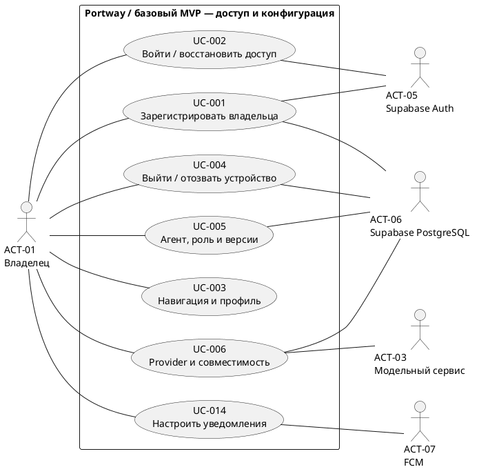
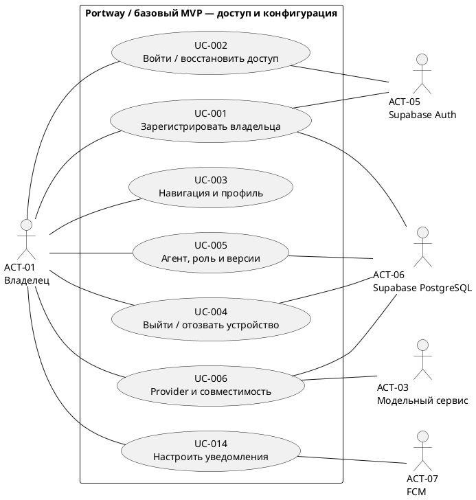
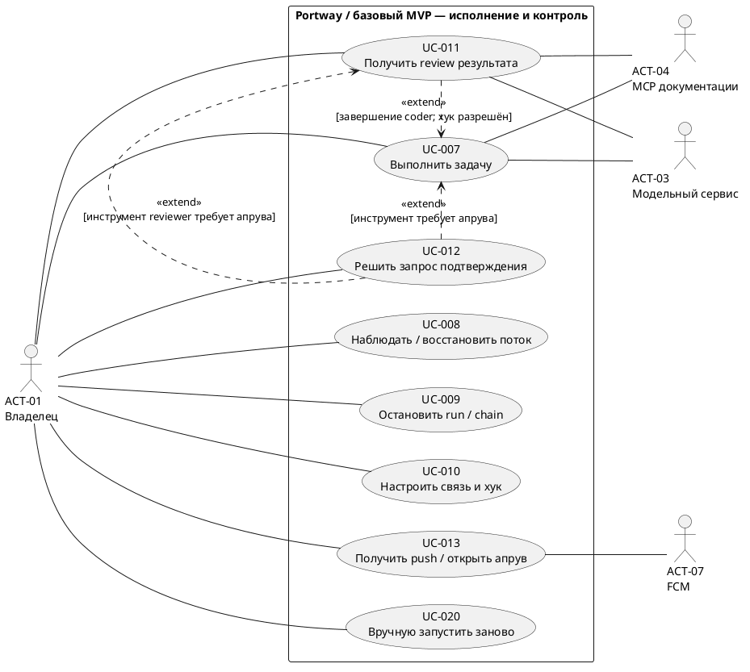
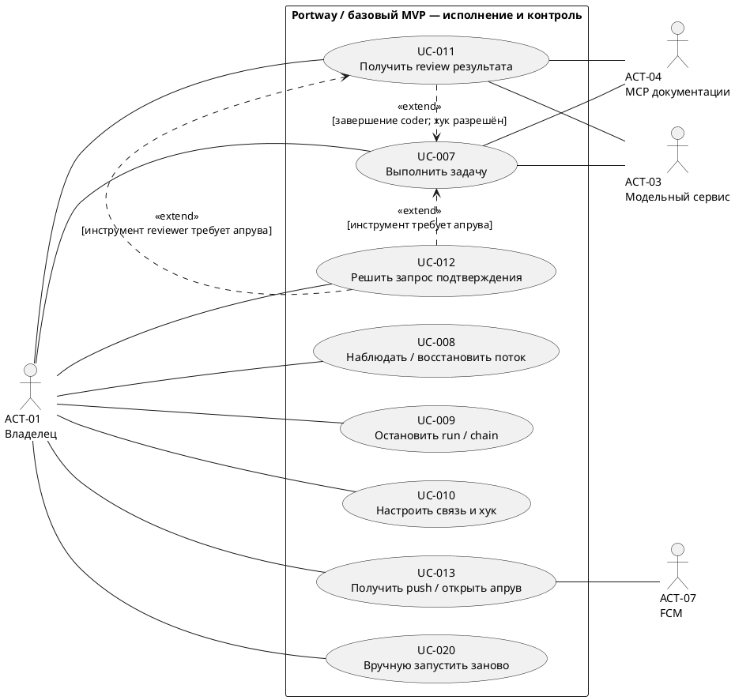
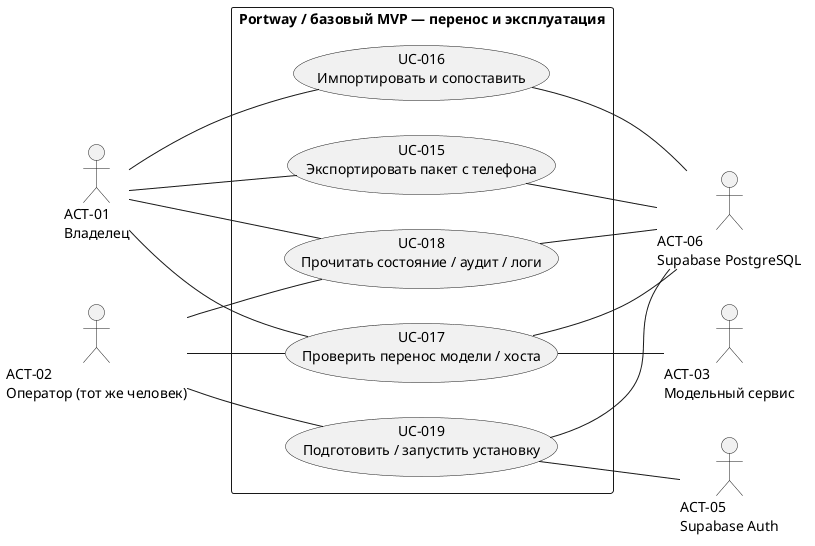
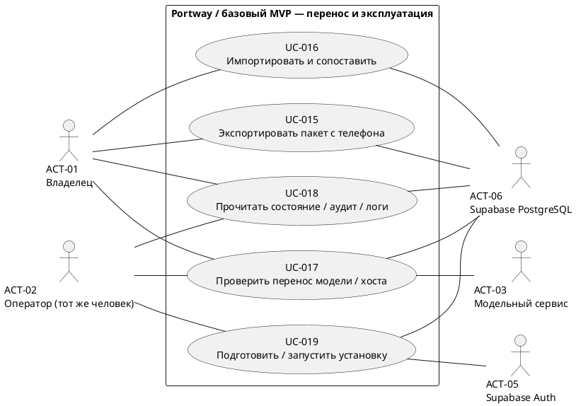

# Portway — варианты использования: [UML-диаграммы][g-uml] и спецификации

| Поле | Значение |
|---|---|
| Артефакт | [DOC-012][id-doc-012] · [Use Case-диаграмма][g-use-case] и спецификации |
| Версия и дата | v0.5 · 10.10.2026 |
| Роль документа | Рабочий документ; обновлять при изменении своей области; актуальный состав — [навигатор](README.md#existing) |
| Статус | Подготовлен проект для базового [MVP][g-mvp]; результаты реализации, испытаний и согласование [владельцем][g-owner] не заявляются |
| [Владелец][g-owner] | [Владелец][g-owner] проекта; подготовка и технические уточнения — [ИИ-агент][g-development-agent] |
| Основания | [ТЗ](02-technical-specification.md), [SRS](03-software-requirements-specification.md), [MoSCoW](05-moscow-prioritization.md), [SMART](04-smart-goals-and-metrics.md), [акторы и границы](08-actors-and-stakeholders.md#actors) |
| Далее | [DOC-020 — архитектура и решения](20-architecture-and-decisions.md); [сокращённый план](README.md#remaining) |

Документ описывает цели [владельца][g-owner] и оператора, взаимодействие с внешними сервисами и наблюдаемые исходы. Он не задаёт точные [API][g-api] paths, JSON-поля или окончательные перечисления состояний: это [DOC-029][id-doc-029]/033–036/038. Здесь сохранены требования действующего [MVP][g-mvp], включая результат и [review][g-review] без [GitHub][g-github]. ID вариантов использования закреплены для дальнейших [критериев приёмки][g-acceptance], [RTM][g-traceability], [BPMN][g-architecture-notations] и [тест-кейсов][g-acceptance].

## Состав документации

Подготовлены все восемь сводных контрактов сокращённого плана; всего 22 проектных артефакта. [Состав и актуальный остаток](README.md#remaining), [сопоставление прежних DOC-ID](01-product-backlog.md#legacy-registry). Новых обязательных проектных документов в очереди нет. Следующая работа — реализация и проверки; [BL][g-work-ids]/[CW][g-work-ids] и все [TC][g-acceptance]/[AC][g-acceptance] остаются неподтверждёнными.

## 1. Граница системы и правила чтения

**Система Portway** включает [Flutter][g-flutter] [Android][g-flutter] [APK][g-apk], [Go][g-go] [control plane][g-control-plane], его внутренний сервис [аудита][g-audit]/состояния и локальный контейнерный [Runtime][g-runtime]. [Coder][g-main-roles], [reviewer][g-main-roles], их [Harness][g-harness] и шина [сообщений][g-message] — внутренние исполнители. Они не изображаются внешними [акторами][g-actors] всей системы. [Android][g-flutter]/Play Services, HTTPS-вход и [хосты][g-host] A/B — инфраструктура сценариев, не дополнительные пользователи.

| [Актор][g-actors] из [DOC-008][id-doc-008] | Участие в этой [модели][g-model] |
|---|---|
| [ACT-01][id-act-01] · [Владелец][g-owner] через [APK][g-apk] | Основной пользователь; регистрация, вход, конфигурация, выполнение, решения и перенос |
| [ACT-02][id-act-02] · Оператор [установки][g-host] | Тот же человек при подготовке/диагностике [хостов][g-host]; отдельный продуктовый аккаунт не возникает |
| [ACT-03][id-act-03] · Совместимый модельный сервис | Ответы, [stream][g-model-protocol], [tool calls][g-tool], [usage][g-usage] и ошибки; предложения действий проходят серверную [политику][g-policy] |
| [ACT-04][id-act-04] · [MCP-сервис][g-mcp] документации | Один разрешённый источник документации; его ответы считаются недоверенными данными |
| [ACT-05][id-act-05] · [Supabase Auth][g-supabase] | Регистрация и проверка сессии; доступ к Portway дополнительно ограничен [owner][g-owner]/device |
| [ACT-06][id-act-06] · [Supabase PostgreSQL][g-supabase] | Внешнее хранилище подтверждённых состояний, версий, [событий][g-event]/[outbox][g-outbox] и [аудита][g-audit] |
| [ACT-07][id-act-07] · [FCM][g-push] | Доставка сигнала об [апруве][g-approval]; уведомление не содержит разрешения на [инструмент][g-tool] |
| [ACT-08][id-act-08] · [GitHub][g-github] | Только условное [S-расширение][g-priorities]; отсутствует на диаграммах базового [MVP][g-mvp] |

Каждая диаграмма — представление одной границы **Portway / базовый [MVP][g-mvp]**. Разделение по целям нужно для читаемости, а не для объявления трёх продуктов. Используется [UML][g-uml] [Use Case][g-use-case] в исходнике PlantUML; это не flowchart. Сплошная линия показывает участие [актора][g-actors]. `<<extend>>` направлен от условного сценария к базовому; условие и точка расширения описаны в спецификации. Асинхронное следование [события][g-event] само по себе не является `<<include>>`. Синтаксис исходников — по [официальному справочнику PlantUML Use Case](https://plantuml.com/use-case-diagram), проверенному 09.10.2026; изображения ниже получены локально из тех же исходников.

[Supabase PostgreSQL][g-supabase] участвует во многих операциях хранения. На схемах его связи показаны только у характерных целей; это не полный перечень обращений к [БД][g-supabase] и не [DFD][g-architecture-notations]. Проверка доступа и [аудит][g-audit] описаны общими правилами, а не десятками одинаковых включаемых овалов. Вход — самостоятельная цель; защищённые операции требуют действующей сессии как предусловия и не подразумевают повторный ввод пароля при каждом действии.

## 2. Каталог вариантов использования

Все [UC-001][id-uc-001]–020 относятся к M-части текущей поставки. Это группировка сценариев, а не новые [задачи][g-task] [BL][g-work-ids] или обещание их реализации. Ссылки на [SRS][g-requirement-ids] здесь локальная трассировка [DOC-012][id-doc-012]; полная [RTM][g-traceability] остаётся [DOC-015][id-doc-015].

| ID | Цель | Главный [актор][g-actors] / инициатор | Требования [SRS][g-requirement-ids] |
|---|---|---|---|
| [UC-001][id-uc-001] | Зарегистрировать единственного [владельца][g-owner] | [Владелец][g-owner] с [setup-доступом][g-device-session] | [FR-001][id-fr-001]/002/081 |
| [UC-002][id-uc-002] | Войти и восстановить доступ при открытии [APK][g-apk] | [Владелец][g-owner] | [FR-001][id-fr-001]–003/082/090 |
| [UC-003][id-uc-003] | Перейти по основным разделам и прочитать профиль | [Владелец][g-owner] | [FR-082][id-fr-082]–084/090 |
| [UC-004][id-uc-004] | Выйти или отозвать доступ устройства | [Владелец][g-owner] | [FR-003][id-fr-003]/085 |
| [UC-005][id-uc-005] | Создать, прочитать и изменить [версию агента][g-agent-version] с [ролью][g-role] | [Владелец][g-owner] | [FR-005][id-fr-005]–009/065/087 |
| [UC-006][id-uc-006] | Настроить [provider][g-provider] и подтвердить требуемую совместимость | [Владелец][g-owner] / оператор | [FR-011][id-fr-011]–016 |
| [UC-007][id-uc-007] | Выполнить [задачу][g-task] выбранной [версией агента][g-agent-version] | [Владелец][g-owner] | [FR-009][id-fr-009]/018–021/025–027/030–039/066 |
| [UC-008][id-uc-008] | Наблюдать [запуск][g-run] и восстановить поток [событий][g-event] | [Владелец][g-owner] | [FR-021][id-fr-021]–023/027/055/067 |
| [UC-009][id-uc-009] | Остановить [запуск][g-run] или всю [цепочку][g-chain] | [Владелец][g-owner] | [FR-024][id-fr-024]/035/054/066 |
| [UC-010][id-uc-010] | Настроить [направленную связь][g-link] и [хук][g-hook] | [Владелец][g-owner] | [FR-044][id-fr-044]/048/069 |
| [UC-011][id-uc-011] | Получить отдельный [review][g-review] [результата coder][g-result] | Завершение [coder][g-main-roles] по настроенному [хуку][g-hook]; выгодополучатель — [владелец][g-owner] | [FR-045][id-fr-045]–053/055; [FR-059][id-fr-059] (M); [FR-070][id-fr-070] (M) |
| [UC-012][id-uc-012] | Решить запрос [подтверждения действия][g-approval] | Требующее [апрува][g-approval] действие; решение — [владелец][g-owner] | [FR-037][id-fr-037]–043/068 |
| [UC-013][id-uc-013] | Получить [push][g-push] и открыть актуальный [апрув][g-approval] | [Событие][g-event] запроса [апрува][g-approval]; [владелец][g-owner] / [FCM][g-push] | [FR-075][id-fr-075]/076 |
| [UC-014][id-uc-014] | Разрешить уведомления и привязать [device token][g-push-token] | [Владелец][g-owner]; смена токена | [FR-086][id-fr-086] |
| [UC-015][id-uc-015] | Экспортировать [версию агента][g-agent-version] с телефона | [Владелец][g-owner] | [FR-060][id-fr-060]/061/077 |
| [UC-016][id-uc-016] | Импортировать [пакет][g-package] и сопоставить зависимости | [Владелец][g-owner] | [FR-062][id-fr-062]/063/077 |
| [UC-017][id-uc-017] | Подтвердить перенос на другую [модель][g-model] и [хост][g-host] | [Владелец][g-owner] / оператор | [FR-064][id-fr-064]/088 |
| [UC-018][id-uc-018] | Прочитать состояние сервиса, [аудит][g-audit] и [логи][g-audit] | [Владелец][g-owner] / оператор | [FR-004][id-fr-004]/089 |
| [UC-019][id-uc-019] | Подготовить и запустить [установку][g-host], сверить прерванную работу | Оператор | [FR-029][id-fr-029]; [NFR-012][id-nfr-012]–014/022/024 |
| [UC-020][id-uc-020] | Вручную запустить [задачу][g-task] заново после сбоя | [Владелец][g-owner] | [FR-018][id-fr-018]/019/029/066 |

## 3. [UML][g-uml] [Use Case-диаграммы][g-use-case]

### 3.1. Доступ и конфигурация

Участие [FCM][g-push] в [UC-014][id-uc-014] означает получение/обновление клиентского токена. Запись привязки к [owner][g-owner]/device выполняет Portway; [FCM][g-push] не решает, кто имеет доступ к [установке][g-host].

### 3.2. Исполнение, контроль и результат

Точка расширения [UC-007][id-uc-007] для [UC-011][id-uc-011] — «[результат coder][g-result] зафиксирован, обработка завершения». Для [UC-012][id-uc-012] — «предложенное действие классифицировано, ещё не передано [Runtime][g-runtime]» в [UC-007][id-uc-007] либо [UC-011][id-uc-011]. [Push][g-push] [UC-013][id-uc-013] следует за созданием [апрува][g-approval] асинхронно; его сбой не разрешает действие и не отменяет серверный [timeout][g-timeout]. Поэтому [UC-013][id-uc-013] не нарисован обязательным синхронным вызовом из [UC-012][id-uc-012]. [MCP][g-mcp] участвует только при разрешённом запросе документации.

### 3.3. Перенос и эксплуатация

[UC-017][id-uc-017] — составная цель проверки [переносимости][g-portability]: использует уже описанные [экспорт][g-export-import], [импорт][g-export-import] и [запуск][g-run] на подготовленных [установках][g-host]. Диаграмма не задаёт их порядок; последовательность [A/M1 → A/M2 → B/M2][g-portability] закреплена ниже. [GitHub][g-github], отдельный [Runner][g-runner], расписания и [Prometheus/Grafana][g-observability-tools] не включены в базовые представления.

## 4. Общие предусловия и гарантии

1. **Доступ.** Кроме bootstrap-регистрации и входа, пользовательские операции требуют проверенных [owner][g-owner] ID и [device-сессии][g-device-session]. Проверка производится сервером, включая подписку на [SSE][g-sse]. Аутентифицированный посторонний [Supabase][g-supabase] user не получает owner-полномочия. Операторские действия на [хосте][g-host] не открывают публичный административный [API][g-api].
2. **Сеть и [секреты][g-secret].** [APK][g-apk] использует настроенный [HTTPS][g-https] URL и проверяет сертификат. Изменение URL не переносит доверие или owner-сессию на другую [установку][g-host]. Серверные ключи отсутствуют в [APK][g-apk]; сохранённый [секрет][g-secret] не возвращается [API][g-api], в [аудите][g-audit]/[логах][g-audit] маскируется, в [Runtime][g-runtime] и [пакет][g-package] не выдаётся. Точные правила хранения — [DOC-046][id-doc-046].
3. **Подтверждённая запись.** Система сообщает успех изменения после сохранения подтверждённого результата. Недоступность [БД][g-supabase] не заменяется успешной записью только на телефоне. При потере ответа после записи исход проверяется по известной идентичности операции; опасный побочный эффект не повторяется вслепую.
4. **Повторы.** Создание [run][g-run] имеет ключ [идемпотентности][g-idempotency] с окном 7 суток: та же операция/параметры возвращают тот же логический [run][g-run], конфликт отклоняется. Дубли [сообщения][g-message]/[хука][g-hook] не создают второй логический [review][g-review]. [Дедупликация][g-idempotency] — 7 суток, повтор [сообщения][g-message] — не дольше 24 ч. Универсальная гарантия exactly-once для внешних действий не обещается.
5. **Права и лимиты.** [Запуск][g-run] фиксирует версию и эффективную конфигурацию. Новые запреты применяются до следующего действия; расширение прав требует новой версии и [запуска][g-run]. [Сообщение][g-message], [роль][g-role], MCP-ответ и текст [модели][g-model] не заменяют серверное разрешение. [Stop][g-cancelled], истечение времени и общий бюджет запрещают новую работу, включая [безопасные альтернативы][g-safe-alternative].
6. **Наблюдаемость.** Ошибка показывает текст, стабильную причину и доступные [run_id][g-run-id]/[correlation_id][g-chain]. Базовый [аудит][g-audit] фиксирует [auth][g-auth]/отзыв, решения [апрувов][g-approval], остановки, запреты и лимиты: субъект, объект, серверное время, действие, исход и контекст без [секретов][g-secret]. Лента и диагностика показывают неопределённый внешний исход отдельно от успеха.
7. **Defaults.** Значения остаются в [SRS][g-requirement-ids] § 4.2: [апрув][g-approval] 180 с; [run][g-run]/[chain][g-chain] 15/30 мин; [LLM][g-model]/[tool][g-tool] 120/60 с; 20/40 [шагов][g-step]; 20 000/40 000 токенов; [hops][g-hops]/[depth][g-depth] 8/2. Изменение defaults должно синхронизировать [SRS][g-requirement-ids] и последующие контракты. Целевые [p95][g-evidence] [событий][g-event] ≤2 с и [stop][g-cancelled] ≤5 с ещё должны быть измерены по [SMART][g-smart].

## 5. Спецификации доступа и конфигурации

### [UC-001][id-uc-001] · Зарегистрировать единственного [владельца][g-owner]

**Цель / [акторы][g-actors]:** первичная настройка [владельцем][g-owner] с участием [Supabase Auth][g-supabase] и [PostgreSQL][g-supabase]. **Предусловия:** подготовленная [установка][g-host] без привязанного [owner][g-owner]; защищённый [setup-доступ][g-device-session]; [APK][g-apk] подключён по [HTTPS][g-https]. **Триггер:** [владелец][g-owner] открывает регистрацию.

**Основной поток:**

1. [Владелец][g-owner] вводит имя, email, пароль и подтверждает [setup-доступ][g-device-session] конкретной [установки][g-host].
2. Сервер проверяет поля, [setup-доступ][g-device-session] и отсутствие уже закреплённого [owner][g-owner].
3. [Supabase Auth][g-supabase] регистрирует учётную запись; если проект требует подтверждения email, приложение показывает ожидаемое действие и завершает предусмотренный callback-путь.
4. После подтверждения личности сервер атомарно закрепляет единственного [owner][g-owner] ID, сохраняет профиль и фиксирует исход регистрации без пароля/setup-секрета.
5. Приложение сообщает о завершении регистрации; [владелец][g-owner] выполняет вход по [UC-002][id-uc-002]. Наличие аккаунта [Supabase][g-supabase] без owner-привязки не считается завершённой регистрацией Portway.

**Альтернативы и ошибки:** пустое имя, невалидный email/пароль — ошибка соответствующего поля; неверный [setup-доступ][g-device-session] или занятый [owner][g-owner] — доступ не выдаётся; повтор/гонка регистрации не создаёт второго [owner][g-owner]. Если [Auth][g-auth] создал аккаунт, а связь [owner][g-owner] не сохранилась, показывается незавершённая настройка: аккаунт не получает права Portway. Порядок восстановления такого bootstrap определяется контрактом, без обещания атомарной транзакции между [Auth][g-auth] и [БД][g-supabase]. Повтор учебной регистрации выполняется на подготовленной чистой тестовой [установке][g-host], не сбрасывает рабочую.

**Постусловия:** один сохранённый [owner][g-owner], либо объяснённая незавершённая/отклонённая регистрация без доступа. **Связи:** [FR-001][id-fr-001]/002/081; [NFR-005][id-nfr-005]/006/019; [BL-100][id-bl-100]/121; [КМ07-03][id-km07-03]/04/05.

### [UC-002][id-uc-002] · Войти и восстановить доступ при открытии [APK][g-apk]

**Цель / [акторы][g-actors]:** [владелец][g-owner] получает актуальный доступ; [Supabase Auth][g-supabase] подтверждает сессию. **Предусловия:** [UC-001][id-uc-001] завершён; настроен [HTTPS][g-https] [API][g-api] URL. **Триггер:** открытие [APK][g-apk] или отправка email/пароля.

**Основной поток:**

1. [APK][g-apk] показывает Splash с названием/логотипом и читает локальное состояние сессии из защищённого хранилища.
2. При отсутствии пригодной сессии [владелец][g-owner] вводит email/пароль; сервер проверяет [Auth][g-auth], привязку [owner][g-owner] и device-доступ.
3. [APK][g-apk] сохраняет только необходимые пользовательские токены. Сервер устанавливает/проверяет [device-сессию][g-device-session].
4. При актуальном доступе открывается главная; при открытии из [push][g-push] после входа перечитывается целевой [апрув][g-approval] по [UC-013][id-uc-013].

**Альтернативы и ошибки:** неверные данные или другой [Supabase][g-supabase] user — отказ без доступа; отозванная/недействительная сессия — вход; недоступный [API][g-api] — объяснённое состояние с возможностью повторить/исправить URL. Серверная недоступность не выдаётся за неверный пароль, сохранённый токен сам по себе не подтверждает актуальные полномочия, Splash не остаётся бесконечно. Неверный TLS-сертификат не принимается молча.

**Постусловия:** главная с проверенным [owner][g-owner]/device-доступом либо вход/ошибка без защищённых действий. **Связи:** [FR-001][id-fr-001]–003/082/090; [NFR-005][id-nfr-005]/019; [BL-100][id-bl-100]/120/121; [КМ07-02][id-km07-02]/04/05.

### [UC-003][id-uc-003] · Перейти по основным разделам и прочитать профиль

**Цель / [актор][g-actors]:** [владелец][g-owner] находит функции и свои данные. **Предусловия:** действующий доступ; для настройки [API][g-api] URL доступен отдельный путь также из ошибки подключения. **Триггер:** выбор раздела или профиля.

**Основной поток:** главная предлагает [агентов][g-agent], [задачи][g-task]/[запуски][g-run], [апрувы][g-approval], связи, [пакеты][g-package], профиль и состояние сервиса; выбранный раздел показывает сохранённые данные либо объяснённую пустоту; профиль отображает имя/email; Back возвращает к ожидаемому разделу. Настройка URL позволяет указать новый [HTTPS][g-https] [API][g-api] и проверить подключение, затем подтвердить доступ к конкретной [установке][g-host] через [UC-002][id-uc-002].

**Альтернативы и ошибки:** ошибка загрузки содержит повтор; пустой каталог предлагает допустимое следующее действие; отзыв сессии переводит ко входу; неработающие основные кнопки недопустимы. Смена [API][g-api] не смешивает данные, [курсоры][g-sse] и незавершённые решения разных установок и не переносит [секреты][g-secret] на новый адрес. Пароль в профиле не показывается. Точный механизм разграничения локального состояния задаётся в контракте клиента.

**Постусловия:** [владелец][g-owner] прочитал профиль/достиг раздела, либо видит объяснённую ошибку и рабочий путь возврата. **Связи:** [FR-082][id-fr-082]–084/090; [NFR-005][id-nfr-005]/019; [BL-009][id-bl-009]/122/123; [КМ07-06][id-km07-06]–09.

### [UC-004][id-uc-004] · Выйти или отозвать доступ устройства

**Цель / [акторы][g-actors]:** [владелец][g-owner] закрывает локальный и серверный доступ; [PostgreSQL][g-supabase] сохраняет отзыв. **Предусловия:** известна [device-сессия][g-device-session]; удалённый отзыв выполняется с другой действующей owner-сессии. **Триггер:** «Выйти» либо отзыв выбранного устройства.

**Основной поток:** сервер фиксирует отзыв [device-сессии][g-device-session] и отвязывает её [push token][g-push-token]; [APK][g-apk] очищает локальные токены/защищённое состояние и показывает вход; следующие запросы от отозванной сессии отклоняются, открытый поток закрывается максимум за 5 с. Повтор отзыва не восстанавливает доступ и возвращает актуальный исход.

**Альтернативы и ошибки:** при отсутствии сети локальный выход выполняется, но серверный отзыв помечен неподтверждённым. Приложение не сообщает, что удалённая сессия уже отозвана; повтор/отзыв с другого действующего устройства позволяет проверить исход. Back не открывает защищённые экраны после локального выхода. Завершение пользовательской сессии само по себе не является командой [stop][g-cancelled] серверной работы — для неё [UC-009][id-uc-009].

**Постусловия:** локальный доступ закрыт; удалённый отзыв либо подтверждён, либо явно ожидает проверки. **Связи:** [FR-003][id-fr-003]/085; [NFR-005][id-nfr-005]/011/018; [BL-100][id-bl-100]/124; [КМ07-10][id-km07-10].

### [UC-005][id-uc-005] · Создать, прочитать и изменить [версию агента][g-agent-version] с [ролью][g-role]

**Цель / [акторы][g-actors]:** [владелец][g-owner] получает доступную для выбора конфигурацию; [PostgreSQL][g-supabase] хранит версии. **Предусловия:** [owner][g-owner]/device-доступ. **Триггер:** создание, чтение или редактирование [агента][g-agent].

**Основной поток:**

1. [APK][g-apk] читает каталог: основные `coder/reviewer/tester/researcher/documenter` и отдельные `code_reader/test_runner/docs_lookup`.
2. [Владелец][g-owner] выбирает [роль][g-role], задаёт инструкции, [навыки][g-skill], [инструменты][g-tool], настройки [MCP][g-mcp], [provider][g-provider]/[model][g-model] и допустимые ссылки на [секреты][g-secret].
3. Сервер проверяет поля/зависимости и сохраняет [агента][g-agent] с версией; [агент][g-agent] появляется при выборе, чтение возвращает сохранённые значения без [секретов][g-secret].
4. При изменении сервер создаёт новую неизменяемую версию. Уже запущенная работа сохраняет исходную версию; выбранная новая доступна следующему [запуску][g-run].

**Альтернативы и ошибки:** некорректное поле или несовместимая зависимость объяснены; отмена формы не меняет подтверждённую версию; при неясном исходе сохранения сначала читается результат. [Пресет субагента][g-subagent-presets] не создаёт дочерний процесс. Ужесточение действующей [политики][g-policy] проверяется перед следующим действием существующего [run][g-run]; новая версия не расширяет его права задним числом.

**Постусловия:** сохранённая читаемая версия либо отсутствие неподтверждённой активной правки. **Связи:** [FR-005][id-fr-005]–009/065/087; [NFR-002][id-nfr-002]/004/006/019; [BL-010][id-bl-010]/011/012/014/110.

### [UC-006][id-uc-006] · Настроить [provider][g-provider] и подтвердить требуемую совместимость

**Цель / [акторы][g-actors]:** [владелец][g-owner]/оператор готовит проверенное подключение; модельный сервис отвечает на контрольные вызовы. **Предусловия:** разрешённый [endpoint][g-model-endpoint] доступен серверу; выбран явный [model][g-model] ID; при необходимости подготовлен серверный [секрет][g-secret]. **Триггер:** добавление/смена [provider][g-provider] либо подготовка M1/M2.

**Основной поток:** сохраняются [endpoint][g-model-endpoint], [model][g-model] ID и [ссылка на секрет][g-secret-reference] (локальный [endpoint][g-model-endpoint] может быть без ключа); [шлюз][g-gateway] выполняет контрольные [stream][g-model-protocol]/[tool call][g-tool]→[tool result][g-tool]/[usage][g-usage]/error проверки; фиксируются конкретный [endpoint][g-model-endpoint]/[model][g-model], поддержанные возможности и источник [usage][g-usage]; для [агента][g-agent] проверяется достаточность возможностей до зависимого [шага][g-step]. При отсутствии [usage][g-usage] применяется консервативная бюджетная [политика][g-policy].

**Альтернативы и ошибки:** ошибка [auth][g-auth]/сети, обрыв [stream][g-model-protocol] или несовместимое [tool calling][g-model-protocol] не объявляются успехом; непроверенные возможности обозначаются; если расход нельзя ограничить, следующий платный вызов блокируется с [`budget_uncertain`][g-budget]. [API][g-api] не возвращает значение сохранённого [секрета][g-secret]. Автоматический список [моделей][g-model] и универсальный пользовательский экран проверки [provider][g-provider] — S ([FR-017][id-fr-017]); обязательные реальные проверки выбранных [моделей][g-model] допустимы как операторская процедура, без зависимости от S.

**Постусловия:** сохранённая конфигурация с проверяемыми сведениями о совместимости либо диагностируемая неподготовленность. **Связи:** [FR-011][id-fr-011]–016; [NFR-001][id-nfr-001]/002/010/016/020; [BL-020][id-bl-020]/021/023/025. Наличие описания процедуры ещё не доказывает работоспособность [модели][g-model].

## 6. Спецификации исполнения и контроля

### [UC-007][id-uc-007] · Выполнить [задачу][g-task] выбранной [версией агента][g-agent-version]

**Цель / [акторы][g-actors]:** [владелец][g-owner] получает результат [задачи][g-task]; модельный сервис и, по необходимости, [MCP][g-mcp] участвуют в выполнении. **Предусловия:** [owner][g-owner]/device-доступ; подготовленный [Runtime][g-runtime] и [модель][g-model]; доступная [версия агента][g-agent-version]; разрешённые [репозиторий][g-repository]/[ревизия][g-repository] и лимиты. **Триггер:** «Запустить» в [APK][g-apk].

**Основной поток:**

1. [Владелец][g-owner] выбирает [задачу][g-task], версию, [репозиторий][g-repository]/[ревизию][g-repository] и лимиты. [APK][g-apk] назначает ключ создания [run][g-run] для этой операции.
2. Сервер проверяет доступ, существование версии, зависимости и лимиты; сохраняет новый [run_id][g-run-id], [correlation_id][g-chain] и эффективную конфигурацию. Повтор с тем же ключом/параметрами возвращает тот же [run][g-run].
3. [Runtime][g-runtime] готовит согласованную [ревизию][g-repository] в отдельной [workspace][g-workspace]/[контейнере][g-sandbox], применяет разрешённое подмножество [devcontainer][g-devcontainer] и ресурсные/сетевые ограничения.
4. [Harness][g-harness] до выдачи очередного действия проверяет [stop][g-cancelled], текущие запреты, время/[шаги][g-step] и остатки [run][g-run]/[chain][g-chain]; перед [LLM-вызовом][g-model-protocol] резервирует токены.
5. [Шлюз][g-gateway] получает ответ [модели][g-model], передаёт части [stream][g-model-protocol] и учитывает [usage][g-usage]/оценку. Предложенный [tool call][g-tool] проходит [политику][g-policy]: [allow][g-approval-decision] — исполнение, [approval][g-approval] — [UC-012][id-uc-012], [deny][g-approval-decision] — отказ без исполнения.
6. [Runtime][g-runtime] выполняет только разрешённый вызов в пределах [workspace][g-workspace]; [MCP][g-mcp] документации использует те же контроли. Результат [инструмента][g-tool] возвращается [модели][g-model] как данные. Входящее [сообщение][g-message] применяется на границе следующего [шага][g-step], а не изменяет уже выданный [инструмент][g-tool].
7. После результата [Harness][g-harness] фиксирует завершение, доступные изменения/[ревизию][g-repository], [события][g-event] и инициирует остановку процессов/освобождение ресурсов. Точка «[результат coder][g-result] зафиксирован» допускает [UC-011][id-uc-011] при разрешённом [хуке][g-hook].

**Альтернативы и ошибки:** конфликт параметров одного ключа отклонён; отсутствующая версия/зависимость и запрещённый [devcontainer][g-devcontainer] не создают исполняемую работу; [модель][g-model]/[tool][g-tool]/[MCP][g-mcp] недоступны — наблюдаемая ошибка [шага][g-step]. Исчерпание лимита либо [stop][g-cancelled] запрещают следующую работу; ожидания [LLM][g-model]/[tool][g-tool]/[апрува][g-approval] входят в wall-clock. Неизвестный внешний эффект отмечен и не повторяется автоматически. Закрытие [APK][g-apk] не останавливает сервер. При ошибке [БД][g-supabase] неподтверждённое действие не представляется успешно сохранённым.

**Постусловия:** доступен фиксированный результат либо различимая причина прекращения; ошибки уборки видны в диагностике. **Связи:** [FR-009][id-fr-009]/018–021/025–027/030–039/049/066; [NFR-003][id-nfr-003]/004/010/011/015/018; [BL-030][id-bl-030]/031/034/040/041/042/044/045/072/117. [GitHub][g-github] и [PR][g-pr] не являются предусловиями: допустим локальный [fixture][g-fixture] с фиксированной [ревизией][g-repository].

### [UC-008][id-uc-008] · Наблюдать [запуск][g-run] и восстановить поток [событий][g-event]

**Цель / [актор][g-actors]:** [владелец][g-owner] видит ход работы и актуальный исход. **Предусловия:** доступ к известному [run][g-run]/[цепочке][g-chain]; расширенный браузер истории не требуется. **Триггер:** открытие ленты или переподключение.

**Основной поток:** [APK][g-apk] читает состояние [run][g-run] и подписывается на [SSE][g-sse]; [события][g-event] отображаются со стабильными ID и порядком внутри [run][g-run]; клиент хранит [курсор][g-sse] и не добавляет второй элемент при повторе ID; после обрыва запрашивает последующие сохранённые [события][g-event] и перечитывает актуальное состояние. Видны [шаги][g-step], причины ошибок, [сообщения][g-message]/[хуки][g-hook], [апрувы][g-approval], бюджеты, результат и [вердикт][g-review].

**Альтернативы и ошибки:** недоступный/истёкший [курсор][g-sse] даёт явную потерю полноты истории и чтение актуального состояния, без молчаливого продолжения с конца. Недоступная сеть отображается как разрыв, не как успех/ошибка [run][g-run]. Отзыв сессии закрывает поток максимум за 5 с. Между разными [run][g-run] глобальный порядок не обещается; работающий [APK][g-apk] не обязан оставаться открытым для продолжения сервера.

**Постусловия:** согласованные видимые состояние/[события][g-event] либо явно обозначенная неполная лента. **Связи:** [FR-021][id-fr-021]–023/027/055/067; [NFR-006][id-nfr-006]/008/011/018/019; [BL-032][id-bl-032]/067/111. [p95][g-evidence] ≤2 с проверяется по [PERF-01][g-smart]; время [FCM][g-push]/генерации [модели][g-model] не включается.

### [UC-009][id-uc-009] · Остановить [запуск][g-run] или всю [цепочку][g-chain]

**Цель / [актор][g-actors]:** [владелец][g-owner] прекращает управляемую работу. **Предусловия:** [owner][g-owner]/device-доступ; известный [run_id][g-run-id] или [correlation_id][g-chain]. **Триггер:** выбор [stop][g-cancelled] и области «[запуск][g-run]»/«[цепочка][g-chain]».

**Основной поток:** сервер фиксирует остановку выбранной области; запрещает новые [шаги][g-step] и выдачу работы; для [chain][g-chain] запрещает новые дочерние [run][g-run]/[хуки][g-hook] и отменяет активные; не допускает выдачи [инструмента][g-tool] по ожидающему [апруву][g-approval] остановленного [run][g-run]; передаёт отмену [LLM][g-model]/[Runtime][g-runtime], прекращает локальные процессы; сохраняет исход, [события][g-event] и [аудит][g-audit]. Повтор [stop][g-cancelled] возвращает актуальное состояние без нового эффекта.

**Альтернативы и ошибки:** уже [terminal run][g-terminal-run] не оживает; поздний [approve][g-approval-decision]/[сообщение][g-message] не отменяет [stop][g-cancelled]. Для остановленного отдельного [run][g-run] не выдаётся новая работа этого [run][g-run]; гарантированная отмена уже существующих других членов [цепочки][g-chain] требует [stop][g-cancelled] [chain][g-chain]. Неизвестный внешний эффект показывается отдельно, а полученный ответ [API][g-api] [stop][g-cancelled] не объявляет его отменённым. Потеря ответа требует сверки состояния, не создания нового [run][g-run].

**Постусловия:** управляемая работа выбранной области прекращена; оставшиеся процессы/неопределённые эффекты диагностируемы. **Связи:** [FR-024][id-fr-024]/035/043/054/066; [NFR-007][id-nfr-007]/009/018; [BL-033][id-bl-033]/044/054/065/117. Предел ≤5 с после серверной фиксации — критерий реального испытания.

### [UC-010][id-uc-010] · Настроить [направленную связь][g-link] и [хук][g-hook]

**Цель / [актор][g-actors]:** [владелец][g-owner] разрешает определённую координацию. **Предусловия:** доступны [coder][g-main-roles]/[reviewer][g-main-roles] и их конфигурации; [owner][g-owner]/device-доступ. **Триггер:** создание/изменение/отключение связи.

**Основной поток:** [владелец][g-owner] выбирает отправителя, получателя, направление, поддерживаемое [событие][g-event] и реакцию; сервер валидирует ссылки/[событие][g-event]/[политику][g-policy] и сохраняет настройку; [APK][g-apk] перечитывает её. Для демо используется [coder][g-main-roles]→[reviewer][g-main-roles] на `run.completed`. Другие поддержанные условия [SRS][g-requirement-ids]: [`tool_result`][g-tool], `approval_requested`, `agent_message`; их точные [payload][g-payload]/реакции будут закреплены в [DOC-034][id-doc-034]/035/041. Отключение запрещает последующую выдачу работы по этой связи.

**Альтернативы и ошибки:** неизвестное [событие][g-event], недопустимый адресат или связь отклоняются; [агент][g-agent] не создаёт/расширяет топологию собственным [сообщением][g-message]. Сохранение связи не запускает task само по себе. Отключение не отменяет уже начатую работу получателя; для неё [stop][g-cancelled] [run][g-run]/[chain][g-chain]. Устройство после потери ответа читает подтверждённую настройку.

**Постусловия:** сохранённая разрешённая топология/[хук][g-hook] либо объяснённый отказ. **Связи:** [FR-044][id-fr-044]/048/069; [NFR-004][id-nfr-004]/007/019; [BL-062][id-bl-062]/063/113.

### [UC-011][id-uc-011] · Получить отдельный [review][g-review] [результата coder][g-result]

**Цель / [акторы][g-actors]:** [владелец][g-owner] получает [вердикт][g-review]; модельный сервис и разрешённый [MCP][g-mcp] участвуют в [reviewer-run][g-run]. **Предусловия:** [результат coder][g-result] фиксирован; [направленная связь][g-link]/[хук][g-hook] разрешены; [reviewer][g-main-roles] подготовлен; [chain][g-chain] допускает новую работу. **Триггер:** обработка завершения [coder][g-main-roles]. **Расширяет:** [UC-007][id-uc-007] после фиксации результата при выполнении условий [хука][g-hook].

**Основной поток:**

1. [Control plane][g-control-plane] проверяет [хук][g-hook], доступ получателя и [конверт][g-message] [сообщения][g-message]: версию, тип/[payload][g-payload], размер ≤64 KiB и подлинность отправителя. ID, [correlation_id][g-chain], [hops][g-hops]/[depth][g-depth] задаёт/проверяет сервер.
2. Через шину/[outbox][g-outbox] сохраняется один логический запрос [review][g-review]. Дубли доставки/[хука][g-hook] не создают второй [reviewer-run][g-run].
3. Сервер фиксирует отдельный [reviewer-run][g-run] с тем же [correlation_id][g-chain], выбранной версией [reviewer][g-main-roles] и согласованными diff/[ревизией][g-repository] [результата coder][g-result]. Передача результата не даёт общего произвольного доступа к [workspace][g-workspace].
4. [Reviewer][g-main-roles] проверяет результат со своими правами. [Шаги][g-step] ограничены общим бюджетом/временем, [hops][g-hops]≤8/[depth][g-depth]≤2; резервы выдаются до конкурентных [LLM-вызовов][g-model-protocol]. При требующем [апрува][g-approval] действии используется [UC-012][id-uc-012].
5. [Вердикт][g-review] и причины/замечания связываются с проверенной [ревизией][g-repository] и показываются вместе с исходным результатом. Завершённый [coder][g-main-roles] сохраняет свой terminal исход.

**Альтернативы и ошибки:** отключённая связь, [stop][g-cancelled], превышение лимита или неподготовленный [reviewer][g-main-roles] показывают отказ/ошибку [review][g-review], не ложный [вердикт][g-review]. Невалидный/подменённый [конверт][g-message] и конфликт [payload][g-payload] одного [message][g-message] ID отклоняются. Доставка активному [агенту][g-agent] применяется на границе [шага][g-step]; для завершённого [coder][g-main-roles] отдельный [review][g-review] не продолжает старый цикл. Отрицательный [вердикт][g-review] не создаёт автоматического исправления; [владелец][g-owner] может начать новый ручной [run][g-run]. Положительный [вердикт][g-review] в базовом [MVP][g-mvp] не публикует [PR][g-pr].

**Постусловия:** один доступный [вердикт][g-review] по фиксированному результату либо отдельная причина отсутствия [review][g-review]; [роли][g-role]/права не повысились от [сообщения][g-message]. **Связи:** [FR-045][id-fr-045]–053/055; [FR-059][id-fr-059] (M); [FR-070][id-fr-070] (M); [NFR-004][id-nfr-004]/007/010/017/018; [BL-060][id-bl-060]–064/066/067/069/118.

### [UC-012][id-uc-012] · Решить запрос [подтверждения действия][g-approval]

**Цель / [актор][g-actors]:** [владелец][g-owner] разрешает или отклоняет конкретное опасное действие. **Предусловия:** активный [run][g-run] предложил действие, которое допускается только через [апрув][g-approval]; server-side [policy][g-policy] проверена. **Триггер:** классификация действия как [approval][g-approval]. **Расширяет:** [UC-007][id-uc-007]/011 в точке до передачи [инструмента][g-tool] [Runtime][g-runtime].

**Основной поток:**

1. Сервер сохраняет [апрув][g-approval], связанный с [run][g-run], [инструментом][g-tool] и неизменяемыми аргументами, с deadline через 180 с по серверным часам. [Инструмент][g-tool] ещё не исполняется; [run][g-run] ожидает решения, появляется [событие][g-event] для [UC-013][id-uc-013].
2. [Владелец][g-owner] открывает актуальный запрос в [APK][g-apk]: видны [инструмент][g-tool], значимые аргументы, состояние и серверный срок.
3. [APK][g-apk] отправляет [approve][g-approval-decision] или [reject][g-approval-decision] с действующим доступом. Сервер атомарно фиксирует один применимый исход с учётом конкурирующих решения/[timeout][g-timeout]/[stop][g-cancelled].
4. При [approve][g-approval-decision] заново проверяются актуальность [run][g-run], deadline, аргументы, действующие запреты и бюджет. Разрешение выдаётся только связанному действию; обычный повтор ответа не вызывает повторного исполнения.
5. При [reject][g-approval-decision]/[timeout][g-timeout] исходное действие не исполняется, [Harness][g-harness] получает структурированный отказ. Он может предложить [безопасную альтернативу][g-safe-alternative], которая заново проходит [policy][g-policy] и бюджеты.

**Альтернативы и ошибки:** просроченное подтверждение, остановка/прерванный [run][g-run], изменённые аргументы или новые запреты не дают разрешение. Текст [`approve`][g-approval-decision] от другого [агента][g-agent] не является решением [владельца][g-owner]. При гонке побеждает один зафиксированный действующий исход, остальные получают текущее состояние. Потерянный ответ проверяется чтением [апрува][g-approval]; неизвестный эффект [инструмента][g-tool] не повторяется вслепую. Идентичный отказанный [tool][g-tool]+аргументы не считается альтернативой; default допускает не более двух последовательных отказанных альтернатив. Без безопасного пути [run][g-run] завершается с объяснением; [stop][g-cancelled]/budget прекращают и поиск альтернативы.

**Постусловия:** одно наблюдаемое решение; исходное действие исполнено только при действующем разрешении либо запрещено. **Связи:** [FR-037][id-fr-037]–043/068; [NFR-004][id-nfr-004]/007/010/019; [BL-050][id-bl-050]/051/052/054/112.

### [UC-013][id-uc-013] · Получить [push][g-push] и открыть актуальный [апрув][g-approval]

**Цель / [акторы][g-actors]:** [владелец][g-owner] узнаёт о запросе при закрытом [APK][g-apk]; [FCM][g-push] доставляет сигнал. **Предусловия:** создан [апрув][g-approval]; зарегистрирован [device token][g-push-token]; Play Services/разрешение уведомлений доступны для положительной проверки. **Триггер:** [событие][g-event] `approval_requested`.

**Основной поток:** сервер ставит отправку уведомления для действующего [owner][g-owner]/device; [FCM][g-push] доставляет уведомление в фон/обычное terminated-состояние; нажатие открывает [APK][g-apk]; при необходимости выполняется [UC-002][id-uc-002]; приложение получает актуальный [апрув][g-approval] у выбранной [установки][g-host] и предлагает [UC-012][id-uc-012] только для действующего запроса. [Push][g-push] несёт идентификатор/сигнал, а не разрешение, секретные аргументы или доверенное конечное состояние.

**Альтернативы и ошибки:** [FCM][g-push] недоступен, токен неактуален, разрешение отключено — причина видна в состоянии доставки; [апрув][g-approval] продолжает ждать до серверного deadline, отказ доставки не разрешает действие. Дубль/поздний [push][g-push] открывает тот же актуальный объект; terminal/expired запрос показывается без возможности исполнить его. После logout/отзыва новые персональные [push][g-push] на отвязанную [device-сессию][g-device-session] не отправляются. Системный [force-stop][g-app-lifecycle] исключён из положительной приёмки [SRS][g-requirement-ids]; обычное закрытие проверяется обязательно.

**Постусловия:** актуальный [апрув][g-approval] открыт либо недоставка/недействительность объяснены. **Связи:** [FR-075][id-fr-075]/076; [NFR-005][id-nfr-005]/011/018/019; [BL-053][id-bl-053]/116/125. [Fake][g-fixture] [FCM][g-push] и успешная серверная отправка не заменяют получение уведомления настоящим [Android 16][g-flutter].

### [UC-014][id-uc-014] · Разрешить уведомления и привязать [device token][g-push-token]

**Цель / [акторы][g-actors]:** [владелец][g-owner] готовит устройство к [push][g-push]; клиентский [FCM][g-push] выдаёт/обновляет токен. **Предусловия:** [APK][g-apk] установлен; device-доступ определён; [Google Play Services][g-flutter] присутствуют. **Триггер:** настройка уведомлений, вход либо смена токена.

**Основной поток:** [APK][g-apk] объясняет назначение уведомлений и запрашивает [Android-разрешение][g-flutter]; получает [FCM device token][g-push-token]; передаёт его защищённому [API][g-api], который связывает токен с текущим [owner][g-owner]/device; при смене обновляет привязку. Пользователь видит состояние разрешения/регистрации. При logout/отзыве используется [UC-004][id-uc-004] для отвязки.

**Альтернативы и ошибки:** отказ разрешения не скрывается и не объявляется готовым [push][g-push]; ошибка получения/сохранения токена допускает повтор, но не показывает ложную регистрацию. Неавторизованная регистрация токена отклоняется. [FCM][g-push] server [credential][g-secret] не помещается в [APK][g-apk].

**Постусловия:** актуальная привязка либо явная неподготовленность уведомлений. **Связи:** [FR-086][id-fr-086]; [NFR-002][id-nfr-002]/005/019; [BL-125][id-bl-125].

## 7. Спецификации переноса и эксплуатации

### [UC-015][id-uc-015] · Экспортировать [версию агента][g-agent-version] с телефона

**Цель / [актор][g-actors]:** [владелец][g-owner] получает переносимый файл конкретной версии. **Предусловия:** читаемая [версия агента][g-agent-version]; [owner][g-owner]/device-доступ. **Триггер:** «Экспортировать» в [APK][g-apk].

**Основной поток:** сервер читает выбранную неизменяемую версию и формирует versioned ZIP с manifest, инструкциями, [навыками][g-skill], [MCP][g-mcp]/[политикой][g-policy]; [секреты][g-secret] заменяет ссылками, локальные [agent][g-agent] ID — переносимыми [алиасами][g-secret-reference]/[ролями][g-role]; [пакет][g-package] валидируется и передаётся [APK][g-apk]; [владелец][g-owner] сохраняет файл через Android-путь выбора места. Повтор описывает ту же конфигурацию версии, не обязан давать побайтово идентичный ZIP.

**Альтернативы и ошибки:** недоступная версия/сбой формирования/отмена Android-сохранения объяснены; отсутствие сохранённого файла не выдаётся за успешный мобильный [экспорт][g-export-import]. Серверные [секреты][g-secret], абсолютные host paths, полная память, [события][g-event] и активный [run][g-run] не переносятся. Значения неизвестных системе [секретов][g-secret] в свободном тексте не обещано автоматически распознавать безошибочно; правила допустимого состава задаёт [DOC-038][id-doc-038].

**Постусловия:** сохранённый мобильный [пакет][g-package] с версией формата и перечнем требуемых привязок либо объяснённый отказ. **Связи:** [FR-060][id-fr-060]/061/077; [NFR-002][id-nfr-002]/017/020; [BL-080][id-bl-080]/081/114.

### [UC-016][id-uc-016] · Импортировать [пакет][g-package] и сопоставить зависимости

**Цель / [актор][g-actors]:** [владелец][g-owner] получает безопасно разобранную конфигурацию для выбранного окружения. **Предусловия:** [owner][g-owner]/device-доступ на целевой [установке][g-host]; [APK][g-apk] выбрал файл. **Триггер:** «Импортировать».

**Основной поток:**

1. [APK][g-apk] передаёт выбранный [пакет][g-package] серверу. Сервер проверяет поддержанную версию/состав и ограничивает ZIP ≤10 [MiB][g-host-resources], распаковку ≤25 [MiB][g-host-resources] и число файлов ≤1000.
2. В ограниченном staging проверяются пути и типы элементов; traversal/symlink отклоняются. Вложенный код, SKILL-инструкции и lifecycle [hooks][g-hook] при [импорте][g-export-import] не исполняются.
3. [APK][g-apk] показывает конфигурацию и требуемые зависимости. [Владелец][g-owner] выбирает целевые [provider][g-provider]/[model][g-model], сопоставляет ссылки [секретов][g-secret], [инструменты][g-tool]/[MCP][g-mcp] и [алиасы][g-secret-reference] связей с разрешёнными локальными объектами.
4. Сервер проверяет совместимость, новые пути/права и полноту сопоставления; подтверждённая конфигурация сохраняется новой версией/[агентом][g-agent] по правилам будущего [DOC-038][id-doc-038]. Нерешённые зависимости явно перечислены и блокируют зависимый [запуск][g-run].
5. [APK][g-apk] перечитывает результат [импорта][g-export-import]; продолжить проверку можно по [UC-017][id-uc-017].

**Альтернативы и ошибки:** неподдержанный формат, превышение лимита, запрещённый путь и несовместимая [модель][g-model] дают явный отказ до активации. Отмена/неудачный разбор не подменяют существующего [агента][g-agent]. При неизвестном исходе подтверждения сначала читается результат; точная идентичность импортной операции будет закреплена в [DOC-036][id-doc-036]/038, гарантия [API][g-api] [run][g-run] key не переносится автоматически на все методы. Несопоставленная конфигурация не объявляется готовой к работе.

**Постусловия:** подтверждённая конфигурация с явными привязками/готовностью либо отсутствие скрытой активации. **Связи:** [FR-016][id-fr-016]/062/063/077; [NFR-002][id-nfr-002]/004/017/020/021; [BL-082][id-bl-082]/083/114.

### [UC-017][id-uc-017] · Подтвердить перенос на другую [модель][g-model] и [хост][g-host]

**Цель / [акторы][g-actors]:** [владелец][g-owner]/оператор доказывает перенос конфигурации реальными [запусками][g-run]; модельные сервисы участвуют в контрольной [задаче][g-task]. **Предусловия:** подготовлены две совместимые реальные [модели][g-model] M1/M2 (одна локальная), исходный [хост][g-host] A и другой [хост][g-host] B; [APK][g-apk] доступен к обеим [установкам][g-host] по [HTTPS][g-https]; контрольный [репозиторий][g-repository]/[ревизия][g-repository] и [задача][g-task] зафиксированы. **Триггер:** проверка обязательного переноса.

**Основной поток:**

1. На A/M1 запускается контрольная [задача][g-task] выбранной версии по [UC-007][id-uc-007]; фиксируются конфигурация, результат, [endpoint][g-model-endpoint]/[model][g-model] ID и исходная [ревизия][g-repository].
2. [Владелец][g-owner] экспортирует эту версию с [Android][g-flutter] по [UC-015][id-uc-015], импортирует [пакет][g-package] на A/M2 по [UC-016][id-uc-016] и связывает новые зависимости.
3. Сравниваются нормализованные инструкции, [навыки][g-skill], [роль][g-role]/права и переносимые [инструменты][g-tool]/[MCP][g-mcp]; ожидаемые локальные замены выделяются. На A/M2 выполняется та же контрольная [задача][g-task].
4. Оператор готовит отдельное окружение [control plane][g-control-plane]/[Runtime][g-runtime] B. [Владелец][g-owner] переключает [API][g-api] URL [APK][g-apk], подтверждает доступ к B, импортирует файл с телефона и заново сопоставляет локальные пути, [provider][g-provider]/[model][g-model], [секреты][g-secret] и [алиасы][g-secret-reference].
5. На B/M2 запускается та же [задача][g-task]. Сохраняются идентичность [хостов][g-host], новые [endpoint][g-model-endpoint]/привязки, версии/[ревизии][g-repository] и результаты всех трёх точек [A/M1 → A/M2 → B/M2][g-portability].

**Альтернативы и ошибки:** несовместимая [модель][g-model]/отсутствующая привязка блокируют зависимую работу и требуют исправления, не снимают обязательность проверки. Второй каталог на A не считается B; ВМ допустима с явной отметкой виртуализации. Наличие ZIP без целевого [запуска][g-run], [Fake][g-fixture] [LLM][g-model] или обещание будущего VPS не доказывают перенос. Изменённые ответы [модели][g-model] допустимы: сравниваются согласованные поля и критерии контрольной [задачи][g-task], а не идентичность текста. Активный [run][g-run]/память не возобновляются на B.

**Постусловия:** сохранены реальные [свидетельства][g-evidence] трёх [запусков][g-run] и сравнения либо перечислены невыполненные части. **Связи:** [FR-064][id-fr-064]/077/088; [NFR-016][id-nfr-016]/017/018; [BL-021][id-bl-021]/082/084/114; [SMART][g-smart] [SM-06][id-sm-06]/07.

### [UC-018][id-uc-018] · Прочитать состояние сервиса, [аудит][g-audit] и [логи][g-audit]

**Цель / [акторы][g-actors]:** [владелец][g-owner]/оператор объясняет сбой и проверяет зависимости; [PostgreSQL][g-supabase] хранит базовый [аудит][g-audit]. **Предусловия:** защищённый доступ к диагностическому [API][g-api]; известный [run_id][g-run-id]/[correlation_id][g-chain], если ошибка относится к работе. **Триггер:** открытие состояния или диагностика ошибки.

**Основной поток:** внутренний сервис в [Go][g-go] сообщает состояние [БД][g-supabase], [Runtime][g-runtime], [provider][g-provider] и [push][g-push]; показывает доступные базовые записи [аудита][g-audit] и структурные [логи][g-audit] приложения, связанные с [run][g-run]/[цепочкой][g-chain]; [владелец][g-owner] сопоставляет состояние, [событие][g-event] и исход действия. Недоступная зависимость видна как ошибка/неизвестность, а не универсальный «всё работает».

**Альтернативы и ошибки:** защищённые данные без [owner][g-owner]/device-доступа не выдаются; [секреты][g-secret] и чувствительные конфигурационные значения маскируются. При недоступной [БД][g-supabase] чтение [аудита][g-audit] может не выполниться — это отдельная причина, не пустой успешный журнал. Неизвестное состояние [provider][g-provider]/[FCM][g-push] не подменяется успешной реальной проверкой. Если [API][g-api] недоступен целиком, оператор использует безопасную локальную диагностику по будущему [runbook][g-runbook]; в [APK][g-apk] видна недоступность сервера.

**Постусловия:** доступны объяснимые состояния и корреляция, либо конкретная причина невозможности диагностики. **Связи:** [FR-004][id-fr-004]/089; [NFR-002][id-nfr-002]/018/019; [BL-103][id-bl-103]/104. Расширенные поиск/[экспорт][g-export-import] [аудита][g-audit], [Prometheus/Grafana][g-observability-tools] и отдельный web [UI][g-ui] не требуются этому сценарию.

### [UC-019][id-uc-019] · Подготовить и запустить [установку][g-host], сверить прерванную работу

**Цель / [акторы][g-actors]:** оператор получает готовый стенд без автоматического повторения опасной работы; [Supabase Auth][g-supabase]/[PostgreSQL][g-supabase] — внешние зависимости. **Предусловия:** подготовленный [хост][g-host], загруженные образы/[модель][g-model], доступы [Supabase][g-supabase]/[FCM][g-push] и серверная конфигурация; точные команды будут в [DOC-052][id-doc-052]/071. **Триггер:** первичный старт или рестарт.

**Основной поток:** оператор запускает документированную процедуру; сервер валидирует конфигурацию без вывода [секретов][g-secret], подключается к [Supabase][g-supabase] и применяет необходимые [миграции][g-environment]; [Runtime][g-runtime] и обязательные зависимости проверяются; до новой работы [reconciliation][g-recovery] отмечает прерванные [run][g-run] как [`failed`][g-interrupted] с причиной [`interrupted`][g-interrupted], инвалидирует их [апрувы][g-approval] и сверяет уборку процессов; после завершения проверок объявляется готовность. Оператор настраивает HTTPS-вход, [APK][g-apk]/[FCM][g-push] и сведения о [модели][g-model]; реальные smoke-проверки выполняются отдельно, а не предполагаются от одного healthcheck.

**Альтернативы и ошибки:** ошибка/отсутствие параметра, [миграции][g-environment] или [БД][g-supabase] блокируют готовность; повтор старта не применяет уже выполненную [миграцию][g-environment] повторно. Старый [Harness][g-harness] не продолжается, опасная команда не повторяется. Неубранный [контейнер][g-sandbox] и неизвестный внешний эффект видны в диагностике. Непроверенные внешние зависимости не объявляются успешно испытанными; рабочая [БД][g-supabase] [Supabase][g-supabase] не заменяется тестовой локальной незаметно.

**Постусловия:** готовность подтверждена по принятому профилю или имеются явные блокеры; для [interrupted][g-interrupted] предлагается [UC-020][id-uc-020]. **Связи:** [FR-029][id-fr-029]; [NFR-012][id-nfr-012]–014/022/024; [BL-003][id-bl-003]/004/006/036/044. Цели ≤10 мин подготовленного старта и ≤10 с [reconciliation][g-recovery] при ≤2 прерванных [run][g-run] проверяются фактически; первоначальная загрузка образов/[моделей][g-model] исключена из первой [метрики][g-audit].

### [UC-020][id-uc-020] · Вручную запустить [задачу][g-task] заново после сбоя

**Цель / [актор][g-actors]:** [владелец][g-owner] продолжает работу контролируемым новым [запуском][g-run]. **Предусловия:** прежний исход прочитан, [interrupted][g-interrupted]/ошибка и возможные внешние эффекты объяснены; доступ/[Runtime][g-runtime]/[модель][g-model] готовы. **Триггер:** ручной выбор повторного [запуска][g-run].

**Основной поток:** [владелец][g-owner] читает состояние прежнего [run][g-run], проверяет известный результат/неопределённость; выбирает актуальную версию/[ревизию][g-repository]/лимиты; [APK][g-apk] создаёт новую логическую операцию с новым ключом, сервер создаёт новый [run_id][g-run-id] по [UC-007][id-uc-007]. Прежний [terminal run][g-terminal-run] и его решения не переписываются. Новые опасные действия заново проходят [policy][g-policy]/[апрув][g-approval].

**Альтернативы и ошибки:** обычный сетевой повтор [UC-007][id-uc-007] с прежним ключом возвращает прежний [run][g-run], а не новый ручной [запуск][g-run]. Непроверенный внешний эффект не копируется и не повторяется автоматически. Неподготовленная зависимость или несовместимая версия блокируют выполнение. Автоматическое resume старого цикла, перенос памяти и автокоррекция после [review][g-review] отсутствуют.

**Постусловия:** новый самостоятельный [run][g-run] либо явный отказ; старое состояние и история сохранены. **Связи:** [FR-018][id-fr-018]/019/029/066; [NFR-004][id-nfr-004]/006/018/024; [BL-030][id-bl-030]/036/117.

## 8. Условные расширения вне базовых диаграмм

Ни одно расширение ниже не включено в M автоматически. Допуск — по [MoSCoW][g-priorities] § 6; не требуется реализовать или проектировать его до подтверждения базового среза.

| ID | Цель / условие | Требования | Граница |
|---|---|---|---|
| UC-S01 | Просмотреть расширенную историю, версии/архив | [FR-010][id-fr-010]/028; [BL-013][id-bl-013]/035 | S; базовые выбор версии, чтение известного [run][g-run] и восстановление [событий][g-event] уже M |
| UC-S02 | Получить список [моделей][g-model] / расширенную проверку подключения | [FR-017][id-fr-017]; [BL-022][id-bl-022] | S; не отменяет обязательную операторскую проверку M1/M2 |
| UC-S03 | Применить дополнительный общий лимит [provider][g-provider] | [FR-078][id-fr-078]; [BL-024][id-bl-024] | S; лимиты [run][g-run]/[chain][g-chain] и конкурентные резервы остаются M |
| UC-S04 | Опубликовать проверенный результат в [GitHub][g-github] [PR][g-pr] | [FR-056][id-fr-056]–059 (S); [FR-070][id-fr-070] (S); [BL-070][id-bl-070]/071 | S; положительный [review][g-review], отдельный [апрув][g-approval], ограниченный [credential][g-secret]; [актор][g-actors] [ACT-08][id-act-08] |
| UC-S05 | Подключить отдельный [Runner][g-runner] | [FR-071][id-fr-071]/072; [BL-043][id-bl-043] | S; аутентифицированное исходящее соединение; не требуется для локального [Runtime][g-runtime]/[хоста][g-host] B |
| UC-S06 | Использовать расширенный [аудит][g-audit] | [FR-079][id-fr-079]; [BL-101][id-bl-101] | S; базовый защищённый сервис остаётся M |
| UC-C01 | Создать расписание и обработать срабатывание | [FR-073][id-fr-073]/074; [BL-090][id-bl-090]/091/115 | C; cron/timezone/misfire контракт отложен |
| UC-C02 | Использовать [Prometheus/Grafana][g-observability-tools] | [FR-080][id-fr-080]; [BL-102][id-bl-102] | C; не замена обязательного [аудита][g-audit]/состояния |

UC-S04 при допуске начинает [control plane][g-control-plane] как отдельное действие после [вердикта][g-review]. Завершённый [coder][g-main-roles] не возобновляется. Неоднозначный ответ [GitHub][g-github] требует сверки, а повтор одной публикации не должен молча создавать второй [PR][g-pr]. Точные условия/диаграмма расширения оформляются только при его включении.

## 9. Связь с демонстрацией и последующими артефактами

Это последовательность проектных целей, а не выполненный протокол испытаний. Критерии [шагов][g-step] подготовлены в [DOC-014](14-demo-acceptance-criteria.md); подробные [тест-кейсы][g-acceptance] и окончательная [ПМИ][g-traceability] — будущие [DOC-059][id-doc-059]/071. Все обязательные реальные проверки сохраняются в [SMART][g-smart].

| Часть демонстрации | Варианты использования | Что должно стать [свидетельством][g-evidence] |
|---|---|---|
| Подготовка стенда/[APK][g-apk] и доступа | [UC-019][id-uc-019] → [UC-001][id-uc-001] → [UC-002][id-uc-002] → [UC-003][id-uc-003] | Готовность стенда, [Android 16][g-flutter]/[HTTPS][g-https], сохранённая регистрация/вход, навигация/профиль |
| [Модели][g-model], [роли][g-role] и ручная связь | [UC-006][id-uc-006] → [UC-005][id-uc-005] → [UC-010][id-uc-010] | Две проверенные [модели][g-model], каталоги [ролей][g-role], сохранённые [coder][g-main-roles]/[reviewer][g-main-roles] и [хук][g-hook] |
| Управляемая работа | [UC-007][id-uc-007] + [UC-008][id-uc-008] + [UC-012][id-uc-012] | Настоящий [Runtime][g-runtime]/[tool][g-tool]/[MCP][g-mcp], [события][g-event], [approve][g-approval-decision]/[reject][g-approval-decision]/[timeout][g-timeout] и отрицательные проверки |
| [Push][g-push] при закрытом [APK][g-apk] | [UC-014][id-uc-014] → [UC-013][id-uc-013] → [UC-012][id-uc-012] | Реальное получение [FCM][g-push], открытие актуального и истёкшего запросов |
| Отдельный результат и [review][g-review] | [UC-011][id-uc-011] + [UC-008][id-uc-008] | Фиксированная [ревизия][g-repository], один [reviewer-run][g-run]/[вердикт][g-review], отсутствие автокоррекции |
| Остановка и сбой | [UC-009][id-uc-009]; отдельно [UC-019][id-uc-019] → [UC-020][id-uc-020] | Прекращение управляемой работы, [interrupted][g-interrupted] без повторения старого действия, новый ручной [run][g-run] |
| Мобильный перенос | [UC-015][id-uc-015] → [UC-016][id-uc-016] → [UC-017][id-uc-017] | [Пакет][g-package] с телефона и реальные A/M1, A/M2, B/M2; сравнение переносимых полей |
| Диагностика и выход | [UC-018][id-uc-018] → [UC-004][id-uc-004] | Защищённые [аудит][g-audit]/[логи][g-audit]/состояние, отзыв device, закрытие потока и отвязка [push][g-push] |

Производительность, два [активных запуска][g-active-run], изоляция, лимиты и поведение при неизвестном [usage][g-usage] проверяются отдельными методиками [SMART][g-smart]/[SRS][g-requirement-ids]; один удачный просмотр демо не доказывает все [NFR][g-requirement-ids]. APK-only имитация, [Fake][g-fixture] [Runtime][g-runtime], [Fake][g-fixture] [LLM][g-model] и [Fake][g-fixture] [push][g-push] полезны в [CI][g-ci-cd], но не закрывают реальные [свидетельства][g-evidence] обязательных сценариев.

| Связанный артефакт | Использует из [DOC-012][id-doc-012] |
|---|---|
| [DOC-013 — сценарии качества и Utility Tree](13-quality-attribute-scenarios-and-utility-tree.md) · подготовлен v0.1 | Условия/среда, ошибки, [stop][g-cancelled]/[события][g-event]/восстановление/перенос и связанные [NFR][g-requirement-ids] |
| [DOC-014 · Приёмка демо](14-demo-acceptance-criteria.md) — подготовлен | Цели/постусловия и альтернативы [UC-001][id-uc-001]–020 |
| [DOC-015][id-doc-015] · [RTM][g-traceability] | UC-ID и [FR/NFR][g-requirement-ids]/BL-связи; затем тест-ID и фактические [свидетельства][g-evidence] |
| [DOC-017][id-doc-017]/018 · [BPMN TO-BE][g-architecture-notations] / [User Flow][g-ui] | Триггеры, действия [владельца][g-owner], ожидания и ветви; нотации оформляются отдельно |
| [DOC-029][id-doc-029]/033–036/038 | Сущности/состояния, [события][g-event], [конверт][g-message] [сообщений][g-message], [API][g-api], [импорт][g-export-import]/[экспорт][g-export-import] |
| [DOC-039][id-doc-039]/040/042 | Последовательности, [цикл агента][g-harness] и правила [апрувов][g-approval]/гонок |
| [DOC-059][id-doc-059]/071 | Отказы/дубли/[таймауты][g-timeout], [шаги][g-step] [тест-кейсов][g-acceptance], [ПМИ][g-traceability] и руководства |

## 10. Статус проверки и история

При подготовке выполнена сверка [модели][g-model] с текущими [D-01][id-d-01]–21, [SRS][g-requirement-ids], каталогом [ACT][g-actors] и [MoSCoW][g-priorities]. Проверены идентификаторы, локальные ссылки и состав [UC][g-use-case]. Три исходника прошли синтаксическую проверку и локальный рендер PlantUML 1.2026.8; PNG просмотрены на читаемость. Это проверка документа и диаграмм, не испытание Portway; согласование [владельцем][g-owner] и реальные результаты приложения не объявляются выполненными.

Технические детали, оставшиеся для контрактов: bootstrap [recovery][g-recovery]/email callback, [политика][g-policy] [идемпотентности][g-idempotency] [импорта][g-export-import] и сохранения конфигурации, конкретные состояния/ошибки, [payload][g-payload] [событий][g-event]/[сообщений][g-message], привязка [reviewer][g-main-roles] к версии, правила staging/commit [пакета][g-package] и очистки. Они не отменяют описанные гарантии и не требуют повторного решения уже утверждённого scope.

| Версия | Дата | Изменение |
|---|---|---|
| v0.1 | 09.10.2026 | Подготовлены 20 обязательных [UC][g-use-case], три представления [UML][g-uml] [Use Case][g-use-case] в PlantUML, основные/альтернативные потоки, трассировка требований и границы S/[C-расширений][g-priorities]; реализации и результатов испытаний нет |
| v0.2 | 09.10.2026 | Добавлена связь с подготовленным [DOC-013][id-doc-013]; UC-ID, потоки, диаграммы и требования сохранены; текущий следующий артефакт реестра — [DOC-014][id-doc-014] |
| v0.3 | 10.10.2026 | Подготовлен [DOC-014][id-doc-014]; выполнена сверка документов, актуализированы календарный статус, ссылки и отдельные [DOC-007][id-doc-007]–011. Термины связаны с каноническим глоссарием; приоритеты и готовность реализации не повышены |
| v0.4 | 10.10.2026 | По запросу [владельца][g-owner] очередь сокращена с 57 позиций до 8 сводных документов; определена роль существующего материала, ссылки на старые DOC-ID сохранены как сопоставление. Требования и приоритеты [BL][g-work-ids]/[CW][g-work-ids] не изменены |
| v0.5 | 10.10.2026 | Подготовлены все восемь сводных контрактов; обновлены навигация/статусы/ссылки и связь с [RTM][g-traceability]/[TC][g-acceptance]; требования, приоритеты и NOT_RUN сохранены |

## Связи и сопровождение

[Карта документов и результаты сверки](README.md#audit); [термины](07-glossary.md#glossary); [актуальные критерии приёмки](14-demo-acceptance-criteria.md). Численные правила — [SRS § 4.2](03-software-requirements-specification.md#defaults), методики — [SMART](04-smart-goals-and-metrics.md#methods), состав — [MoSCoW](05-moscow-prioritization.md#scope). Изменение этого артефакта проверяется по связанным требованиям и зависимым документам.

<!-- glossary-and-id-links: определения ссылок для текста выше -->
[g-acceptance]: 07-glossary.md#term-acceptance
[g-active-run]: 07-glossary.md#term-active-run
[g-agent]: 07-glossary.md#term-agent
[g-agent-version]: 07-glossary.md#term-agent-version
[g-api]: 07-glossary.md#term-api
[g-apk]: 07-glossary.md#term-apk
[g-app-lifecycle]: 07-glossary.md#term-app-lifecycle
[g-approval]: 07-glossary.md#term-approval
[g-approval-decision]: 07-glossary.md#term-approval-decision
[g-architecture-notations]: 07-glossary.md#term-architecture-notations
[g-audit]: 07-glossary.md#term-audit
[g-auth]: 07-glossary.md#term-auth
[g-budget]: 07-glossary.md#term-budget
[g-cancelled]: 07-glossary.md#term-cancelled
[g-chain]: 07-glossary.md#term-chain
[g-ci-cd]: 07-glossary.md#term-ci-cd
[g-control-plane]: 07-glossary.md#term-control-plane
[g-depth]: 07-glossary.md#term-depth
[g-devcontainer]: 07-glossary.md#term-devcontainer
[g-device-session]: 07-glossary.md#term-device-session
[g-environment]: 07-glossary.md#term-environment
[g-event]: 07-glossary.md#term-event
[g-evidence]: 07-glossary.md#term-evidence
[g-export-import]: 07-glossary.md#term-export-import
[g-fixture]: 07-glossary.md#term-fixture
[g-flutter]: 07-glossary.md#term-flutter
[g-gateway]: 07-glossary.md#term-gateway
[g-github]: 07-glossary.md#term-github
[g-go]: 07-glossary.md#term-go
[g-harness]: 07-glossary.md#term-harness
[g-hook]: 07-glossary.md#term-hook
[g-hops]: 07-glossary.md#term-hops
[g-host]: 07-glossary.md#term-host
[g-host-resources]: 07-glossary.md#term-host-resources
[g-https]: 07-glossary.md#term-https
[g-idempotency]: 07-glossary.md#term-idempotency
[g-interrupted]: 07-glossary.md#term-interrupted
[g-link]: 07-glossary.md#term-link
[g-main-roles]: 07-glossary.md#term-main-roles
[g-mcp]: 07-glossary.md#term-mcp
[g-message]: 07-glossary.md#term-message
[g-model]: 07-glossary.md#term-model
[g-model-endpoint]: 07-glossary.md#term-model-endpoint
[g-model-protocol]: 07-glossary.md#term-model-protocol
[g-mvp]: 07-glossary.md#term-mvp
[g-observability-tools]: 07-glossary.md#term-observability-tools
[g-outbox]: 07-glossary.md#term-outbox
[g-owner]: 07-glossary.md#term-owner
[g-package]: 07-glossary.md#term-package
[g-payload]: 07-glossary.md#term-payload
[g-policy]: 07-glossary.md#term-policy
[g-portability]: 07-glossary.md#term-portability
[g-pr]: 07-glossary.md#term-pr
[g-priorities]: 07-glossary.md#term-priorities
[g-provider]: 07-glossary.md#term-provider
[g-push]: 07-glossary.md#term-push
[g-push-token]: 07-glossary.md#term-push-token
[g-recovery]: 07-glossary.md#term-recovery
[g-repository]: 07-glossary.md#term-repository
[g-requirement-ids]: 07-glossary.md#term-requirement-ids
[g-result]: 07-glossary.md#term-result
[g-review]: 07-glossary.md#term-review
[g-role]: 07-glossary.md#term-role
[g-run]: 07-glossary.md#term-run
[g-run-id]: 07-glossary.md#term-run-id
[g-runbook]: 07-glossary.md#term-runbook
[g-runner]: 07-glossary.md#term-runner
[g-runtime]: 07-glossary.md#term-runtime
[g-safe-alternative]: 07-glossary.md#term-safe-alternative
[g-sandbox]: 07-glossary.md#term-sandbox
[g-secret]: 07-glossary.md#term-secret
[g-secret-reference]: 07-glossary.md#term-secret-reference
[g-skill]: 07-glossary.md#term-skill
[g-smart]: 07-glossary.md#term-smart
[g-sse]: 07-glossary.md#term-sse
[g-step]: 07-glossary.md#term-step
[g-subagent-presets]: 07-glossary.md#term-subagent-presets
[g-supabase]: 07-glossary.md#term-supabase
[g-task]: 07-glossary.md#term-task
[g-terminal-run]: 07-glossary.md#term-terminal-run
[g-timeout]: 07-glossary.md#term-timeout
[g-tool]: 07-glossary.md#term-tool
[g-traceability]: 07-glossary.md#term-traceability
[g-ui]: 07-glossary.md#term-ui
[g-uml]: 07-glossary.md#term-uml
[g-usage]: 07-glossary.md#term-usage
[g-use-case]: 07-glossary.md#term-use-case
[g-workspace]: 07-glossary.md#term-workspace
[id-act-01]: 08-actors-and-stakeholders.md#act-01
[id-act-02]: 08-actors-and-stakeholders.md#act-02
[id-act-03]: 08-actors-and-stakeholders.md#act-03
[id-act-04]: 08-actors-and-stakeholders.md#act-04
[id-act-05]: 08-actors-and-stakeholders.md#act-05
[id-act-06]: 08-actors-and-stakeholders.md#act-06
[id-act-07]: 08-actors-and-stakeholders.md#act-07
[id-act-08]: 08-actors-and-stakeholders.md#act-08
[id-bl-003]: 01-product-backlog.md#bl-003
[id-bl-009]: 01-product-backlog.md#bl-009
[id-bl-010]: 01-product-backlog.md#bl-010
[id-bl-013]: 01-product-backlog.md#bl-013
[id-bl-020]: 01-product-backlog.md#bl-020
[id-bl-021]: 01-product-backlog.md#bl-021
[id-bl-022]: 01-product-backlog.md#bl-022
[id-bl-024]: 01-product-backlog.md#bl-024
[id-bl-030]: 01-product-backlog.md#bl-030
[id-bl-032]: 01-product-backlog.md#bl-032
[id-bl-033]: 01-product-backlog.md#bl-033
[id-bl-043]: 01-product-backlog.md#bl-043
[id-bl-050]: 01-product-backlog.md#bl-050
[id-bl-053]: 01-product-backlog.md#bl-053
[id-bl-060]: 01-product-backlog.md#bl-060
[id-bl-062]: 01-product-backlog.md#bl-062
[id-bl-070]: 01-product-backlog.md#bl-070
[id-bl-080]: 01-product-backlog.md#bl-080
[id-bl-082]: 01-product-backlog.md#bl-082
[id-bl-090]: 01-product-backlog.md#bl-090
[id-bl-100]: 01-product-backlog.md#bl-100
[id-bl-101]: 01-product-backlog.md#bl-101
[id-bl-102]: 01-product-backlog.md#bl-102
[id-bl-103]: 01-product-backlog.md#bl-103
[id-bl-125]: 01-product-backlog.md#bl-125
[id-d-01]: 02-technical-specification.md#d-01
[id-doc-007]: 07-glossary.md
[id-doc-008]: 08-actors-and-stakeholders.md
[id-doc-012]: 12-use-case-diagrams-and-specifications.md
[id-doc-013]: 13-quality-attribute-scenarios-and-utility-tree.md
[id-doc-014]: 14-demo-acceptance-criteria.md
[id-doc-015]: 01-product-backlog.md#doc-015
[id-doc-017]: 01-product-backlog.md#doc-017
[id-doc-029]: 29-data-and-state-model.md
[id-doc-034]: 01-product-backlog.md#doc-034
[id-doc-036]: 36-api-events-and-messages.md
[id-doc-038]: 38-agent-package-format.md
[id-doc-039]: 01-product-backlog.md#doc-039
[id-doc-046]: 01-product-backlog.md#doc-046
[id-doc-052]: 52-build-deploy-and-operations.md
[id-doc-059]: 01-product-backlog.md#doc-059
[id-fr-001]: 03-software-requirements-specification.md#fr-001
[id-fr-003]: 03-software-requirements-specification.md#fr-003
[id-fr-004]: 03-software-requirements-specification.md#fr-004
[id-fr-005]: 03-software-requirements-specification.md#fr-005
[id-fr-009]: 03-software-requirements-specification.md#fr-009
[id-fr-010]: 03-software-requirements-specification.md#fr-010
[id-fr-011]: 03-software-requirements-specification.md#fr-011
[id-fr-016]: 03-software-requirements-specification.md#fr-016
[id-fr-017]: 03-software-requirements-specification.md#fr-017
[id-fr-018]: 03-software-requirements-specification.md#fr-018
[id-fr-021]: 03-software-requirements-specification.md#fr-021
[id-fr-024]: 03-software-requirements-specification.md#fr-024
[id-fr-029]: 03-software-requirements-specification.md#fr-029
[id-fr-037]: 03-software-requirements-specification.md#fr-037
[id-fr-044]: 03-software-requirements-specification.md#fr-044
[id-fr-045]: 03-software-requirements-specification.md#fr-045
[id-fr-056]: 03-software-requirements-specification.md#fr-056
[id-fr-059]: 03-software-requirements-specification.md#fr-059
[id-fr-060]: 03-software-requirements-specification.md#fr-060
[id-fr-062]: 03-software-requirements-specification.md#fr-062
[id-fr-064]: 03-software-requirements-specification.md#fr-064
[id-fr-070]: 03-software-requirements-specification.md#fr-070
[id-fr-071]: 03-software-requirements-specification.md#fr-071
[id-fr-073]: 03-software-requirements-specification.md#fr-073
[id-fr-075]: 03-software-requirements-specification.md#fr-075
[id-fr-078]: 03-software-requirements-specification.md#fr-078
[id-fr-079]: 03-software-requirements-specification.md#fr-079
[id-fr-080]: 03-software-requirements-specification.md#fr-080
[id-fr-082]: 03-software-requirements-specification.md#fr-082
[id-fr-086]: 03-software-requirements-specification.md#fr-086
[id-nfr-001]: 03-software-requirements-specification.md#nfr-001
[id-nfr-002]: 03-software-requirements-specification.md#nfr-002
[id-nfr-003]: 03-software-requirements-specification.md#nfr-003
[id-nfr-004]: 03-software-requirements-specification.md#nfr-004
[id-nfr-005]: 03-software-requirements-specification.md#nfr-005
[id-nfr-006]: 03-software-requirements-specification.md#nfr-006
[id-nfr-007]: 03-software-requirements-specification.md#nfr-007
[id-nfr-012]: 03-software-requirements-specification.md#nfr-012
[id-nfr-016]: 03-software-requirements-specification.md#nfr-016
[id-sm-06]: 04-smart-goals-and-metrics.md#sm-06
[id-uc-001]: 12-use-case-diagrams-and-specifications.md#uc-001
[id-uc-002]: 12-use-case-diagrams-and-specifications.md#uc-002
[id-uc-003]: 12-use-case-diagrams-and-specifications.md#uc-003
[id-uc-004]: 12-use-case-diagrams-and-specifications.md#uc-004
[id-uc-005]: 12-use-case-diagrams-and-specifications.md#uc-005
[id-uc-006]: 12-use-case-diagrams-and-specifications.md#uc-006
[id-uc-007]: 12-use-case-diagrams-and-specifications.md#uc-007
[id-uc-008]: 12-use-case-diagrams-and-specifications.md#uc-008
[id-uc-009]: 12-use-case-diagrams-and-specifications.md#uc-009
[id-uc-010]: 12-use-case-diagrams-and-specifications.md#uc-010
[id-uc-011]: 12-use-case-diagrams-and-specifications.md#uc-011
[id-uc-012]: 12-use-case-diagrams-and-specifications.md#uc-012
[id-uc-013]: 12-use-case-diagrams-and-specifications.md#uc-013
[id-uc-014]: 12-use-case-diagrams-and-specifications.md#uc-014
[id-uc-015]: 12-use-case-diagrams-and-specifications.md#uc-015
[id-uc-016]: 12-use-case-diagrams-and-specifications.md#uc-016
[id-uc-017]: 12-use-case-diagrams-and-specifications.md#uc-017
[id-uc-018]: 12-use-case-diagrams-and-specifications.md#uc-018
[id-uc-019]: 12-use-case-diagrams-and-specifications.md#uc-019
[id-uc-020]: 12-use-case-diagrams-and-specifications.md#uc-020
[id-km07-02]: 03-software-requirements-specification.md#km07-02
[id-km07-03]: 03-software-requirements-specification.md#km07-03
[id-km07-06]: 03-software-requirements-specification.md#km07-06
[id-km07-10]: 03-software-requirements-specification.md#km07-10
[g-development-agent]: 07-glossary.md#term-development-agent
[g-work-ids]: 07-glossary.md#term-work-ids
[g-actors]: 07-glossary.md#term-actors
