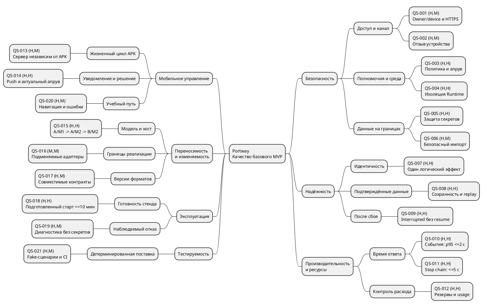
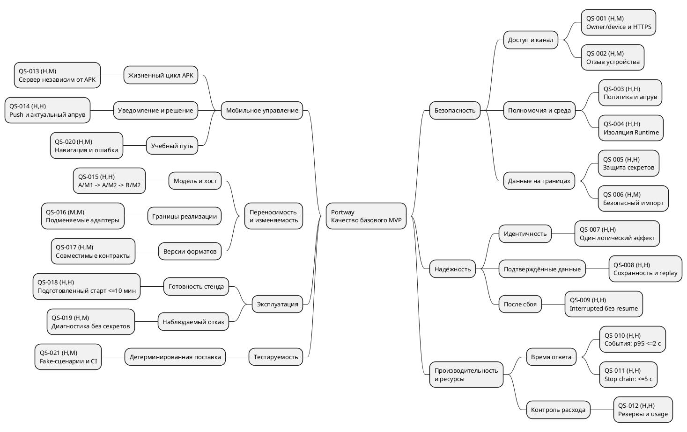

# Portway — [сценарии качества][g-quality-scenario] и [Utility Tree][g-quality-scenario]

| Поле | Значение |
|---|---|
| Артефакт | [DOC-013][id-doc-013] · [Сценарии качества][g-quality-scenario] (6 частей) и [Utility Tree][g-quality-scenario] |
| Версия и дата | v0.4 · 10.10.2026 |
| Роль документа | Справочный материал; использовать по необходимости, без самостоятельной очереди работ; актуальный состав — [навигатор](README.md#existing) |
| Статус | Подготовлен проект для базового [MVP][g-mvp]; оценки предварительные, испытания и согласование [владельцем][g-owner] не заявляются |
| [Владелец][g-owner] | [Владелец][g-owner] проекта; подготовка и технические оценки — [ИИ-агент][g-development-agent] |
| Основания | [SRS](03-software-requirements-specification.md), [SMART](04-smart-goals-and-metrics.md), [MoSCoW](05-moscow-prioritization.md), [Use Case](12-use-case-diagrams-and-specifications.md), [риски v0](11-initial-risk-register.md#risks), [ТЗ](02-technical-specification.md) |
| Далее | [DOC-020 — архитектура и решения](20-architecture-and-decisions.md); [сокращённый план](README.md#remaining) |

Сценарии [QS-001][id-qs-001]–021 конкретизируют все **24 [NFR][g-requirement-ids]** действующей [SRS][g-requirement-ids]. Формулировки задают проверяемый ответ системы в определённых условиях; они не являются результатами проверки. Требования и defaults не меняются. [GitHub][g-github], отдельный [Runner][g-runner], расписания и [Prometheus/Grafana][g-observability-tools] остаются за границей базового [MVP][g-mvp]. Локальные связи [QS][g-quality-scenario]↔[NFR][g-requirement-ids]/[UC][g-use-case] связаны с RTM, тест-кейсами и ПМИ [DOC-057][id-doc-057] (разделы сводного [DOC-057][id-doc-057]; прежние [DOC-015][id-doc-015]/059/071 не требуют отдельных файлов).

## Состав документации

Подготовлены все восемь сводных контрактов сокращённого плана; всего 22 проектных артефакта. [Состав и актуальный остаток](README.md#remaining), [сопоставление прежних DOC-ID](01-product-backlog.md#legacy-registry). Новых обязательных проектных документов в очереди нет. Следующая работа — реализация и проверки; [BL][g-work-ids]/[CW][g-work-ids] и все [TC][g-acceptance]/[AC][g-acceptance] остаются неподтверждёнными.

## 1. Метод и правила оценки

### 1.1. Шесть частей сценария

«6 частей» в реестре означает шесть полей **каждого** сценария, а не ограничение числа сценариев до шести. Используется структура из приложения A отчёта SEI [Deriving Architectural Tactics, CMU/SEI-2003-TR-004, печатная с. 43](https://www.sei.cmu.edu/documents/704/2003_005_001_14213.pdf):

| Поле | Что фиксируем в Portway |
|---|---|
| Источник | Кто или что создаёт воздействие: [владелец][g-owner], [модель][g-model], доставка [сообщения][g-message], сеть, оператор/[CI][g-ci-cd] |
| Воздействие | Конкретный запрос, изменение, отказ или конкурирующее действие |
| Условия | Состояние системы, нагрузка, подготовленность окружения и действующие ограничения |
| Артефакт | Затронутая система/подсистема, данные или интерфейс |
| Ответ | Наблюдаемое поведение Portway при воздействии |
| Мера ответа | Как отличить выполнение от нарушения требования; порог или проверяемый инвариант |

Первые пять полей определяют контекст, последнее — критерий. Если [SRS][g-requirement-ids] не задаёт временной SLA, здесь не придумывается новый. Для безопасности/сохранности используются количества запрещённых эффектов, дубликатов или утечек **на определённом наборе проверок**. Нулевой результат этого набора не является доказательством отсутствия любых возможных угроз.

### 1.2. Два измерения [Utility Tree][g-quality-scenario]

Дерево имеет четыре уровня: **полезность Portway → атрибут качества → уточнение → конкретный [QS][g-quality-scenario]**. Пара `(I,D)` означает важность сценария для продукта и предполагаемую трудность достижения при выбранной архитектуре; H/M/L — высокая/средняя/низкая. Такая структура и пары описаны в SEI [Using the SEI ATAM to Evaluate WIN-T, CMU/SEI-2005-TN-027, § 4.5](https://sei.cmu.edu/documents/2080/2005_004_001_14522.pdf).

| Измерение | H | M | L |
|---|---|---|---|
| I · важность | Нарушает обязательный сценарий защиты, контроль исполнения, данные или перенос | Существенно для инженерной поддержки/изменения, но не отдельный главный пользовательский результат | Ограниченный эффект для текущего среза |
| D · трудность | Между несколькими границами доверия, конкурентными исполнителями или реальными внешними зависимостями; необходим ранний эксперимент | Проверяется в ограниченной подсистеме по известному контракту/методике | Простое локальное правило с малым числом зависимостей |

Оценки назначены [агентом][g-development-agent] на основе [D-01][id-d-01]–21, [NFR][g-requirement-ids] и [RSK-01][id-rsk-01]–16; это **проектная оценка**, не голосование [стейкхолдеров][g-actors], не оценка человеко-часов и не проведённая ATAM-экспертиза. Все перечисленные [QS][g-quality-scenario] относятся к [M-требованиям][g-priorities]. Даже `(M,M)` не переводит [NFR][g-requirement-ids] в [Should][g-priorities] и не разрешает пропускать его приёмку. После выбора [моделей][g-model]/[хостов][g-host] и первых измерений оценки можно уточнить, сохраняя ID.

## 2. Реестр сценариев и оценок

| ID | Атрибут / уточнение | Сценарий | I | D | Основные [NFR][g-requirement-ids] |
|---|---|---|---|---|---|
| [QS-001][id-qs-001] | Безопасность / доступ и канал | Защитить [API][g-api] от неподтверждённого [owner][g-owner]/device и неверного [TLS][g-https] | H | M | [NFR-005][id-nfr-005] |
| [QS-002][id-qs-002] | Безопасность / отзыв доступа | Прекратить доступ отозванного устройства | H | M | [NFR-005][id-nfr-005]/019 |
| [QS-003][id-qs-003] | Безопасность / [политика][g-policy] и разрешение | Отклонить повышение прав и разрешить только актуальное действие | H | H | [NFR-004][id-nfr-004]/007 |
| [QS-004][id-qs-004] | Безопасность / изоляция | Ограничить настоящий [Runtime][g-runtime] и его ресурсы | H | H | [NFR-003][id-nfr-003] |
| [QS-005][id-qs-005] | Безопасность / [секреты][g-secret] | Хранить [секреты][g-secret] зашифрованно и исключить утечки на границах | H | H | [NFR-001][id-nfr-001]/002 |
| [QS-006][id-qs-006] | Безопасность / [импорт][g-export-import] | Безопасно разобрать ограниченный [пакет][g-package] | H | M | [NFR-021][id-nfr-021] |
| [QS-007][id-qs-007] | Надёжность / идентичность действий | Не повторить логический [run][g-run]/[review][g-review]/решение при дублировании | H | H | [NFR-007][id-nfr-007] |
| [QS-008][id-qs-008] | Надёжность / сохранность и [replay][g-sse] | Восстановить подтверждённые данные и поток | H | H | [NFR-006][id-nfr-006] |
| [QS-009][id-qs-009] | Надёжность / восстановление после сбоя | Сверить [interrupted][g-interrupted] и не продолжить старые действия | H | H | [NFR-024][id-nfr-024]/006 |
| [QS-010][id-qs-010] | Производительность и ресурсы / задержка | Отобразить сохранённые [события][g-event] с [p95][g-evidence] ≤2 с | H | H | [NFR-008][id-nfr-008] |
| [QS-011][id-qs-011] | Производительность и ресурсы / отмена | Прекратить управляемую [цепочку][g-chain] за ≤5 с | H | H | [NFR-009][id-nfr-009] |
| [QS-012][id-qs-012] | Производительность и ресурсы / бюджет | Ограничить конкурентные расходы и неизвестный [usage][g-usage] | H | H | [NFR-010][id-nfr-010] |
| [QS-013][id-qs-013] | Мобильное управление / независимость клиента | Продолжить серверную работу при закрытии [APK][g-apk] | H | M | [NFR-011][id-nfr-011] |
| [QS-014][id-qs-014] | Мобильное управление / [push][g-push] и актуальность | Получить реальный [push][g-push] и открыть действующий [апрув][g-approval] | H | H | [NFR-011][id-nfr-011]/019 |
| [QS-015][id-qs-015] | [Переносимость][g-portability] и изменяемость / перенос | Сохранить конфигурацию на [A/M1 → A/M2 → B/M2][g-portability] | H | H | [NFR-017][id-nfr-017] |
| [QS-016][id-qs-016] | [Переносимость][g-portability] и изменяемость / адаптеры | Заменить [Provider][g-provider]/[Runtime][g-runtime] без переписывания бизнес-правил | M | M | [NFR-016][id-nfr-016] |
| [QS-017][id-qs-017] | [Переносимость][g-portability] и изменяемость / контракты | Обработать поддержанные форматы и отклонить несовместимые | H | M | [NFR-020][id-nfr-020] |
| [QS-018][id-qs-018] | Эксплуатация / подготовленный старт | Запустить стенд с проверками конфигурации/[миграций][g-environment] за ≤10 мин | H | H | [NFR-012][id-nfr-012]–014/022 |
| [QS-019][id-qs-019] | Эксплуатация / диагностика | Объяснить отказ зависимости через защищённый сервис | H | M | [NFR-018][id-nfr-018]/002 |
| [QS-020][id-qs-020] | Мобильное управление / понятность интерфейса | Пройти учебный путь и понять ошибку/ожидание | H | M | [NFR-019][id-nfr-019] |
| [QS-021][id-qs-021] | Тестируемость / поставка | Детерминированно проверить обязательный backend-срез и сбой [CI][g-ci-cd] | H | M | [NFR-015][id-nfr-015]/023 |

## 3. [Utility Tree][g-quality-scenario]

В листьях указаны устойчивые QS-ID и пары `(I,D)`. Уточнения группируют сценарии; длина ветви и её расположение не означают вес или готовность. Это дерево требований к качеству, а не [UML][g-uml], [BPMN][g-architecture-notations], [WBS][g-planning] работ или схема взаимодействия компонентов. Визуализация использует [синтаксис PlantUML MindMap](https://plantuml.com/mindmap-diagram); PNG и SVG получены из встроенного исходника.

[Масштабируемая версия дерева (SVG)](diagrams/13-quality/utility-tree.svg).

## 4. Сценарии безопасности

### [QS-001][id-qs-001] · Защитить [API][g-api] и канал `(H,M)`

| Часть | Спецификация |
|---|---|
| Источник | [Владелец][g-owner] через [APK][g-apk] либо неподтверждённый клиент/другой [Supabase][g-supabase] user |
| Воздействие | Запрос к защищённой операции/потоку; попытка регистрации без [setup-доступа][g-device-session]; подключение [APK][g-apk] к [API][g-api] с неверным сертификатом |
| Условия | Подготовленная [установка][g-host] с одним [owner][g-owner], реальный HTTPS-маршрут телефона; действительная и недействительная [auth][g-auth]/[device-сессии][g-device-session] представлены в проверках |
| Артефакт | [Go][g-go] [API][g-api]/access control, bootstrap, [SSE][g-sse], HTTPS-клиент [APK][g-apk] |
| Ответ | Сервер допускает только привязанного [owner][g-owner] с действующим device-доступом; отклоняет чужой ID/отсутствие доступа; [APK][g-apk] проверяет сертификат. Минимальный публичный healthcheck не раскрывает защищённые данные |
| Мера ответа | 0 успешных защищённых чтений/изменений/подписок для всех отрицательных проверок; 0 вторых [owner][g-owner] при конкурирующем bootstrap; неверный [TLS][g-https] не принят; положительный вход [владельца][g-owner] работает. Измерения по [MX-07][id-mx-07], временной SLA входа не вводится |

**Связи:** [NFR-005][id-nfr-005]; [FR-001][id-fr-001]/002/081/090; [UC-001][id-uc-001]/002/007/008/018; [BL-009][id-bl-009]/100/121; [SM-01][id-sm-01]/02/08; [RSK-06][id-rsk-06]/10. Точный bootstrap/callback-контракт — [DOC-036][id-doc-036]/046; успешная регистрация чужого аккаунта в [Supabase][g-supabase] сама по себе не даёт доступ к Portway.

### [QS-002][id-qs-002] · Прекратить доступ отозванного устройства `(H,M)`

| Часть | Спецификация |
|---|---|
| Источник | [Владелец][g-owner] либо уже отозванное устройство |
| Воздействие | Logout/серверный отзыв, затем защищённый запрос, открытый [SSE][g-sse] и новый запрос персонального [push][g-push] |
| Условия | До отзыва сессия действовала и поток был открыт; момент фиксации отзыва известен серверу |
| Артефакт | [Device-сессия][g-device-session], access checks, [SSE][g-sse], push-привязка и локальное состояние [APK][g-apk] |
| Ответ | Следующие защищённые запросы отклоняются, поток закрывается, [push token][g-push-token] отвязывается. [APK][g-apk] очищает локальный доступ и показывает вход; Back не возвращает защищённый экран |
| Мера ответа | [SSE][g-sse] закрыт не позже 5 с после фиксации отзыва; 0 новых разрешённых защищённых операций и новых адресованных этой [device-сессии][g-device-session] [push][g-push] после отзыва; защищённый экран недоступен после локального выхода. Если серверный отзыв при [offline][g-self-hosted] не подтверждён, это явно показано, а не объявлено завершённым |

**Связи:** [NFR-005][id-nfr-005]/019; [FR-003][id-fr-003]/085; [UC-004][id-uc-004]/008/013/014; [BL-100][id-bl-100]/124/125; [SM-02][id-sm-02]/08; [RSK-10][id-rsk-10]. Уже отправленное во внешнюю [FCM][g-push] уведомление нельзя считать отозванным задним числом: открытие всё равно перечитывает объект после проверки доступа.

### [QS-003][id-qs-003] · Отклонить повышение прав и применить только актуальный [апрув][g-approval] `(H,H)`

| Часть | Спецификация |
|---|---|
| Источник | [Модель][g-model], межагентное [сообщение][g-message]/MCP-ответ, [владелец][g-owner] и конкурирующие серверные обработчики |
| Воздействие | Недоверенный текст требует расширить права/подменить [approve][g-approval-decision]; одновременно приходят [approve][g-approval-decision]/[reject][g-approval-decision]/[timeout][g-timeout]/[stop][g-cancelled]; аргументы или действующий запрет меняются |
| Условия | [Run][g-run] ожидает [апрув][g-approval] с deadline 180 с; [инструмент][g-tool] ещё не выдан [Runtime][g-runtime]; права получателя и аргументы зафиксированы |
| Артефакт | [Политика][g-policy] [control plane][g-control-plane]/[Runtime][g-runtime], [Approval][g-approval], [ToolCall][g-tool], [Harness][g-harness] |
| Ответ | Текст не повышает права. Одно актуальное решение фиксируется с проверкой [владельца][g-owner], [run][g-run], аргументов, deadline и запретов. [Reject][g-approval-decision]/[timeout][g-timeout] запрещают исходное действие; альтернатива заново проверяется, [stop][g-cancelled]/budget прекращают её поиск |
| Мера ответа | На отрицательном наборе [MX-05][id-mx-05]/07 — 0 запрещённых [tool][g-tool] effects, включая поздний [approve][g-approval-decision], подмену аргументов и повтор идентичного отказанного действия; на гонке — одно зафиксированное применимое решение и не более одного обычного исполнения разрешённого действия. Реальный deadline 180 с проверен хотя бы один раз; остальные гонки допускают управляемые часы |

**Связи:** [NFR-004][id-nfr-004]/007; [FR-037][id-fr-037]–043/046/049; [UC-007][id-uc-007]/011/012; [BL-050][id-bl-050]–054/066/112; [SM-04][id-sm-04]/05/08; [RSK-07][id-rsk-07]/09. Read-only [reviewer][g-main-roles] остаётся read-only. Default — не более двух последовательных отказанных альтернатив; неизвестный внешний эффект не получает обещания exactly-once.

### [QS-004][id-qs-004] · Ограничить настоящий [Runtime][g-runtime] и его ресурсы `(H,H)`

| Часть | Спецификация |
|---|---|
| Источник | Предложенный [tool call][g-tool] или devcontainer-конфигурация [задачи][g-task] |
| Воздействие | Попытка чтения host/чужой [workspace][g-workspace]/host socket, privileged или lifecycle [hook][g-hook]; превышение CPU/RAM/времени; запрос запрещённой сети |
| Условия | Настоящий [Runtime][g-runtime] на исходном [хосте][g-host]; до двух [контейнеров][g-sandbox], каждому 2 [vCPU][g-host-resources] и 1 [GiB][g-host-resources] RAM; [модель][g-model]/сборка [APK][g-apk] учитываются отдельно |
| Артефакт | [Контейнер][g-sandbox], [workspace][g-workspace], [devcontainer][g-devcontainer] validator, сетевые/ресурсные ограничения, остановка процессов |
| Ответ | Запрещённая конфигурация отклоняется до исполнения; [инструмент][g-tool] запускается [non-root][g-host-resources] с ограниченными путями/сетью/ресурсами; превышение и остаточные процессы наблюдаемы |
| Мера ответа | 0 доступов к запрещённым host-путям/socket/чужой [workspace][g-workspace] и 0 исполненных запрещённых [hooks][g-hook] в выбранных probes; фактические CPU/RAM/время и запрет сети проверены отдельно. Разрешённые файловые/test/git/[MCP][g-mcp] действия работают в своей [workspace][g-workspace]; [Fake][g-fixture] [Runtime][g-runtime] доказательством изоляции не считается |

**Связи:** [NFR-003][id-nfr-003]; [FR-030][id-fr-030]–036; [UC-007][id-uc-007]/009/018/019; [BL-040][id-bl-040]–042/044/045; [SM-03][id-sm-03]/08; [RSK-07][id-rsk-07]. Разрешённое подмножество [devcontainer][g-devcontainer] и каталог команд детализируются в [DOC-042][id-doc-042]/045; поддержка полного [devcontainer][g-devcontainer] не предполагается.

### [QS-005][id-qs-005] · Защитить хранимые [секреты][g-secret] и пути их выдачи `(H,H)`

| Часть | Спецификация |
|---|---|
| Источник | [Владелец][g-owner]/оператор, запросы [API][g-api], [экспорт][g-export-import], диагностика и [Runtime][g-runtime] |
| Воздействие | Сохранение маркерных [LLM][g-model]/DB/[FCM-секретов][g-secret], чтение обычных записей [БД][g-supabase], вызовы защищённых [API][g-api], логирование, [экспорт][g-export-import] и [запуск][g-run] [инструментов][g-tool] |
| Условия | Тестовые уникальные маркеры известны системе; ключевой материал и доступ к расшифрованию отделены от обычного чтения данных |
| Артефакт | [Secret][g-secret] storage, [шлюз][g-gateway], [API][g-api] serializers, [аудит][g-audit]/[логи][g-audit], Package, [APK][g-apk] и окружение [Runtime][g-runtime] |
| Ответ | [Секреты][g-secret] [LLM][g-model] хранятся зашифрованно; наружу после сохранения выдаются ссылки/маскированные сведения. Серверные [секреты][g-secret] не попадают в [APK][g-apk], [пакет][g-package] или [инструменты][g-tool]; [шлюз][g-gateway] использует разрешённый [credential][g-secret] в своей границе |
| Мера ответа | Значения [LLM][g-model] не читаются в открытом виде обычной выгрузкой хранилища; 0 маркерных [секретов][g-secret] на запрещённых поверхностях [MX-07][id-mx-07], включая ошибки/отладку. Отдельно проверены права и исключение секретных полей. Алгоритм/мастер-ключ должны быть определены в [DOC-046][id-doc-046] до реализации |

**Связи:** [NFR-001][id-nfr-001]/002; [FR-011][id-fr-011]/061/089/090; [UC-006][id-uc-006]/007/015/018/019; [BL-025][id-bl-025]/081/103; [SM-06][id-sm-06]/08; [RSK-08][id-rsk-08]. Скрытые неизвестные [секреты][g-secret] в свободном тексте не обещано распознавать безошибочно. Git [credential][g-secret] относится только к условному [S-расширению][g-priorities], его исключение не расширяет доступ обычного shell.

### [QS-006][id-qs-006] · Безопасно разобрать ограниченный [пакет][g-package] `(H,M)`

| Часть | Спецификация |
|---|---|
| Источник | [Владелец][g-owner] через [Android][g-flutter] picker; содержимое импортируемого ZIP считается недоверенным |
| Воздействие | [Пакет][g-package] содержит traversal/symlink, неизвестную версию, исполняемый код либо превышает размер/число элементов |
| Условия | [Импорт][g-export-import] на исходной/целевой [установке][g-host]; staging изолирован; существующие активные конфигурации доступны для сверки |
| Артефакт | Package validator/unpacker, staging и подтверждение конфигурации |
| Ответ | До активации проверяются версия/состав/пути и ограничения; включённый код/инструкции не исполняются. Отклонение/отмена не подменяют действующего [агента][g-agent]; нерешённые зависимости явно блокируют [запуск][g-run] |
| Мера ответа | ZIP ≤10 [MiB][g-host-resources], распакованный состав ≤25 [MiB][g-host-resources] и ≤1000 файлов; граничные допустимые и превышающие значения проверены. В отрицательных [пакетах][g-package] — 0 выходов из staging, 0 исполнений включённого кода и 0 скрытых изменений активной конфигурации; валидный мобильный [импорт][g-export-import] работает по [MX-06][id-mx-06]/07 |

**Связи:** [NFR-021][id-nfr-021]; [FR-062][id-fr-062]/063/077; [UC-016][id-uc-016]; [BL-082][id-bl-082]/083/114; [SM-06][id-sm-06]/08; [RSK-11][id-rsk-11]. Окончательные правила staging/commit и повторов [импорта][g-export-import] — [DOC-036][id-doc-036]/038; [run][g-run] request key не объявляется универсальной гарантией всех методов.

## 5. Сценарии надёжности и сохранности

### [QS-007][id-qs-007] · Сохранить один логический эффект при повторах `(H,H)`

| Часть | Спецификация |
|---|---|
| Источник | [APK][g-apk] после потерянного ответа, [outbox][g-outbox] и конкурирующие обработчики [сообщений][g-message]/[хуков][g-hook] |
| Воздействие | Десять повторов одной операции/[сообщения][g-message]/[события][g-event], включая конкурентные; тот же ID с другим [payload][g-payload] |
| Условия | Повторы в допустимом окне: request key/[dedupe][g-idempotency] 7 суток, доставка [сообщения][g-message] ≤24 ч; исходная топология разрешена |
| Артефакт | Создание [Run][g-run], [outbox][g-outbox]/deduplication, [hook][g-hook]→[reviewer-run][g-run], решение [апрува][g-approval] |
| Ответ | Та же идентичность и параметры возвращают прежний логический результат; конфликт отклоняется. Принятый [хук][g-hook] создаёт один [reviewer-run][g-run]; повтор решения не выдаёт второй [инструмент][g-tool] |
| Мера ответа | По [MX-04][id-mx-04]: один [run][g-run] для ключа создания, один [review][g-review] для [события][g-event] [хука][g-hook] и одно применимое решение; конфликт [payload][g-payload] не создаёт новый эффект. После [stop][g-cancelled] отложенная доставка не создаёт новую работу [цепочки][g-chain]. Истёкшее окно повторов не выдаётся за бессрочную [идемпотентность][g-idempotency] |

**Связи:** [NFR-007][id-nfr-007]; [FR-019][id-fr-019]/041/043/047/050/054; [UC-007][id-uc-007]/009/011/012/020; [BL-030][id-bl-030]/054/061/062/065/069; [SM-04][id-sm-04]/05/08; [RSK-09][id-rsk-09]. Гарантия касается внутреннего логического эффекта, а не произвольной внешней операции с неизвестным исходом.

### [QS-008][id-qs-008] · Восстановить подтверждённые данные и поток `(H,H)`

| Часть | Спецификация |
|---|---|
| Источник | Сеть/[APK][g-apk] и [владелец][g-owner] после переподключения |
| Воздействие | Обрыв [SSE][g-sse] после сохранения [событий][g-event]; повтор чтения версии/решения; подключение с сохранённым либо истёкшим [курсором][g-sse] |
| Условия | Данные подтверждены [БД][g-supabase]; [события][g-event]/ключи сохраняются 7 суток, [аудит][g-audit] 30 суток; известен [run_id][g-run-id]/[курсор][g-sse]. Расширенная история S не требуется |
| Артефакт | [PostgreSQL][g-supabase], [AgentVersion][g-agent-version], решения, [Event][g-event] store/[SSE][g-sse] и локальная лента [APK][g-apk] |
| Ответ | Подтверждённые данные читаются с прежней идентичностью; [события][g-event] [replay][g-sse] сохраняют порядок внутри [run][g-run], дубли не добавляют вторую строку. Недоступный [курсор][g-sse] даёт явную неполноту и актуальное состояние |
| Мера ответа | Все сохранённые последующие [события][g-event] в доступном окне получены без потерь/дубликатов в отображении; версии/решения не изменились от переподключения; истёкший [курсор][g-sse] явно отклонён. Окна хранения проверяются управляемыми часами; частичная лента не объявляется полной |

**Связи:** [NFR-006][id-nfr-006]; [FR-008][id-fr-008]/021–023/067; [UC-005][id-uc-005]/008/012; [BL-012][id-bl-012]/032/052/111; [SM-04][id-sm-04]/08/09; [RSK-06][id-rsk-06]/14. Изменение версии не переписывает снимок существующего [run][g-run]. Рабочий результат хранится 24 ч после завершения; материалы защиты копируются отдельно до очистки.

### [QS-009][id-qs-009] · Сверить [interrupted][g-interrupted] без продолжения старого цикла `(H,H)`

| Часть | Спецификация |
|---|---|
| Источник | Сбой процесса/[хоста][g-host] и оператор, запускающий сервер заново |
| Воздействие | Рестарт при двух незавершённых [run][g-run], включая ожидающий [апрув][g-approval]/[инструмент][g-tool] с возможным неизвестным внешним эффектом |
| Условия | Состояния записаны в [БД][g-supabase]; доступны зависимости для [reconciliation][g-recovery]; активных [run][g-run] ≤2 |
| Артефакт | Startup/[recovery][g-recovery], [Run][g-run]/[Approval][g-approval], [Runtime][g-runtime] [cleanup][g-cleanup], ручной повтор [задачи][g-task] |
| Ответ | До новой работы прерванные [run][g-run] помечаются [`failed`][g-interrupted] с причиной [`interrupted`][g-interrupted], [апрувы][g-approval] инвалидируются; старый [Harness][g-harness]/опасная команда не повторяются. Неопределённый эффект и незавершённая уборка видны; продолжение возможно новым ручным [run][g-run] |
| Мера ответа | Целевая сверка ≤10 с при заданных условиях; все прерванные [run][g-run]/[апрувы][g-approval] обработаны, 0 автоматически продолженных старых циклов и 0 повторов опасного эффекта. Новый ручной [запуск][g-run] имеет новый ID; terminal состояния прежних [run][g-run] сохранены. Ошибка сверки не маскируется готовностью |

**Связи:** [NFR-024][id-nfr-024]/006; [FR-029][id-fr-029]/035; [UC-019][id-uc-019]/020; [BL-036][id-bl-036]/044; [SM-08][id-sm-08]; [RSK-14][id-rsk-14]. Время уборки и неизвестность внешнего эффекта фиксируются отдельно; окончательное восстановление данных/backup — будущие [DOC-047][id-doc-047]/056, новый HA/SLA не вводится.

## 6. Сценарии производительности и контроля ресурсов

### [QS-010][id-qs-010] · Отобразить [событие][g-event] с [p95][g-evidence] ≤2 с `(H,H)`

| Часть | Спецификация |
|---|---|
| Источник | [Control plane][g-control-plane], фиксирующий [событие][g-event] [запуска][g-run] |
| Воздействие | Поток сохранённых [событий][g-event] по реальному HTTPS-маршруту поступает подключённому [APK][g-apk] |
| Условия | [PERF-01][g-smart]: CachyOS/i5-13420H/16 GB, [Android 16][g-flutter], два активных [run][g-run], один [APK][g-apk], 10 [событий][g-event]/с на [цепочку][g-chain]; базовый вариант — одна [цепочка][g-chain]; прогрев выполнен |
| Артефакт | Запись [Event][g-event], публикация/[SSE][g-sse], получение и отображение в [APK][g-apk] |
| Ответ | Каждое [событие][g-event] со стабильным ID отображается и связывается с [run][g-run]/[chain][g-chain], задержка измеряется от серверной фиксации до отображения |
| Мера ответа | По [MX-02][id-mx-02] в каждом из трёх прогонов N≥1000; nearest-rank [p95][g-evidence] — элемент ceil(0.95×N) — ≤2000 мс. Часы сопоставимы, погрешность/сеть/[payload][g-payload] записаны; неполученные [события][g-event] отражаются как ошибки, не исключаются ради [p95][g-evidence] |

**Связи:** [NFR-008][id-nfr-008]; [FR-022][id-fr-022]/023/067; [UC-008][id-uc-008]; [BL-032][id-bl-032]/111; [SM-09][id-sm-09]; [RSK-06][id-rsk-06]/15. Время генерации [модели][g-model] и [FCM][g-push] исключено. Обрывы/[replay][g-sse] — [QS-008][id-qs-008]; последовательное [coder][g-main-roles]→[reviewer][g-main-roles] демо отдельно от нагрузочного профиля двух активных [run][g-run].

### [QS-011][id-qs-011] · Прекратить управляемую [цепочку][g-chain] за ≤5 с `(H,H)`

| Часть | Спецификация |
|---|---|
| Источник | [Владелец][g-owner], отправляющий [stop][g-cancelled] [chain][g-chain] |
| Воздействие | Сервер фиксирует остановку [цепочки][g-chain] при [инструменте][g-tool], ожидании [LLM][g-model], [апруве][g-approval] либо очереди [сообщений][g-message] |
| Условия | Реальный [Runtime][g-runtime], все активные [run][g-run] [цепочки][g-chain] известны; в выборке представлены указанные виды ожидания/работы |
| Артефакт | [Chain][g-chain]/[Harness][g-harness] cancellation, [LLM][g-model] adapter, [Runtime][g-runtime] processes, выдача [сообщений][g-message]/дочерних [run][g-run] |
| Ответ | Новая работа запрещается, локально управляемые процессы/[шаги][g-step] прекращаются; поздний [approve][g-approval-decision]/[хук][g-hook]/[сообщение][g-message] не оживляют [цепочку][g-chain]. Неизвестный внешний эффект остаётся отдельно обозначенным |
| Мера ответа | По [MX-03][id-mx-03] для 10 уникальных цепочек максимум от фиксации [stop][g-cancelled] до прекращения управляемой работы ≤5 с; затем 10 с наблюдения и отложенное [сообщение][g-message] — 0 возобновлений/новых [run][g-run]. Ответ «[stop][g-cancelled] принят» не заменяет проверки процессов |

**Связи:** [NFR-009][id-nfr-009]; [FR-024][id-fr-024]/035/054; [UC-009][id-uc-009]/011/012; [BL-033][id-bl-033]/044/065; [SM-09][id-sm-09]; [RSK-09][id-rsk-09]/15. Уже совершённый внешний эффект не откатывается этим сценарием; [stop][g-cancelled] одного [run][g-run] и [stop][g-cancelled] всей [chain][g-chain] имеют разные области.

### [QS-012][id-qs-012] · Ограничить конкурентные резервы и неизвестный [usage][g-usage] `(H,H)`

| Часть | Спецификация |
|---|---|
| Источник | Параллельные [Harness][g-harness], модельный сервис с неполным [usage][g-usage], входящая передача/делегирование |
| Воздействие | Два [run][g-run] запрашивают один остаток [chain][g-chain]; ответ не содержит надёжного расхода; попытка следующего [шага][g-step] при предельном budget/time/[hops][g-hops]/[depth][g-depth] |
| Условия | Defaults [SRS][g-requirement-ids] § 4.2: [run][g-run]/[chain][g-chain] 20 000/40 000 токенов, 20/40 [шагов][g-step], 15/30 мин wall-clock; output cap 2048; [hops][g-hops]/[depth][g-depth] 8/2; резерв input+разрешённый output |
| Артефакт | [Бюджет Run/Chain][g-budget], [LLM][g-model] gateway, reservations, серверные counters и отмена |
| Ответ | Резерв атомарно выдаётся до конкурентного вызова и уточняется/освобождается по результату. Неизвестный [usage][g-usage] помечается оценкой/источником; при невозможности ограничить расход следующий платный вызов блокируется с [`budget_uncertain`][g-budget]. Общие лимиты не сбрасываются новым [сообщением][g-message] |
| Мера ответа | По [MX-04][id-mx-04]/07: один остаток не выдан двум работам; новые вызовы сверх доступного резерва/времени/[шагов][g-step] запрещены; неполный [usage][g-usage] не учитывается как ноль. Для [hops][g-hops]/[depth][g-depth]/budget проверены значения до/на границе и попытка превышения; отказ виден с сохранённым [correlation_id][g-chain] |

**Связи:** [NFR-010][id-nfr-010]; [FR-015][id-fr-015]/025/026/051–054; [UC-007][id-uc-007]/009/011/012; [BL-023][id-bl-023]/034/064/065; [SM-04][id-sm-04]/08; [RSK-12][id-rsk-12]. Это контроль выдачи работы и расходов, не обещание нулевого денежного перерасхода внешнего [provider][g-provider]. Бюджет на весь [provider][g-provider] — отдельное [S-расширение][g-priorities].

## 7. Сценарии мобильного управления

### [QS-013][id-qs-013] · Продолжить серверную работу при закрытии [APK][g-apk] `(H,M)`

| Часть | Спецификация |
|---|---|
| Источник | [Владелец][g-owner]/жизненный цикл [Android][g-flutter] |
| Воздействие | Обычное закрытие [APK][g-apk] во время работы либо [ожидания апрува][g-awaiting-approval]; позднее повторное открытие |
| Условия | Сервер/зависимости доступны; [run][g-run]/[chain][g-chain] имеют остаток бюджета; положительная push-проверка не использует системный [force-stop][g-app-lifecycle] |
| Артефакт | Серверный [Harness][g-harness]/таймеры, сохранённый [Run][g-run]/[Approval][g-approval] и восстановление [APK][g-apk] |
| Ответ | Закрытие [APK][g-apk] не останавливает [run][g-run], не разрешает действие и не останавливает server-side deadline. При открытии клиент перечитывает актуальные данные/[события][g-event] |
| Мера ответа | Разрешённая серверная работа продолжается без клиента; 0 исполнений неподтверждённого действия; [апрув][g-approval] просрочен по server deadline 180 с независимо от телефона. После открытия виден фактический исход/неполнота [replay][g-sse], а не устаревшее локальное состояние |

**Связи:** [NFR-011][id-nfr-011]; [FR-023][id-fr-023]/026/038/067; [UC-007][id-uc-007]/008/012; [BL-030][id-bl-030]/051/111; [SM-03][id-sm-03]/05/08; [RSK-05][id-rsk-05]/06. Закрытие [APK][g-apk] не равно недоступности [хоста][g-host]: [MVP][g-mvp] зависит от сервера, сети, [Supabase][g-supabase] и [FCM][g-push].

### [QS-014][id-qs-014] · Получить реальный [push][g-push] и открыть актуальный [апрув][g-approval] `(H,H)`

| Часть | Спецификация |
|---|---|
| Источник | Серверный запрос [апрува][g-approval], [FCM][g-push] и [владелец][g-owner], нажимающий уведомление |
| Воздействие | Новый [push][g-push] в фоне/[terminated][g-app-lifecycle], повтор/поздняя доставка, смена токена либо отказ [Android-разрешения][g-flutter] |
| Условия | Реальный [Android 16][g-flutter] с Play Services; [owner][g-owner]/device и текущий token привязаны; положительные прогоны имеют разрешение уведомлений и проверенный внешний маршрут |
| Артефакт | [Push][g-push] dispatch/[state][g-uml], [FCM][g-push], [Android][g-flutter] notifications/deep link, [auth][g-auth] и чтение [Approval][g-approval] |
| Ответ | Сигнал доставляется; нажатие открывает [APK][g-apk], при необходимости вход, затем актуальный серверный [апрув][g-approval]. Недоставка/нет разрешения видны; [push][g-push] не содержит разрешения или секретных аргументов |
| Мера ответа | [MX-05][id-mx-05]: три [background][g-app-lifecycle] + три [terminated][g-app-lifecycle] прогона, все 6 получают уведомление до [TTL][g-timeout] 180 с на тестовом маршруте; фиксируются отправка/приём/открытие/актуальность. Отдельные negatives (stale [push][g-push], [deny][g-approval-decision] permission, logout/token refresh, late [approve][g-approval-decision]) дают 0 запрещённых [tool][g-tool] effects |

**Связи:** [NFR-011][id-nfr-011]/019; [FR-068][id-fr-068]/075/076/086; [UC-012][id-uc-012]–014; [BL-053][id-bl-053]/112/116/125; [SM-05][id-sm-05]; [RSK-05][id-rsk-05]. Любой неудачный прогон остаётся в отчёте; [Fake][g-fixture] [FCM][g-push]/ответ сервера не заменяют приём телефоном. TTL-порог — тестовая цель [SMART][g-smart], не SLA гарантированной доставки внешнего [FCM][g-push]; [force-stop][g-app-lifecycle] исключён из положительной выборки.

### [QS-020][id-qs-020] · Пройти учебный путь и понять ошибку/ожидание `(H,M)`

| Часть | Спецификация |
|---|---|
| Источник | [Владелец][g-owner] через [Android][g-flutter] [APK][g-apk] |
| Воздействие | Регистрация/вход, переходы главной/разделов/профиля, пустые данные, ошибка сети, [ожидание апрува][g-awaiting-approval] и logout |
| Условия | [APK][g-apk] на [Android 16][g-flutter], чистый тестовый стенд для регистрации; состояния с/без актуальной сессии и недоступного [API][g-api] представлены |
| Артефакт | Splash, формы, навигация/Back, профиль, лента, [апрувы][g-approval], [пакет][g-package] и состояние сервиса |
| Ответ | Состояние/ошибка показываются текстом; основные переходы и возврат работают. Видны [инструмент][g-tool], значимые аргументы и актуальность [апрува][g-approval]; пользователь может повторить доступную операцию/исправить URL/войти |
| Мера ответа | Учебный путь КМ07 пройден целиком: Splash → регистрация → вход → главная/навигация → профиль → основные функции → выход; 0 неработающих основных кнопок, вечных Splash и возвратов в защищённый экран после logout; пароль/серверные [секреты][g-secret] не показаны. Визуальные и ошибочные состояния проверены по [SM-02][id-sm-02]/05/06 |

**Связи:** [NFR-019][id-nfr-019]; [FR-065][id-fr-065]–070 (M); [FR-077][id-fr-077]/081–086/090; [UC-001][id-uc-001]–005/007–018; [BL-110][id-bl-110]–114/116–118/120–125; [SM-02][id-sm-02]/05/06; [RSK-05][id-rsk-05]/10. Критерии базового результата [FR-070][id-fr-070] применяются без [PR][g-pr]. Точные [User Flow][g-ui]/экраны — [DOC-018][id-doc-018]/061/062, новый норматив скорости обучения не вводится.

## 8. Сценарии [переносимости][g-portability] и изменяемости

### [QS-015][id-qs-015] · Сохранить конфигурацию при смене [модели][g-model] и [хоста][g-host] `(H,H)`

| Часть | Спецификация |
|---|---|
| Источник | [Владелец][g-owner] с телефона и оператор целевого [хоста][g-host] |
| Воздействие | [Экспорт][g-export-import] версии на A/M1, [импорт][g-export-import] с выбором M2 на A, затем [импорт][g-export-import] на другой [control plane][g-control-plane]/[Runtime][g-runtime] B с новыми локальными привязками |
| Условия | Две реальные совместимые [модели][g-model], одна локальная; отдельный B (допустима явно указанная ВМ); фиксированы исходная версия, [fixture][g-fixture]/[ревизия][g-repository]/[задача][g-task] и ожидаемые критерии |
| Артефакт | [Android][g-flutter] [export][g-export-import]/[import][g-export-import], Package, [AgentVersion][g-agent-version]/[Role][g-role], привязки [provider][g-provider]/[secret][g-secret]/[tools][g-tool]/[MCP][g-mcp]/[алиасов][g-secret-reference], целевой [запуск][g-run] |
| Ответ | Переносимые инструкции, [навыки][g-skill], [инструменты][g-tool]/права сохраняют согласованный смысл; [секреты][g-secret]/локальные пути связываются заново. На A/M1, A/M2 и B/M2 выполняется контрольная [задача][g-task] |
| Мера ответа | По [MX-06][id-mx-06] три реальные точки [A/M1 → A/M2 → B/M2][g-portability] имеют результат/[endpoint][g-model-endpoint]/[model][g-model]/host/revision; нормализованные переносимые поля совпадают с согласованным исходником, локальные замены перечислены; 0 секретных значений в [пакете][g-package]. Нерешённая зависимость блокирует [запуск][g-run] и отмечается как незавершённая проверка |

**Связи:** [NFR-017][id-nfr-017]; [FR-060][id-fr-060]–064/077/088; [UC-015][id-uc-015]–017; [BL-080][id-bl-080]–084/114; [SM-06][id-sm-06]/07; [RSK-03][id-rsk-03]/04/11. Другой каталог A и ZIP без целевого [запуска][g-run] не доказывают перенос. Тексты ответов [моделей][g-model] не обязаны совпадать; активный [run][g-run]/полная память не переносятся.

### [QS-016][id-qs-016] · Подменить адаптеры без переписывания бизнес-правил `(M,M)`

| Часть | Спецификация |
|---|---|
| Источник | [ИИ-агент разработки][g-development-agent]/оператор, выбирающий реализацию [Provider][g-provider] или [Runtime][g-runtime] |
| Воздействие | Переключение [Fake][g-fixture] [LLM][g-model]/[Runtime][g-runtime] на выбранные реальные адаптеры либо поддержанную вторую [модель][g-model] |
| Условия | Контракты [Harness][g-harness]/[Runtime][g-runtime]/[Provider][g-provider] опубликованы для реализуемого среза; реальные capabilities явно проверены; нужны только разрешённые изменения конфигурации/точки сборки |
| Артефакт | Границы модулей, adapters/composition, контрактные сценарии |
| Ответ | Прикладные правила [auth][g-auth], [апрувов][g-approval], лимитов и [оркестрации][g-orchestration] используют общий контракт; адаптер нормализует [stream][g-model-protocol]/[tool calls][g-tool]/[usage][g-usage]/errors и сообщает несовместимость |
| Мера ответа | Один набор применимых контрактных сценариев выполнен на [дублёрах][g-fixture] и выбранных реальных адаптерах; 0 необходимых переписываний бизнес-правил из-за замены. Изменения ограничены адаптером, конфигурацией/сборкой и явными capabilities; неподдержанная функция диагностируется, а не имитируется как успешно поддержанная |

**Связи:** [NFR-016][id-nfr-016]; [FR-012][id-fr-012]–016/020/032/033; [UC-006][id-uc-006]/007/017; [BL-005][id-bl-005]/021/023/031/042; [SM-03][id-sm-03]/07/10; [RSK-03][id-rsk-03]/16. Сценарий не обещает поддержку любых [моделей][g-model], CLI-harness или отдельного [Runner][g-runner]; интерфейсы уточняются в [DOC-024][id-doc-024]/043/045.

### [QS-017][id-qs-017] · Обработать поддержанные версии контрактов `(H,M)`

| Часть | Спецификация |
|---|---|
| Источник | [APK][g-apk], модельный адаптер, отправитель межагентного [сообщения][g-message] или импортируемый [пакет][g-package] |
| Воздействие | Валидный либо неизвестный versioned формат, недопустимый [payload][g-payload]/type/отправитель/[алиас][g-secret-reference] и конфликт идентичности |
| Условия | Проверяется конкретная опубликованная версия реализуемого [API][g-api]/[событий][g-event]/[конверта][g-message]/[пакета][g-package]; проектные контракты [DOC-036][id-doc-036]/038 подготовлены; их исполняемые схемы и соответствие коду проверяются [TC-001][id-tc-001]/013/015/026 |
| Артефакт | Boundary validators, serializers, [шлюз][g-gateway] и обработчики [событий][g-event]/[пакета][g-package] |
| Ответ | Поддержанный контракт принимается/выдаётся согласованно; неизвестная версия и невалидные поля отклоняются с понятной причиной до зависимого исполнения. Сервер проверяет отправителя и сам задаёт counters |
| Мера ответа | Все валидные/невалидные примеры опубликованной версии дают ожидаемый исход; 0 скрытых понижений версии/прав и 0 исполнений отклонённого ввода. [Конверт][g-message] ≤64 KiB, неизвестные типы/версии/подменённый sender отклонены. Отчёт фиксирует версию и набор примеров |

**Связи:** [NFR-020][id-nfr-020]; [FR-013][id-fr-013]/016/045/046/062/063; [UC-006][id-uc-006]/007/011/016; [BL-023][id-bl-023]/060/066/080/082/083; [SM-04][id-sm-04]/06/07/10; [RSK-11][id-rsk-11]/16. Совпадение URL [endpoint][g-model-endpoint] не доказывает [model][g-model] compatibility; транспорт/формат не расширяют права.

## 9. Сценарии эксплуатации и тестируемости

### [QS-018][id-qs-018] · Поднять подготовленный стенд с проверкой конфигурации/[миграций][g-environment] `(H,H)`

| Часть | Спецификация |
|---|---|
| Источник | Оператор [установки][g-host] |
| Воздействие | Документированный старт чистой/поддержанной предыдущей схемы, повтор старта, ошибочный env или намеренно неуспешная [миграция][g-environment] |
| Условия | [PERF-01][g-smart]; образы/[модель][g-model] уже загружены, внешние аккаунты/доступы [Supabase][g-supabase]/[FCM][g-push] и [HTTPS][g-https] подготовлены; каждый старт имеет фиксированное исходное состояние |
| Артефакт | [Go][g-go] startup/configuration/readiness, [миграции][g-environment] [Supabase PostgreSQL][g-supabase], [Runtime][g-runtime]/обязательные зависимости |
| Ответ | Конфигурация проверяется без чувствительных значений; [миграции][g-environment] применяются к чистой/поддержанной схеме один раз, проверки зависимостей и [reconciliation][g-recovery] выполняются до готовности. Ошибка не даёт обычный готовый сервер |
| Мера ответа | [MX-01][id-mx-01]: каждый из трёх подготовленных [запусков][g-run] ≤600 с до проверки обязательных компонентов/[API][g-api]; чистая/предыдущая схема и повтор [миграции][g-environment] проверены отдельно. Ошибочные env/[миграция][g-environment]/[БД][g-supabase] блокируют готовность с понятной причиной. Неудачный прогон не исключается; рабочая [БД][g-supabase] остаётся [Supabase][g-supabase] |

**Связи:** [NFR-012][id-nfr-012]–014/022; [FR-029][id-fr-029]/090; [UC-019][id-uc-019]; [BL-003][id-bl-003]/004/006/009/036; [SM-01][id-sm-01]/08; [RSK-02][id-rsk-02]/06/14. Первые загрузки/настройка внешних аккаунтов не входят в 600 с, но остаются работой плана. Готовый healthcheck не доказывает уже пройденные [push][g-push]/две [модели][g-model]/перенос; commands/[compose][g-environment] — [DOC-052][id-doc-052]/071.

### [QS-019][id-qs-019] · Объяснить отказ через защищённый сервис `(H,M)`

| Часть | Спецификация |
|---|---|
| Источник | [Provider][g-provider]/[Runtime][g-runtime]/[БД][g-supabase]/[FCM][g-push], чей отказ воспроизводится; [владелец][g-owner] читает диагностику |
| Воздействие | Ошибка [auth][g-auth]/сети/[инструмента][g-tool], недоставка [push][g-push] либо недоступность [БД][g-supabase]/компонента |
| Условия | Есть [owner][g-owner]/device-доступ; [API][g-api] доступен настолько, чтобы отдать состояние; [run_id][g-run-id]/[correlation_id][g-chain] известны, если отказ относится к работе |
| Артефакт | Внутренний сервис [аудита][g-audit]/состояния, структурные [логи][g-audit] и ошибки [API][g-api], [события][g-event] [Run][g-run] |
| Ответ | Показаны различимые причина/состояние и контекст; для записываемых случаев состояние/[событие][g-event]/[аудит][g-audit] связываются по ID. [Секреты][g-secret] маскируются; неизвестный внешний исход и недоступная диагностика обозначаются явно |
| Мера ответа | Воспроизведённая ошибка каждого обязательного компонента видна через защищённый сервис; доступный контекст позволяет найти соответствующее [событие][g-event]/[аудит][g-audit] там, где запись возможна. 0 маркерных [секретов][g-secret] и 0 выдач защищённой диагностики постороннему; недоступная [БД][g-supabase] не представляется пустым успешным журналом |

**Связи:** [NFR-018][id-nfr-018]/002; [FR-004][id-fr-004]/027/089; [UC-008][id-uc-008]/018/019; [BL-032][id-bl-032]/067/103/104; [SM-08][id-sm-08]; [RSK-02][id-rsk-02]/08/14. При полной недоступности [API][g-api] [APK][g-apk] показывает ошибку, оператор использует локальный [runbook][g-runbook]; во время отказа [БД][g-supabase] сохранённый [аудит][g-audit] не обещается без дополнительного хранилища. Новый SLA восстановления/доступности и обязательные [Grafana][g-observability-tools]/web [UI][g-ui] не вводятся.

### [QS-021][id-qs-021] · Детерминированно проверить backend-срез и отказ [CI][g-ci-cd] `(H,M)`

| Часть | Спецификация |
|---|---|
| Источник | [ИИ-агент разработки][g-development-agent] и [CI][g-ci-cd] после изменения кода |
| Воздействие | Проверка обязательного сценария/отказов/дублей на [Fake][g-fixture] [LLM][g-model]/[Runtime][g-runtime]; контрольное внесение ошибки обязательной проверки |
| Условия | Чистый checkout, фиксированные fixtures/часы/ответы, без настоящих ключей и внешних сетевых вызовов; [GitHub][g-github] S не включён |
| Артефакт | Сборка, format/lint, unit/integration, [Fake][g-fixture] adapters и сквозная [API][g-api]→[LLM][g-model]→[Runtime][g-runtime]→[event][g-event] [фикстура][g-fixture] |
| Ответ | Предсказуемые сценарии проверяют бизнес-правила, [CI][g-ci-cd] сохраняет отчёт и даёт ненулевой исход при нарушении обязательного этапа; исправленная версия проходит |
| Мера ответа | По [SM-10][id-sm-10] два последовательных успешных итоговых pipeline; отдельно намеренная ошибка делает нужный этап неуспешным. Набор обязательного backend-среза воспроизводим без сети/[секретов][g-secret], включает отказы/дубли/отмену. Реальные [Android][g-flutter]/[FCM][g-push]/[Runtime][g-runtime]/M1/M2/B проверяются дополнительно и имеют отдельные [свидетельства][g-evidence] |

**Связи:** [NFR-015][id-nfr-015]/023; [UC-007][id-uc-007]–009/011/012/016/019; [BL-001][id-bl-001]/002/005/007/119; [SM-10][id-sm-10]; [RSK-01][id-rsk-01]/14/15. [Fake][g-fixture] [GitHub][g-github]/PR-сценарий создаются только при допуске S. Процент покрытия строк не подменяет проверку существенных сценариев; отчёты [CI][g-ci-cd] в этой итерации не получены, поскольку реализация не выполнялась.

## 10. Архитектурные чувствительности и компромиссы

Это выводы [агента][g-development-agent] из требований/сценариев, а не проверенные характеристики готовой архитектуры. Они задают вопросы будущим [DOC-020][id-doc-020]/021/027 и детальным дизайнам; [ADR-журнал][g-traceability] пока не создан.

| Связанное качество | Чувствительное решение / компромисс | Что проверить и где закрепить |
|---|---|---|
| [QS-003][id-qs-003]/004/005 и [QS-010][id-qs-010]/011 | Серверная [политика][g-policy] и ограниченный [Runtime][g-runtime] защищают [хост][g-host]/права, но добавляют проверки и ограничивают [инструменты][g-tool] | Каталог действий, выдача разрешения, запреты/[cleanup][g-cleanup] и задержка на реальном профиле; [DOC-042][id-doc-042]/045/046 |
| [QS-007][id-qs-007]/008 и [QS-010][id-qs-010] | Подтверждённая [БД][g-supabase]/[outbox][g-outbox] и [dedupe][g-idempotency] сохраняют эффекты/[события][g-event]; записи и обработка конкуренции входят в задержку | Транзакционные границы, identity [hook][g-hook]/[review][g-review], порядок внутри [run][g-run], [курсор][g-sse] и [p95][g-evidence]; [DOC-034][id-doc-034]/035/041 |
| [QS-009][id-qs-009]/011 и [QS-012][id-qs-012] | Безопасная остановка/ручное восстановление ограничивают неясные эффекты; ожидания и [recovery][g-recovery] не должны бесконечно держать резервы | Cancel propagation, terminal исходы, [reconciliation][g-recovery] и освобождение/уточнение резерва; [DOC-033][id-doc-033]/039/043/047 |
| [QS-010][id-qs-010]/012/015/018 | Локальная [модель][g-model] снижает внешнюю стоимость, но делит CPU/RAM [хоста][g-host] с двумя [контейнерами][g-sandbox] и может не поддержать [tool calls][g-tool] | Выбрать конкретные M1/M2, измерить ресурсы/совместимость; контракты не должны считать [usage][g-usage] нулём; [DOC-026][id-doc-026]/043/045 |
| [QS-013][id-qs-013]/014/002 | Сервер независим от [APK][g-apk]; [push][g-push] и смена токена внешние. Пользователь должен видеть недоставку и перечитывать [апрув][g-approval] после [auth][g-auth] | Реальные шесть прогонов, deadline/late [push][g-push]/revoke и защищённый deep link; [DOC-039][id-doc-039]/042/061 |
| [QS-006][id-qs-006]/015/017 | Переносимый [пакет][g-package] сохраняет конфигурацию, но [секреты][g-secret]/host paths/[алиасы][g-secret-reference] требуют явной новой привязки | Схема формата, staging/commit, [blocked][g-acceptance] dependencies и сравнение нормализованных полей; [DOC-036][id-doc-036]/038 |
| [QS-018][id-qs-018]/019/021 | [Модульный монолит][g-go] упрощает поставку, но ПК/сеть/[Supabase][g-supabase] — общие зависимости и единый процесс может отказать целиком | Ошибки готовности/[миграции][g-environment], protected diagnostics, локальный [runbook][g-runbook] и [CI][g-ci-cd]; [DOC-023][id-doc-023]/051/052/071 |

### 10.1. Порядок архитектурного анализа

1. До настоящих произвольных [инструментов][g-tool]: [QS-001][id-qs-001]–006 — [owner][g-owner]/device, [политика][g-policy]/[апрувы][g-approval], изоляция, [секреты][g-secret] и [импорт][g-export-import]. `(H,M)` здесь не означает разрешение отложить защиту.
2. До вывода об [оркестрации][g-orchestration]: [QS-007][id-qs-007]/009/011/012 — дубли, [stop][g-cancelled], [interrupted][g-interrupted], бюджеты/counters; одновременно уточняется контракт [событий][g-event]/[replay][g-sse] [QS-008][id-qs-008].
3. До вывода о мобильном [MVP][g-mvp] и переносе: [QS-014][id-qs-014]/015/018 — реальный [FCM][g-push], M1/M2/B и подготовленный старт. Эти ранние эксперименты проверяют внешние зависимости, не только документы.
4. На собранном срезе: [QS-010][id-qs-010] и весь обязательный набор; результаты [QS-016][id-qs-016]/017/019–021 связываются с контрактами/версией сборки. Заключение о [p95][g-evidence] не берётся из отдельного localhost-теста.

Это порядок выяснения [риска][g-risk], а не новый календарь или сокращение [Must][g-priorities]. Текущие сроки/ресурс и правило допуска [S/C][g-priorities] остаются в [SMART][g-smart]/[MoSCoW][g-priorities]; оценка сложности дерева не доказывает достижимость всей поставки к 12.10.

## 11. Полнота покрытия и будущие [свидетельства][g-evidence]

| [NFR][g-requirement-ids] | Основной сценарий |
|---|---|
| [NFR-001][id-nfr-001] | [QS-005][id-qs-005] |
| [NFR-002][id-nfr-002] | [QS-005][id-qs-005]; дополнительно [QS-019][id-qs-019] |
| [NFR-003][id-nfr-003] | [QS-004][id-qs-004] |
| [NFR-004][id-nfr-004] | [QS-003][id-qs-003] |
| [NFR-005][id-nfr-005] | [QS-001][id-qs-001]/002 |
| [NFR-006][id-nfr-006] | [QS-008][id-qs-008]/009 |
| [NFR-007][id-nfr-007] | [QS-003][id-qs-003]/007 |
| [NFR-008][id-nfr-008] | [QS-010][id-qs-010] |
| [NFR-009][id-nfr-009] | [QS-011][id-qs-011] |
| [NFR-010][id-nfr-010] | [QS-012][id-qs-012] |
| [NFR-011][id-nfr-011] | [QS-013][id-qs-013]/014 |
| [NFR-012][id-nfr-012] | [QS-018][id-qs-018] |
| [NFR-013][id-nfr-013] | [QS-018][id-qs-018] |
| [NFR-014][id-nfr-014] | [QS-018][id-qs-018] |
| [NFR-015][id-nfr-015] | [QS-021][id-qs-021] |
| [NFR-016][id-nfr-016] | [QS-016][id-qs-016] |
| [NFR-017][id-nfr-017] | [QS-015][id-qs-015] |
| [NFR-018][id-nfr-018] | [QS-019][id-qs-019] |
| [NFR-019][id-nfr-019] | [QS-002][id-qs-002]/014/020 |
| [NFR-020][id-nfr-020] | [QS-017][id-qs-017] |
| [NFR-021][id-nfr-021] | [QS-006][id-qs-006] |
| [NFR-022][id-nfr-022] | [QS-018][id-qs-018] |
| [NFR-023][id-nfr-023] | [QS-021][id-qs-021] |
| [NFR-024][id-nfr-024] | [QS-009][id-qs-009] |

Все [QS][g-quality-scenario] сейчас имеют фактический статус **«не проверено на реализации»**. Для каждого будущего прогона сохраняются: [QS][g-quality-scenario]/[NFR][g-requirement-ids]/[UC][g-use-case] и тест-ID, commit/[APK][g-apk]/версии контрактов, окружение/[endpoint][g-model-endpoint]/[model][g-model]/host, входные данные и режим ([fake][g-fixture]/real), временные отметки/погрешность где применимо, ожидаемый и фактический исход, сырая выборка/[логи][g-audit] без [секретов][g-secret], дефекты и ссылка на [свидетельство][g-evidence]. Для [QS-010][id-qs-010]/011/014/015/018 обязательны исходные выборки/прогоны [SMART][g-smart], а не только итоговая галочка.

Статусы после реализации: не проверено / пройдено / не пройдено / заблокировано с причиной. Заблокированный реальный прогон не заменяется [fake][g-fixture]; повтор сохраняет первоначальный сбой и причину изменения. Материалы защиты копируются отдельно до [cleanup][g-cleanup] результатов/[логов][g-audit]. Разработчик подтверждает технические [свидетельства][g-evidence], [владелец][g-owner] выполняет устройство/доступы и учебную демонстрацию.

| Связанный документ | Что получает из [DOC-013][id-doc-013] |
|---|---|
| [DOC-014 · Приёмка демо](14-demo-acceptance-criteria.md) — подготовлен | Проверяемые меры ответа и границы положительных/отрицательных прогонов |
| [DOC-015][id-doc-015] · [RTM][g-traceability] | [QS][g-quality-scenario]/[NFR][g-requirement-ids]/[UC][g-use-case] и связь с будущими тестами/[свидетельствами][g-evidence] |
| [DOC-020][id-doc-020]/021 · Драйверы/стиль | `(I,D)`, чувствительности и вопросы наиболее трудных сценариев |
| [DOC-027][id-doc-027] · [ADR][g-traceability] | Основания выбора и ограничения; оценки не выдаются за проведённые эксперименты |
| [DOC-057][id-doc-057]–060 · Проверки | Контексты, [fake][g-fixture]/real-границы, измерения, negative/concurrency fixtures |
| [DOC-067][id-doc-067]/071 · [Риски][g-risk]/[ПМИ][g-traceability] | Наблюдённые проблемы, фактические результаты и инструкции демонстрации |

## 12. Источники, проверка документа и история

Проектные требования/пороги взяты из действующих [SRS][g-requirement-ids]/[SMART][g-smart], приоритеты — [MoSCoW][g-priorities], цели — [DOC-012][id-doc-012], исходные [риски][g-risk] — [DOC-011][id-doc-011]. Методические разделы официальных отчётов SEI и справочник PlantUML проверены 09.10.2026; даты издания отчётов — 2003 и 2005:

1. Felix Bachmann, Len Bass, Mark H. Klein. [Deriving Architectural Tactics: A Step Toward Methodical Architectural Design](https://sei.cmu.edu/library/deriving-architectural-tactics-a-step-toward-methodical-architectural-design/), CMU/SEI-2003-TR-004; приложение A — шестичастный формат сценария.
2. Paul C. Clements, John K. Bergey, Dave Mason. [Using the SEI Architecture Tradeoff Analysis Method to Evaluate WIN-T: A Case Study](https://sei.cmu.edu/documents/2080/2005_004_001_14522.pdf), CMU/SEI-2005-TN-027; § 4.5 — [Utility Tree][g-quality-scenario] и пары важности/трудности. Применение структуры здесь не означает проведения полноценной [ATAM][g-quality-scenario].
3. [PlantUML MindMap](https://plantuml.com/mindmap-diagram) — синтаксис визуализации дерева; не источник продуктовых требований.

Проверены полный набор 24 [NFR][g-requirement-ids], одинаковые QS-ID/пары в реестре и дереве, наличие шести частей у каждого [QS][g-quality-scenario], ссылки на существующие [FR][g-requirement-ids]/[UC][g-use-case]/[BL][g-work-ids]/[SM][g-smart]/[MX][g-smart]/[RSK][g-risk] и локальные файлы. Исходник дерева прошёл синтаксическую проверку и локальный рендер PlantUML 1.2026.8 в PNG/SVG; PNG просмотрен на читаемость. Реальные испытания приложения и согласование [владельцем][g-owner] не подменяются этой проверкой.

| Версия | Дата | Изменение |
|---|---|---|
| v0.1 | 09.10.2026 | Подготовлены 21 шестичастный сценарий для 24 [NFR][g-requirement-ids], [Utility Tree][g-quality-scenario] с `(I,D)`, чувствительности/компромиссы и требования к будущим [свидетельствам][g-evidence]; scope, пороги и статус реализации сохранены |
| v0.2 | 10.10.2026 | Подготовлен [DOC-014][id-doc-014]; выполнена сверка документов, актуализированы календарный статус, ссылки и отдельные [DOC-007][id-doc-007]–011. Термины связаны с каноническим глоссарием; приоритеты и готовность реализации не повышены |
| v0.3 | 10.10.2026 | По запросу [владельца][g-owner] очередь сокращена с 57 позиций до 8 сводных документов; определена роль существующего материала, ссылки на старые DOC-ID сохранены как сопоставление. Требования и приоритеты [BL][g-work-ids]/[CW][g-work-ids] не изменены |
| v0.4 | 10.10.2026 | Подготовлены все восемь сводных контрактов; обновлены навигация/статусы/ссылки и связь с [RTM][g-traceability]/[TC][g-acceptance]; требования, приоритеты и NOT_RUN сохранены |

## Связи и сопровождение

[Карта документов и результаты сверки](README.md#audit); [термины](07-glossary.md#glossary); [актуальные критерии приёмки](14-demo-acceptance-criteria.md). Численные правила — [SRS § 4.2](03-software-requirements-specification.md#defaults), методики — [SMART](04-smart-goals-and-metrics.md#methods), состав — [MoSCoW](05-moscow-prioritization.md#scope). Изменение этого артефакта проверяется по связанным требованиям и зависимым документам.

<!-- glossary-and-id-links: определения ссылок для текста выше -->
[g-acceptance]: 07-glossary.md#term-acceptance
[g-agent]: 07-glossary.md#term-agent
[g-agent-version]: 07-glossary.md#term-agent-version
[g-api]: 07-glossary.md#term-api
[g-apk]: 07-glossary.md#term-apk
[g-app-lifecycle]: 07-glossary.md#term-app-lifecycle
[g-approval]: 07-glossary.md#term-approval
[g-approval-decision]: 07-glossary.md#term-approval-decision
[g-architecture-notations]: 07-glossary.md#term-architecture-notations
[g-audit]: 07-glossary.md#term-audit
[g-auth]: 07-glossary.md#term-auth
[g-awaiting-approval]: 07-glossary.md#term-awaiting-approval
[g-budget]: 07-glossary.md#term-budget
[g-cancelled]: 07-glossary.md#term-cancelled
[g-chain]: 07-glossary.md#term-chain
[g-ci-cd]: 07-glossary.md#term-ci-cd
[g-cleanup]: 07-glossary.md#term-cleanup
[g-control-plane]: 07-glossary.md#term-control-plane
[g-depth]: 07-glossary.md#term-depth
[g-devcontainer]: 07-glossary.md#term-devcontainer
[g-development-agent]: 07-glossary.md#term-development-agent
[g-device-session]: 07-glossary.md#term-device-session
[g-environment]: 07-glossary.md#term-environment
[g-event]: 07-glossary.md#term-event
[g-evidence]: 07-glossary.md#term-evidence
[g-export-import]: 07-glossary.md#term-export-import
[g-fixture]: 07-glossary.md#term-fixture
[g-flutter]: 07-glossary.md#term-flutter
[g-gateway]: 07-glossary.md#term-gateway
[g-github]: 07-glossary.md#term-github
[g-go]: 07-glossary.md#term-go
[g-harness]: 07-glossary.md#term-harness
[g-hook]: 07-glossary.md#term-hook
[g-hops]: 07-glossary.md#term-hops
[g-host]: 07-glossary.md#term-host
[g-host-resources]: 07-glossary.md#term-host-resources
[g-https]: 07-glossary.md#term-https
[g-idempotency]: 07-glossary.md#term-idempotency
[g-interrupted]: 07-glossary.md#term-interrupted
[g-main-roles]: 07-glossary.md#term-main-roles
[g-mcp]: 07-glossary.md#term-mcp
[g-message]: 07-glossary.md#term-message
[g-model]: 07-glossary.md#term-model
[g-model-endpoint]: 07-glossary.md#term-model-endpoint
[g-model-protocol]: 07-glossary.md#term-model-protocol
[g-mvp]: 07-glossary.md#term-mvp
[g-observability-tools]: 07-glossary.md#term-observability-tools
[g-orchestration]: 07-glossary.md#term-orchestration
[g-outbox]: 07-glossary.md#term-outbox
[g-owner]: 07-glossary.md#term-owner
[g-package]: 07-glossary.md#term-package
[g-payload]: 07-glossary.md#term-payload
[g-planning]: 07-glossary.md#term-planning
[g-policy]: 07-glossary.md#term-policy
[g-portability]: 07-glossary.md#term-portability
[g-pr]: 07-glossary.md#term-pr
[g-priorities]: 07-glossary.md#term-priorities
[g-provider]: 07-glossary.md#term-provider
[g-push]: 07-glossary.md#term-push
[g-push-token]: 07-glossary.md#term-push-token
[g-quality-scenario]: 07-glossary.md#term-quality-scenario
[g-recovery]: 07-glossary.md#term-recovery
[g-repository]: 07-glossary.md#term-repository
[g-requirement-ids]: 07-glossary.md#term-requirement-ids
[g-review]: 07-glossary.md#term-review
[g-role]: 07-glossary.md#term-role
[g-run]: 07-glossary.md#term-run
[g-run-id]: 07-glossary.md#term-run-id
[g-runbook]: 07-glossary.md#term-runbook
[g-runner]: 07-glossary.md#term-runner
[g-runtime]: 07-glossary.md#term-runtime
[g-sandbox]: 07-glossary.md#term-sandbox
[g-secret]: 07-glossary.md#term-secret
[g-secret-reference]: 07-glossary.md#term-secret-reference
[g-self-hosted]: 07-glossary.md#term-self-hosted
[g-skill]: 07-glossary.md#term-skill
[g-smart]: 07-glossary.md#term-smart
[g-sse]: 07-glossary.md#term-sse
[g-step]: 07-glossary.md#term-step
[g-supabase]: 07-glossary.md#term-supabase
[g-task]: 07-glossary.md#term-task
[g-timeout]: 07-glossary.md#term-timeout
[g-tool]: 07-glossary.md#term-tool
[g-traceability]: 07-glossary.md#term-traceability
[g-ui]: 07-glossary.md#term-ui
[g-uml]: 07-glossary.md#term-uml
[g-usage]: 07-glossary.md#term-usage
[g-use-case]: 07-glossary.md#term-use-case
[g-workspace]: 07-glossary.md#term-workspace
[id-bl-001]: 01-product-backlog.md#bl-001
[id-bl-003]: 01-product-backlog.md#bl-003
[id-bl-005]: 01-product-backlog.md#bl-005
[id-bl-009]: 01-product-backlog.md#bl-009
[id-bl-012]: 01-product-backlog.md#bl-012
[id-bl-023]: 01-product-backlog.md#bl-023
[id-bl-025]: 01-product-backlog.md#bl-025
[id-bl-030]: 01-product-backlog.md#bl-030
[id-bl-032]: 01-product-backlog.md#bl-032
[id-bl-033]: 01-product-backlog.md#bl-033
[id-bl-036]: 01-product-backlog.md#bl-036
[id-bl-040]: 01-product-backlog.md#bl-040
[id-bl-050]: 01-product-backlog.md#bl-050
[id-bl-053]: 01-product-backlog.md#bl-053
[id-bl-080]: 01-product-backlog.md#bl-080
[id-bl-082]: 01-product-backlog.md#bl-082
[id-bl-100]: 01-product-backlog.md#bl-100
[id-bl-110]: 01-product-backlog.md#bl-110
[id-d-01]: 02-technical-specification.md#d-01
[id-doc-007]: 07-glossary.md
[id-doc-011]: 11-initial-risk-register.md
[id-doc-012]: 12-use-case-diagrams-and-specifications.md
[id-doc-013]: 13-quality-attribute-scenarios-and-utility-tree.md
[id-doc-014]: 14-demo-acceptance-criteria.md
[id-doc-015]: 01-product-backlog.md#doc-015
[id-doc-018]: 01-product-backlog.md#doc-018
[id-doc-020]: 20-architecture-and-decisions.md
[id-doc-023]: 01-product-backlog.md#doc-023
[id-doc-024]: 01-product-backlog.md#doc-024
[id-doc-026]: 01-product-backlog.md#doc-026
[id-doc-027]: 01-product-backlog.md#doc-027
[id-doc-033]: 01-product-backlog.md#doc-033
[id-doc-034]: 01-product-backlog.md#doc-034
[id-doc-036]: 36-api-events-and-messages.md
[id-doc-039]: 01-product-backlog.md#doc-039
[id-doc-042]: 01-product-backlog.md#doc-042
[id-doc-046]: 01-product-backlog.md#doc-046
[id-doc-047]: 01-product-backlog.md#doc-047
[id-doc-052]: 52-build-deploy-and-operations.md
[id-doc-057]: 57-verification-and-traceability.md
[id-doc-067]: 01-product-backlog.md#doc-067
[id-fr-001]: 03-software-requirements-specification.md#fr-001
[id-fr-003]: 03-software-requirements-specification.md#fr-003
[id-fr-004]: 03-software-requirements-specification.md#fr-004
[id-fr-008]: 03-software-requirements-specification.md#fr-008
[id-fr-011]: 03-software-requirements-specification.md#fr-011
[id-fr-012]: 03-software-requirements-specification.md#fr-012
[id-fr-013]: 03-software-requirements-specification.md#fr-013
[id-fr-015]: 03-software-requirements-specification.md#fr-015
[id-fr-019]: 03-software-requirements-specification.md#fr-019
[id-fr-022]: 03-software-requirements-specification.md#fr-022
[id-fr-023]: 03-software-requirements-specification.md#fr-023
[id-fr-024]: 03-software-requirements-specification.md#fr-024
[id-fr-029]: 03-software-requirements-specification.md#fr-029
[id-fr-030]: 03-software-requirements-specification.md#fr-030
[id-fr-037]: 03-software-requirements-specification.md#fr-037
[id-fr-060]: 03-software-requirements-specification.md#fr-060
[id-fr-062]: 03-software-requirements-specification.md#fr-062
[id-fr-065]: 03-software-requirements-specification.md#fr-065
[id-fr-068]: 03-software-requirements-specification.md#fr-068
[id-fr-070]: 03-software-requirements-specification.md#fr-070
[id-fr-077]: 03-software-requirements-specification.md#fr-077
[id-mx-01]: 04-smart-goals-and-metrics.md#mx-01
[id-mx-02]: 04-smart-goals-and-metrics.md#mx-02
[id-mx-03]: 04-smart-goals-and-metrics.md#mx-03
[id-mx-04]: 04-smart-goals-and-metrics.md#mx-04
[id-mx-05]: 04-smart-goals-and-metrics.md#mx-05
[id-mx-06]: 04-smart-goals-and-metrics.md#mx-06
[id-mx-07]: 04-smart-goals-and-metrics.md#mx-07
[id-nfr-001]: 03-software-requirements-specification.md#nfr-001
[id-nfr-002]: 03-software-requirements-specification.md#nfr-002
[id-nfr-003]: 03-software-requirements-specification.md#nfr-003
[id-nfr-004]: 03-software-requirements-specification.md#nfr-004
[id-nfr-005]: 03-software-requirements-specification.md#nfr-005
[id-nfr-006]: 03-software-requirements-specification.md#nfr-006
[id-nfr-007]: 03-software-requirements-specification.md#nfr-007
[id-nfr-008]: 03-software-requirements-specification.md#nfr-008
[id-nfr-009]: 03-software-requirements-specification.md#nfr-009
[id-nfr-010]: 03-software-requirements-specification.md#nfr-010
[id-nfr-011]: 03-software-requirements-specification.md#nfr-011
[id-nfr-012]: 03-software-requirements-specification.md#nfr-012
[id-nfr-013]: 03-software-requirements-specification.md#nfr-013
[id-nfr-014]: 03-software-requirements-specification.md#nfr-014
[id-nfr-015]: 03-software-requirements-specification.md#nfr-015
[id-nfr-016]: 03-software-requirements-specification.md#nfr-016
[id-nfr-017]: 03-software-requirements-specification.md#nfr-017
[id-nfr-018]: 03-software-requirements-specification.md#nfr-018
[id-nfr-019]: 03-software-requirements-specification.md#nfr-019
[id-nfr-020]: 03-software-requirements-specification.md#nfr-020
[id-nfr-021]: 03-software-requirements-specification.md#nfr-021
[id-nfr-022]: 03-software-requirements-specification.md#nfr-022
[id-nfr-023]: 03-software-requirements-specification.md#nfr-023
[id-nfr-024]: 03-software-requirements-specification.md#nfr-024
[id-qs-001]: 13-quality-attribute-scenarios-and-utility-tree.md#qs-001
[id-qs-002]: 13-quality-attribute-scenarios-and-utility-tree.md#qs-002
[id-qs-003]: 13-quality-attribute-scenarios-and-utility-tree.md#qs-003
[id-qs-004]: 13-quality-attribute-scenarios-and-utility-tree.md#qs-004
[id-qs-005]: 13-quality-attribute-scenarios-and-utility-tree.md#qs-005
[id-qs-006]: 13-quality-attribute-scenarios-and-utility-tree.md#qs-006
[id-qs-007]: 13-quality-attribute-scenarios-and-utility-tree.md#qs-007
[id-qs-008]: 13-quality-attribute-scenarios-and-utility-tree.md#qs-008
[id-qs-009]: 13-quality-attribute-scenarios-and-utility-tree.md#qs-009
[id-qs-010]: 13-quality-attribute-scenarios-and-utility-tree.md#qs-010
[id-qs-011]: 13-quality-attribute-scenarios-and-utility-tree.md#qs-011
[id-qs-012]: 13-quality-attribute-scenarios-and-utility-tree.md#qs-012
[id-qs-013]: 13-quality-attribute-scenarios-and-utility-tree.md#qs-013
[id-qs-014]: 13-quality-attribute-scenarios-and-utility-tree.md#qs-014
[id-qs-015]: 13-quality-attribute-scenarios-and-utility-tree.md#qs-015
[id-qs-016]: 13-quality-attribute-scenarios-and-utility-tree.md#qs-016
[id-qs-017]: 13-quality-attribute-scenarios-and-utility-tree.md#qs-017
[id-qs-018]: 13-quality-attribute-scenarios-and-utility-tree.md#qs-018
[id-qs-019]: 13-quality-attribute-scenarios-and-utility-tree.md#qs-019
[id-qs-020]: 13-quality-attribute-scenarios-and-utility-tree.md#qs-020
[id-qs-021]: 13-quality-attribute-scenarios-and-utility-tree.md#qs-021
[id-rsk-01]: 11-initial-risk-register.md#rsk-01
[id-rsk-02]: 11-initial-risk-register.md#rsk-02
[id-rsk-03]: 11-initial-risk-register.md#rsk-03
[id-rsk-05]: 11-initial-risk-register.md#rsk-05
[id-rsk-06]: 11-initial-risk-register.md#rsk-06
[id-rsk-07]: 11-initial-risk-register.md#rsk-07
[id-rsk-08]: 11-initial-risk-register.md#rsk-08
[id-rsk-09]: 11-initial-risk-register.md#rsk-09
[id-rsk-10]: 11-initial-risk-register.md#rsk-10
[id-rsk-11]: 11-initial-risk-register.md#rsk-11
[id-rsk-12]: 11-initial-risk-register.md#rsk-12
[id-rsk-14]: 11-initial-risk-register.md#rsk-14
[id-sm-01]: 04-smart-goals-and-metrics.md#sm-01
[id-sm-02]: 04-smart-goals-and-metrics.md#sm-02
[id-sm-03]: 04-smart-goals-and-metrics.md#sm-03
[id-sm-04]: 04-smart-goals-and-metrics.md#sm-04
[id-sm-05]: 04-smart-goals-and-metrics.md#sm-05
[id-sm-06]: 04-smart-goals-and-metrics.md#sm-06
[id-sm-08]: 04-smart-goals-and-metrics.md#sm-08
[id-sm-09]: 04-smart-goals-and-metrics.md#sm-09
[id-sm-10]: 04-smart-goals-and-metrics.md#sm-10
[id-uc-001]: 12-use-case-diagrams-and-specifications.md#uc-001
[id-uc-004]: 12-use-case-diagrams-and-specifications.md#uc-004
[id-uc-005]: 12-use-case-diagrams-and-specifications.md#uc-005
[id-uc-006]: 12-use-case-diagrams-and-specifications.md#uc-006
[id-uc-007]: 12-use-case-diagrams-and-specifications.md#uc-007
[id-uc-008]: 12-use-case-diagrams-and-specifications.md#uc-008
[id-uc-009]: 12-use-case-diagrams-and-specifications.md#uc-009
[id-uc-012]: 12-use-case-diagrams-and-specifications.md#uc-012
[id-uc-015]: 12-use-case-diagrams-and-specifications.md#uc-015
[id-uc-016]: 12-use-case-diagrams-and-specifications.md#uc-016
[id-uc-019]: 12-use-case-diagrams-and-specifications.md#uc-019
[g-actors]: 07-glossary.md#term-actors
[g-risk]: 07-glossary.md#term-risk
[g-work-ids]: 07-glossary.md#term-work-ids

[id-tc-001]: 57-verification-and-traceability.md#tc-001
