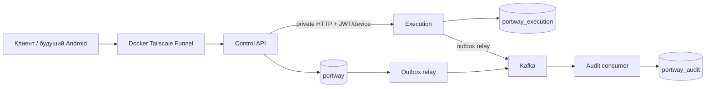
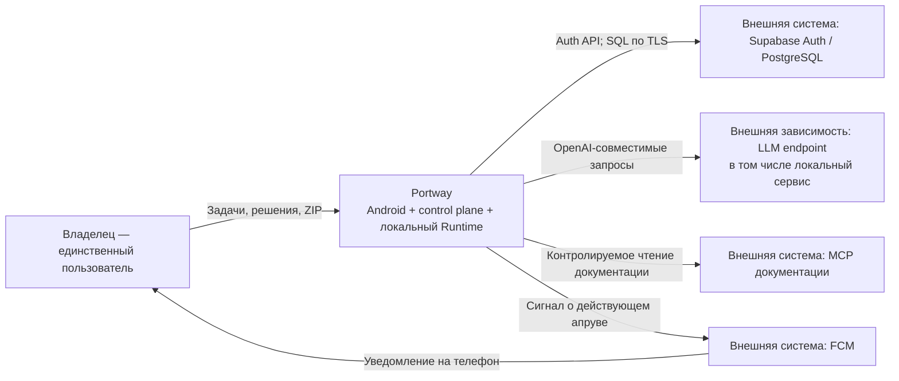
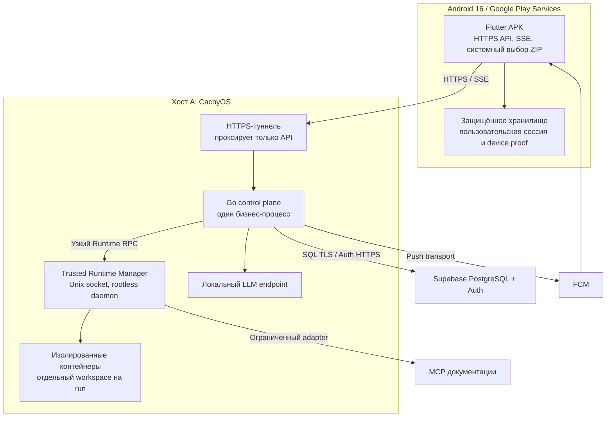
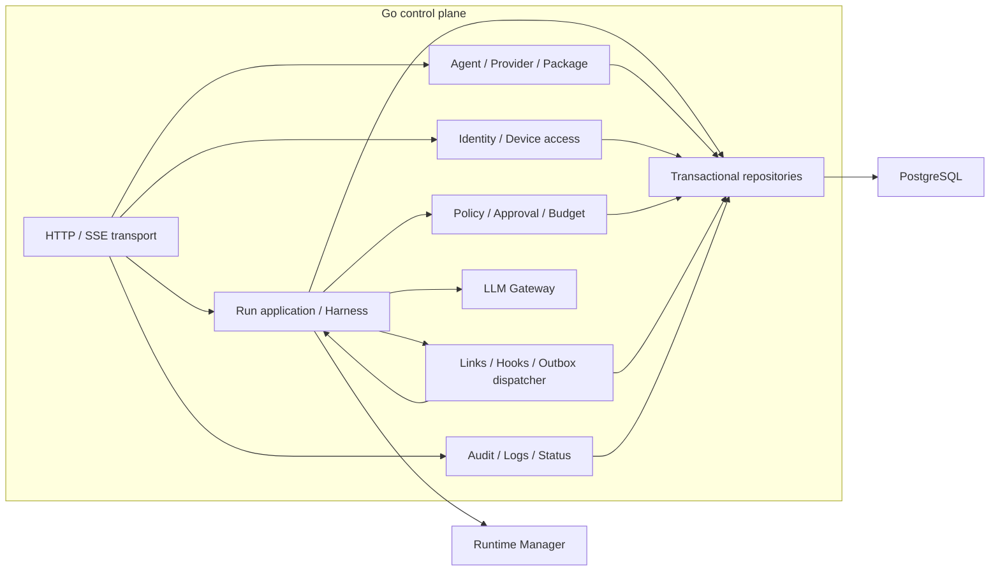
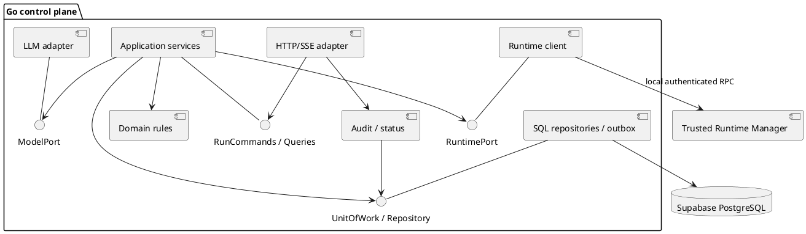
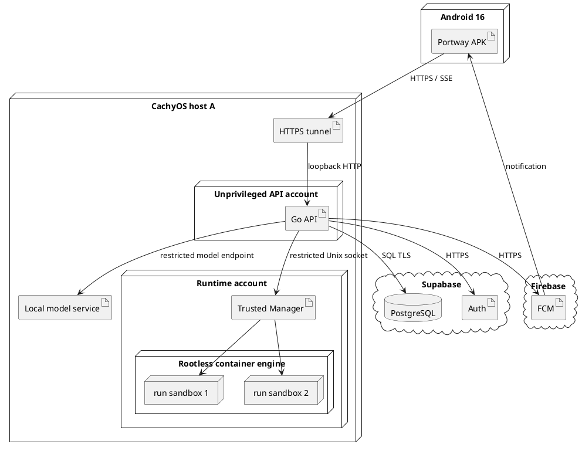

# Portway — архитектура и решения

> **Изменение 11.10.2026 (D-22):** по решению владельца целевая архитектура — Go-микросервисы и Kafka. [Принятое изменение архитектуры](21-microservices-kafka-amendment.md) заменяет прежний монолит/DB-only шину; PostgreSQL outbox сохраняется для надёжной публикации. Старые схемы одного процесса ниже — baseline до изменения, не текущая целевая топология. Первый реализованный срез Kafka описан в [DOC-022](22-kafka-first-slice.md); полный переход ещё не завершён.


### Приоритет владельца: native Codex demo, 13.10.2026

Ближайшая работа — телефон → Portway → Codex CLI на ноутбуке → progress/ответ/stop, с существующим ChatGPT-входом и read-only workspace. Это отдельный opt-in профиль [контракта](36-api-events-and-messages.md#codex-demo), не реализация всего контейнерного Runtime/reviewer/approval flow. Generic POST `/v1/runs` сохраняет admission guard. Нормативные SYS/FR/BL/TC и обязательный объём MVP не удаляются; запрос владельца задаёт порядок ближайшей поставки. Новый срок защиты не установлен. Flutter разрабатывается параллельно в отдельном чате по [DOC-061](61-android-screens-flows-and-api.md#codex-demo-client).


Native bridge — отдельный доверенный процесс владельца на ноутбуке; исходящий poll/report API с dedicated key, без SQL/daemon socket. Control API владеет только demo queue/events; текущая D-22 топология общего execution сохраняется. Синхронная проверка lease/device определяет authority; Kafka получает безопасные audit facts. Это техническое решение под прямой запрос владельца, не замена ADR-09/16 полного Runtime.

## Текущая топология, 12.10.2026

D-22 применяется к коду: `control-api` (identity/config/secrets, схема `portway`) → private HTTP `execution` (run/chain/approval/result, схема `portway_execution`); у каждого своя DB-role, чужие таблицы недоступны. Outbox relay публикует Kafka, отдельный audit consumer владеет `portway_audit`. JWT/device authority проверяется через control API, не только через асинхронные события. Публичный HTTPS — отдельный Docker Tailscale Funnel. Runtime Manager и notification/query consumers ещё не реализованы. Harness/Result — локальный проверенный срез; production model/tool admission закрыт.



[Фактический статус](implementation-status.md), [порядок реализации](implementation-plan.md). Диаграммы одного процесса далее — исторический baseline 10.10; их внутрипроцессные стрелки не разрешают cross-service SQL или общие транзакции.

<a id="doc-020"></a>

| Поле | Значение |
|---|---|
| Артефакт | [DOC-020][id-doc-020]; объединяет архитектурные позиции исходного каталога |
| Версия и дата | v0.4 · 14.10.2026 |
| Статус | Проектный baseline; реализация и испытания NOT_RUN |
| Основания | [ТЗ](02-technical-specification.md), [SRS](03-software-requirements-specification.md), [границы](10-project-scope-and-constraints.md), [QS](13-quality-attribute-scenarios-and-utility-tree.md) |
| Связанные контракты | [Данные](29-data-and-state-model.md), [API](36-api-events-and-messages.md), [исполнение](40-agent-execution-and-security.md), [пакет](38-agent-package-format.md), [Android](61-android-screens-flows-and-api.md), [проверки](57-verification-and-traceability.md), [эксплуатация](52-build-deploy-and-operations.md) |

<a id="drivers"></a>
## 1. Архитектурные основания

Portway даёт одному [владельцу][g-owner] мобильное управление исполнением [агентов][g-agent] на его компьютере. Основная законченная вертикаль: [Android][g-flutter] → [задача][g-task] [coder][g-main-roles] → [инструменты][g-tool] в [Runtime][g-runtime] → неизменяемый результат → отдельный [reviewer][g-main-roles] → [вердикт][g-result] на телефоне. Вторая обязательная вертикаль — перенос конфигурации с телефона A/M1 → A/M2 → B/M2. Перенос работающего процесса или памяти не проектируется.

Архитектурные драйверы: серверное исполнение [политики][g-policy] и [апрува][g-approval], наблюдаемость при закрытом [APK][g-apk], запрет повторного опасного действия при неизвестном исходе, атомарные общие [бюджеты][g-budget], неизменяемая [версия агента][g-agent-version], работа одного разработчика до защиты 12.10.2026. Цели [p95][g-evidence] ≤2 с, [stop][g-cancelled] ≤5 с и подготовленный старт ≤600 с проверяются по [SRS][g-requirement-ids] § 4.2 и [SMART][g-smart]; схема не является доказательством их достижения.

Целевой состав с D-22 — Go-микросервисы, Kafka, [Supabase][g-supabase] [Auth][g-auth]/[PostgreSQL][g-supabase], локальный [Runtime][g-runtime], один совместимый LLM-адаптер, реальный [MCP][g-mcp] документации, [FCM][g-push] и [Flutter][g-flutter] [APK][g-apk]. [Runner][g-runner], GitHub-публикация, расписания и [Prometheus][g-observability-tools]/[Grafana][g-observability-tools] остаются условными расширениями по [MoSCoW][g-priorities]. Границы сервисов и правила Kafka описаны в [изменении D-22](21-microservices-kafka-amendment.md). NATS, Redis и Kubernetes не добавляются.

<a id="c4-context"></a>
## 2. [C4][g-architecture-notations] Context — система и окружение

Вид показывает участников и внешние системы; мобильное приложение входит в Portway. [Модель][g-model], [MCP][g-mcp] и [Auth][g-auth]/БД не являются внутренними [агентами][g-agent].



<a id="c4-container"></a>
## 3. [C4][g-architecture-notations] Container — единицы исполнения

Container в [C4][g-architecture-notations] означает единицу исполнения/хранения, а не только Docker. Trusted [Runtime][g-runtime] Manager — локальная привилегированная граница одного продукта, без собственного бизнес-API в интернете. Он запускается отдельным режимом того же Go-проекта; это не необязательный удалённый [Runner][g-runner].



API-процесс и агентские [контейнеры][g-sandbox] не получают Docker socket. Manager владеет доступом к rootless daemon; принимает только утверждённый набор операций и проверяемое разрешение. [Workspace][g-workspace] — управляемый том, не произвольный host mount. [Модель][g-model] и сборка [Android][g-flutter] находятся вне лимитов двух агентских [контейнеров][g-sandbox]. На [хосте][g-host] B повторяются [control plane][g-control-plane]/Manager и новые локальные привязки; внешний Supabase-проект/схема имеют изолированный installation_id.

<a id="c4-component"></a>
## 4. [C4 Component][g-architecture-notations] — ответственность внутри [control plane][g-control-plane]

Здесь компоненты представлены через ответственность и используемые внешние [контейнеры][g-sandbox]. Отдельное UML-представление ниже определяет интерфейсы и зависимости реализации.



<a id="uml-components"></a>
## 5. [UML Component][g-uml] — интерфейсы и зависимости



| Модуль [Go][g-go] / предполагаемый каталог | Ответственность и правило зависимости | Основные требования |
|---|---|---|
| `internal/identity` | [Auth][g-auth] adapter, один [owner][g-owner], [device sessions][g-device-session], отзыв; домен не зависит от [Flutter][g-flutter] | [FR-001][id-fr-001]–004/081/085 |
| `internal/agents`, `providers`, `packages` | Неизменяемые версии, возможности [модели][g-model], [staging][g-staging]/[activation][g-staging] [пакета][g-package] | [FR-005][id-fr-005]–016/060–064/087/088 |
| `internal/runs` | Команды, [Harness][g-harness], [шаги][g-step], результат, [stop][g-cancelled]/[recovery][g-recovery]; вызывает порты | [FR-018][id-fr-018]–029/036/059 |
| `internal/policy`, `approvals`, `budgets` | Серверные правила, одно решение, транзакционные резервы | [FR-025][id-fr-025]/026/037–043/051–054 |
| `internal/messaging` | [Направленные связи][g-link], [хуки][g-hook], [конверт][g-message], inbox/[outbox][g-outbox] | [FR-044][id-fr-044]–055 |
| `internal/runtime` | Клиент узкого интерфейса Manager; не принимает пользовательский Docker [API][g-api] | [FR-030][id-fr-030]–035 |
| `internal/gateway` | Нормализованные [stream][g-model-protocol]/[tool][g-tool]/[usage][g-usage]/error; capability report | [FR-011][id-fr-011]–016 |
| `internal/audit`, `status` | Отдельная обязательная подсистема чтения [аудита][g-audit]/[логов][g-audit] и диагностики | [FR-004][id-fr-004]/089 |
| `internal/transport`, `storage` | HTTP/[SSE][g-sse], SQL, [миграции][g-environment]; направленные зависимости внутрь | [NFR-001][id-nfr-001]/006/016/020 |

Application services открывают [транзакцию][g-atomicity] через [UnitOfWork][g-atomicity]; доменные правила не отправляют HTTP/[FCM][g-push] и не запускают [контейнеры][g-sandbox]. Адаптеры возвращают типизированные результаты/ошибки. Внешние вызовы выполняются после durable-записи намерения; их неизвестный исход не превращается в повтор команды. Конвенции: [UTC][g-identifier-formats] в хранении, [UUID][g-identifier-formats] для идентичности, версионированные DTO, контекстная отмена, [миграции][g-environment] до [ready][g-readiness], запрет [секретов][g-secret] в [логах][g-audit]. Библиотеки и точные toolchain-версии фиксируются lock-файлами при реализации, а не выдумываются в проектном baseline.

<a id="sequence"></a>
## 6. [UML][g-uml] [Sequence][g-uml] — исполнение и отдельный [review][g-review]

```mermaid
sequenceDiagram
  actor O as Владелец / APK
  participant API as Go API
  participant DB as PostgreSQL
  participant H as Harness
  participant P as Policy / Approval
  participant R as Runtime Manager
  participant B as Outbox dispatcher
  O->>API: create run + request key
  API->>DB: transaction(run, chain, event, outbox)
  API-->>O: run + snapshot cursor
  B->>H: durable run work
  H->>P: tool proposal + current budgets
  alt approval required
    P->>DB: pending approval + event + push intent
    O->>API: approve / reject
    API->>DB: compare-and-set with stop/deadline checks
  end
  H->>R: authorized immutable tool call
  R-->>H: result / explicit unknown
  H->>DB: terminal coder + pinned result + hook intent
  B->>DB: dedupe; create reviewer with same chain
  B->>H: start distinct reviewer run
  H->>R: read pinned result only
  H->>DB: verdict + event
  API-->>O: SSE / latest result
  Note over O,H: Negative verdict requires a new manual task
```

Атомарные границы, конкуренция [stop][g-cancelled]/approve и восстановление определены в [DOC-029][id-doc-029]/040. [FCM][g-push] — сигнал, а решение всегда читает свежий серверный [апрув][g-approval]. Ни один callback/[сообщение][g-message] не исполняет approve от имени [владельца][g-owner].

<a id="deployment"></a>
## 7. [UML][g-uml] [Deployment][g-ci-cd] — доверенные узлы



Публичен только [HTTPS][g-https] [API][g-api]; SQL, Manager, [модель][g-model] и daemon не публикуются [туннелем][g-https]. Настройка firewall/egress и проверка реального маршрута входят в [DOC-052][id-doc-052]/057. Два [контейнера][g-sandbox] не означают две одновременно загруженные локальные [модели][g-model].

<a id="flutter-architecture"></a>
## 8. Устройство Flutter-клиента

Слои: экраны → feature controllers → [repositories][g-repository] → [API][g-api]/[SSE][g-sse], secure storage, [FCM][g-push] и системный document picker. Контроллеры [auth][g-auth], [run][g-run] feed, [approval][g-approval] и [import][g-export-import] имеют явные состояния; [UI][g-ui] не является источником статуса [run][g-run], deadline или прав. Один session coordinator обновляет токен, закрывает старые [SSE][g-sse] и разносит отзыв всем экранам. При смене [API][g-api] URL очищается контекст старой установки и требуется новый вход; конфигурации разных [хостов][g-host] не смешиваются. Постоянная offline-очередь опасных команд не нужна.

Навигация, тексты, возврат из callback/[push][g-push], доступность и соответствие экранов операциям находятся в [DOC-061][id-doc-061]. Контрактные DTO берутся из [DOC-036][id-doc-036]; локальный кеш всегда помечается временем и не разрешает действие без сервера.

### Реализация клиента, 13.10.2026

Первый пакет — `apps/portway`. Принятое инженерное решение в пределах §8: Flutter `ChangeNotifier`/`ListenableBuilder` для feature controllers, constructor injection для repositories/storage/HTTP, Material `Navigator` для небольшого стека. Смена поколения session пересоздаёт Navigator целиком; закрытые экраны старой установки не возвращаются через Back. Новая state-management зависимость пока не нужна. `http` обслуживает JSON API; `flutter_secure_storage` хранит host-bound credentials и одну незавершённую мутацию Codex. `pubspec.lock` закреплён; RU ARB генерируется `gen-l10n`.

Refresh single-flight, без повтора потерянного refresh token; TOKEN_EXPIRED допускает один retry исходного запроса с тем же body/key. Logout очищает локальный доступ и сохраняет revoke-only tombstone URL/proof до ACK. Auth callback является подсказкой навигации, не доказательством входа. Отдельный Codex repository использует JSON polling 2с foreground, 5с после ошибки; dashboard 10с. Background останавливает таймеры, resume начинает со snapshot. Общий SSE, FCM и approval coordinator ещё не реализованы.

Дизайн: [Figma Portway](https://www.figma.com/design/BZ7UxNzlF3OmJRhd5JS19s/portway), semantic Dark/Light → ThemeData; [решения](../DESIGN.md), [клиент и команды](../apps/portway/README.md), [локальные свидетельства](evidence/flutter-client-2026-10-13.md).

<a id="decisions"></a>
## 9. Краткий журнал [ADR][g-traceability]

Статус «принято» означает проектное решение по делегированию, а не испытанную интеграцию. Глобальные D остаются в [ТЗ][g-requirement-ids]. Изменение [ADR][g-traceability] требует синхронной правки зависимых контрактов, требований при изменении обязательства и затронутых проверок.

| ID | Решение / причина | Последствие и проверка | Основание |
|---|---|---|---|
| <a id="adr-01"></a>[ADR-01][id-adr-01] | Ручная направленная топология; исключить скрытый planner | Только настроенные маршруты; [TC-013][id-tc-013]/024 | [D-09][id-d-09] |
| <a id="adr-02"></a>[ADR-02][id-adr-02] | Отдельный [reviewer][g-main-roles], ручное исправление | Фиксированный результат; terminal [coder][g-main-roles] не оживает; [TC-014][id-tc-014]/025 | [D-09][id-d-09]/10 |
| <a id="adr-03"></a>[ADR-03][id-adr-03] | Собственный versioned JSON-конверт | Валидация/лимиты/серверные counters; [TC-013][id-tc-013]/024 | [D-09][id-d-09] |
| <a id="adr-04"></a>[ADR-04][id-adr-04] | Заменено D-22: отдельные Go-сервисы | Execution владеет согласованными run/budget/approval транзакциями; [TC-001][id-tc-001] | [D-22](21-microservices-kafka-amendment.md) |
| <a id="adr-05"></a>[ADR-05][id-adr-05] | [Supabase][g-supabase] [PostgreSQL][g-supabase] + [Auth][g-auth] | Внешняя доступность; закрытая бизнес-схема; [TC-002][id-tc-002]/017 | [D-07][id-d-07]/17/18 |
| <a id="adr-06"></a>[ADR-06][id-adr-06] | D-22: [Outbox][g-outbox] → Kafka → inbox, [at-least-once][g-at-least-once] + [dedupe][g-idempotency] | Один логический эффект, unknown не повторять; [TC-024][id-tc-024]/030 | [D-22](21-microservices-kafka-amendment.md) |
| <a id="adr-07"></a>[ADR-07][id-adr-07] | [SSE][g-sse] с per-run cursor | Replay 7 суток, snapshot при 410; [TC-008][id-tc-008]/027 | [D-17][id-d-17] |
| <a id="adr-08"></a>[ADR-08][id-adr-08] | Удалённый [Runner][g-runner] отложен, вне базы | Нет Runner-протокола в обязательной поставке | [D-05][id-d-05]/21 |
| <a id="adr-09"></a>[ADR-09][id-adr-09] | Локальный ограниченный [Runtime][g-runtime] через trusted Manager | Нет daemon socket у [API][g-api]/[агента][g-agent]; [TC-006][id-tc-006]/023 | [D-07][id-d-07]; [FR-030][id-fr-030]–035 |
| <a id="adr-10"></a>[ADR-10][id-adr-10] | [GitHub][g-github] App только при S-расширении | Временный узкий credential, публикация после [review][g-review]+[approval][g-approval] | [D-10][id-d-10]/16/21 |
| <a id="adr-11"></a>[ADR-11][id-adr-11] | [FCM][g-push] + HTTPS-туннель; текущий Docker Tailscale Funnel (ngrok — прежний кандидат) | Реальные [Android][g-flutter]/[push][g-push]/SSE-прогоны обязательны | [D-05][id-d-05]/19 |
| <a id="adr-12"></a>[ADR-12][id-adr-12] | Один [owner][g-owner], email confirmation, серверная [device session][g-device-session] | [JWT][g-jwt-jwks] сам по себе не доказывает отсутствие отзыва; [TC-002][id-tc-002]/022 | [D-18][id-d-18] |
| <a id="adr-13"></a>[ADR-13][id-adr-13] | Неизменяемая версия и snapshot эффективных прав | Текущие запреты могут ужесточить snapshot; [TC-004][id-tc-004]/021 | [D-13][id-d-13]/17 |
| <a id="adr-14"></a>[ADR-14][id-adr-14] | Audit/status — внутренний Go-модуль | Защищённое чтение, причины деградации; [TC-017][id-tc-017]/031 | [D-15][id-d-15]/17 |
| <a id="adr-15"></a>[ADR-15][id-adr-15] | Версионируемый [ZIP][g-package], [staging][g-staging] перед [activation][g-staging] | Перенос без [секретов][g-secret] и исполнения кода; [TC-015][id-tc-015]/026 | [D-11][id-d-11] |
| <a id="adr-16"></a>[ADR-16][id-adr-16] | Единые транзакционные [бюджеты][g-budget] и [fencing][g-fencing] [stop][g-cancelled] | Нет двойного резерва/новых выдач после [stop][g-cancelled]; [TC-009][id-tc-009]/010/028 | [FR-024][id-fr-024]–026/051–054 |
| <a id="adr-17"></a>[ADR-17][id-adr-17] | Agent Bridge v2 (14.10.2026): один мост на ноутбуке ведёт Codex CLI и Claude Code; аккаунты подключаются только OAuth-потоками официальных CLI в изолированных профилях (`CODEX_HOME`/`CLAUDE_CONFIG_DIR`), лимиты читаются без inference (`codex app-server`, OAuth usage), управление — одноразовые команды через тот же исходящий poll | Токены и коды не покидают ноутбук/шифруются (код входа стирается после выдачи, snapshot с email — AES-GCM); API делает preflight по snapshot (`AI_LIMIT_EXHAUSTED` и др.); новый audit action требует одновременного обновления relay/audit; [контракт](36-api-events-and-messages.md#agent-bridge-v2), [evidence](evidence/agent-bridge-2026-10-13.txt) | Запрос владельца 13.10.2026; не заменяет ADR-09/16 |
| <a id="adr-18"></a>[ADR-18][id-adr-18] | Flutter 0.2.0 (14.10.2026): без внешнего state-management — `ChangeNotifier`-контроллеры и repository поверх session coordinator; единая система токенов (`PortwayColors` ThemeExtension, сетка 4 pt, радиусы 8/12/24) и одно семейство иконок Material rounded/outlined 18–24 dp; `url_launcher` только для https-страниц входа из allowlist, `flutter_markdown_plus` для ответа; демо-фикстуры только compile-time флагом `PORTWAY_FIXTURES` | Меньше зависимостей и тот же протокол идемпотентности; обычная сборка не содержит выдуманных ответов; [DESIGN.md](../DESIGN.md), [DOC-061](61-android-screens-flows-and-api.md#flutter-0-2) | Запрос владельца 13.10.2026 (редизайн); дополняет [Flutter-архитектуру](#flutter-architecture) |

<a id="readiness"></a>
## 10. Что ещё должно подтвердиться кодом

Выбор двух [model][g-model] ID, доступы [Supabase][g-supabase]/[FCM][g-push]/[MCP][g-mcp], rootless isolation, [SSE][g-sse] через [туннель][g-https] и отдельная установка B остаются проверяемыми зависимостями. Документы для обязательной базы подготовлены; следующая работа — реализация вертикальных срезов по [backlog][g-work-ids] и сбор [свидетельств][g-evidence] [DOC-057][id-doc-057]. Цели не снижаются из-за завершения проектирования. [CW-001][id-cw-001]–004 требуют отдельных фактических текста/источников/репетиции; архитектура служит им источником.

## История

| Версия | Дата | Изменение |
|---|---|---|
| v0.4 | 14.10.2026 | ADR-18: решения клиента 0.2.0 (состояние, токены, иконки, фикстуры). ADR-17: Agent Bridge v2 (Codex CLI + Claude Code, аккаунты через OAuth CLI, лимиты, команды моста) |
| v0.3 | 13.10.2026 | Зафиксированы реализация Flutter, session coordinator и отдельный клиент Codex |
| v0.2 | 13.10.2026 | Отдельный opt-in native Codex bridge и HTTP очередь, существующая D-22 топология сохраняется |
| v0.1 | 10.10.2026 | Созданы согласованные архитектурные виды, границы модулей и журнал решений сокращённого комплекта |

[g-agent]: 07-glossary.md#term-agent

[g-agent-version]: 07-glossary.md#term-agent-version

[g-api]: 07-glossary.md#term-api

[g-apk]: 07-glossary.md#term-apk

[g-approval]: 07-glossary.md#term-approval

[g-architecture-notations]: 07-glossary.md#term-architecture-notations

[g-at-least-once]: 07-glossary.md#term-at-least-once

[g-atomicity]: 07-glossary.md#term-atomicity

[g-audit]: 07-glossary.md#term-audit

[g-auth]: 07-glossary.md#term-auth

[g-budget]: 07-glossary.md#term-budget

[g-cancelled]: 07-glossary.md#term-cancelled

[g-ci-cd]: 07-glossary.md#term-ci-cd

[g-control-plane]: 07-glossary.md#term-control-plane

[g-device-session]: 07-glossary.md#term-device-session

[g-environment]: 07-glossary.md#term-environment

[g-evidence]: 07-glossary.md#term-evidence

[g-export-import]: 07-glossary.md#term-export-import

[g-fencing]: 07-glossary.md#term-fencing

[g-flutter]: 07-glossary.md#term-flutter

[g-github]: 07-glossary.md#term-github

[g-go]: 07-glossary.md#term-go

[g-harness]: 07-glossary.md#term-harness

[g-hook]: 07-glossary.md#term-hook

[g-host]: 07-glossary.md#term-host

[g-https]: 07-glossary.md#term-https

[g-idempotency]: 07-glossary.md#term-idempotency

[g-identifier-formats]: 07-glossary.md#term-identifier-formats

[g-jwt-jwks]: 07-glossary.md#term-jwt-jwks

[g-link]: 07-glossary.md#term-link

[g-main-roles]: 07-glossary.md#term-main-roles

[g-mcp]: 07-glossary.md#term-mcp

[g-message]: 07-glossary.md#term-message

[g-model]: 07-glossary.md#term-model

[g-model-protocol]: 07-glossary.md#term-model-protocol

[g-observability-tools]: 07-glossary.md#term-observability-tools

[g-outbox]: 07-glossary.md#term-outbox

[g-owner]: 07-glossary.md#term-owner

[g-package]: 07-glossary.md#term-package

[g-policy]: 07-glossary.md#term-policy

[g-priorities]: 07-glossary.md#term-priorities

[g-push]: 07-glossary.md#term-push

[g-readiness]: 07-glossary.md#term-readiness

[g-recovery]: 07-glossary.md#term-recovery

[g-repository]: 07-glossary.md#term-repository

[g-requirement-ids]: 07-glossary.md#term-requirement-ids

[g-result]: 07-glossary.md#term-result

[g-review]: 07-glossary.md#term-review

[g-run]: 07-glossary.md#term-run

[g-runner]: 07-glossary.md#term-runner

[g-runtime]: 07-glossary.md#term-runtime

[g-sandbox]: 07-glossary.md#term-sandbox

[g-secret]: 07-glossary.md#term-secret

[g-smart]: 07-glossary.md#term-smart

[g-sse]: 07-glossary.md#term-sse

[g-staging]: 07-glossary.md#term-staging

[g-step]: 07-glossary.md#term-step

[g-supabase]: 07-glossary.md#term-supabase

[g-task]: 07-glossary.md#term-task

[g-tool]: 07-glossary.md#term-tool

[g-traceability]: 07-glossary.md#term-traceability

[g-ui]: 07-glossary.md#term-ui

[g-uml]: 07-glossary.md#term-uml

[g-usage]: 07-glossary.md#term-usage

[g-work-ids]: 07-glossary.md#term-work-ids

[g-workspace]: 07-glossary.md#term-workspace

[id-adr-01]: 20-architecture-and-decisions.md#adr-01

[id-adr-02]: 20-architecture-and-decisions.md#adr-02

[id-adr-03]: 20-architecture-and-decisions.md#adr-03

[id-adr-04]: 20-architecture-and-decisions.md#adr-04

[id-adr-05]: 20-architecture-and-decisions.md#adr-05

[id-adr-06]: 20-architecture-and-decisions.md#adr-06

[id-adr-07]: 20-architecture-and-decisions.md#adr-07

[id-adr-08]: 20-architecture-and-decisions.md#adr-08

[id-adr-09]: 20-architecture-and-decisions.md#adr-09

[id-adr-10]: 20-architecture-and-decisions.md#adr-10

[id-adr-11]: 20-architecture-and-decisions.md#adr-11

[id-adr-12]: 20-architecture-and-decisions.md#adr-12

[id-adr-13]: 20-architecture-and-decisions.md#adr-13

[id-adr-14]: 20-architecture-and-decisions.md#adr-14

[id-adr-15]: 20-architecture-and-decisions.md#adr-15

[id-adr-16]: 20-architecture-and-decisions.md#adr-16
[id-adr-17]: 20-architecture-and-decisions.md#adr-17
[id-adr-18]: 20-architecture-and-decisions.md#adr-18

[id-cw-001]: 01-product-backlog.md#cw-001

[id-d-05]: 02-technical-specification.md#d-05

[id-d-07]: 02-technical-specification.md#d-07

[id-d-09]: 02-technical-specification.md#d-09

[id-d-10]: 02-technical-specification.md#d-10

[id-d-11]: 02-technical-specification.md#d-11

[id-d-13]: 02-technical-specification.md#d-13

[id-d-15]: 02-technical-specification.md#d-15

[id-d-17]: 02-technical-specification.md#d-17

[id-d-18]: 02-technical-specification.md#d-18

[id-doc-020]: 20-architecture-and-decisions.md

[id-doc-029]: 29-data-and-state-model.md

[id-doc-036]: 36-api-events-and-messages.md

[id-doc-052]: 52-build-deploy-and-operations.md

[id-doc-057]: 57-verification-and-traceability.md

[id-doc-061]: 61-android-screens-flows-and-api.md

[id-fr-001]: 03-software-requirements-specification.md#fr-001

[id-fr-004]: 03-software-requirements-specification.md#fr-004

[id-fr-005]: 03-software-requirements-specification.md#fr-005

[id-fr-011]: 03-software-requirements-specification.md#fr-011

[id-fr-018]: 03-software-requirements-specification.md#fr-018

[id-fr-024]: 03-software-requirements-specification.md#fr-024

[id-fr-025]: 03-software-requirements-specification.md#fr-025

[id-fr-030]: 03-software-requirements-specification.md#fr-030

[id-fr-044]: 03-software-requirements-specification.md#fr-044

[id-nfr-001]: 03-software-requirements-specification.md#nfr-001

[id-tc-001]: 57-verification-and-traceability.md#tc-001

[id-tc-002]: 57-verification-and-traceability.md#tc-002

[id-tc-004]: 57-verification-and-traceability.md#tc-004

[id-tc-006]: 57-verification-and-traceability.md#tc-006

[id-tc-008]: 57-verification-and-traceability.md#tc-008

[id-tc-009]: 57-verification-and-traceability.md#tc-009

[id-tc-013]: 57-verification-and-traceability.md#tc-013

[id-tc-014]: 57-verification-and-traceability.md#tc-014

[id-tc-015]: 57-verification-and-traceability.md#tc-015

[id-tc-017]: 57-verification-and-traceability.md#tc-017

[id-tc-024]: 57-verification-and-traceability.md#tc-024
