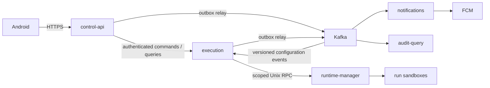

# Portway — переход на микросервисы и Kafka

**11.10.2026 · решение владельца D-22, принято. Первый срез relay/audit consumer выполнен в коде; полное разделение ещё не завершено. См. [фактический срез](22-kafka-first-slice.md).** Владелец явно выбрал микросервисную архитектуру и Kafka между сервисами. Это заменяет прежний выбор Go-монолита (D-17 / ADR-04) и PostgreSQL-only шины (часть ADR-06). При расхождении с прежними диаграммами и формулировками DOC-020/029/036/040 этот документ имеет приоритет. Продуктовые функции, policy, approval, budgets, дедупликация и гарантии остановки сохраняются.

## Границы сервисов

Один репозиторий Go, отдельные процессы/контейнеры и точки сборки. Монорепозиторий не требует одного процесса.

| Сервис | Ответственность и данные |
|---|---|
| `control-api` | Публичный HTTP API, Supabase Auth/device guard, агенты/версии, providers/secrets, packages и пользовательская конфигурация links/hooks. Основа уже написана; выделение границ ещё предстоит |
| `execution` | Run/chain/Harness, budgets, approvals, tool intents, stop epochs, durable events/results, исполнение routing/hooks. Один владелец всех строк, которые нужны для атомарного stop/approve/reserve; отдельный Runtime client |
| `notifications` | Kafka consumer уведомлений, доставка FCM, retries; device/token lifecycle передаётся через защищённый API владельца данных и события. Перед отправкой проверяет действительность устройства/апрува, сигнал не даёт прав approve |
| `audit-query` | Kafka consumer для общей read-проекции аудита и диагностического API; authoritative audit intent остаётся в транзакции исходного сервиса |
| `runtime-manager` | Отдельный trusted локальный процесс под отдельным OS account, узкий Unix socket, rootless engine и scoped grants. Это граница исполнения, доступ к daemon не переносится в API |

Supabase Free содержит PostgreSQL и Auth, не процессы Go/Kafka. На первом стенде сервисы и Kafka работают в Docker на ПК владельца. В одном Supabase-проекте — отдельные закрытые схемы и DB-роли сервисов, без прямого доступа к чужим таблицам. Текущая `portway` со схемой identity/config пока сохраняется: массового переноса существующих таблиц без миграции нет. Future ownership и миграции фиксируются вместе с выделением сервисов. Cross-service FK/SQL JOIN и общие транзакции не проектируются; передаются immutable snapshots/references.

## Доставка и согласованность

Kafka — брокер асинхронных межсервисных событий. PostgreSQL outbox **сохраняется**: сервис атомарно фиксирует изменение данных, audit и outbox, relay публикует событие в Kafka. Consumer записывает receipt и свой бизнес-эффект одной локальной DB-транзакцией, затем подтверждает Kafka offset. Crash после commit до offset может дать повтор; unique event/consumer receipt его поглощает. Не обещается общая exactly-once транзакция Kafka + PostgreSQL + внешние инструменты. [Семантика Kafka](https://kafka.apache.org/41/design/design/#message-delivery-semantics).

Межсервисный event envelope отделён от агентского DOC-036: `schema_version`, `event_id`, `installation_id`, `producer`, `type`, `aggregate_id`, `correlation_id`, `occurred_at`, `payload`. Kafka key — installation+aggregate/chain, порядок только внутри partition. Нет password/JWT/device proof/provider credentials/raw stdout в payload. Topic naming/схемы и совместимость закрепляются в коде при добавлении producer/consumer.

Readiness не скрывает недоступность Kafka. События могут временно оставаться в bounded outbox, но создание работы останавливается, если необходимые downstream-действия нельзя надёжно обеспечить. Retention событий/дедупликации 7 суток и redelivery ≤24 ч сохраняются; просроченный intent нельзя исполнить после удаления receipt. DLQ наблюдаем; повтор требует проверки deadline/idempotency, а не слепого replay команды.

Критические stop/approval/доступ не зависят только от задержки Kafka: control-api вызывает authenticated execution command, execution проверяет актуальные owner/device и атомарно меняет свой state/epoch. Grants до выполнения сверяются Runtime Manager. Сервисные credentials не равны пользовательским полномочиям. Точный внутренний протокол и проверка отзыва задаются перед реализацией; без этого run admission закрыт. Клиентский SSE replay читается из durable per-run history execution, Kafka offset не становится публичным SSE cursor.

## Профиль ресурсов первого стенда

Скриншот владельца показывает t3.nano и 5/60 соединений; это наблюдение текущего проекта, не гарантия производительности. В текущем коде max pool API уменьшен с 8 до **2**, `min=0`, idle timeout 2 минуты; мигратор — **1**. При выделении сервисов стартовый общий бюджет app connections — до 8 (2+2+2+2), затем нагрузочная проверка и корректировка. Резерв для Supabase служебных соединений/оператора сохраняется. Реальный размер pooler и resource limits берутся из Dashboard, не вычисляются из названия региона.

Kafka для dev/lab: один KRaft broker/controller в отдельном контейнере с persistent volume и ограничениями CPU/RAM/disk. Это не HA; потеря его диска требует восстановления/сверки, а не утверждения об отсутствии потерь. Конкретный image/digest, JVM heap, storage/retention caps и latency проверяются при внедрении. Kafka не размещается внутри Supabase и не использует её connection slots. Возможность всего стенда плюс LLM поместиться на ПК должна подтвердиться измерением.

## Порядок изменения реализации и проверок

1. Реально подключить текущий control-api к Supabase, сохранить раздельные app/migration credentials и TLS verification.
2. Выделить execution с собственной схемой/миграциями и authenticated command API; реализовать run/chain/budgets/approvals как один согласованный агрегат.
3. Добавить Kafka в Compose, outbox relay/inbox consumer и versioned event contracts. Проверить duplicate delivery, broker outage, crash между DB commit/publish/offset, out-of-order и backlog caps.
4. Выделить notifications/audit-query, связать FCM и query API, проверить отзыв/stop при задержках и недоступности брокера.
5. Обновить полные C4/UML/ER/OpenAPI для реализованных границ и выполнить затронутые TC-001/008/009/011/012/013/017/024/027/028/030; прежний foundation smoke не подтверждает Kafka/microservices.

Сроки и ресурс из прежнего baseline не подтверждают реализуемость расширенной архитектуры к защите. Требования не снимаются; готовность отмечается по фактическим проверкам.
