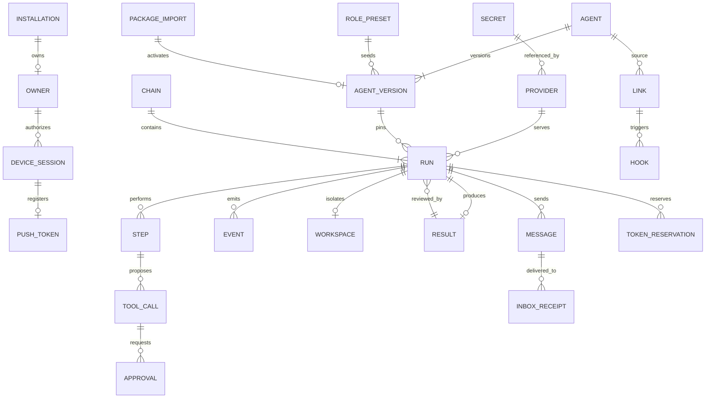
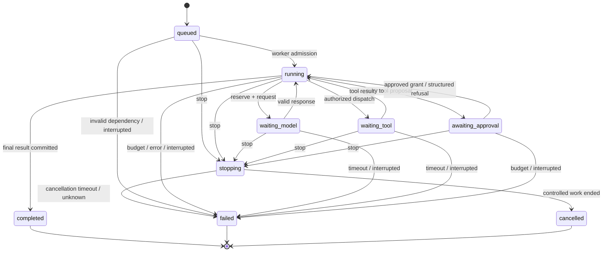
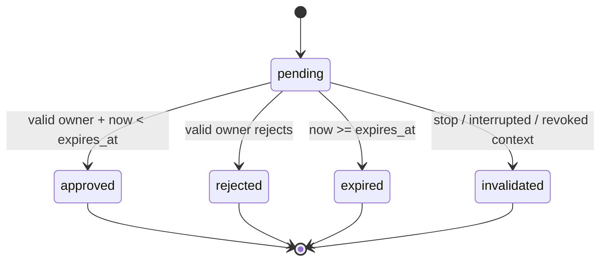

# Portway — данные и состояния

> **Изменение 11.10.2026 (D-22):** по решению владельца целевая архитектура — Go-микросервисы и Kafka. [Принятое изменение архитектуры](21-microservices-kafka-amendment.md) заменяет прежний монолит/DB-only шину; PostgreSQL outbox сохраняется для надёжной публикации. Старые схемы одного процесса ниже — baseline до изменения, не текущая целевая топология. Первый реализованный срез Kafka описан в [DOC-022](22-kafka-first-slice.md); полный переход ещё не завершён.

| Поле | Значение |
|---|---|
| Артефакт | [DOC-029][id-doc-029] |
| Версия и дата | v0.1 · 10.10.2026 |
| Статус | Проектный контракт; DDL/[миграции][g-environment] и испытания NOT_RUN |
| Основания | [SRS § 4.2 и § 6](03-software-requirements-specification.md#defaults), [архитектура](20-architecture-and-decisions.md) |
| Потребители | [API](36-api-events-and-messages.md), [исполнение](40-agent-execution-and-security.md), [пакет](38-agent-package-format.md), [тесты](57-verification-and-traceability.md), [эксплуатация](52-build-deploy-and-operations.md) |

## 1. Идентичность и инварианты

Хранение — [PostgreSQL][g-supabase] в закрытой бизнес-схеме `portway`; клиент не использует anonymous Data [API][g-api] для этих таблиц. Все бизнес-строки имеют `installation_id`, [UUID][g-identifier-formats] `id`, [UTC][g-identifier-formats] `created_at`; изменяемые агрегаты — `version bigint` для [compare-and-set][g-atomicity]. Ссылки между установками запрещены составными FK `(installation_id, id)`. [Owner][g-owner] — один на installation; разные host A/B не получают общие [device sessions][g-device-session] или [секреты][g-secret].

[AgentVersion][g-agent-version] содержит неизменяемую нормализованную конфигурацию и её [SHA-256][g-config-hash]. Изменение создаёт следующую версию. [Run][g-run] ссылается на версию и хранит snapshot эффективных прав/лимитов/выбранной [модели][g-model]; текущие серверные запреты применяются поверх snapshot, расширение прав задним числом невозможно. [Terminal run][g-terminal-run] и зафиксированный [Result][g-result] не переписываются для следующего [запуска][g-run]. Допустимы только отдельные append-записи диагностики и сведения о cleanup.

Неизвестный внешний исход принадлежит ToolCall, а не означает успешный [run][g-run]. Сохраняются `outcome=unknown`, причина и доступные [evidence][g-evidence] references; автоматический повтор опасного действия блокируется. Секретное значение хранится только шифротекстом; в [AgentVersion][g-agent-version]/[пакете][g-package]/[API][g-api] остаётся [Secret reference][g-secret-reference].

## 2. [ER][g-architecture-notations] — основные связи

Глобальные таблицы [outbox][g-outbox], audit, request keys и структурных [логов][g-audit] связаны идентификаторами контекста; они не образуют второй независимый источник состояния [run][g-run]. Полная память [LLM][g-model] и перенос активного [workspace][g-workspace] не включаются в Package.

## 3. Физический словарь таблиц

`jsonb` применяется к versioned DTO и payload с валидацией приложения; обязательная идентичность/состояние/уникальность находятся в типизированных столбцах. `timestamptz` хранит время; [UUID][g-identifier-formats] генерируется сервером. Внешние [Auth][g-auth] [UUID][g-identifier-formats] сохраняются как данные, без FK к управляемой чужим сервисом схеме.

| Таблица / ключевые поля | Ограничения и жизненный цикл |
|---|---|
| `installations(id, owner_id?, setup_hash?, status, schema_version)` | Один [owner][g-owner]; status `unclaimed/pending_confirmation/claimed`; setup hash отключается после claim |
| `registration_intents(id, installation_id, auth_user_id?, email_hash, state, request_hash)` | Одна активная первичная регистрация на installation; не хранить пароль/confirmation token; неопределённый upstream не освобождает claim молча |
| `owners(id, installation_id, auth_user_id, display_name, email)` | UNIQUE installation, UNIQUE `(installation_id, auth_user_id)`; [owner][g-owner] привязывается после подтверждения email |
| `device_sessions(id, owner_id, proof_hash, auth_session_id, revoked_at, last_seen_at)` | Только hash случайного proof; отзыв не удаляет запись немедленно; новый вход создаёт новую session |
| `push_tokens(id, device_session_id, token_ciphertext, token_hash, permission, state, updated_at)` | Один текущий token на session, UNIQUE token_hash; logout/отзыв немедленно делает inactive; не выводить token в [логи][g-audit] |
| `role_presets(id, code, group_code, catalog_version, baseline_policy)` | 5 основных / 3 subagent; код+версия уникальны; выбор [роли][g-role] не создаёт [run][g-run] |
| `agents(id, name, current_version_id, archived_at?)` | current_version ссылается на собственную [AgentVersion][g-agent-version]; архив относится к S, обязательное чтение версии остаётся M |
| `agent_versions(id, agent_id, ordinal, config_json, config_hash, source_import_id?)` | UNIQUE `(agent_id, ordinal)`; запрет UPDATE/DELETE конфигурации прикладными правами; исторические FK RESTRICT |
| `providers(id, label, endpoint, model_id, secret_ref?, capabilities, checked_at, config_version)` | Endpoint — настройка [владельца][g-owner]; capability report привязан к [model][g-model]/config version, без ключа в JSON |
| `secrets(id, alias, ciphertext, nonce, key_version, state)` | UNIQUE alias в installation; [AES-256-GCM][g-encryption], UNIQUE installation/[key_version][g-encryption]/[nonce][g-encryption]; master key вне БД; [API][g-api] даёт лишь metadata |
| `chains(id, status, deadline_at, step_limit, token_limit, spent_tokens, reserved_tokens, stop_epoch, failure_reason?)` | Общий [бюджет][g-budget] и [fencing][g-fencing]; CHECK неотрицательных остатков; `correlation_id` [API][g-api] равен [chain][g-chain].id |
| `runs(id, chain_id, agent_version_id, provider_id, parent_run_id?, input_result_id?, state, reason?, config_snapshot, deadline_at, step_count, spent_tokens, reserved_tokens, next_event_seq, events_pruned_through, stop_epoch, terminal_at?)` | Parent внутри той же [chain][g-chain]; version/config immutable; terminal status не изменяется; per-run seq выделяется под [row lock][g-atomicity] |
| `steps(id, run_id, ordinal, kind, state, started_at?, finished_at?, error_code?)` | UNIQUE `(run_id, ordinal)`; kind [model][g-model]/[tool][g-tool]/message; [шаг][g-step] учитывается до выдачи работы |
| `tool_calls(id, step_id, tool_name, args_json, args_hash, policy_version, state, dispatch_id?, outcome, permit_epoch?, started_at?, finished_at?)` | Неизменяемые аргументы; UNIQUE [dispatch_id][g-fencing]; dangerous unknown не повторять; секретные значения в args запрещены |
| `approvals(id, run_id, tool_call_id, args_hash, state, expires_at, decision_actor?, decided_at?, decision_reason?)` | Не более одного pending для tool_call; [CAS][g-atomicity] pending→terminal; 180 с от server creation; FK не позволяет другой [run][g-run]/[tool][g-tool] |
| `token_reservations(id, run_id, step_id, amount, settled_amount?, source, state)` | UNIQUE step_id; reserve/settle/[release][g-ci-cd] ровно один раз; списание [цепочки][g-chain] и [run][g-run] в одной [транзакции][g-atomicity] |
| `events(id, run_id, seq, type, schema_version, payload, committed_at)` | UNIQUE `(run_id, seq)`; append-only; полезная история 7 суток; payload не содержит credential |
| `workspaces(id, run_id, runtime_handle, source_revision, state, cleanup_state, retain_until?)` | UNIQUE run_id; handle не является произвольным host path; результат удерживается 24 ч после terminal |
| `results(id, run_id, source_revision, result_revision?, diff_hash?, artifact_manifest, verdict?, summary, config_hash)` | UNIQUE run_id; закреплённая ревизия/diff; source/result hash обязателен для [repository][g-repository] [review][g-review]; файлы могут истечь отдельно от metadata |
| `links(id, from_agent_id, to_agent_id, enabled, allowed_types, version)` | Source/target в installation; [направленная связь][g-link], сервер проверяет enabled на принятии и delivery |
| `hooks(id, link_id, event_type, action, target_version_id, enabled, version)` | [События][g-event] только из каталога; `start_review` — единственное автоматическое создание [review][g-review] в базовом сценарии |
| `messages(id, sender_run_id, chain_id, from_agent_id, to_agent_id, type, schema_version, payload, payload_hash, reply_to?, hops, depth, accepted_at, deliver_until)` | UNIQUE id в installation; ≤64 KiB; immutable accepted envelope; counters определяет сервер; [redelivery][g-retry] ≤24 ч |
| `inbox_receipts(id, message_id, consumer_key, state, result_ref?)` | UNIQUE `(message_id, consumer_key)`; эффект и receipt в одной [транзакции][g-atomicity]; ключи сохраняются 7 суток |
| `outbox(id, aggregate_id, intent_type, body, state, available_at, lease_until?, attempts, delivery_key, deliver_until, last_error?)` | UNIQUE delivery_key; [транзакция][g-atomicity] вместе с source [state][g-uml]; lease не доказывает, что внешний эффект отсутствовал |
| `request_keys(id, owner_id, operation, key_hash, request_hash, response_status, resource_id, response_body_safe, expires_at)` | UNIQUE `(owner_id, operation, key_hash)`; 7 суток; same key/different payload→409 |
| `package_imports(id, device_session_id, state, file_hash, staged_handle?, manifest, mappings, unresolved, config_hash?, activated_version_id?, expires_at)` | [Staging][g-staging] не активный [агент][g-agent]; [activation][g-staging] атомарна; expiry технического [staging][g-staging] отражается [API][g-api]; лимиты [DOC-038][id-doc-038] |
| `audit_entries(id, actor_type, actor_id?, action, object_type, object_id?, outcome, reason, run_id?, chain_id?, server_time, safe_metadata)` | Append-only для app [role][g-role]; 30 суток; нет сырого prompt, пароля, ключа или stdout |
| `application_logs(id, level, code, request_id?, run_id?, chain_id?, dependency?, safe_fields, server_time)` | Структурные поля; 7 суток; доступ только [owner][g-owner]; не заменяют [events][g-event]/audit |

Файловый [ZIP][g-package] [экспорта][g-export-import] формируется из [AgentVersion][g-agent-version]; постоянная отдельная таблица экспортов для базы не нужна. Необязательные PR/[Runner][g-runner]/Schedule-таблицы не создаются заранее. CHECK/foreign-key ограничения и allowlist enum значений должны быть внесены в [миграции][g-environment], а не оставлены только HTTP-валидатору.

## 4. Индексы, [транзакции][g-atomicity] и [миграции][g-environment]

Нужны индексы: `(installation_id, runs.state, created_at)`, `(chain_id, state)`, `(run_id, ordinal)` [шагов][g-step], `(run_id, seq)` [событий][g-event], `(state, expires_at)` pending [approvals][g-approval], `(state, available_at)` [outbox][g-outbox], `(run_id, server_time)` и `(chain_id, server_time)` audit/logs, `(state, retain_until)` workspaces, `(deliver_until)` [сообщений][g-message]/receipts. Частичные UNIQUE-индексы защищают единственную активную registration и pending [approval][g-approval]. [UUID][g-identifier-formats] и context ID не помещаются в высококардинальные metric labels.

| Операция | Атомарная запись | Внешнее продолжение |
|---|---|---|
| Create [run][g-run] | Request key + [chain][g-chain]/[run][g-run] + начальный [event][g-event] + [outbox][g-outbox] | Worker запускает только после commit |
| Reserve [model][g-model] [step][g-step] | Lock [chain][g-chain]→[run][g-run]; проверить [stop][g-cancelled]/deadlines/[steps][g-step]/tokens; записать [Step][g-step] и Reservation, обновить оба остатка | Gateway после commit; settlement при ответе/обрыве |
| Resolve [approval][g-approval] | Lock [chain][g-chain]→[run][g-run]→tool_call→[approval][g-approval]; проверить [owner][g-owner]/device, pending и срок; [CAS][g-atomicity] + audit/[event][g-event] + dispatch intent | Manager получает [grant][g-fencing] после commit, повторно проверяет [fencing][g-fencing] |
| [Stop][g-cancelled] [chain][g-chain] | Lock [chain][g-chain]; увеличить [stop_epoch][g-fencing], [state][g-uml] stopping; пометить активные [run][g-run]; pending [approvals][g-approval] invalidated; cancel intents + audit | Cancellation наблюдаема до подтверждённого terminal; неизвестное явно отдельно |
| Complete [coder][g-main-roles] | [Result][g-result] + terminal [event][g-event] + подходящий [hook][g-hook] intent с delivery_key | [Reviewer][g-main-roles] создаётся отдельной идемпотентной [транзакцией][g-atomicity] |
| Consume message | Receipt + вход следующего [шага][g-step]/новый [reviewer][g-main-roles] + [event][g-event]/[outbox][g-outbox] | ACK только после commit; duplicate читает сохранённый результат |
| Activate [import][g-export-import] | Валидация [mapping][g-staging]+[policy][g-policy]; [Agent][g-agent]/[AgentVersion][g-agent-version] + [import][g-export-import] activated + audit | Никакой команды/загрузки кода при [activation][g-staging] |

Все [транзакции][g-atomicity], затрагивающие несколько агрегатов, придерживаются одного порядка locks: [chain][g-chain]→[run][g-run]→tool_call→[approval][g-approval]; остальные строки берутся после них в сортированном порядке ID. [Outbox][g-outbox] lease claim — короткая [транзакция][g-atomicity] `FOR UPDATE SKIP LOCKED`; сетевой вызов вне SQL-транзакции. Deadline сравнивается с серверным временем БД; ограничения внешнего вызова дополнительно используют монотонный таймер процесса. Deadlock/serialization [retry][g-retry] допустим для незафиксированной [транзакции][g-atomicity], не для уже выданного опасного действия.

[Миграции][g-environment] нумеруются, имеют checksum и таблицу применённых версий; применение эксклюзивно и до [ready][g-readiness]. Минимальная последовательность: identity/config → [runs][g-run]/budgets/[runtime][g-runtime] → [approvals][g-approval]/[events][g-event]/[outbox][g-outbox] → links/messages/results → packages/audit/indexes. Проверяются fresh DB и upgrade с предыдущей версией. Destructive [rollback][g-runbook] схемы не автоматизируется; сначала snapshot, затем совместимая forward-fix или восстановление по [DOC-052][id-doc-052].

## 5. [UML][g-uml] [State][g-uml] — [run][g-run]

Reject/expiry запрещает исходное действие и возвращает структурированный отказ в [Harness][g-harness], пока есть [бюджет][g-budget]/время; это не команда автоматически исполнить другой [инструмент][g-tool]. Исчерпание двух последовательных отказанных альтернатив завершает [run][g-run] `failed/policy_exhausted`. [Stop][g-cancelled] не возвращает [run][g-run] в running. `budget_uncertain`, `deadline_exceeded`, `provider_error`, `interrupted` — reason codes состояния failed, а не независимые состояния, которые клиент должен угадывать. Непрерванные [terminal run][g-terminal-run] не меняются при рестарте.

[Chain][g-chain]: `active→stopping→cancelled|failed` или `active→completed|failed`. Completed возможен только при отсутствии активных [run][g-run] и обязательных недоставленных [hook][g-hook] intents. Отрицательный [review][g-review] может завершить [chain][g-chain] с verdict `changes_requested`, без автоматического coder-run. Terminal [chain][g-chain] не принимает новые дочерние [run][g-run]; ручная новая [задача][g-task] создаёт новую [chain][g-chain], сохраняя reference на старую.

## 6. [UML][g-uml] [State][g-uml] — [approval][g-approval] и исполнение [инструмента][g-tool]

[Approval][g-approval] — решение; ToolCall — исполнение. `approved` не равен `succeeded`. Одобренное решение не переписывается при последующем [stop][g-cancelled]: отзывается [grant][g-fencing], ToolCall становится cancelled/unknown по реальному исходу. Повтор того же решения возвращает текущее состояние; конфликтующее позднее решение даёт 409 с текущим [state][g-uml]. Срок измеряется на сервере, `now == expires_at` уже истёк.

| ToolCall [state][g-uml] | Допустимое продолжение / смысл |
|---|---|
| `proposed` | [policy][g-policy]→`awaiting_approval/ready/denied` |
| `awaiting_approval` | [grant][g-fencing]→[ready][g-readiness]; отказ/expiry→denied; [stop][g-cancelled]→cancelled |
| `ready` | После повторной проверки прав/[бюджета][g-budget]/epoch→dispatching; иначе denied/cancelled |
| `dispatching` | Manager признал тот же [dispatch_id][g-fencing]→running; потеря ACK→unknown, без слепой повторной команды |
| `running` | `succeeded/failed/cancelled/unknown`; [timeout][g-timeout] может оставлять внешний исход unknown |
| `succeeded/failed/denied/cancelled/unknown` | Терминально для этого ToolCall; другой аргумент/альтернатива — новый ID и новая policy-проверка |

## 7. Хранение, удаление и replay

[Events][g-event]/logs/request keys/[dedupe][g-idempotency] — 7 суток, audit — 30 суток, message [redelivery][g-retry] — не более 24 ч. [Result][g-result] [workspace][g-workspace] удерживается 24 ч после terminal, затем файлы очищаются; metadata результата и исход истории сохраняют причину `artifact_expired`. Пользовательский [ZIP][g-package] и отдельно сохранённые материалы защиты cleanup не удаляет. Active workspaces не чистятся по возрасту без [stop][g-cancelled]/[reconciliation][g-recovery].

Удаление [событий][g-event] сохраняет watermark `events_pruned_through`; [курсор][g-sse] ниже него получает 410 HISTORY_EXPIRED, клиент читает согласованный snapshot и новый high-water cursor. DELETE ключа [dedupe][g-idempotency] допускается лишь после конца всех допустимых повторов; нельзя возобновлять старый [outbox][g-outbox] после удаления receipt. Контролируемая очистка — batch job по серверному времени с audit итогов и protected references. Документы не вводят новую обязательную product-функцию backup.

## История

| Версия | Дата | Изменение |
|---|---|---|
| v0.1 | 10.10.2026 | Заданы сущности, ограничения, транзакционные границы, состояния и [политика][g-policy] хранения |

[g-agent]: 07-glossary.md#term-agent

[g-agent-version]: 07-glossary.md#term-agent-version

[g-api]: 07-glossary.md#term-api

[g-approval]: 07-glossary.md#term-approval

[g-architecture-notations]: 07-glossary.md#term-architecture-notations

[g-atomicity]: 07-glossary.md#term-atomicity

[g-audit]: 07-glossary.md#term-audit

[g-auth]: 07-glossary.md#term-auth

[g-budget]: 07-glossary.md#term-budget

[g-cancelled]: 07-glossary.md#term-cancelled

[g-chain]: 07-glossary.md#term-chain

[g-ci-cd]: 07-glossary.md#term-ci-cd

[g-config-hash]: 07-glossary.md#term-config-hash

[g-device-session]: 07-glossary.md#term-device-session

[g-encryption]: 07-glossary.md#term-encryption

[g-environment]: 07-glossary.md#term-environment

[g-event]: 07-glossary.md#term-event

[g-evidence]: 07-glossary.md#term-evidence

[g-export-import]: 07-glossary.md#term-export-import

[g-fencing]: 07-glossary.md#term-fencing

[g-harness]: 07-glossary.md#term-harness

[g-hook]: 07-glossary.md#term-hook

[g-idempotency]: 07-glossary.md#term-idempotency

[g-identifier-formats]: 07-glossary.md#term-identifier-formats

[g-link]: 07-glossary.md#term-link

[g-main-roles]: 07-glossary.md#term-main-roles

[g-message]: 07-glossary.md#term-message

[g-model]: 07-glossary.md#term-model

[g-outbox]: 07-glossary.md#term-outbox

[g-owner]: 07-glossary.md#term-owner

[g-package]: 07-glossary.md#term-package

[g-policy]: 07-glossary.md#term-policy

[g-readiness]: 07-glossary.md#term-readiness

[g-recovery]: 07-glossary.md#term-recovery

[g-repository]: 07-glossary.md#term-repository

[g-result]: 07-glossary.md#term-result

[g-retry]: 07-glossary.md#term-retry

[g-review]: 07-glossary.md#term-review

[g-role]: 07-glossary.md#term-role

[g-run]: 07-glossary.md#term-run

[g-runbook]: 07-glossary.md#term-runbook

[g-runner]: 07-glossary.md#term-runner

[g-runtime]: 07-glossary.md#term-runtime

[g-secret]: 07-glossary.md#term-secret

[g-secret-reference]: 07-glossary.md#term-secret-reference

[g-sse]: 07-glossary.md#term-sse

[g-staging]: 07-glossary.md#term-staging

[g-step]: 07-glossary.md#term-step

[g-supabase]: 07-glossary.md#term-supabase

[g-task]: 07-glossary.md#term-task

[g-terminal-run]: 07-glossary.md#term-terminal-run

[g-timeout]: 07-glossary.md#term-timeout

[g-tool]: 07-glossary.md#term-tool

[g-uml]: 07-glossary.md#term-uml

[g-workspace]: 07-glossary.md#term-workspace

[id-doc-029]: 29-data-and-state-model.md

[id-doc-038]: 38-agent-package-format.md

[id-doc-052]: 52-build-deploy-and-operations.md
