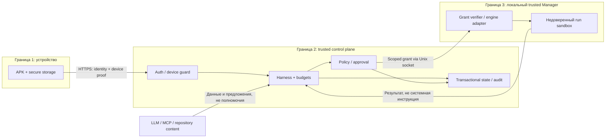

# Portway — исполнение [агентов][g-agent] и безопасность

> **Изменение 11.10.2026 (D-22):** по решению владельца целевая архитектура — Go-микросервисы и Kafka. [Принятое изменение архитектуры](21-microservices-kafka-amendment.md) заменяет прежний монолит/DB-only шину; PostgreSQL outbox сохраняется для надёжной публикации. Старые схемы одного процесса ниже — baseline до изменения, не текущая целевая топология. Первый реализованный срез Kafka описан в [DOC-022](22-kafka-first-slice.md); полный переход ещё не завершён.

> **Фактический срез 12.10:** [статус](implementation-status.md), [план](implementation-plan.md), [Harness/Result](26-harness-turns-and-results.md). Проектные структуры далее задают целевой контракт; реализованное подмножество описано в коде/миграциях и [OpenAPI JSON](../api/openapi.json). NOT_RUN baseline не отрицает выполненные инженерные проверки.

| Поле | Значение |
|---|---|
| Артефакт | [DOC-040][id-doc-040] |
| Версия и дата | v0.2 · 13.10.2026 |
| Статус | Целевые защиты полного MVP; реализованные инженерные проверки/native demo — evidence, полная приёмка NOT_RUN |
| Основания | [ТЗ](02-technical-specification.md), [SRS defaults](03-software-requirements-specification.md#defaults), [QS](13-quality-attribute-scenarios-and-utility-tree.md) |
| Контракты | [Архитектура](20-architecture-and-decisions.md), [транзакции/состояния](29-data-and-state-model.md), [API/envelope](36-api-events-and-messages.md), [пакет](38-agent-package-format.md), [тесты](57-verification-and-traceability.md), [runbook](52-build-deploy-and-operations.md) |

## Native Codex: границы первого профиля

Профиль добровольно включается отдельным `PORTWAY_CODEX_BRIDGE_KEY`. API хранит задания и события в control schema; native bridge не получает SQL/master/provider credentials. Prompt, events и ответ шифруются AES-256-GCM с installation/run/field AAD; в Kafka/audit отправляются только `codex.queued|stopped|completed|failed`, object ID и actor ID. CLI auth остаётся в пользовательском CODEX_HOME на ноутбуке, не монтируется в контейнеры и не передаётся Android.

Процесс запускается через `exec.Command` без shell, prompt идёт stdin. Только выбранный оператором абсолютный workspace, sandbox `read-only`, approval `never`, без user config/rules, daemon и web search; stdin API не задаёт binary/path/model/flags. Окружение сохраняет только HOME/PATH/CODEX_HOME/CA/LANG, model/API/database/bridge env keys не наследуются. Перед стартом моста и каждой задачей требуется `codex login status = Logged in using ChatGPT`. Raw stderr, reasoning, command line/output, auth и thread ID не публикуются; final text и agent messages доступны только владельцу.

Read-only Codex sandbox запрещает запись команд, но **не является контейнерной изоляцией чтения всего ноутбука**. Оператор выбирает workspace без чувствительных исходных данных; исходный код/запрос/прочитанные CLI данные могут обрабатываться сервисом Codex. Этот owner-only профиль нельзя считать реализацией rootless Runtime и per-tool approvals DOC-040. Предоставление записи и подключение MCP требуют следующего отдельного среза. Защиты shell sandbox зависят от ОС и установленного Codex; ошибки не обходятся опасными флагами.

Мост выполняет один процесс, ограничивает время/размер JSONL и отменяет всю process group. Heartbeat проверяет актуальные run state, lease и originating device; ошибка связи отменяет процесс. Backend сериализует admission/poll/report и device authority проверяет под блокировкой; terminal не оживает. Uncertain выдача не повторяется после рестарта. Lease tokens хранятся hash, prompt/events/answer — ciphertext; retention 7 суток и capacity 1000 requests ограничивают историю. Bridge key даёт доверенному ноутбуку возможность получать задания/публиковать ответы, поэтому хранится как отдельный секрет и никогда не встроен в APK.

## 1. Потоки и границы доверия

[Владелец][g-owner] авторизует продукт через серверные [auth][g-auth]/device проверки; [LLM][g-model], AGENTS.md, [skill][g-skill], [repository][g-repository] content, [MCP][g-mcp]/[tool][g-tool] result, межагентный payload и [FCM][g-push] notification являются недоверенными данными. Ни одна инструкция в этих данных не меняет [policy][g-policy], не создаёт [owner][g-owner] identity и не заменяет [апрув][g-approval]. [API][g-api] URL/[LLM][g-model]/[MCP][g-mcp]/[repository][g-repository] destination выбираются как настройки [владельца][g-owner] и проверяются allowlist, а не извлекаются из произвольного prompt для сетевого доступа.

[FCM][g-push] и [туннель][g-https] — внешние транспорты; секретные credentials не доверяются их payload. [API][g-api]/[agent][g-agent] [sandbox][g-sandbox] не имеют daemon socket. Master key, DB credential и [FCM][g-push] server credential доступны только trusted server accounts. Supabase-бизнес-схема не опубликована anonymous Data [API][g-api]; app DB [role][g-role] имеет минимальные CRUD/append права, migration [role][g-role] отделён.

## 2. [Harness][g-harness] и [LLM][g-model] Gateway

1. Принять [run][g-run] только после [owner][g-owner]/device, immutable version, [repository][g-repository] revision, [model][g-model] capabilities, resolved dependencies и лимитов; записать состояние/[event][g-event]/[outbox][g-outbox] одной [транзакцией][g-atomicity].
2. Worker admits queued [run][g-run] после [reconciliation][g-recovery]. Перед каждым [шагом][g-step] проверить [chain][g-chain]/[run][g-run] status, deadline, [steps][g-step] и token reserve. [Сообщения][g-message] inbox вводятся на границе [шага][g-step], не меняют выполняющийся [tool][g-tool] call.
3. Gateway отправляет нормализованный запрос выбранному [model][g-model] endpoint. Частичный [stream][g-model-protocol] публикуется как partial; [tool][g-tool] proposals собираются полностью и валидируются до [policy][g-policy]. Обрыв не достраивается вымышленными аргументами.
4. [Tool][g-tool] proposal получает новый ToolCall ID, canonical args/hash, risk [class][g-uml] и действующую [policy][g-policy] version. Allow/[approval][g-approval]/deny выбирает сервер; permission нельзя передать текстом [модели][g-model].
5. Разрешённое действие выдаётся Manager только с [grant][g-fencing] и [dispatch_id][g-fencing]. Результат/[timeout][g-timeout]/unknown сохраняются перед следующей модельной итерацией. Отклонённое действие возвращает структурированный отказ.
6. Final answer фиксирует [Result][g-result] и terminal [event][g-event]. Для [repository][g-repository] [run][g-run] сохранены исходная/результирующая ревизии и diff hash. [Hook][g-hook] формирует отдельный reviewer-run; от него ждут verdict, не новый [coder][g-main-roles].

Gateway обязан отличать actual [usage][g-usage], conservative estimate и unknown, finish/[timeout][g-timeout]/transport error, поддерживаемый/отсутствующий [stream][g-model-protocol]/[tool calling][g-model-protocol]. Capability report относится к endpoint+[model][g-model]+config revision; изменение [модели][g-model] инвалидирует отчёт. Для обеих [моделей][g-model] обязательны реальные проверки [stream][g-model-protocol], [tool][g-tool]/result, [usage][g-usage]/error и контрольной [задачи][g-task]. Один локальный [inference][g-model-protocol] сервис может обслуживать два активных [run][g-run] последовательно; это не отменяет общий budget reservation.

## 3. Эффективная [политика][g-policy] и [роли][g-role]

Эффективные права — пересечение server allowlist, неизменяемого version snapshot, назначенной [роли][g-role], текущих ужесточающих запретов и разрешений конкретного [workspace][g-workspace]. Наследуемое [сообщение][g-message]/[review][g-review] request может сузить доступ, но не расширить его. [Политика][g-policy] проверяется до proposal acceptance, после решения [approval][g-approval] и непосредственно перед dispatch. [Unresolved][g-staging] [tool][g-tool]/[model][g-model]/secret/[agent][g-agent] [mapping][g-staging] блокирует [run][g-run].

| Операция | Базовое решение | Проверяемые условия |
|---|---|---|
| `workspace.read/list`, чтение закреплённого diff | allow | Только текущий [workspace][g-workspace]/разрешённый [Result][g-result], нормализованный относительный путь |
| `workspace.write` структурированным [инструментом][g-tool] | allow только для write-роли | Внутри [workspace][g-workspace], запрет системных/секретных путей; [reviewer][g-main-roles]/code_reader read-only |
| `shell.exec` произвольной команды | [approval][g-approval] | Canonical argv/working dir, время/egress/FS лимиты; approve не снимает [sandbox][g-sandbox] |
| `tests.run` | allow только для заранее определённого test profile | Profile привязан к образу/фиксированной ревизии; произвольная команда маскирующаяся под test→shell [approval][g-approval] |
| `docs.lookup` через разрешённый [MCP][g-mcp] | allow | Allowlisted adapter/endpoint, scoped credential только адаптеру, нет произвольной сети |
| Доступ к host FS/socket, privileged, внешняя сеть вне allowlist | deny | Ни [апрув][g-approval], ни [роль][g-role] не обходят hard prohibition |
| [GitHub][g-github] publish | Вне базы; при S всегда [approval][g-approval] после positive [review][g-review] | Выполняет trusted server, временный узкий credential |

`coder`/`documenter` имеют ограниченный write; `reviewer`/`researcher`/`code_reader`/`docs_lookup` не имеют общего write/shell. `tester`/`test_runner` используют только configured test profile; изменение профиля/команды требует обычной проверки [риска][g-risk]. Каталог 5+3 — [пресеты][g-role], не автоматическая команда из восьми исполнителей. [Reviewer][g-main-roles] читает закреплённый [Result][g-result] через read-only snapshot, а не живой изменяющийся [workspace][g-workspace] [coder][g-main-roles].

## 4. [Апрув][g-approval], гонки и [безопасная альтернатива][g-safe-alternative]

Pending [approval][g-approval] содержит [run][g-run]/tool_call/args_hash, server creation и expires_at=creation+180 с. Экран получает meaningful safe args, но decision передаёт только ID/hash/version/approve|reject. Server time, а не таймер телефона, определяет срок. В SQL [CAS][g-atomicity] pending→terminal выполняется с locks [chain][g-chain]→[run][g-run]→tool_call→[approval][g-approval] и актуальными [owner][g-owner]/device, [stop][g-cancelled] epoch, [policy][g-policy] и budget.

| Конкуренция | Обязательный исход |
|---|---|
| Approve и reject / две копии approve | Одно решение; повтор читает текущий [state][g-uml]; один [dispatch_id][g-fencing] |
| Approve и `now >= expires_at` | Истёкший [апрув][g-approval] не выдаёт [grant][g-fencing], даже если [UI][g-ui] ещё показывал секунду |
| Approve и [stop][g-cancelled]/restart | После durable [stop][g-cancelled]/[reconciliation][g-recovery] новых [grants][g-fencing] нет; pending invalidated |
| Аргументы изменены после показа | Старый hash не разрешает новые args; новый ToolCall и [approval][g-approval] |
| [Grant][g-fencing] выдан, но ещё не исполнен | Manager проверяет epoch/expiry; [stop][g-cancelled] отзывает допуск; approved не равно executed |
| Потерян ACK Manager | Query того же [dispatch_id][g-fencing]; unknown не переисполняется другой командой |

[Grant][g-fencing] аутентифицируется [HMAC-SHA-256][g-encryption] отдельным Manager credential по canonical serialization и связан с installation/[run][g-run]/tool_call/[dispatch_id][g-fencing], canonical args hash, [policy][g-policy] version, [stop_epoch][g-fencing], ограниченным сроком и ресурсами. Срок допуска команды по [grant][g-fencing] не позже deadline [run][g-run]/[chain][g-chain] и, для действия с [апрувом][g-approval], `expires_at` этого решения; задержанный dispatch не продлевает разрешение. Время уже допущенной команды ограничено отдельным [tool timeout][g-timeout] и deadline [run][g-run]/[chain][g-chain]. Он проверяется Manager по локальному аутентифицированному каналу; не передаётся [LLM][g-model]/в [sandbox][g-sandbox] как универсальный токен. До старта проверяется серверный admission; уже допущенный текущий [шаг][g-step] отменяется при [stop][g-cancelled], новые выдачи после [stop][g-cancelled] commit запрещены. Это не обещание атомарной [транзакции][g-atomicity] между [PostgreSQL][g-supabase] и внешним процессом.

Reject/expiry возвращает `{code, tool_call_id, denied_args_hash, reason, allowed_capability_hints}`. [Harness][g-harness] может предложить [безопасную альтернативу][g-safe-alternative]; она получает новый ID и снова проходит все проверки. Идентичные отклонённые [tool][g-tool]+args не запускаются под другим названием. Не более двух последовательных отказанных альтернатив; затем failed/policy_exhausted с объяснением. Разрешённое безопасное действие сбрасывает счётчик последовательных отказов. [Stop][g-cancelled], deadline и budget заканчивают попытки немедленно.

## 5. [Бюджеты][g-budget], deadlines и [stop][g-cancelled]

Канонические числа — [SRS][g-requirement-ids] § 4.2: [run][g-run]/[chain][g-chain] 15/30 мин wall-clock, 20/40 [шагов][g-step], 20k/40k токенов, output cap 2048, [LLM][g-model] 120 с, [tool][g-tool] 60 с, [hops][g-hops]/[depth][g-depth] 8/2. Ожидание [approval][g-approval], очереди [модели][g-model] и внешней зависимости входит во время [run][g-run]/[chain][g-chain]. Значение request DTO не может расширить server maximum.

До [LLM][g-model] вызова под locks [chain][g-chain]→[run][g-run] резервируются известный input+максимально разрешённый output в обоих остатках; один остаток двум вызовам не выдаётся. [Step][g-step] учитывается до dispatch. Settlement заменяет reserve фактом, возвращает только подтверждённый неиспользованный остаток и выполняется идемпотентно по [step][g-step] ID. При обрыве уже начатого запроса резерв не освобождается как нулевой [usage][g-usage]. Консервативная оценка маркируется source; если оценка не ограничивает остаток, дальнейший платный вызов блокируется budget_uncertain. Выбор бесплатной локальной [модели][g-model] не отменяет time/[steps][g-step].

[Stop][g-cancelled] [chain][g-chain] увеличивает [fencing][g-fencing] epoch и записывает cancel intents в той же [транзакции][g-atomicity]. Активным операциям передаётся context cancellation, Manager прекращает контролируемые процессы, dispatcher больше не создаёт детей/альтернатив. [API][g-api] отвечает stopping, а не premature cancelled. Цель ≤5 с проверяется 10 самостоятельными chain-trials; через 10 с нет оживления. При зависшем/внешнем действии исход unknown и причина отдельно видны, ложный PASS недопустим.

## 6. [Runtime][g-runtime] и devcontainer-подмножество

Manager — отдельный trusted локальный процесс под [runtime][g-runtime] account; [API][g-api] имеет доступ к узкому Unix socket по ОС-правам и installation credential. Operations: prepare [workspace][g-workspace], admit/execute/query dispatch, cancel [run][g-run], inspect resources, retain/cleanup [workspace][g-workspace]. Произвольные Docker parameters через этот интерфейс не принимаются. Manager сохраняет admission с hash команды до старта процесса и фиксирует outcome в защищённом локальном журнале. После собственного restart незавершённая запись считается unknown; сверка и остановка остатков не исполняют команду заново. Один [dispatch_id][g-fencing] описывает одну immutable команду; повтор execute возвращает сохранённый [state][g-uml], не запускает второй процесс. Журнал хранит идентификатор, hash и безопасные метаданные, без credentials/raw stdout; срок записи не короче 7-суточного окна [дедупликации][g-idempotency].

До двух [sandbox][g-sandbox], каждому максимум 2 vCPU/1 GiB, non-root внутри, drop capabilities, no-new-privileges, ограниченные PID/FS/time и контролируемый egress. Read-only root filesystem с выделенным writable [workspace][g-workspace]/temp, управляемый том без произвольного host bind; Docker socket, privileged, host network/PID namespace и host devices запрещены. Точная реализация egress firewall/прокси доказывается отрицательными пробами; один Docker network сам по себе не доказывает изоляцию.

Поддержанные devcontainer-поля: allowlisted `image` по digest, разрешённые несекретные environment keys, выбранный [workspace][g-workspace]; неизвестные/запрещённые настройки отклоняются до create. Не поддержаны lifecycle [hooks][g-hook], Features, произвольные Dockerfile/build context, privileged, дополнительные mounts/ports/socket. [Repository][g-repository] configuration не является разрешением выполнить setup script.

[Repository][g-repository] source закрепляется allowlisted ref и commit SHA; trusted fetch подготавливает чистый snapshot в управляемом томе. Для [coder][g-main-roles] локальный Git в [sandbox][g-sandbox] может создать result revision без [GitHub][g-github] App. [Reviewer][g-main-roles] получает отдельный read-only snapshot результата. Старт стороннего [repository][g-repository] test script всё ещё классифицируется как выполнение недоверенного кода; profile/[approval][g-approval] не отключают [sandbox][g-sandbox].

[LLM][g-model] доступен только через [control plane][g-control-plane]; [sandbox][g-sandbox] не получает [provider][g-provider] key. [MCP][g-mcp] документации запускается/вызывается отдельным ограниченным adapter Manager с allowlisted destination, собственным scope credential, [timeout][g-timeout] и теми же [policy][g-policy] checks. [MCP][g-mcp] output не исполняется. Межsandbox-сеть запрещена; межагентная передача идёт только через server bus. Реальный [Context7][g-context7] — кандидат, отсутствие доступа фиксируется как блокер обязательной интеграции.

## 7. [Outbox][g-outbox], routing и отдельный [review][g-review]

[State][g-uml] transition+[event][g-event]+[outbox][g-outbox] фиксируются в одной [транзакции][g-atomicity]; dispatcher получает короткую lease, исполняет доставку, ACK после сохранения outcome. [At-least-once][g-at-least-once] может дать повтор [сообщения][g-message], поэтому consumer receipt и бизнес-эффект атомарны. [Dedupe][g-idempotency] 7 суток, [redelivery][g-retry] до 24 ч; после конца окна — [DLQ][g-retry]/наблюдаемая ошибка. Lease expiry сама по себе не разрешает повтор опасного внешнего действия.

Routing проверяет sender [run][g-run], installation/[chain][g-chain], link direction/enabled, [hook][g-hook] version, payload schema/размер и server [hops][g-hops]/[depth][g-depth]. Для active target ввод данных только на границе [шага][g-step]. Отключённая связь останавливает ещё не начатую доставку; уже зафиксированный эффект не отменяется задним числом. Неоднозначный активный адресат получает ROUTE_AMBIGUOUS вместо выбора произвольного [run][g-run].

[Coder][g-main-roles] completion сохраняет [Result][g-result] и [hook][g-hook] intent с ключом source_event_id+hook_id+hook_version. Consumer создаёт ровно один reviewer-run и receipt, закрепляет source/result revision+diff hash+target [AgentVersion][g-agent-version]; [reviewer][g-main-roles] не наследует write-права [coder][g-main-roles]. Negative/inconclusive verdict виден в [цепочке][g-chain]. Ни reply, ни [retry][g-retry], ни restarts не запускают исправление terminal [coder][g-main-roles]. Новый [запуск][g-run] делает [владелец][g-owner] явно.

## 8. Identity, [секреты][g-secret] и [аудит][g-audit]

Первичный [setup proof][g-device-session] случайный (не менее 256 бит), вне [репозитория][g-repository]/[логов][g-audit]; в БД hash. Registration intent резервирует единственный claim до проверенного email confirmation. Callback принимает одноразовый token_hash, проверяет ответ [Supabase][g-supabase] и ожидаемый [auth][g-auth] user; затем связывает [owner][g-owner]. Callback query и [auth][g-auth] bodies исключаются из access logs. Фиксированный redirect в [APK][g-apk] не содержит access/refresh токенов; пользователь входит обычным способом.

[JWT][g-jwt-jwks] с асимметричной подписью проверяется по configured [Supabase][g-supabase] [JWKS][g-jwt-jwks] с allowlisted alg/issuer/audience; ротация key IDs обрабатывается ограниченным обновлением ключей. Для legacy shared-secret схемы сервер проверяет токен через [Auth][g-auth] [API][g-api], без копирования [JWT][g-jwt-jwks] secret в [APK][g-apk]. Неизвестный/непроверяемый ключ — fail closed. Подпись unexpired [JWT][g-jwt-jwks] не доказывает server-side session revocation: обязательный отзыв Portway обеспечивается DB device guard на каждом запросе и периодическим guard [SSE][g-sse] ≤5 с; внешняя Auth-session проверяется при login/refresh и чувствительных изменениях доступа. При недоступности необходимой проверки доступ не выдумывается.

Logout сначала отзывает device и [push][g-push] в DB; [Supabase][g-supabase] signout отражается отдельно. Offline [APK][g-apk] очищает локальную сессию и показывает неподтверждённый remote revoke; сохранение ограниченного [device proof][g-device-session] для отложенного отзыва требует защищённой tombstone-записи, которая не даёт локального входа и удаляется после ACK. При невозможности отзыва с устройства — другой авторизованный device либо доверенная локальная команда оператора.

[Provider][g-provider] secrets — [AES-256-GCM][g-encryption]: 256-bit master key вне БД, новый 96-bit random [nonce][g-encryption] для каждой записи, UNIQUE installation/[key_version][g-encryption]/[nonce][g-encryption], AAD installation_id+secret_id+[key_version][g-encryption], обязательная проверка authentication tag; [FCM][g-push]/DB/master credentials только server [runtime][g-runtime]. [API][g-api] write-only [секретов][g-secret], allowlisted safe error/log fields. [APK][g-apk] содержит только необходимую пользовательскую сессию и публичную клиентскую Firebase конфигурацию. Системные [секреты][g-secret] не поступают в [tools][g-tool] environment, Package или [model][g-model] context. Временный Git credential допустим только при включённом [GitHub][g-github] S и для trusted операции с ограниченным repo/scope, последующей очисткой/отзывом.

Audit append-only app [role][g-role]: actor/action/object/server time/outcome/reason/[run][g-run]/[chain][g-chain]; 30 суток. [Логи][g-audit] — структурные safe fields, 7 суток. Unknown secret в произвольном [repository][g-repository] text нельзя надёжно обнаружить только regex: исключение raw bodies/stdout и marker scans дополняют secret isolation, не дают обещание универсального распознавания. Protected [Result][g-result] и [approval][g-approval] args показывают нужные [владельцу][g-owner] данные с redaction credential-полей.

## 9. Минимальная [модель угроз][g-stride] и проверяемые контроли

| Угроза / категория | Контроль | Проверка / остаточное ограничение |
|---|---|---|
| Чужой [JWT][g-jwt-jwks], подмена device / spoofing | [Owner][g-owner] subject + active proof hash + installation scope | [TC-002][id-tc-002]/022; компрометация unlocked телефона вне гарантии |
| Prompt/[MCP][g-mcp] injection / elevation | Данные не полномочия, [policy][g-policy] intersection, scoped [tool][g-tool] ports | [TC-021][id-tc-021]/023; качество [модели][g-model] не заменяет enforcement |
| Изменение args, stale approve / tampering | Canonical hash, [CAS][g-atomicity], server [TTL][g-timeout], epoch | [TC-011][id-tc-011]/021; approved не означает external success |
| Дубликат [hook][g-hook]/message / replay | Unique receipt/key, payload hash, bounded [retry][g-retry] | [TC-024][id-tc-024]/030; external exactly-once не обещается |
| [ZIP][g-package] traversal/bomb/symlink | [Streaming][g-model-protocol] byte/file caps, path validation, [staging][g-staging] noexec | [TC-015][id-tc-015]/026; filename/manifest недоверен |
| Host escape/egress / elevation | Rootless Manager boundary, no socket/mount/privilege, egress allowlist | [TC-006][id-tc-006]/023; ошибка/уязвимость kernel требует обновления [хоста][g-host] |
| Утечка [provider][g-provider]/DB/[FCM][g-push] ключа / disclosure | Раздельное хранение, encryption, write-only [API][g-api], safe logs | [TC-017][id-tc-017]/029; backup/master key также защищаются |
| Token/[approval][g-approval] concurrency / DoS | Atomic reserve, caps, rate limits, wall-clock [timeout][g-timeout] | [TC-010][id-tc-010]/028; внешний [LLM][g-model]/[FCM][g-push] может быть недоступен |
| Отрицание решения / repudiation | Append audit context и неизменяемые snapshots | [TC-017][id-tc-017]/031; расширенный tamper-proof audit S |
| Старый [push][g-push]/deep link / spoofing | Сигнал ID, reauth, GET latest, server decision | [TC-012][id-tc-012]/032; [FCM][g-push] delivery не SLA Portway |

## 10. Отказ и восстановление

При старте [ready][g-readiness]=false: [миграции][g-environment]/состояние БД → поиск nonterminal [run][g-run] → сверка Manager handles/dispatch → остановка контролируемых остатков → failed/interrupted, pending [approvals][g-approval] invalidated → сохранение unknown и cleanup outcomes → [ready][g-readiness] по доступным операциям. Цель [reconciliation][g-recovery] ≤10 с при ≤2 [run][g-run]; если не достигнута, статус [degraded][g-readiness]/blocked с причиной. Нельзя объявить [ready][g-readiness] для новых [run][g-run] пока старые разрешения могут действовать без [fencing][g-fencing].

При падении DB новые [grants][g-fencing]/[шаги][g-step] прекращаются; active [tool][g-tool] ограничен сроком уже выданного [grant][g-fencing], Manager принимает локальную cancel и сохраняет исход для последующей сверки. При потере Manager ACK нельзя утверждать «не исполнилось»; query dispatch либо unknown. При ошибке [LLM][g-model]/[FCM][g-push]/[MCP][g-mcp] возвращается типизированный статус, без [fake][g-fixture] успеха в реальном прогоне. После restart никакого возобновления [Harness][g-harness]/[approval][g-approval]; новый ручной [run][g-run]/[chain][g-chain] с новым ID. Cleanup [workspace][g-workspace] через 24 ч не удаляет пользовательский [ZIP][g-package] или отдельно сохранённые материалы защиты.

## История

| Версия | Дата | Изменение |
|---|---|---|
| v0.2 | 13.10.2026 | Добавлен opt-in native Codex demo profile: контракт, ограничения, локальный мост; полный MVP и Android acceptance не заявлены |
| v0.1 | 10.10.2026 | Определены [Harness][g-harness], [policy][g-policy]/[approval][g-approval]/budget, локальный [Runtime][g-runtime], delivery, threats и [recovery][g-recovery] |

[g-agent]: 07-glossary.md#term-agent

[g-agent-version]: 07-glossary.md#term-agent-version

[g-api]: 07-glossary.md#term-api

[g-apk]: 07-glossary.md#term-apk

[g-approval]: 07-glossary.md#term-approval

[g-at-least-once]: 07-glossary.md#term-at-least-once

[g-atomicity]: 07-glossary.md#term-atomicity

[g-audit]: 07-glossary.md#term-audit

[g-auth]: 07-glossary.md#term-auth

[g-budget]: 07-glossary.md#term-budget

[g-cancelled]: 07-glossary.md#term-cancelled

[g-chain]: 07-glossary.md#term-chain

[g-context7]: 07-glossary.md#term-context7

[g-control-plane]: 07-glossary.md#term-control-plane

[g-depth]: 07-glossary.md#term-depth

[g-device-session]: 07-glossary.md#term-device-session

[g-encryption]: 07-glossary.md#term-encryption

[g-environment]: 07-glossary.md#term-environment

[g-event]: 07-glossary.md#term-event

[g-fencing]: 07-glossary.md#term-fencing

[g-fixture]: 07-glossary.md#term-fixture

[g-github]: 07-glossary.md#term-github

[g-harness]: 07-glossary.md#term-harness

[g-hook]: 07-glossary.md#term-hook

[g-hops]: 07-glossary.md#term-hops

[g-host]: 07-glossary.md#term-host

[g-https]: 07-glossary.md#term-https

[g-idempotency]: 07-glossary.md#term-idempotency

[g-jwt-jwks]: 07-glossary.md#term-jwt-jwks

[g-main-roles]: 07-glossary.md#term-main-roles

[g-mcp]: 07-glossary.md#term-mcp

[g-message]: 07-glossary.md#term-message

[g-model]: 07-glossary.md#term-model

[g-model-protocol]: 07-glossary.md#term-model-protocol

[g-outbox]: 07-glossary.md#term-outbox

[g-owner]: 07-glossary.md#term-owner

[g-package]: 07-glossary.md#term-package

[g-policy]: 07-glossary.md#term-policy

[g-provider]: 07-glossary.md#term-provider

[g-push]: 07-glossary.md#term-push

[g-readiness]: 07-glossary.md#term-readiness

[g-recovery]: 07-glossary.md#term-recovery

[g-repository]: 07-glossary.md#term-repository

[g-requirement-ids]: 07-glossary.md#term-requirement-ids

[g-result]: 07-glossary.md#term-result

[g-retry]: 07-glossary.md#term-retry

[g-review]: 07-glossary.md#term-review

[g-risk]: 07-glossary.md#term-risk

[g-role]: 07-glossary.md#term-role

[g-run]: 07-glossary.md#term-run

[g-runtime]: 07-glossary.md#term-runtime

[g-safe-alternative]: 07-glossary.md#term-safe-alternative

[g-sandbox]: 07-glossary.md#term-sandbox

[g-secret]: 07-glossary.md#term-secret

[g-skill]: 07-glossary.md#term-skill

[g-sse]: 07-glossary.md#term-sse

[g-staging]: 07-glossary.md#term-staging

[g-step]: 07-glossary.md#term-step

[g-stride]: 07-glossary.md#term-stride

[g-supabase]: 07-glossary.md#term-supabase

[g-task]: 07-glossary.md#term-task

[g-timeout]: 07-glossary.md#term-timeout

[g-tool]: 07-glossary.md#term-tool

[g-ui]: 07-glossary.md#term-ui

[g-uml]: 07-glossary.md#term-uml

[g-usage]: 07-glossary.md#term-usage

[g-workspace]: 07-glossary.md#term-workspace

[id-doc-040]: 40-agent-execution-and-security.md

[id-tc-002]: 57-verification-and-traceability.md#tc-002

[id-tc-006]: 57-verification-and-traceability.md#tc-006

[id-tc-010]: 57-verification-and-traceability.md#tc-010

[id-tc-011]: 57-verification-and-traceability.md#tc-011

[id-tc-012]: 57-verification-and-traceability.md#tc-012

[id-tc-015]: 57-verification-and-traceability.md#tc-015

[id-tc-017]: 57-verification-and-traceability.md#tc-017

[id-tc-021]: 57-verification-and-traceability.md#tc-021

[id-tc-024]: 57-verification-and-traceability.md#tc-024
