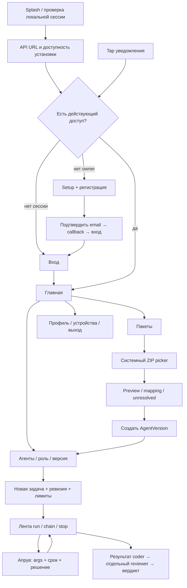

# Portway — [Android][g-flutter]: экраны, переходы и [API][g-api]

<a id="doc-061"></a>

| Поле | Значение |
|---|---|
| Артефакт | [DOC-061][id-doc-061] |
| Версия и дата | v0.1 · 10.10.2026 |
| Статус | Проектный UX/interaction baseline; [APK][g-apk] и визуальная проверка NOT_RUN |
| Основания | [Vision](06-product-vision.md), [SRS](03-software-requirements-specification.md), [20 UC](12-use-case-diagrams-and-specifications.md), [AC](14-demo-acceptance-criteria.md) |
| Контракты | [API](36-api-events-and-messages.md), [данные/состояния](29-data-and-state-model.md), [пакет](38-agent-package-format.md), [Flutter-архитектура](20-architecture-and-decisions.md#flutter-architecture), [проверки](57-verification-and-traceability.md) |

<a id="brief"></a>
## 1. Назначение и направление интерфейса

Один разработчик с телефона ставит [задачу][g-task], следит за [агентом][g-agent], решает запрос опасного действия и получает проверенный результат. Режим Operate: состояние, причина и следующее действие важнее украшения. Проверяемый главный путь — вход → [coder][g-main-roles] task → актуальный [approval][g-approval] → отдельный [review][g-review] → результат; второй — [ZIP][g-package] [export][g-export-import]/[import][g-export-import] → [mapping][g-staging] → [запуск][g-run] на другом [model][g-model]/host.

Native [Android][g-flutter]/Material-компоненты [Flutter][g-flutter], системный шрифт, светлая/тёмная тема, спокойные поверхности и один акцент для основного действия. Цвет статуса сопровождается текстом/иконкой. Это проектное направление для будущей реализации; изображения/логотип/готовые экраны не заявлены. Splash использует название Portway и простой текстовый знак P, не требует отдельного raster asset. Технические IDs доступны в деталях/копировании, не вытесняют понятные названия на главном экране.

Три основные destination в нижней навигации: «Главная», «[Агенты][g-agent]», «[Задачи][g-task]». [Апрувы][g-approval] — заметный pending count и отдельный экран из главной/[задачи][g-task]; «[Пакеты][g-package]», «Связи», «Подключения», «Состояние», «Профиль» доступны из меню. Back возвращает в предыдущий экран, сохранённая navigation [state][g-uml] не восстанавливает [секреты][g-secret] или недействительную сессию.

<a id="flow"></a>
## 2. [User Flow][g-ui]



После tap [push][g-push] сохраняется только разрешённый pending destination `{installation_id, approval_id}`. Вход/refresh выполняется до GET latest [approval][g-approval]; данные уведомления не являются разрешением выполнить [инструмент][g-tool]. Смена [API][g-api] URL требует подтвердить переход к другой установке, завершить старые потоки/локальную сессию и войти заново. Неподтверждённый отзыв старого device обозначается отдельно.

<a id="screens"></a>
## 3. Минимальные экраны и привязка к контракту

| Экран / путь | Основное содержание и действие | [API][g-api] / требования |
|---|---|---|
| UI-01 Splash | Portway; затем доступ/URL; нет искусственной задержки | client-config; [FR-082][id-fr-082] |
| UI-02 Установка | Изменяемый [HTTPS][g-https] [API][g-api] URL, «Проверить», результат/причина | GET client-config/status по доступу; [FR-090][id-fr-090] |
| UI-03 Регистрация | Имя/email/пароль/[setup proof][g-device-session]; confirm-email состояние | POST [auth][g-auth]/register, callback; [FR-081][id-fr-081]; [UC-001][id-uc-001] |
| UI-04 Вход | Email/пароль; session expired/revoked причины | POST [auth][g-auth]/login/refresh; [FR-001][id-fr-001]/065 |
| UI-05 Главная | Активные [задачи][g-task], pending [approvals][g-approval], доступность сервера; «Новая [задача][g-task]» | GET [runs][g-run]/[approvals][g-approval]/status; [FR-083][id-fr-083] |
| UI-06 [Агенты][g-agent] | Basic list, создание; отдельные main/subagent presets | GET [agents][g-agent]/[roles][g-role]; [FR-005][id-fr-005]–009/087 |
| UI-07 Конфигурация версии | Инструкции/[skills][g-skill]/[tools][g-tool]/[MCP][g-mcp], [роль][g-role]/[provider][g-provider], права; «Сохранить новую версию» | POST [agents][g-agent]/versions, GET version; [FR-005][id-fr-005]–009 |
| UI-08 Подключения | [Provider][g-provider] endpoint/[model][g-model], secret ref write-only, capability report | providers/capability-check/secret-refs; [FR-011][id-fr-011]–016 |
| UI-09 Новая [задача][g-task] | Task, [AgentVersion][g-agent-version], [provider][g-provider], registered repo/ref+revision, лимиты | POST [runs][g-run]+key; [FR-018][id-fr-018]/066 |
| UI-10 [Задача][g-task] | [State][g-uml]/reason, feed, partial output, budget/source, [run][g-run]/[chain][g-chain] [stop][g-cancelled], связанные [run][g-run] | GET [run][g-run]/[chain][g-chain], [SSE][g-sse], POST [stop][g-cancelled]; [FR-021][id-fr-021]–027/051–055/067 |
| UI-11 [Апрувы][g-approval] | Pending list; [инструмент][g-tool], существенные args, срок и контекст | GET [approvals][g-approval]/detail; [FR-068][id-fr-068] |
| UI-12 Решение [апрува][g-approval] | Полные безопасные детали; «Разрешить»/«Отклонить»; подтверждённый server outcome | POST decision; [FR-038][id-fr-038]–043/068 |
| UI-13 Результат | Pinned revision/diff, summary, artifacts, отдельный [reviewer][g-main-roles] verdict; новая [задача][g-task] вручную | GET result/artifact; [FR-050][id-fr-050]/059/070 M |
| UI-14 Связи и [хуки][g-hook] | From→to, [событие][g-event]/action, enabled, target reviewer-version | links/[hooks][g-hook]; [FR-044][id-fr-044]/048/069 |
| UI-15 [Пакеты][g-package] | [Экспорт][g-export-import] выбранной версии / [импорт][g-export-import] [ZIP][g-package]; status последнего [import][g-export-import] | package endpoints; [FR-060][id-fr-060]–064/077 |
| UI-16 Сопоставление | [Модель][g-model]/[provider][g-provider], [tools][g-tool]/[MCP][g-mcp]/secrets/[agent][g-agent] aliases, права/diff, [unresolved][g-staging] | [mappings][g-staging]/activate; [FR-063][id-fr-063]/088 |
| UI-17 Профиль и устройства | Имя/email, session labels, уведомления/permission, revoke/logout | me/devices/[push][g-push]/[auth][g-auth] logout; [FR-003][id-fr-003]/084–086 |
| UI-18 Состояние и диагностика | DB/[Runtime][g-runtime]/[model][g-model]/[push][g-push] с checked_at/причиной; audit/logs по контексту | status/audit/logs; [FR-004][id-fr-004]/089 |

UI-ID — локальный индекс раздела, не новые независимые артефакты. Фильтры/архив истории, редактор [ролей][g-role], [GitHub][g-github] PR, [Runner][g-runner] и расписания не получают пустых основных кнопок. Уже доступный M-результат показывается независимо от PR. В формах нет ввода master key, DB string или [FCM][g-push] server credential.

<a id="approval-layout"></a>
## 4. Ключевой экран [апрува][g-approval]

```text
← Подтверждение                         Требует решения
Задача: Demo coder                       Осталось 01:42

Инструмент: shell.exec
Каталог: /workspace/demo
Команда: git diff --check
Причина запроса: произвольная shell-команда

Разрешается только указанное действие.
Права песочницы и лимиты сохраняются.

[Разрешить]                              [Отклонить]
Контекст задачи / подробные аргументы / срок сервера
```

Это структурный [wireframe][g-ui]; пример команды не меняет [policy][g-policy] arbitrary shell→[approval][g-approval]. На узком экране действия располагаются вертикально и остаются достижимы при большом шрифте. Нет автоматического approve, предвыбранного решения или жеста свайпа для опасного подтверждения. Значимые argv/путь/изменяемый объект видны до действия; длинные детали раскрываются и копируются безопасно. Таймер рассчитывается по server_time offset и после [background][g-app-lifecycle] синхронизируется; при сомнении состояния кнопка недоступна до GET.

Во время POST обе кнопки заблокированы, виден «Отправляем решение». Потеря ответа → GET latest и повтор исходного key при необходимости. «Разрешено» показывается после server ACK, отдельно от «[Инструмент][g-tool] выполнен». Expired/rejected/invalidated экран сохраняет причину и переход в [задачу][g-task], без рабочей старой кнопки. [Stop][g-cancelled] из ленты сразу показывает «Останавливаем», terminal — после подтверждения сервера.

<a id="states"></a>
## 5. Общие состояния и UX-тексты

| Состояние | Поведение / текст / действие |
|---|---|
| Initial loading | Skeleton структуры, сохранение формы; никакого ложного empty |
| Empty [agents][g-agent]/tasks | «Создайте первого [агента][g-agent]» / «Поставьте [задачу][g-task] выбранной версии» и рабочая CTA |
| No pending [approvals][g-approval] | «Сейчас решений не требуется»; переход к [задачам][g-task] |
| Сервер недоступен | «Нет связи с этой установкой» + последнее обновление + повтор/изменить URL; cached status отмечен |
| [SSE][g-sse] reconnect | «Восстанавливаем [события][g-event]»; id [dedupe][g-idempotency], snapshot при gap; [stop][g-cancelled]/approve требуют сервер |
| 410 history | «Часть истории недоступна. Показано текущее состояние»; свежий cursor |
| [JWT][g-jwt-jwks] expired/device revoked | Refresh либо вход; stale controls disabled; объяснение отзыва |
| Budget uncertain | «Расход не подтверждён. Следующий платный [шаг][g-step] заблокирован» + source/предел; не 0 токенов |
| [Provider][g-provider]/[tool][g-tool] unknown | «Исход действия неизвестен» + [tool][g-tool] ID/context; нет автоматической кнопки повторить опасное действие |
| [Mapping][g-staging] [unresolved][g-staging] | Список конкретных зависимостей; activate/start disabled, переход к выбору target refs |
| Package invalid/too large | Понятная причина/лимит; выбрать другой [ZIP][g-package]; нет частично созданного [агента][g-agent] |
| Уведомления запрещены | Статус и действие открыть системные настройки; не обещать [background][g-app-lifecycle] [approval][g-approval] alert |
| Offline logout | Локальный доступ очищен; «Отзыв на сервере не подтверждён» и способ завершить отзыв |
| Artifact expired | «Файлы результата очищены»; metadata/revision/причина доступны; не пустой успешный download |

Пользовательские ошибки форм отображаются у поля, submission сохраняет неопасный ввод. Пароль/setup/secret value очищаются после завершения/выхода и не входят в [state][g-uml] restoration, crash log или analytics. Изменённые формы имеют предупреждение при уходе, отмена системного picker считается отменой пользователя, не ошибкой сервера.

<a id="package-flow"></a>
## 6. [ZIP][g-package] и смена установки

[Export][g-export-import]: выбрать [AgentVersion][g-agent-version] → GET package → системный «Сохранить документ» → итог имя/размер/config hash. [Import][g-export-import]: системный «Открыть документ» → показать имя/размер → upload/[staging][g-staging] → preview/validation → [mapping][g-staging] → «Создать [агента][g-agent]» → полученная версия. [UI][g-ui] не просит filesystem permission для всего накопителя, использует scoped document URI. Закрытие экрана не превращает pending [import][g-export-import] в activated.

[Mapping][g-staging] каждой required зависимости показывает alias, целевую привязку и статус проверки. Secret создаётся write-only или выбирается ref; значение не возвращается. Изменение M1→M2 и A→B не меняет portable instructions/[skills][g-skill]/[policy][g-policy]. На B показывается имя/ID установки, чтобы пользователь не принял новый каталог A за другой [хост][g-host]. Протокол трёх ячеек и сравнение hash — [DOC-038][id-doc-038]/057.

<a id="push"></a>
## 7. [Push][g-push] и lifecycle

После объяснения назначения запрашивается [Android][g-flutter] notification permission; отказ не блокирует обычный вход, но показывается ограничение. Token регистрируется только с [owner][g-owner]/device; rotation обновляет сервер, logout/revoke отвязывает. Notification+data содержит лишь тип/installation_id/approval_id, без args/[секретов][g-secret] и без кнопки прямого approve. Сервер задаёт [FCM][g-push] [TTL][g-timeout] не больше остатка server [approval][g-approval] deadline.

Foreground обновляет актуальную ленту/статус без двойного уведомления. [Background][g-app-lifecycle] tap и normal [terminated][g-app-lifecycle] launch проходят единый coordinator: получить destination → восстановить/проверить [auth][g-auth] → GET [approval][g-approval] → открыть актуальное состояние. [Android][g-flutter] [force-stop][g-app-lifecycle] через настройки исключён из гарантии доставки до повторного открытия. Для приёмки — 3 [background][g-app-lifecycle]+3 normal [terminated][g-app-lifecycle] с реальным [FCM][g-push] до [TTL][g-timeout]; SDK callbacks/локальная нотификация не заменяют испытание.

По первичным источникам на 10.10.2026: [FCM Flutter client и переходы](https://firebase.google.com/docs/cloud-messaging/flutter/client), [Flutter receive/lifecycle](https://firebase.google.com/docs/cloud-messaging/flutter/receive-messages), [Android notification permission](https://firebase.google.com/docs/cloud-messaging/android/get-started), [FCM message lifespan](https://firebase.google.com/docs/cloud-messaging/customize-messages/setting-message-lifespan). Реальное поведение выбранного телефона/прошивки проверяется в [TC-012][id-tc-012]/032.

<a id="accessibility"></a>
## 8. Доступность и проверка будущего [UI][g-ui]

Touch targets минимум 48 [dp][g-accessibility], семантические подписи [TalkBack][g-accessibility], порядок фокуса по смыслу, контраст обычного текста не ниже 4.5:1, крупного/значимых границ 3:1. Шрифт масштабируется до 200% без потери action/args; горизонтальная прокрутка допускается только внутри code/diff, не всей формы. Цвет не единственный сигнал; уменьшение анимации учитывается, декоративных ожиданий нет. Пороги выбраны для проекта по [Android accessibility](https://developer.android.com/guide/topics/ui/accessibility/apps) и [W3C contrast guidance](https://www.w3.org/WAI/WCAG22/Understanding/contrast-minimum.html); 200% — выбранная проверка масштаба, а не заявленный результат. Строки русские, timestamps отображаются с локальной зоной и явным server deadline в деталях.

Проверить компактный телефон portrait/landscape, светлую/тёмную тему, клавиатуру/большой шрифт/[TalkBack][g-accessibility], длинную команду/имя/ошибку, 1000 [событий][g-event] без неограниченного роста виджетов, возврат из [background][g-app-lifecycle]/callback/picker и повторный tap [push][g-push]. Базовые состояния входят в [TC-003][id-tc-003]/012/015/032. Визуальная QA возможна после появления [APK][g-apk]; этот файл задаёт ожидаемое поведение и не является отчётом её выполнения.

## История

| Версия | Дата | Изменение |
|---|---|---|
| v0.1 | 10.10.2026 | Созданы экранный состав, flows, контракты, тексты состояний, [approval][g-approval] [wireframe][g-ui] и [accessibility][g-accessibility] baseline |

[g-accessibility]: 07-glossary.md#term-accessibility

[g-agent]: 07-glossary.md#term-agent

[g-agent-version]: 07-glossary.md#term-agent-version

[g-api]: 07-glossary.md#term-api

[g-apk]: 07-glossary.md#term-apk

[g-app-lifecycle]: 07-glossary.md#term-app-lifecycle

[g-approval]: 07-glossary.md#term-approval

[g-auth]: 07-glossary.md#term-auth

[g-cancelled]: 07-glossary.md#term-cancelled

[g-chain]: 07-glossary.md#term-chain

[g-device-session]: 07-glossary.md#term-device-session

[g-event]: 07-glossary.md#term-event

[g-export-import]: 07-glossary.md#term-export-import

[g-flutter]: 07-glossary.md#term-flutter

[g-github]: 07-glossary.md#term-github

[g-hook]: 07-glossary.md#term-hook

[g-host]: 07-glossary.md#term-host

[g-https]: 07-glossary.md#term-https

[g-idempotency]: 07-glossary.md#term-idempotency

[g-jwt-jwks]: 07-glossary.md#term-jwt-jwks

[g-main-roles]: 07-glossary.md#term-main-roles

[g-mcp]: 07-glossary.md#term-mcp

[g-model]: 07-glossary.md#term-model

[g-owner]: 07-glossary.md#term-owner

[g-package]: 07-glossary.md#term-package

[g-policy]: 07-glossary.md#term-policy

[g-provider]: 07-glossary.md#term-provider

[g-push]: 07-glossary.md#term-push

[g-review]: 07-glossary.md#term-review

[g-role]: 07-glossary.md#term-role

[g-run]: 07-glossary.md#term-run

[g-runner]: 07-glossary.md#term-runner

[g-runtime]: 07-glossary.md#term-runtime

[g-secret]: 07-glossary.md#term-secret

[g-skill]: 07-glossary.md#term-skill

[g-sse]: 07-glossary.md#term-sse

[g-staging]: 07-glossary.md#term-staging

[g-step]: 07-glossary.md#term-step

[g-task]: 07-glossary.md#term-task

[g-timeout]: 07-glossary.md#term-timeout

[g-tool]: 07-glossary.md#term-tool

[g-ui]: 07-glossary.md#term-ui

[g-uml]: 07-glossary.md#term-uml

[id-doc-038]: 38-agent-package-format.md

[id-doc-061]: 61-android-screens-flows-and-api.md

[id-fr-001]: 03-software-requirements-specification.md#fr-001

[id-fr-003]: 03-software-requirements-specification.md#fr-003

[id-fr-004]: 03-software-requirements-specification.md#fr-004

[id-fr-005]: 03-software-requirements-specification.md#fr-005

[id-fr-011]: 03-software-requirements-specification.md#fr-011

[id-fr-018]: 03-software-requirements-specification.md#fr-018

[id-fr-021]: 03-software-requirements-specification.md#fr-021

[id-fr-038]: 03-software-requirements-specification.md#fr-038

[id-fr-044]: 03-software-requirements-specification.md#fr-044

[id-fr-050]: 03-software-requirements-specification.md#fr-050

[id-fr-060]: 03-software-requirements-specification.md#fr-060

[id-fr-063]: 03-software-requirements-specification.md#fr-063

[id-fr-068]: 03-software-requirements-specification.md#fr-068

[id-fr-081]: 03-software-requirements-specification.md#fr-081

[id-fr-082]: 03-software-requirements-specification.md#fr-082

[id-fr-083]: 03-software-requirements-specification.md#fr-083

[id-fr-090]: 03-software-requirements-specification.md#fr-090

[id-tc-003]: 57-verification-and-traceability.md#tc-003

[id-tc-012]: 57-verification-and-traceability.md#tc-012

[id-uc-001]: 12-use-case-diagrams-and-specifications.md#uc-001
